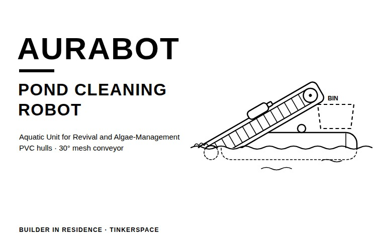
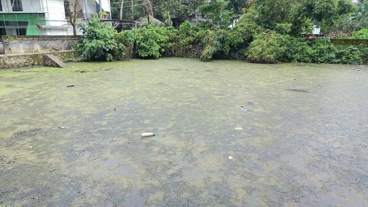
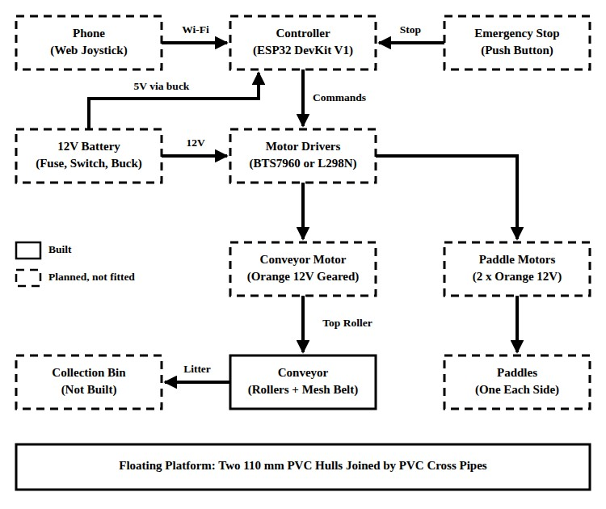
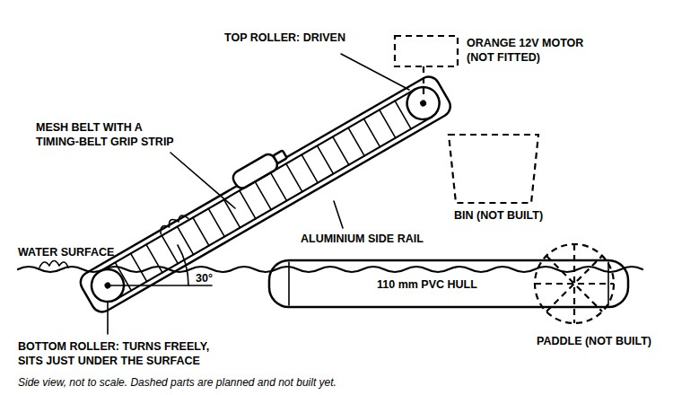
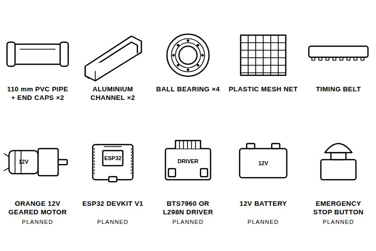
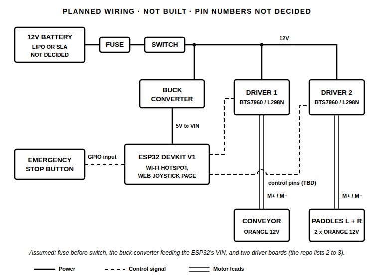
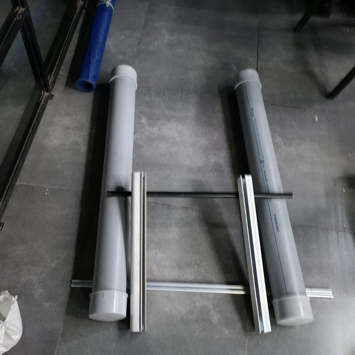
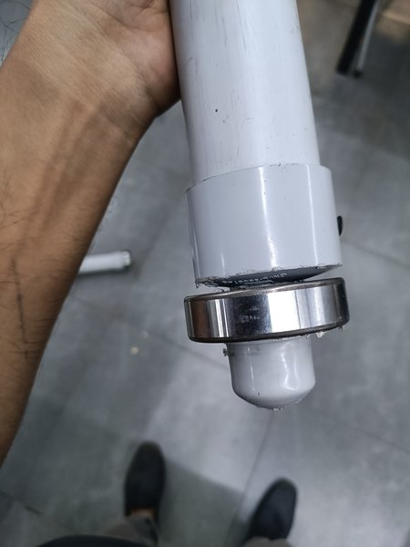
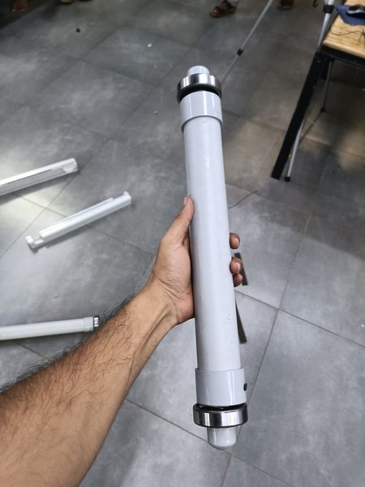
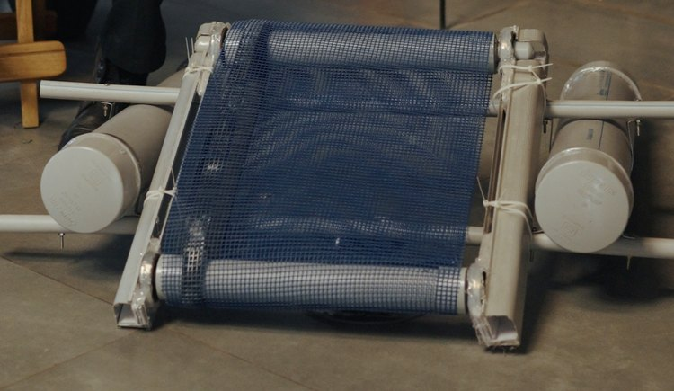

# Building AURABot, a DIY Pond Cleaning Robot with PVC Hulls and a Mesh Conveyor

There is a pond close to the Tinkerspace facility in Kochi that nobody uses any more. The water is stagnant, a green mat covers part of the surface, and litter has collected in it. Children used to swim here until the water got dirty, and about five years ago the municipality started a clean-up that reportedly cost 40 to 50 lakh rupees and was left unfinished. So, can a small robot built from plumbing pipe help bring a pond like this back?

In this project, I built AURABot, a pond cleaning robot made from PVC pipe and parts from local shops. Two 110mm PVC hulls carry a mesh conveyor at 30 degrees, which is meant to lift floating litter and weed out of the water and drop it into a bin. This guide shows how to check a pond before building, which parts to get, and how to build the hulls and the conveyor, along with the planned wiring and firmware. So far, the hulls and the conveyor are built, while the motors, the electronics and the bin are not, and the pond cleaning robot has not touched water yet. You can also check out similar [robotics projects](https://circuitdigest.com/robotics-projects) and [ESP32 projects](https://circuitdigest.com/esp32-projects) done previously here at Circuit Digest.

> **Quick Answer: What is AURABot?**
>
> **AURABot** (Aquatic Unit for Revival and Algae-Management) is an open-source **pond cleaning robot** made from PVC plumbing pipe. Two **110mm PVC hulls** carry a **mesh conveyor at 30 degrees** that is meant to lift floating litter and weed into a bin. The hulls and the conveyor are built, and the motors, the **ESP32** control and the bin are still planned.

**Table of Contents**

- [What Is AURABot?](#what-is-aurabot)
  - [Why Only the Surface](#why-aurabot-only-works-at-the-surface)
- [Check Your Pond First](#before-you-build-check-your-pond)
- [How AURABot Works](#how-does-the-aurabot-pond-cleaning-robot-work)
- [Components Required](#components-required-for-aurabot)
- [Planned Wiring Diagram](#planned-wiring-diagram-of-aurabot)
  - [Planned Connections](#planned-connections)
- [Building the Hulls and Conveyor](#building-the-hulls-and-the-conveyor)
- [Planned ESP32 Firmware](#planned-esp32-control-firmware)
- [Testing Safely](#testing-aurabot-safely)
- [Live Demo](#live-video-demonstration)
- [Output](#output-aurabot-at-demo-day)
- [Troubleshooting](#troubleshooting-aurabot)
- [Lessons From My Build](#lessons-from-my-build)
- [GitHub](#aurabot-github-repository)

## What Is AURABot?

AURABot is a robot meant to help bring a stagnant pond back to life by collecting what floats on it. The hull is plain PVC pipe that any plumbing shop sells, so that anyone can copy the build, and the main job of the robot, collecting waste, depends on the conveyor and the bin, so those come first. For a professional version of the idea, look at Clearbot, whose Clearbot Neo is about three metres long and cleans set sections of water much like a household robot cleaner. If you want a simpler boat to start with, Circuit Digest has an [Arduino RC boat controlled with 433 MHz RF modules](https://circuitdigest.com/microcontroller-projects/simple-arduino-rc-boat-that-can-be-controlled-wirelessly-using-rf-module). If interested, do check it out.

### Why AURABot Only Works at the Surface

Residents told me that a group of college students once experimented on this pond, and about two days later many fish died and an oily film was seen on the water. I do not know what they did or what killed the fish. One explanation I considered is that disturbing the bottom released hydrogen sulphide built up in the mud of a pond that never drains. I have not tested for it, and the oily film points to other possible causes, so this is only a guess. The rule I took from it is simple: stay at the surface and do not touch the bottom. A research scholar from the Marine Biology department at CUSAT suggested starting with the floating weeds and the microalgae and leaving the rooted plants for later. I still need to ask her whether even that is safe for the fish.

## Before You Build: Check Your Pond

The design depends on the pond, so survey yours before cutting any pipe. Below is the pond near Tinkerspace, with the green mat on the surface and litter floating in it.

For a first depth check, I dipped the midrib of a coconut frond into the water, and it went down 3 to 4 feet. For a better reading, tie a stone to a fishing line and lower it. Ask the people living around the pond about its history, find out whether fish live in it, and check where the water drains. Locals expect the municipality to be involved, so sort out permission before any test in the water. The table below gives what I found at this pond.

| Item | What I Found |
|---|---|
| Size | About 25 m by 25 m, roughly 625 m², measured on a map |
| Depth | About 5 feet where I could reach; the middle may be deeper |
| Drainage outlet | At about 8 feet, so the water never reaches it and only seeps out through the stone wall |
| Fish | Alive; residents say they grow to 30 to 35 cm |
| Earlier clean-up | About five years ago, 40 to 50 lakh rupees, stopped by a flash flood that left equipment in the pond |

Cleaning alone will not keep a pond like this clean. Water from around this pond is now routed straight into a nearby drain, so nothing flows through it any more. Restoring that inflow and outflow is a separate job from the robot, but it matters just as much. Try to get the algae identified as well, as the water here is too far below the bank to reach the weeds for a pull test.

## How Does the AURABot Pond Cleaning Robot Work?

Two 110mm PVC pipes with caps on both ends float the robot, and PVC cross pipes join them. Between the hulls, a mesh belt runs over two PVC rollers, held between two aluminium side rails at 30 degrees, with the lower end just under the water surface. As the belt turns, floating litter and weed ride up it and fall into a bin at the top. Two paddles, one on each side, are meant to move the robot, and an ESP32 is meant to run the three motors from a phone. Below is the block diagram of the AURABot pond cleaning robot.

The solid boxes are the parts that are built, which is the floating platform and the conveyor. Everything in dashed boxes is planned and not fitted yet, from the phone and the ESP32 down to the three motors. Below is a side view of the conveyor.

Only the top roller is driven, and the bottom roller just turns freely. A strip of timing belt is stuck under the mesh and around one roller, so that the roller can drive the mesh without slipping. For another build that moves objects on a belt, here is the [automatic bottle filling system using Arduino](https://circuitdigest.com/microcontroller-projects/automatic-bottle-filling-system-using-arduino) on Circuit Digest.

## Components Required for AURABot

Below is the list of components for AURABot, with what has actually been fitted so far.

| S.No | Component | Description | Quantity | Status |
|---|---|---|---|---|
| 1. | 110mm PVC Pipe with End Caps [TODO: length] | Hulls | 2 | Built |
| 2. | PVC Pipe | Cross pipes between the hulls | As required | Built |
| 3. | Aluminium Channel (flex banner stand base) | Conveyor side rails | 2 | Built |
| 4. | PVC Pipe Rollers with End Caps | About 40 cm wide | 2 | Built |
| 5. | Ball Bearings [TODO: size] | Roller supports | 4 | Fitted |
| 6. | Plastic Mesh Net | Belt | 1 | Fitted |
| 7. | Timing Belt, cut to length | Grip between roller and mesh | 1 | Fitted |
| 8. | Orange 12V 100 RPM Geared Motor | Conveyor roller and two paddles | 3 to 4 | Not fitted |
| 9. | Paddles with Long Blades | Propulsion | 2 | Not built |
| 10. | Plastic or Mesh Bin | Collecting waste | 1 | Not built |
| 11. | ESP32 DevKit V1 | Controller | 1 | Not fitted |
| 12. | BTS7960 or L298N Motor Driver | Driving the motors | 2 to 3 | Not fitted |
| 13. | 12V Battery (LiPo or Sealed Lead-Acid) | Power | 1 | Not decided |
| 14. | Buck Converter, Fuse, Power Switch, Emergency Stop Button | Power and safety | 1 each | Not fitted |

The banner-stand base is light and already has the right channel shape for the side rails. The Orange geared motors were chosen because Tinkerspace already had them, and sellers list them at roughly 10 to 12 kg-cm of rated torque. They cannot go under water, which is why AURABot uses paddles with long blades instead of propellers; an underwater propeller driven from a motor on board would need universal joints, which I could not find locally. Waterproof 12V motors and propellers were not available at Tomson or Matha Electronics either. I also bought a 12V 85 RPM worm-gear motor from Matha Electronics for ₹1,770, but the current plan uses the Orange motors. To learn how a driver like the L298N runs a DC motor, refer to our [L298N motor driver with Arduino](https://circuitdigest.com/microcontroller-projects/interfacing-l298n-motor-driver-with-arduino) tutorial.

## Planned Wiring Diagram of AURABot

Nothing electrical has been wired on AURABot yet, so below is the planned wiring, drawn from the parts list and the firmware notes in the repository.

The 12V battery goes through a fuse and a power switch to the motor drivers, and a buck converter steps the same supply down for the ESP32 DevKit V1. The ESP32 reads an emergency stop button on one of its inputs, as the firmware draft expects, and sends control signals to the drivers. One driver runs the conveyor motor and the other runs the two paddle motors. The fuse-then-switch order, the buck converter feeding the ESP32's VIN pin and the use of two driver boards are my assumptions, as the repository lists two to three drivers and does not give a wiring order. Our article on [calculating the run time of a drone LiPo battery](https://circuitdigest.com/article/calculating-the-energy-run-time-and-charge-of-a-drone-lipo-battery) shows how to size a pack. That is all about the planned wiring. For an example of BTS7960 drivers on a heavier robot, see the [Raspberry Pi based autonomous UV robot](https://circuitdigest.com/microcontroller-projects/raspberry-pi-based-autonomous-uv-robot) on Circuit Digest.

### Planned Connections

| From | To | Status |
|---|---|---|
| 12V battery | Fuse, then power switch | Battery type not decided, order assumed |
| Power switch | Motor driver power inputs | Planned |
| Power switch | Buck converter, then ESP32 VIN | Assumed |
| Emergency stop button | ESP32 input | Pin not decided |
| ESP32 GPIOs | Driver 1 and driver 2 control pins | Pins not decided |
| Driver 1 | Conveyor motor (top roller) | Planned |
| Driver 2 | Left and right paddle motors | Planned |

## Building the Hulls and the Conveyor

Below are the PVC hull pipes, the aluminium rails and the mesh, laid out before assembly.

**Step 1⇒ Make the Hulls**

Cap both ends of the two 110mm PVC pipes so that they are sealed and float.

**Step 2⇒ Join the Hulls**

Join the two hulls with PVC cross pipes. These cross pipes also carry the conveyor later, so leave room for it between the hulls.

**Step 3⇒ Cut the Side Rails and Seat the Bearings**

Cut each of the two aluminium banner-stand rails to the size of the bearings, so that each of the four bearings sits partly inside the rail. Fix the bearings with a glue gun. Do not weld near the bearings, as the heat melts their rubber seals, which keep debris out of the balls. Below is the end of a roller with its bearing.

**Step 4⇒ Make the Rollers**

Each roller is a PVC pipe about 40 cm wide with an end cap on each side. Drill the end caps so that smaller, shorter pipes pass through them and into the bearings. Below is a complete roller with a bearing on each end.

**Step 5⇒ Fit the Mesh Belt**

Wrap the plastic mesh net over both rollers. Stick pieces of timing belt under the mesh and around the roller that will be driven, so that it can grip the mesh. Attach them evenly and with a flexible adhesive, as an uneven or stiff joint makes the belt move with difficulty.

**Step 6⇒ Mount the Conveyor**

Set the side rails at 30 degrees with the lower roller just under the water line, and tie the whole conveyor to the PVC cross pipes. The bin goes at the top end, where the waste falls off the belt.

My first frame was 1-inch hollow steel pipe, cut with a hand-held cut-off saw and drilled for U-clamps to hold the hulls. Avoid it. The aluminium rails cannot be welded to steel, the stacked steel side frame came out too heavy for hulls of a sensible size, and cutting the 30 degree piece by hand took far longer than I expected. If you do cut metal, get help from someone trained on the power saw.

## Planned ESP32 Control Firmware

The firmware is still a draft, and it is not in the repository yet. In the draft, the ESP32 creates its own Wi-Fi hotspot, so no router is needed at the pond, and you drive the robot from a joystick on a web page after joining the hotspot with a phone. It stops all the motors if no command arrives for 1.5 seconds, and it has an input for a physical emergency stop button. The draft was written for an earlier layout of the robot, with a surface brush, a comb roller and a depth actuator, so it has to be changed for one conveyor motor and two paddle motors before it is useful. Part of the sizing work and this draft were done with an AI assistant, and none of it has been run on the robot. Circuit Digest's [ESP32-CAM surveillance car](https://circuitdigest.com/microcontroller-projects/esp32-cam-surveillance-car) uses the same idea of the ESP32 hosting its own access point with a control page on the phone.

## Testing AURABot Safely

Test in stages, and stop if anything looks wrong for the fish. Turn the conveyor by hand on the bench first and make sure the belt moves freely over both rollers. Then test the robot in a tub, then at the pond edge, before any real run. For the first run in the pond, use a small trial patch with a dissolved oxygen test kit and watch the fish the whole time. For measuring water quality during such a trial, the [turbidity meter using Arduino](https://circuitdigest.com/microcontroller-projects/measuring-turbidity-of-water-to-determine-water-quality-using-arduino-turbidity-sensor) on Circuit Digest is a simple place to start.

## Live Video Demonstration

Below is the video demonstration of AURABot.

*Video not published yet.*

[TODO: video of AURABot at the demo, with the conveyor turned by hand to show the belt moving over the rollers]

## Output: AURABot at Demo Day

Below is the assembled prototype, as it was shown at the demo on 20 September 2026 and photographed on 2 October.

The two capped hulls sit on either side, joined by the PVC cross pipes, and the conveyor is tied to them with cable ties, with the blue mesh running over both rollers. The prototype was not ready to touch water. The table below gives the state of each part.

| Part | Status |
|---|---|
| Two PVC hulls with end caps, joined by PVC cross pipes | Built |
| Conveyor frame, two aluminium side rails at 30 degrees | Built |
| Two PVC rollers on four ball bearings | Built |
| Mesh belt with timing-belt grip | Fitted, but it moves stiffly |
| Paddle propulsion and collection bin | Not built |
| Electronics and firmware | Draft only, never run on the robot |
| Test in water | Not done |

## Troubleshooting AURABot

| Symptom | Likely Cause | Fix |
|---|---|---|
| The mesh belt moves stiffly | The adhesive made the mesh stiff where the timing belt is stuck, and the belt was attached to the roller unevenly (my guess, not confirmed) | Re-attach the timing belt evenly with a thinner, more flexible adhesive |
| Round objects like bottles roll back down the belt | A smooth belt at 30 degrees cannot hold them | Add raised rubber strips across the belt |
| Bearings cannot be welded to the frame | Welding heat melts the rubber seals | Seat each bearing in a cut-out in the rail and glue it |
| The aluminium rails will not join the steel frame | Aluminium cannot be welded to steel | Use one material; AURABot went back to aluminium rails and PVC cross pipes |
| The frame is too heavy for the hulls | Stacked 1-inch steel pipes | Use the lighter aluminium and PVC, or bigger hulls |

## Lessons From My Build

Understand the pond before designing the robot. It took me six or seven weeks to see how deep the problem was, which left only the last two or three weeks for the hardware.

Build the part that does the job first. I started out trying to make a hull that looked like Clearbot, until Kurian asked why an open-source project was being built like a finished commercial product. The waste is collected by the conveyor and the bin, so they come first, on a hull of plain pipe.

Plan more time for the frame than you think it needs. Mine took far longer than I expected, and I managed my time badly, which is why nothing else was fitted for the demo.

## Conclusion

The two hulls and the conveyor are built, and they show that a surface collector can be made from plumbing pipe, a banner stand and a mesh net. AURABot has not reached the water yet. The repository lists what is still to do: fix the belt friction, add rubber strips to the belt, build and fit the paddles, motors and bin, fit the electronics with updated firmware, and test in a tub before the pond edge. After that comes a small trial patch with a dissolved oxygen test kit while watching the fish, and getting the algae identified by an expert.

## AURABot GitHub Repository

The AURABot repository has the full README with the pond survey, the build logs and the build photos. The code and CAD folders do not have files yet. AURABot was built by Nihaal Yoosuf at Tinkerspace, Kochi, as part of the Builder in Residence programme sponsored by Circuit Digest, and it is released under the GNU General Public License v3.0.

[Code & Schematics (GitHub)](https://github.com/BuilderinResidencyTinkerspace/AURABot) · [Download Zip](https://github.com/BuilderinResidencyTinkerspace/AURABot/archive/refs/heads/main.zip)

## Frequently Asked Questions About the AURABot Pond Cleaning Robot

**⇥ 1. Why does AURABot only clean the surface of the pond?**

Many fish died about two days after an earlier experiment on the same pond, and disturbing the mud of a pond that never drains may have played a part. Until that is understood, the robot stays at the surface and leaves the bottom alone.

**⇥ 2. Why are the hulls made from PVC pipe and not a proper boat hull?**

The goal is a pond cleaning robot that anyone can copy with parts from a local shop, which was Kurian's advice. A capped PVC pipe needs no moulding or fibreglass work, and the same pipe is sold in any plumbing shop.

**⇥ 3. Has AURABot been tested in water?**

No. The prototype has no propulsion, electronics or bin yet. The next steps listed in the repository are a test in a tub, then at the pond edge, before any real run.

## Water and Robotics Projects on Circuit Digest

Explore boats, waste-collecting robots and water-quality projects built with Arduino, ESP32 and NodeMCU.

- **[Build a Simple Arduino RC Boat that can be Controlled Wirelessly using 433 MHz RF Modules](https://circuitdigest.com/microcontroller-projects/simple-arduino-rc-boat-that-can-be-controlled-wirelessly-using-rf-module)**: *In this project, we will build a remote-controlled Arduino Air-Boat, using a homemade 433 MHz transmitter and receiver.*
- **[AI-Powered Autonomous Waste-Collecting and Sorting Robot](https://circuitdigest.com/microcontroller-projects/ai-powered-autonomous-waste-collecting-and-sorting-robot)**: *This project aims to develop an intelligent robot that can automatically collect and sort waste, with an ESP32-S3 camera as its vision unit.*
- **[Smart Water Quality Monitoring System Using IoT](https://circuitdigest.com/microcontroller-projects/arduino-nodemcu-based-smart-water-quality-monitoring-system-using-iot)**: *The various parameters that can be monitored are soil moisture, pH of water and temperature, using an Arduino and a NodeMCU.*

## Complete Project Code

AURABot has no code in its repository yet. The draft ESP32 firmware described above is still to be updated for one conveyor motor and two paddle motors and added to the code folder. [TODO: add the ESP32 firmware to the repository]
