# We Built AquaNav, a Fish-Following Rover Using Raspberry Pi 5 and OpenCV

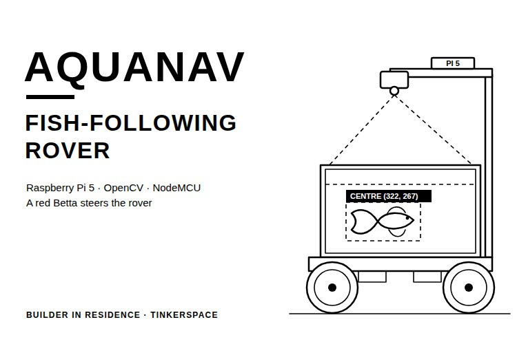

Most robots move because someone presses a button or a program tells them where to go. AquaNav takes its input from a fish. A red Betta swims in a glass tank on top of a four-wheel rover, a camera watches the tank from above, and the rover moves according to where the fish goes. The idea came from a reel of a fish-driven vehicle, and we wanted to build our own version.

In this project, we built AquaNav, a fish-following rover on an aluminium frame. A Raspberry Pi 5 with a Pi Camera Module 3 looks down into the tank from a mast, finds the fish with OpenCV and works out which part of the frame it is in. It then sends a movement command over USB to a NodeMCU, which drives four 12V DC motors through two L298N motor drivers. The rover drives and the final move, stop and wait behaviour ran with the fish on board, but the final OpenCV tracking and NodeMCU motor code are not in the repository yet, so this guide gives the published YOLO vision pipeline in full and describes the rest of the fish-following rover. You can also check out similar [robotics projects](https://circuitdigest.com/robotics-projects) and [Raspberry Pi projects](https://circuitdigest.com/simple-raspberry-pi-projects-for-beginners) done previously here at Circuit Digest.

> **Quick Answer: What is AquaNav?**
>
> **AquaNav** is a **fish-following rover** built on an aluminium frame with a custom glass aquarium on top. A **Raspberry Pi 5** tracks a red Betta with **OpenCV** and a Pi camera, and a **NodeMCU** drives four 12V DC motors through two **L298N** boards, moving the rover in short 5 to 8 second bursts based on which part of the frame the fish is in.

**Table of Contents**

- [What Is AquaNav?](#what-is-aquanav)
- [How the Rover Works](#how-does-the-aquanav-fish-following-rover-work)
- [Components Required](#components-required-for-the-aquanav-rover)
- [Wiring Diagram](#wiring-diagram-of-the-aquanav-rover)
  - [Connection Table](#aquanav-connection-table)
- [Building the Rover Base](#building-the-aquanav-rover-base)
- [Aquarium and Fish](#preparing-the-aquarium-and-the-fish)
- [Hardware Assembly](#hardware-assembly-of-aquanav)
- [Raspberry Pi Setup](#setting-up-the-raspberry-pi-and-the-fish-detector)
- [Motor Control from the Pi](#controlling-the-motors-from-the-raspberry-pi)
- [Testing the Fish Tracking](#testing-the-fish-tracking)
- [Code Explanation](#aquanav-vision-code-explanation)
- [Live Demo](#live-video-demonstration)
- [Output](#output-of-the-aquanav-fish-following-rover)
- [Troubleshooting](#troubleshooting-aquanav)
- [Lessons From Our Build](#lessons-from-our-build)
- [GitHub](#aquanav-github-repository)

## What Is AquaNav?

AquaNav is a four-wheel rover where the position of the fish in the camera frame is the input, in place of a joystick or a remote. When the fish swims into one corner of the tank, the rover moves according to that corner, and when it comes back to the centre, the rover stops. Keep the tank small, as every extra litre of water is weight for the frame and motors to carry, which is also why we chose a fighter fish. The [Raspberry Pi ball tracking robot](https://circuitdigest.com/microcontroller-projects/raspberry-pi-ball-tracking-robot-using-processing) on Circuit Digest works on a similar idea, following a ball by its colour. If interested, do check it out.

## How Does the AquaNav Fish-Following Rover Work?

The working is split between two boards. The Raspberry Pi 5 reads frames from the Pi Camera Module 3, finds the fish with an OpenCV HSV colour mask and checks which part of the frame its centre falls in. The NodeMCU receives commands such as forward, left or stop from the Pi over a USB cable and switches the two L298N motor drivers, which run the four 12V Johnson DC motors. The Pi also serves a dashboard on port 5000, so the camera view and the robot status can be watched from a laptop on the same Wi-Fi network. Below is the block diagram of the AquaNav fish-following rover.

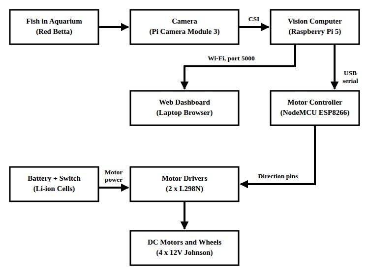

The repository does not show how the Raspberry Pi itself is powered, so the diagram leaves that out. The Pi to NodeMCU link is a plain USB serial connection, the same kind used in our [Arduino and Raspberry Pi serial communication](https://circuitdigest.com/microcontroller-projects/arduino-raspberry-pi-interfacing) tutorial.

Below is the flowchart of the movement logic.

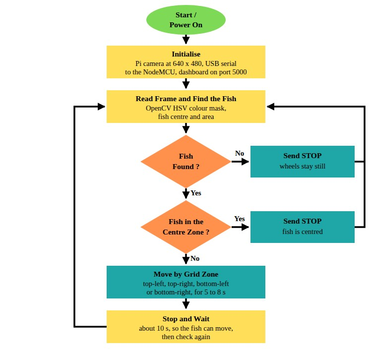

The camera frame is split into four zones, top-left, top-right, bottom-left and bottom-right, with a centre zone in the middle. If the fish is in the centre, or not found at all, the rover stays still. If it is in one of the four zones, the rover moves according to that zone for 5 to 8 seconds, stops, and waits for about 10 seconds before it checks again. When the rover moved for as long as the fish stayed outside the centre, it kept on driving, so we settled on the timed cycle. Which movement each zone triggers is set in the final tracking code, which is not in the repository yet [TODO: zone-to-movement mapping].

## Components Required for the AquaNav Rover

Below is the list of components required to build this project.

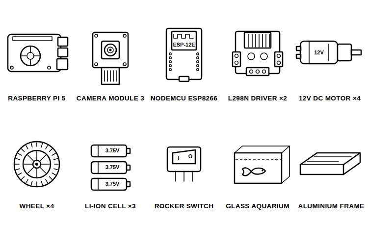

| S.No | Component | Description | Quantity |
|---|---|---|---|
| 1. | Raspberry Pi 5 | Fish tracking and dashboard | 1 |
| 2. | Raspberry Pi Camera Module 3 | Watches the tank from the mast | 1 |
| 3. | NodeMCU ESP8266 | Motor controller, on USB to the Pi | 1 |
| 4. | L298N Motor Driver | Dual H-bridge, two motors each | 2 |
| 5. | 12V Johnson DC Geared Motor [TODO: RPM] | Drives one wheel each | 4 |
| 6. | Wheel [TODO: diameter] | Sturdier than 60 mm mecanum wheels, which could not carry the load | 4 |
| 7. | Battery [TODO: final pack] and Rocker Switch | Motor power | 1 each |
| 8. | Custom Glass Aquarium | Holds the fish | 1 |
| 9. | Aluminium Frame | Rover base | 1 |
| 10. | 3D-Printed Shaft | Joins each wheel to its motor | 4 |
| 11. | Ultrasonic Sensor [TODO: model] | Tested on its own, not yet in the final circuit | 1 |
| 12. | Perfboard and Wires | Final soldered circuit | As required |
| 13. | Red Betta (Fighter Fish) | Decides where the rover goes | 1 |

The Raspberry Pi 5 runs the camera, the tracking and the dashboard, so the NodeMCU only has to switch the motor drivers. We started with an ESP32-S3 board and moved to the NodeMCU after the ESP32's USB port got damaged. The L298N boards are the common red modules with a heatsink. To learn how the L298N works, refer to our [L298N motor driver with Arduino](https://circuitdigest.com/microcontroller-projects/interfacing-l298n-motor-driver-with-arduino) tutorial.

## Wiring Diagram of the AquaNav Rover

Below is the wiring diagram for the AquaNav fish-following rover.

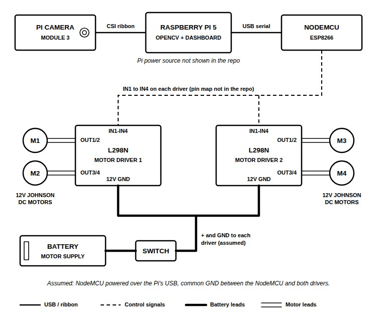

The table below lists every connection. The NodeMCU to L298N pin map is not in the repository, so the diagram shows those lines without GPIO numbers. The battery feeding both L298N boards through the switch with a common ground is the usual way to wire this, but the build notes do not show it, so do confirm it on your build. Never connect the cells straight to a controller board. Our ESP32 crashed the moment we did that, so feed any board from the battery through a buck converter, as shown in our [DC-DC buck converter circuit](https://circuitdigest.com/microcontroller-projects/arduino-dc-dc-buck-converter-circuit) article. That is all about the wiring.

### AquaNav Connection Table

| Connection | From | To | Note |
|---|---|---|---|
| Camera | Pi Camera Module 3 | Raspberry Pi 5 CSI port | Ribbon cable |
| Commands | Raspberry Pi 5 USB port | NodeMCU micro-USB | Serial over USB |
| Motor inputs | NodeMCU GPIO pins | IN1 to IN4 on both L298N boards | [TODO: NodeMCU to L298N pin map] |
| Motors 1 and 2 | L298N 1, OUT1/OUT2 and OUT3/OUT4 | Two Johnson motors | One motor per output pair |
| Motors 3 and 4 | L298N 2, OUT1/OUT2 and OUT3/OUT4 | Two Johnson motors | One motor per output pair |
| Motor power | Battery through the rocker switch | 12V and GND on both L298N boards | Assumed, with a common ground |
| NodeMCU power | Raspberry Pi 5 USB | NodeMCU | Assumed, same cable as the commands |

## Building the AquaNav Rover Base

The base has to carry the frame, the electronics and a tank full of water. Below are the three bases we tried, from left to right.

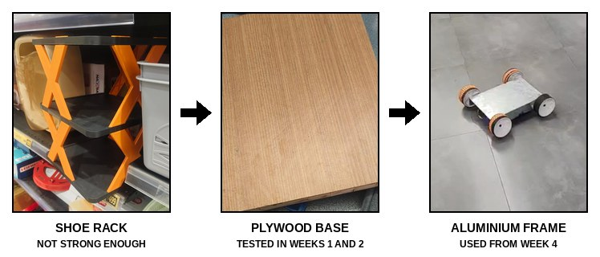

Skip furniture-type bases. A 3-level shoe rack could not safely hold the aquarium, and plywood and wooden bases were only good enough for early wheel tests. An aluminium frame gave the rover the support and grip it needed. Ours had been made for a college event two years earlier, and Jayasurya gave it to us after the aluminium shops we asked would not build one to order.

Choose the wheels for the full load as well. Below are the 60 mm mecanum wheels we started with, on the wooden base, with the 3D-printed shafts that join each wheel to its motor.

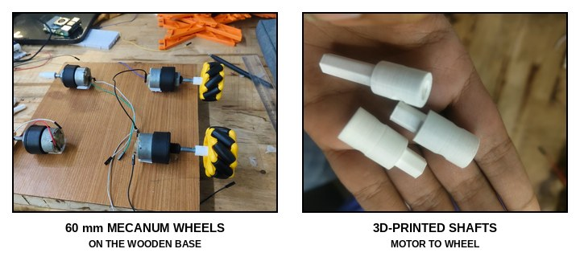

These wheels could not handle the weight of the setup, so we moved to a sturdier set of four wheels. Print the shafts in small steps and test the fit each time, as ours were only a few millimetres apart, some too loose and some too tight, before one fitted. The shaft STL is not in the repository. Its only CAD file, Aquanav2.STL, is a 155 × 210mm plate up to 10mm thick, and the build notes do not say which part it is.

## Preparing the Aquarium and the Fish

Below is the custom aquarium, with the Betta still in its bottle while it gets used to the water.

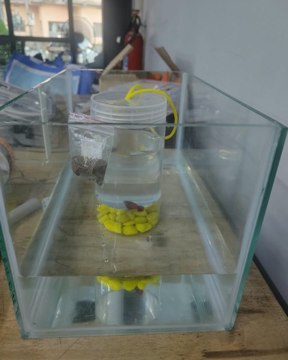

The aquarium shops near us mostly had round tanks, so we had a rectangular one built by Glass Word, a shop near Tinkerspace, to our own dimensions [TODO: aquarium dimensions]. It weighs around [TODO: aquarium weight] kg, so check that your base and wheels can carry it once it is filled. Clean and fill the tank, keep the fish in its bottle inside the aquarium for some time so that it adjusts to the water temperature, and then release it.

## Hardware Assembly of AquaNav

Below is the aluminium frame with the motors and electronics on it.

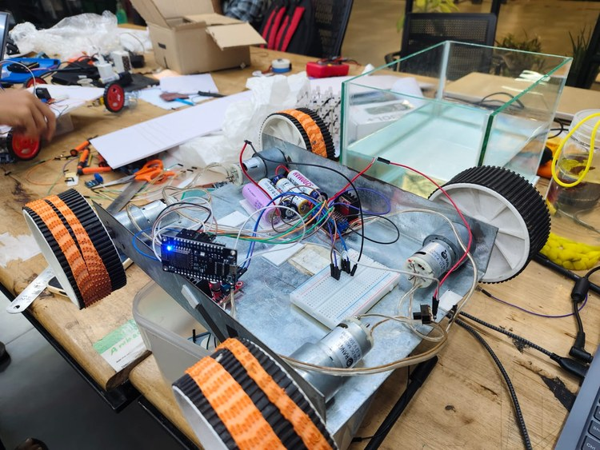

Fix the four Johnson geared motors along the sides of the frame and fit the wheels on the printed shafts. Put the controller, the two L298N boards and the cells in the middle, and test the drive on a breadboard first. With the ESP32 in charge, our rover went forward, backward, left and right, did a U-turn and stopped on command, and it moved with the aquarium on top as well. Below is the same wheel test with the NodeMCU.

<video controls preload="metadata" width="640" poster="videos/AquaNav-NodeMCU-Wheel-Test.jpg">
<source src="videos/AquaNav-NodeMCU-Wheel-Test.mp4" type="video/mp4">
<source src="https://github.com/user-attachments/assets/a4c982b5-eb25-45fc-81e4-ac32052ffe72" type="video/mp4">
<a href="https://github.com/user-attachments/assets/a4c982b5-eb25-45fc-81e4-ac32052ffe72">NodeMCU wheel test (MP4)</a>
</video>

Once the drive works, move everything from the breadboard to a perfboard and solder it, then complete the circuit with the battery and the switch. Below is our soldered perfboard.

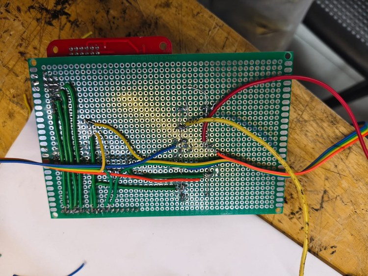

Finally, place the aquarium on the frame and mount the Raspberry Pi and the camera on a mast above the tank, with the camera looking down into the water.

## Setting Up the Raspberry Pi and the Fish Detector

The vision code runs on Raspberry Pi OS with the system Python. Follow the steps below in order.

**Step 1⇒ Connect to the Pi and Check the Camera**

We worked on the Pi over SSH from PowerShell on a laptop. Check the camera with these commands before writing any tracking code.

```bash
rpicam-hello                          # check that the camera is detected
rpicam-hello -t 5000                  # preview for 5 seconds
rpicam-still -t 2000 -o test.jpg      # capture an image after 2 seconds
rpicam-vid -t 10000 -o test.h264      # record a 10-second video
```

**Step 2⇒ Install the Packages**

```bash
sudo apt update
sudo apt install -y python3-pip python3-venv python3-picamera2 --no-install-recommends
python3 -m venv --system-site-packages ~/aquanav-venv
source ~/aquanav-venv/bin/activate
pip install ultralytics flask opencv-python-headless numpy
```

The `--system-site-packages` flag lets the virtual environment see Picamera2, which comes from apt and is tied to libcamera.

**Step 3⇒ Arrange the Code Folders**

The files sit flat in the code folder of the repository, but the imports expect subfolders. Put settings.py in config/, camera_stream.py in camera/, fish_detector.py and visualizer.py in vision/, and stream_server.py in web/, as listed in code/README.md.

**Step 4⇒ Collect and Label the Fish Images**

Run collect_fish_images.py with the fish in the tank. It captures 1000 photos at 640 × 480, one every 0.5 seconds, into the folder set in `SAVE_DIR`, so change that path to your own. We labelled more than 1000 images by hand, and the README says the labelling was done in Edge Impulse.

**Step 5⇒ Train the Model**

```python
from ultralytics import YOLO

model = YOLO("yolo11n.pt")
model.train(data="data.yaml", epochs=50, imgsz=640, batch=16, name="fish_tracking")
# data.yaml: train: images/train, val: images/val, names: {0: fish}
```

Copy the trained best.pt to vision/models/best.pt, as the model is not in the repository, and run `python check_model.py /path/to/best.pt` to print its class names. Set `FISH_CLASS_NAME` in settings.py to match.

**Step 6⇒ Test One Stage at a Time**

```bash
python test_camera.py      # camera only, saves stage1_test_frame.jpg
python test_detection.py   # camera + YOLO, prints 10 detections
python main.py             # full pipeline + live stream on port 5000
```

Once main.py is running, open `http://<pi-ip>:5000` in a browser on the same network. Below is our trained model tracking the fish, with its grid position printed next to the box.

<video controls preload="metadata" width="360" poster="videos/AquaNav-YOLO-Fish-Tracking.jpg">
<source src="videos/AquaNav-YOLO-Fish-Tracking.mp4" type="video/mp4">
<source src="https://github.com/user-attachments/assets/0fe73372-cad0-411d-8595-1c96e9e69063" type="video/mp4">
<a href="https://github.com/user-attachments/assets/0fe73372-cad0-411d-8595-1c96e9e69063">YOLO fish tracking (MP4)</a>
</video>

## Controlling the Motors from the Raspberry Pi

Connect the NodeMCU to the Raspberry Pi with a USB cable and send the movement commands from the Pi as serial data. Below is the control page on the Pi, with the NodeMCU connected over USB.

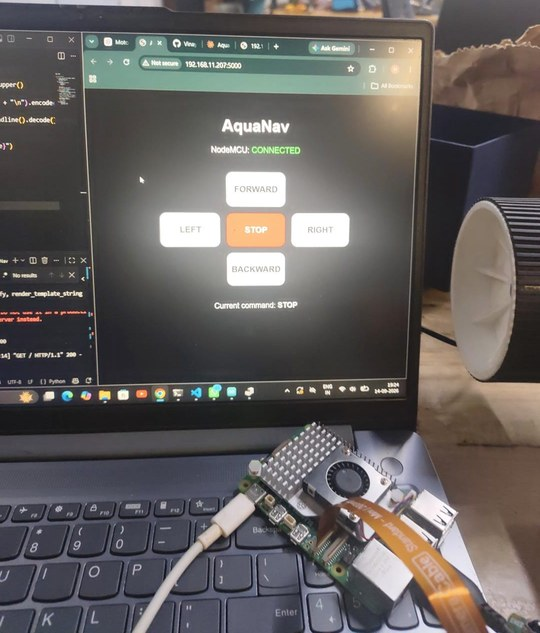

The page has forward, left, stop, right and backward buttons and shows whether the NodeMCU is connected. Its code and the NodeMCU motor sketch are not in the repository yet.

## Testing the Fish Tracking

Once the YOLO model had to drive the wheels, it kept giving us trouble, so we moved to OpenCV, which gave better results. The rover only needs to know where the fish is, and an HSV colour mask finds that as one blob. Our OpenCV version tracks the fish as a dark blue blob, matching how the camera was showing it, and prints the fish's horizontal and vertical zone, its centre and its area. Below is that version running.

<video controls preload="metadata" width="640" poster="videos/AquaNav-OpenCV-HSV-Fish-Tracking.jpg">
<source src="videos/AquaNav-OpenCV-HSV-Fish-Tracking.mp4" type="video/mp4">
<source src="https://github.com/user-attachments/assets/ec2f21c9-5562-4859-bf95-afc372da9829" type="video/mp4">
<a href="https://github.com/user-attachments/assets/ec2f21c9-5562-4859-bf95-afc372da9829">OpenCV HSV fish tracking (MP4)</a>
</video>

The red fish showed up dark blue because of a colour-order slip in the code, covered in the code explanation below, so fix that first and then set the HSV range for red. Check that the printed zone and centre follow the fish around the tank before you connect the tracking to the motors. If you want to try the dataset route with Edge Impulse instead, refer to our [ESP32-CAM object detection using Edge Impulse](https://circuitdigest.com/microcontroller-projects/object-recognition-using-esp32-cam-and-edge-impulse) project.

## AquaNav Vision Code Explanation

The code is written in Python for the Raspberry Pi 5. The final OpenCV tracking, the grid movement and the NodeMCU motor code are not in the repository yet [TODO: add the final tracking, movement and NodeMCU code], so this section explains the YOLO pipeline that is.

**Settings**

```python
CAMERA_RESOLUTION = (640, 480)   # keep low for real-time inference on Pi 5
CAMERA_FRAMERATE = 30

MODEL_PATH = "vision/models/best.pt"
CONFIDENCE_THRESHOLD = 0.5
FISH_CLASS_NAME = "fish"         # set this from the Stage 0 model audit

WEB_HOST = "0.0.0.0"
WEB_PORT = 5000
```

All the values that may need tuning sit in settings.py. The camera runs at 640 × 480 to keep inference fast on the Pi 5, detections below a confidence of 0.5 are ignored, and the web stream listens on port 5000 on every interface.

**Camera Wrapper**

```python
        cam_config = self.picam2.create_preview_configuration(
            main={"size": resolution, "format": "RGB888"}
        )
        self.picam2.configure(cam_config)

    def get_frame(self):
        """Return one frame as a numpy array (H, W, 3) in RGB order."""
        return self.picam2.capture_array()
```

CameraStream is a thin wrapper around Picamera2. It sets up a preview configuration at the configured size in the RGB888 format, and get_frame() returns each frame as a NumPy array. Picamera2's RGB888 frames are actually stored in blue, green, red order, which is what OpenCV expects, while the docstring here assumes RGB. main.py then converts RGB to BGR, which swaps red and blue, and that is the most likely reason our red fish looked dark blue.

**Fish Detection**

```python
        results = self.model(frame, conf=self.confidence, verbose=False)[0]

        detections = []
        for box in results.boxes:
            x1, y1, x2, y2 = box.xyxy[0].tolist()
            conf = float(box.conf[0])
            cx = int((x1 + x2) / 2)
            cy = int((y1 + y2) / 2)
```

detect() runs the YOLO model on one frame with the confidence threshold from settings.py. For every box, it reads the corners and the confidence and works out the centre by averaging the corners, returning a list of Detection objects holding plain numbers.

**Main Loop and Live Stream**

```python
        while True:
            frame = camera.get_frame()  # RGB
            bgr_frame = cv2.cvtColor(frame, cv2.COLOR_RGB2BGR)

            detections = detector.detect(bgr_frame)
            annotated = draw_detections(bgr_frame, detections)

            if detections:
                d = detections[0]
                print(f"Fish center: ({d.center_x}, {d.center_y}) "
                      f"conf={d.confidence:.2f}")

            update_frame(annotated)
```

main() starts the camera and the Flask stream server on its own thread, then loops forever. draw_detections() adds a green box, a red dot at the centre and the confidence to each frame, the fish centre is printed to the terminal, and update_frame() hands the frame to stream_server.py, which serves it as an MJPEG stream.

## Live Video Demonstration

Below is the final AquaNav run. A team member walks alongside, holding the white cable that runs up to the Raspberry Pi on the mast.

<video controls preload="metadata" width="360" poster="videos/AquaNav-Final-Run.jpg">
<source src="videos/AquaNav-Final-Run.mp4" type="video/mp4">
<source src="https://github.com/user-attachments/assets/6563d761-fa05-4fc8-ad89-8df4f1718b3e" type="video/mp4">
<a href="https://github.com/user-attachments/assets/6563d761-fa05-4fc8-ad89-8df4f1718b3e">AquaNav final run (MP4)</a>
</video>

Below is the earlier dashboard stage, where the tracking drove the motors for the first time.

<video controls preload="metadata" width="640" poster="videos/AquaNav-Tracking-Dashboard-with-Motor-Control.jpg">
<source src="videos/AquaNav-Tracking-Dashboard-with-Motor-Control.mp4" type="video/mp4">
<source src="https://github.com/user-attachments/assets/f4fea29d-f7ad-4eb2-a113-34528671f2db" type="video/mp4">
<a href="https://github.com/user-attachments/assets/f4fea29d-f7ad-4eb2-a113-34528671f2db">Tracking dashboard with motor control (MP4)</a>
</video>

## Output of the AquaNav Fish-Following Rover

Below is the finished AquaNav rover, with the red Betta in the tank and the Raspberry Pi and camera on the mast above it.

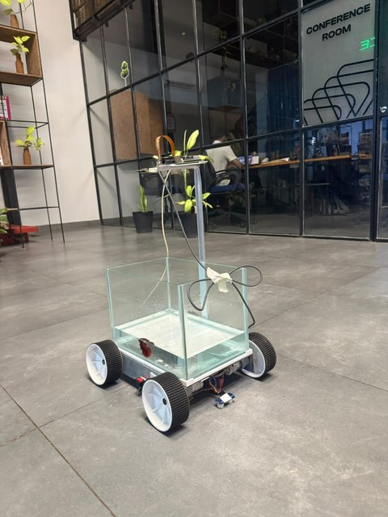

In the dashboard clip, the Robot Status panel shows the fish state, how far the fish moved between frames in pixels and the motor command, with the rules of that stage: fish moves → FORWARD, fish stationary → STOP and fish not found → STOP. When the fish has moved only 1.0 px, the motor shows STOP. The grid strategy, with its move, stop and wait cycle, is the final behaviour we kept.

## Troubleshooting AquaNav

| Symptom | Likely Cause | Fix |
|---|---|---|
| The red fish shows up blue | Picamera2's RGB888 frames are already in B, G, R order, and the extra RGB to BGR conversion swaps red and blue | Pass the frame to OpenCV without the conversion, then set the HSV range for red |
| ModuleNotFoundError: No module named 'camera' | The files are flat in the code folder, but the imports expect subfolders | Arrange camera/, config/, vision/ and web/ as per code/README.md |
| The Raspberry Pi switches off while the motors run | The supply cannot hold up under the motor load | Use a battery that meets the measured need of around 14V and 2A |
| The ESP32 crashes as soon as the battery is connected | The cells were wired straight to the board | Feed the board through a buck converter |
| The NodeMCU web page works only while it is plugged into the laptop | We did not find the cause | Connect the NodeMCU to the Pi over USB instead |
| The wheels struggle once the aquarium is on | 60 mm mecanum wheels cannot carry the load | Use a sturdier set of four wheels on a metal frame |
| The printed shaft is loose or will not go on | The bore is a millimetre or two off | Reprint in small steps and test the fit each time |

## Lessons From Our Build

Size the power supply before you change motors or wheels. After we moved to the bigger wheels and motors, three 3.75V cells drained in about five minutes, and we measured the need at around 14V and 2A. We kept testing on an external power supply and then a borrowed battery, and even then the Raspberry Pi kept switching off.

Test the wheels, the ultrasonic sensor and the fish tracking separately before you join them. All three worked on their own for us, and connecting the tracking directly to the wheels was much harder than testing each part.

Use a wired link between the Pi and the motor controller. A web page hosted by the ESP32 on its own Wi-Fi network worked, much like our [NodeMCU web server](https://circuitdigest.com/microcontroller-projects/build-a-nodemcu-webserver-to-control-led-from-webpage) tutorial, but it lagged, and with the Pi and the NodeMCU on the same Wi-Fi network, the NodeMCU only behaved while it was connected to the laptop. The USB serial link had neither problem.

## Conclusion

AquaNav moves according to where a red Betta swims, using a Raspberry Pi 5, OpenCV and a NodeMCU. To take a build like this further, the open items are a battery sized for the measured 14V and 2A, the final tracking and NodeMCU code in the repository, and the colour order fixed so that the fish shows up red. The team's next idea is a Guided Mode, where the rover maps a place such as a shopping mall with LiDAR and guides a person to the spot they ask for on a screen or by voice. Further, one can use the same kind of colour tracking on a flying platform, just like this [ESP32 drone with object tracking using LiteWing](https://circuitdigest.com/microcontroller-projects/object-tracking-drone-using-litewing) on Circuit Digest.

## AquaNav GitHub Repository

The AquaNav_ repository has the YOLO vision code, the dataset collection script, the build notes with their photos and videos, and one CAD file, Aquanav2.STL.

[Code & Schematics (GitHub)](https://github.com/BuilderinResidencyTinkerspace/AquaNav_) · [Download Zip](https://github.com/BuilderinResidencyTinkerspace/AquaNav_/archive/refs/heads/main.zip)

## Frequently Asked Questions About AquaNav

**⇥ 1. Can AquaNav follow any fish?**

Yes, but the tracking is set up for our red Betta. A fish of a different colour needs a new HSV colour range, and a YOLO model would need new images of that fish as well.

**⇥ 2. How long does AquaNav run on a battery?**

With three 3.75V cells, it ran for about five minutes after we changed to the bigger wheels and motors. The runtime on the final battery was not recorded [TODO: runtime with the final battery].

## Robotics and Computer Vision Projects

Explore more robots that see and follow, with guides and code.

- **[Raspberry Pi Ball Tracking Robot using Processing](https://circuitdigest.com/microcontroller-projects/raspberry-pi-ball-tracking-robot-using-processing)**: *Robots are thought to understand and interact with the real world through sensors and machine learning processing.*
- **[How to Build an ESP32 Drone with Object Tracking Using LiteWing](https://circuitdigest.com/microcontroller-projects/object-tracking-drone-using-litewing)**: *Most people assume object tracking for autonomous flight is very complex, but it doesn't have to be that way.*
- **[WiFi Controlled Robot using Arduino](https://circuitdigest.com/microcontroller-projects/arduino-wifi-controlled-robot)**: *There are many types of robots, from the simple ones like a toy car to the advanced ones like industrial robots.*

## Complete Project Code

Below is everything in the code folder of the repository. As per code/README.md, settings.py goes in config/, camera_stream.py in camera/, fish_detector.py and visualizer.py in vision/, and stream_server.py in web/.

**code/settings.py**

```python
"""Central configuration for AquaNav. Edit values here instead of scattering
magic numbers through the codebase."""

# --- Camera ---
CAMERA_RESOLUTION = (640, 480)   # keep low for real-time inference on Pi 5
CAMERA_FRAMERATE = 30

# --- YOLO model ---
MODEL_PATH = "vision/models/best.pt"
CONFIDENCE_THRESHOLD = 0.5
FISH_CLASS_NAME = "fish"         # set this from the Stage 0 model audit

# --- Web stream ---
WEB_HOST = "0.0.0.0"
WEB_PORT = 5000
```

**code/camera_stream.py**

```python
"""Thin wrapper around Picamera2 so the rest of the codebase never talks to
the camera driver directly."""

from picamera2 import Picamera2

from config import settings


class CameraStream:
    def __init__(self, resolution=settings.CAMERA_RESOLUTION):
        self.picam2 = Picamera2()
        cam_config = self.picam2.create_preview_configuration(
            main={"size": resolution, "format": "RGB888"}
        )
        self.picam2.configure(cam_config)

    def start(self):
        self.picam2.start()

    def stop(self):
        self.picam2.stop()

    def get_frame(self):
        """Return one frame as a numpy array (H, W, 3) in RGB order."""
        return self.picam2.capture_array()
```

**code/fish_detector.py**

```python
"""YOLOv8-based fish detector. Wraps ultralytics so the rest of the code
only deals with plain Python data, not YOLO-specific objects."""

from dataclasses import dataclass

from ultralytics import YOLO

from config import settings


@dataclass
class Detection:
    x1: int
    y1: int
    x2: int
    y2: int
    confidence: float
    center_x: int
    center_y: int


class FishDetector:
    def __init__(self, model_path=settings.MODEL_PATH,
                 confidence=settings.CONFIDENCE_THRESHOLD):
        self.model = YOLO(model_path)
        self.confidence = confidence

    def detect(self, frame) -> list[Detection]:
        """Run inference on one BGR frame, return a list of Detections."""
        results = self.model(frame, conf=self.confidence, verbose=False)[0]

        detections = []
        for box in results.boxes:
            x1, y1, x2, y2 = box.xyxy[0].tolist()
            conf = float(box.conf[0])
            cx = int((x1 + x2) / 2)
            cy = int((y1 + y2) / 2)
            detections.append(
                Detection(int(x1), int(y1), int(x2), int(y2), conf, cx, cy)
            )
        return detections
```

**code/visualizer.py**

```python
"""Draws detection boxes and centers onto a frame for the live web view."""

import cv2


def draw_detections(frame, detections):
    for d in detections:
        cv2.rectangle(frame, (d.x1, d.y1), (d.x2, d.y2), (0, 255, 0), 2)
        cv2.circle(frame, (d.center_x, d.center_y), 5, (0, 0, 255), -1)
        label = f"{d.confidence:.2f}"
        cv2.putText(frame, label, (d.x1, max(d.y1 - 8, 0)),
                    cv2.FONT_HERSHEY_SIMPLEX, 0.5, (0, 255, 0), 2)
    return frame
```

**code/stream_server.py**

```python
"""Minimal Flask MJPEG server — just enough to view the live annotated
feed in a browser. No templates, no extra frameworks."""

import threading

import cv2
from flask import Flask, Response

app = Flask(__name__)

_latest_frame = None
_lock = threading.Lock()


def update_frame(frame):
    """Called by main.py every loop iteration with the newest annotated frame."""
    global _latest_frame
    with _lock:
        _latest_frame = frame.copy()


def _generate():
    while True:
        with _lock:
            if _latest_frame is None:
                continue
            ok, jpeg = cv2.imencode(".jpg", _latest_frame)
        if not ok:
            continue
        yield (b"--frame\r\n"
               b"Content-Type: image/jpeg\r\n\r\n" + jpeg.tobytes() + b"\r\n")


@app.route("/")
def index():
    return ("<html><body><h2>AquaNav — Fish Detection</h2>"
            "</body></html>")


@app.route("/video_feed")
def video_feed():
    return Response(_generate(),
                     mimetype="multipart/x-mixed-replace; boundary=frame")


def run_server(host, port):
    app.run(host=host, port=port, threaded=True, use_reloader=False)
```

**code/main.py**

```python
"""Milestone 1: Camera -> YOLO fish detection -> bounding box -> fish
center -> live web stream.

Run this, then open http://<pi-ip>:5000 in a browser on the same network.
"""

import threading

import cv2

from camera.camera_stream import CameraStream
from config import settings
from vision.fish_detector import FishDetector
from vision.visualizer import draw_detections
from web.stream_server import run_server, update_frame


def main():
    camera = CameraStream()
    detector = FishDetector()

    camera.start()
    print("Camera started. Web server: "
          f"http://{settings.WEB_HOST}:{settings.WEB_PORT}")

    server_thread = threading.Thread(
        target=run_server, args=(settings.WEB_HOST, settings.WEB_PORT),
        daemon=True,
    )
    server_thread.start()

    try:
        while True:
            frame = camera.get_frame()  # RGB
            bgr_frame = cv2.cvtColor(frame, cv2.COLOR_RGB2BGR)

            detections = detector.detect(bgr_frame)
            annotated = draw_detections(bgr_frame, detections)

            if detections:
                d = detections[0]
                print(f"Fish center: ({d.center_x}, {d.center_y}) "
                      f"conf={d.confidence:.2f}")

            update_frame(annotated)

    except KeyboardInterrupt:
        print("Stopping...")
    finally:
        camera.stop()


if __name__ == "__main__":
    main()
```

**code/collect_fish_images.py**

```python
from picamera2 import Picamera2
import time
import os

# ==============================
# SETTINGS
# ==============================

TOTAL_IMAGES = 1000
INTERVAL = 0.5

SAVE_DIR = "/home/aquanav/AquaNav/fish_dataset"

WIDTH = 640
HEIGHT = 480

# ==============================
# CREATE FOLDER
# ==============================

os.makedirs(SAVE_DIR, exist_ok=True)

# ==============================
# CAMERA
# ==============================

picam2 = Picamera2()

config = picam2.create_still_configuration(
    main={
        "size": (WIDTH, HEIGHT),
        "format": "RGB888"
    }
)

picam2.configure(config)

picam2.start()

time.sleep(2)

print()
print("================================")
print("AquaNav Fish Image Collector")
print("================================")
print()
print(f"Saving to: {SAVE_DIR}")
print(f"Images: {TOTAL_IMAGES}")
print(f"Interval: {INTERVAL} seconds")
print()
print("Starting in 5 seconds...")
print()

time.sleep(5)

# ==============================
# CAPTURE
# ==============================

for i in range(1, TOTAL_IMAGES + 1):

    filename = os.path.join(
        SAVE_DIR,
        f"fish_{i:04d}.jpg"
    )

    picam2.capture_file(filename)

    print(
        f"[{i}/{TOTAL_IMAGES}] "
        f"{filename}"
    )

    time.sleep(INTERVAL)

# ==============================
# FINISH
# ==============================

picam2.stop()

print()
print("================================")
print("DONE!")
print(f"{TOTAL_IMAGES} images captured.")
print(f"Saved in: {SAVE_DIR}")
print("================================")
```

**code/check_model.py**

```python
"""One-off script to inspect an existing YOLO checkpoint before reusing it.

Usage:
    python check_model.py path/to/best.pt
"""

import sys

from ultralytics import YOLO

if len(sys.argv) != 2:
    print("Usage: python check_model.py path/to/best.pt")
    sys.exit(1)

model = YOLO(sys.argv[1])

print("Class names:", model.names)
print("Number of classes:", len(model.names))
print("Model task:", model.task)
```

**code/test_camera.py**

```python
"""Stage 1 test: confirm the camera captures frames and save one to disk
so you can eyeball it. Delete once Stage 1 passes."""

import cv2

from camera.camera_stream import CameraStream

cam = CameraStream()
cam.start()

frame = cam.get_frame()          # RGB
bgr = cv2.cvtColor(frame, cv2.COLOR_RGB2BGR)
cv2.imwrite("stage1_test_frame.jpg", bgr)

print("Frame shape:", frame.shape)
print("Saved stage1_test_frame.jpg")

cam.stop()
```

**code/test_detection.py**

```python
"""Stage 2 test: run detection on 10 live frames and print results to the
terminal (no web server involved). Delete once Stage 2 passes."""

import time

import cv2

from camera.camera_stream import CameraStream
from vision.fish_detector import FishDetector

cam = CameraStream()
detector = FishDetector()
cam.start()

for i in range(10):
    frame = cam.get_frame()
    bgr = cv2.cvtColor(frame, cv2.COLOR_RGB2BGR)

    start = time.time()
    detections = detector.detect(bgr)
    elapsed = time.time() - start

    print(f"Frame {i}: {len(detections)} detection(s), "
          f"{elapsed*1000:.0f} ms inference")
    for d in detections:
        print(f"  -> center=({d.center_x},{d.center_y}) conf={d.confidence:.2f}")

cam.stop()
```
