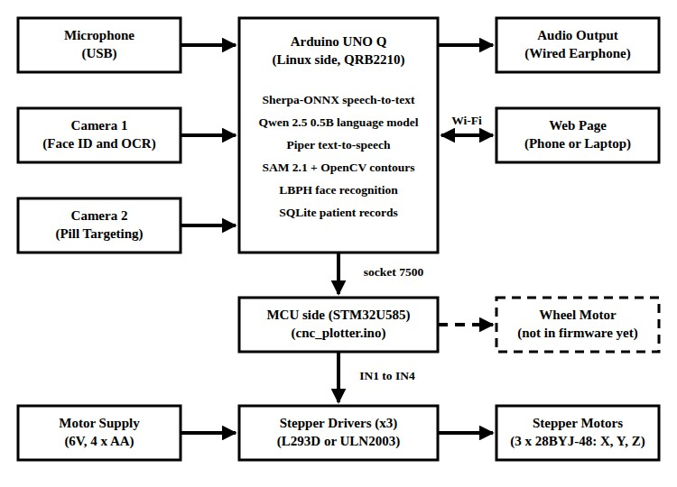
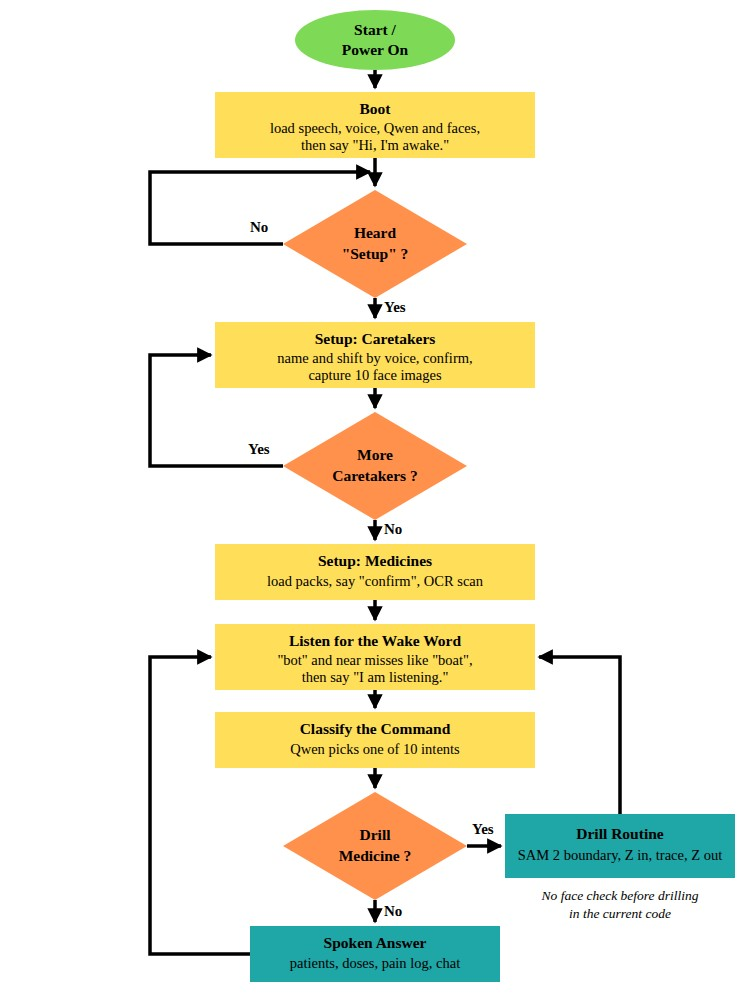
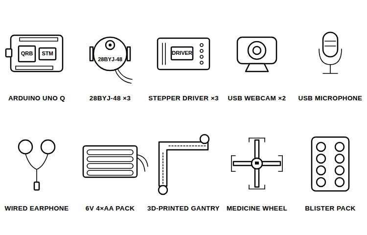
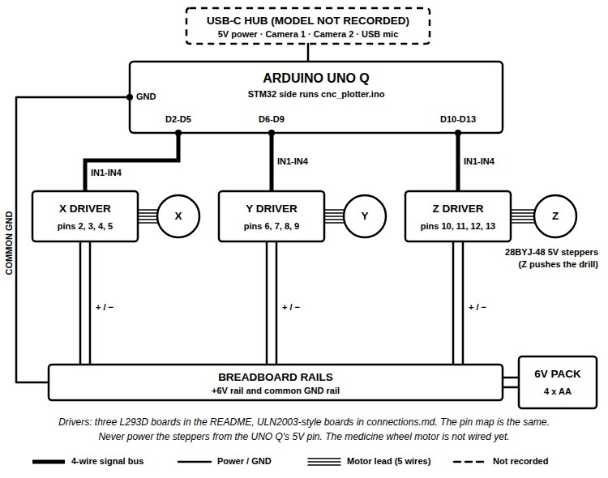
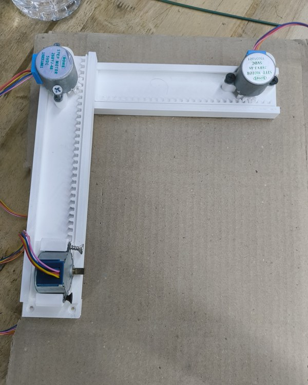
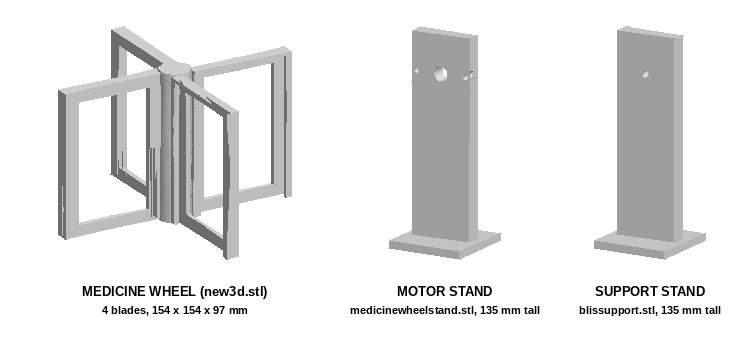
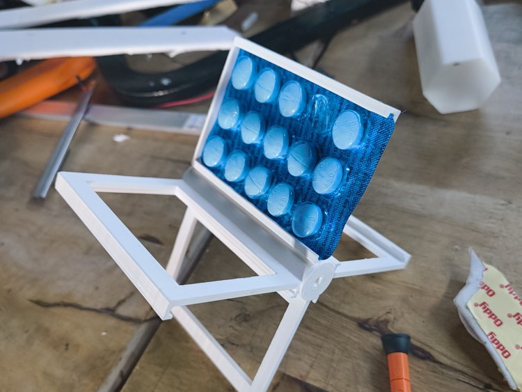
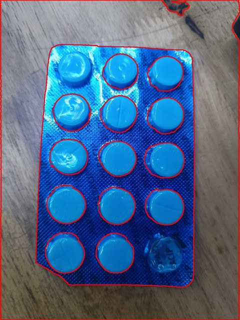

Anyone who has looked after an elderly relative knows the routine. The tablets come in foil strips, and every few hours someone has to find the right strip, press out the right pill and remember whether it was already taken. Most pill organisers only move that work to a weekly sorting session. So, could a machine take the whole strip as it comes from the pharmacy, push the pill out itself, and let the patient simply ask for it by voice?

In this project, we built Blister Bot, a prototype medicine dispenser that holds blister packs in a 3D-printed wheel and uses a small three-axis gantry with a drill tip to cut a pill out of the foil, and this article shows how to build it. An Arduino UNO Q runs everything on the board: speech-to-text, a Qwen 2.5 language model, text-to-speech, face recognition, and SAM 2 to find the pill boundaries in a camera image. The gantry moves on command and the face recognition and voice assistant work, but drilling is not stable yet, and the medicine dispenser prototype has not pushed out a pill. You can also check out similar [Arduino projects](https://circuitdigest.com/arduino-projects) and [AI projects](https://circuitdigest.com/ai-projects-and-tutorials) done previously here at Circuit Digest.

<div style="background-color:#e8f4fd;border-left:4px solid #1a73e8;border-radius:4px;margin:1em 0 1.5em;padding:14px 18px;" role="note" aria-label="Quick Answer"><strong style="display:block;margin-bottom:6px;">Quick Answer: What is Blister Bot?</strong><strong>Blister Bot</strong> is a <strong>blister pack medicine dispenser prototype</strong> built on an <strong>Arduino UNO Q</strong>. A camera and <strong>SAM 2</strong> find the pill outline, and three <strong>28BYJ-48</strong> steppers move a drill tip to cut around it from the foil side, while a voice assistant with face recognition takes the requests. The gantry and the AI work, but drilling a pill out has not succeeded yet.</div>

<div class="toc" style="background-color:#EBF2FA;border-radius:4px;margin:20px 0;max-width:800px;padding:20px;"><h3 style="color:#333;font-size:1.2em;margin:0 0 15px 0;"><strong>Table of Contents</strong></h3><ul style="list-style-type:none;margin:0;padding-left:0;">
<li><a href="#what-is-blister-bot"><strong>What Is Blister Bot?</strong></a></li>
<li><a href="#how-does-the-blister-bot-medicine-dispenser-work"><strong>How Blister Bot Works</strong></a></li>
<li style="margin-left:20px;"><a href="#ai-models-running-on-the-arduino-uno-q"><strong>└ AI Models on the UNO Q</strong></a></li>
<li><a href="#components-required-for-blister-bot"><strong>Components Required</strong></a></li>
<li><a href="#circuit-diagram-of-blister-bot"><strong>Circuit Diagram</strong></a></li>
<li style="margin-left:20px;"><a href="#stepper-driver-pin-connections"><strong>└ Stepper Driver Pin Connections</strong></a></li>
<li><a href="#3d-printing-the-gantry-and-the-medicine-wheel"><strong>3D Printing the Parts</strong></a></li>
<li><a href="#assembling-blister-bot"><strong>Assembly</strong></a></li>
<li><a href="#setting-up-blister-bot-on-the-arduino-uno-q"><strong>Setting Up the UNO Q</strong></a></li>
<li><a href="#blister-bot-code-explanation"><strong>Code Explanation</strong></a></li>
<li><a href="#live-video-demonstration"><strong>Live Demo</strong></a></li>
<li><a href="#output-testing-the-blister-bot-prototype"><strong>Output</strong></a></li>
<li><a href="#troubleshooting-blister-bot"><strong>Troubleshooting</strong></a></li>
<li><a href="#lessons-from-our-build"><strong>Lessons From Our Build</strong></a></li>
<li><a href="#blister-bot-github-repository"><strong>GitHub</strong></a></li>
</ul></div>

### What Is Blister Bot?

Blister Bot is meant to be a fully offline dispenser that takes an unopened blister strip, reaches the pill from the foil side and pushes it out, with the packs on a rotating holder, the most promising of the layouts tried in Blender. Plain OpenCV could not find the pill edges reliably, so the vision side uses SAM 2, the open source segmentation model from Meta, which at around 600 MB fits in the UNO Q's 4GB of RAM. For a different take on the same problem, Circuit Digest has the [DoseRight ESP32 smart medicine dispenser](https://circuitdigest.com/microcontroller-projects/doseright-smart-automatic-medicine-manager). If interested, do check it out.

### How Does the Blister Bot Medicine Dispenser Work?

The working is split across the two halves of the Arduino UNO Q. The Linux side, a Qualcomm QRB2210, runs the Python programs: it listens through a USB microphone, answers through a wired earphone, recognises faces from Camera 1 and finds pill outlines in the image from Camera 2. The STM32U585 microcontroller side runs a small sketch that drives three stepper drivers. The Python side sends plain text commands such as `X 120` to a local socket on port 7500, the sketch moves that axis by 120 steps and replies `ACK:X`. Below is the block diagram of the Blister Bot medicine dispenser.



Camera 2 looks at the clear bubbles on the front of the pack, while the drill works from the foil side at the back, so the X direction is mirrored between the image and the gantry. The dashed wheel motor would turn the holder to the next strip, and it is not in the firmware yet. If you are new to the board, here is the [Getting Started with Arduino UNO Q](https://circuitdigest.com/tutorial/getting-started-with-arduino-uno-q-beginners-guide) guide on Circuit Digest.

Below is the flowchart of the master controller program, master_controller.py.



On power-up, the bot loads its models and waits for someone to say "setup". It registers caretakers by voice with ten face images each and scans the loaded packs with OCR, then listens for the wake word. The language model sorts each command into one of ten intents, and a medicine request starts the drill routine. In the current code, the face check is not called before drilling, and the wheel does not turn.

#### AI Models Running on the Arduino UNO Q

| Job | Model or Library | Notes from the Code |
|---|---|---|
| Speech-to-text | Sherpa-ONNX streaming Zipformer, Indian English | INT8, 16 kHz, mic gain 2.5 |
| Language model | Qwen 2.5 0.5B Instruct, Q4_K_M GGUF | 512-token context, 2 threads |
| Text-to-speech | Piper, en_US-lessac-low | 16 kHz output |
| Face recognition | OpenCV LBPH with a Haar cascade | 10 images per person |
| Pill boundaries | SAM 2.1 Hiera Small with OpenCV contours | Contour fallback if SAM is missing |
| Medicine text | pytesseract | Reads each detected region |

### Components Required for Blister Bot

Below is the list of components required to build this project.



| S.No | Component | Description | Quantity |
|---|---|---|---|
| 1. | Arduino UNO Q (4GB) | Runs the AI on Linux and the motors on the STM32 | 1 |
| 2. | 28BYJ-48 Stepper Motor, 5V | X, Y and Z axes of the gantry | 3 |
| 3. | Stepper Driver Board | L293D in the README, ULN2003-style in connections.md | 3 |
| 4. | USB Webcam | Camera 1 for faces and OCR, Camera 2 for pills | 2 |
| 5. | USB Microphone | Voice input | 1 |
| 6. | Wired Earphone | Voice output | 1 |
| 7. | USB-C Hub | Connects the cameras and the microphone | 1 |
| 8. | 4 x AA Battery Pack, 6V | Motor supply | 1 |
| 9. | Breadboard and Jumper Wires | Power rails and connections | As required |
| 10. | 3D-Printed Gantry Parts | Based on imaicom's Arduino mini CNC plotter | 1 set |
| 11. | 3D-Printed Medicine Wheel and Stands | Holds the blister packs | 1 set |

The UNO Q runs both the models and the motor sketch, so the build needs only one board. The 28BYJ-48 is a small 5V geared stepper with plenty of holding force for a light gantry, and the plotter design the gantry is based on was built around it. The UNO Q has a single USB-C port, so the two cameras and the microphone need a hub [TODO: USB-C hub model]. To learn how a 28BYJ-48 is driven, refer to our [28BYJ-48 stepper motor with Arduino](https://circuitdigest.com/microcontroller-projects/arduino-stepper-motor-control-tutorial) tutorial.

### Circuit Diagram of Blister Bot

Below is the circuit diagram for Blister Bot.



Each stepper has its own driver board, and each driver takes four inputs, IN1 to IN4, from the UNO Q's microcontroller pins. The X driver is on pins 2 to 5, the Y driver on pins 6 to 9 and the Z driver, which pushes the drill, on pins 10 to 13. The motors plug into their drivers with their five-wire connectors. All three drivers take their power from the breadboard rails, fed by a 6V pack of four AA cells, and one of the UNO Q's GND pins goes to the same ground rail so that the signals have a common reference. Never power the steppers from the UNO Q's 5V pin, as they draw more current than the board can supply. That is all about the circuit.

docs/connections.md uses ULN2003-style driver boards and the README says L293D, but the pin map is the same either way.

#### Stepper Driver Pin Connections

| Driver | IN1 | IN2 | IN3 | IN4 | Motor |
|---|---|---|---|---|---|
| X | Pin 2 | Pin 3 | Pin 4 | Pin 5 | Gantry, horizontal |
| Y | Pin 6 | Pin 7 | Pin 8 | Pin 9 | Gantry, vertical |
| Z | Pin 10 | Pin 11 | Pin 12 | Pin 13 | Drill tip |

### 3D Printing the Gantry and the Medicine Wheel

All the printable parts are in the cad folder, and the repository does not record print settings. The gantry is based on the Arduino mini CNC plotter by imaicom on Thingiverse, a 28BYJ-48 pen plotter with printed rack-and-pinion rails under a Creative Commons Attribution licence, so credit its designer if you share your prints. The numbered files 1.stl to 9.stl, A.stl, B.stl and Arduino_mini_CNC_plotter-N1.stl appear to come from that design. Below is our printed gantry with its three motors, first tested on a sheet of cardboard.



The wheel, which takes packs of different shapes without a custom slot for each, is modelled in Zoo's KCL language in cad/main.kcl, with its dimensions in cad/NOTES.md. Print new3d.stl for the wheel, and medicinewheelstand.stl and blissupport.stl for its two stands. Below is the CAD of the wheel and its two stands, rendered from those STL files.



The wheel has four blades at 90° around a 20mm hub. Each blade is 95mm long and 68mm wide, with two 2mm side walls that leave a 64mm bay for the strip. Small lips 3.5mm above the base hold the foil edge, and a 50 × 80mm window through each blade leaves the pills hanging over open space so that the camera can see the bubbles. The hub ends in a D-shaped socket, 5mm across and 12mm deep, for the 28BYJ-48 shaft, with no fit allowance, so check it against your motor before printing. The stand medicinewheelstand.stl has the motor mounting holes, and blissupport.stl has a single small hole that looks meant for the far end of the hub. Both are 135mm tall.

### Assembling Blister Bot

Follow the steps below once the parts are printed.

**Step 1⇒ Build the Gantry**

Each axis is a motor whose printed pinion runs along a printed rack. Prints flex under side loads and these geared motors have modest torque, so stiffen the frame. We used cardboard gussets and hot glue during testing. If you want to see a plotter built from old DVD drives, Circuit Digest has a [DIY Arduino based CNC plotter](https://circuitdigest.com/microcontroller-projects/arduino-cnc-machine-project-code) as well.

**Step 2⇒ Mount the Wheel and the Cameras**

Mount the wheel between its two stands, with the motor on medicinewheelstand.stl. Fix the holder and the stands firmly to the base. Ours was not glued down, and the pack shifted when the drill pushed on it. Place Camera 2 in front of the pack, facing the bubbles, and the drill behind it on the foil side. Below is a printed holder with a blister pack in it.



**Step 3⇒ Wire the Drivers**

Wire the three drivers as per the pin table above, power them from the 6V pack through the breadboard rails, and join the UNO Q's GND to the same rail. Plug the cameras and the microphone into the USB-C hub, and connect the wired earphone for the replies.

### Setting Up Blister Bot on the Arduino UNO Q

The UNO Q runs Debian on its Linux side, and all the Python programs run there. Clone the repository on the board and follow the steps below in order.

**Step 1⇒ Install the Packages**

With the board on Wi-Fi, install the system packages and the Python libraries.

```bash
sudo apt update
sudo apt install python3-pip python3-opencv ffmpeg portaudio19-dev libasound-dev
pip3 install faster-whisper edge-tts rapidocr-onnxruntime Flask pyserial sounddevice llama-cpp-python sherpa-onnx piper-tts
pip3 install git+https://github.com/facebookresearch/sam2.git
```

These are the README's lines. master_controller.py also needs tesseract-ocr, pytesseract and opencv-contrib-python-headless.

**Step 2⇒ Download the Models**

The model files are not in the repository. Run setup.sh from code/UNO, which downloads the Indian English streaming Zipformer from the Hugging Face repository Akshatkasera007/STT-streaming-zipformer-indian-en into STT-streaming-zipformer-indian-en, along with qwen2.5-0.5b-instruct-q4_k_m.gguf and the Piper voice en_US-lessac-low.onnx. Then put sam2.1_hiera_small.pt in code/blister_detector/checkpoints, using download_ckpts.sh in sam2-main/checkpoints, as the blister_detector README names an older checkpoint that the config does not load. Also copy haarcascade_frontalface_default.xml from OpenCV's data folder into the code folder, where master_controller.py looks for it.

**Step 3⇒ Flash the Motor Sketch**

Upload code/stepper_motor_controller/cnc_plotter.ino to the STM32 side of the board. The Python programs reach this sketch through a local socket on 127.0.0.1:7500. The repository connects to that port but does not create it, so check that it is open on your board before going further. For another project that uses both halves of the UNO Q, take a look at the [automatic waste segregation system using Arduino UNO Q](https://circuitdigest.com/microcontroller-projects/automatic-waste-segregation-system-using-arduino-uno-q).

**Step 4⇒ Test the Gantry and the Drill Path**

Run python3 app.py in code/stepper_motor_controller and open port 5000 from a phone to jog each axis. Then run python3 test_drill.py from the code folder, which captures a frame, finds the largest pill outline and prints the moves without turning any motor. Add `--live` only when the gantry is clear. Before a live run, calibrate `PIXEL_TO_STEP_RATIO`, which is still 1.0: move the drill by a known number of steps, measure how far it moves in Camera 2's image, and set the ratio from that.

**Step 5⇒ Start the Bot**

Run python3 master_controller.py from the code folder. To start it on boot, copy blisterbot.service to /etc/systemd/system and enable it, after changing its WorkingDirectory and ExecStart to the code folder, as the file expects master_controller.py at the top of the repository.

### Blister Bot Code Explanation

The code is split between the C++ sketch on the STM32 and the Python programs on Linux. Below are the main parts, in the order a command travels through them.

**Half-Step Drive in the Firmware**

```cpp
const int stepMatrix[8][4] = {
  {1, 0, 0, 0}, {1, 1, 0, 0}, {0, 1, 0, 0}, {0, 1, 1, 0},
  {0, 0, 1, 0}, {0, 0, 1, 1}, {0, 0, 0, 1}, {1, 0, 0, 1}
};

void stepMotor(const int pins[4], int &currentStep, int dir) {
  if (dir == 1) {
    currentStep++;
    if (currentStep > 7) currentStep = 0;
  } else if (dir == -1) {
    currentStep--;
    if (currentStep < 0) currentStep = 7;
  }
  for (int i = 0; i < 4; i++) {
    digitalWrite(pins[i], stepMatrix[currentStep][i]);
  }
  delay(2);
}
```

The eight rows energise the four coils in a half-step pattern, so each call moves the motor half a step either way, with a 2 ms gap between steps. Each axis has its own step counter, and after every move, `powerDown()` drives that axis's pins LOW so the coils do not heat up while idle.

**Serial Commands from Linux**

```cpp
if (command.startsWith("X ")) {
  int steps = command.substring(2).toInt();
  rotateSteps('X', steps);
  Serial.println("ACK:X");
}
```

In `loop()`, the sketch reads one line at a time at 115200 baud, and Y and Z are handled the same way as X. It sends `ACK:X` only after the move is finished. On the Python side, `move_axis()` writes the command to the socket on port 7500 and waits up to 5 seconds for that reply, so the next move never starts on top of the last one.

**Finding the Pill Boundaries**

```python
for contour in contours:
    area = cv2.contourArea(contour)
    if area < MIN_AREA:
        continue
    x, y, w, h = cv2.boundingRect(contour)
    if not (MIN_ASPECT_RATIO <= w / float(h) <= MAX_ASPECT_RATIO):
        continue
    if len(contour) >= 5:
        (ex, ey), (ew, eh), angle = cv2.fitEllipse(contour)
        ellipse_area = np.pi * (ew / 2) * (eh / 2)
        if min(area, ellipse_area) / max(area, ellipse_area) < MIN_ELLIPSE_SCORE:
            continue
    detected_contours.append(contour)
```

SAM 2.1 generates masks for everything it sees, with 16 points per side, and this loop in `get_pill_boundary()` keeps the pill-like ones: at least 500 pixels, a width-to-height ratio between 0.3 and 3.0, and an area that matches a fitted ellipse by at least 55%. Without SAM 2 or its checkpoint, the predictor falls back to adaptive thresholding.

**The Drill Routine**

```python
self.move_axis('Z', -2)
start_pt = target_contour[0][0]
self.move_to_pixel(start_pt[0], start_pt[1], cx, cy)
self.move_axis('Z', 2)
for pt_arr in target_contour[1:]:
    self.move_to_pixel(pt_arr[0][0], pt_arr[0][1], cx, cy)
    time.sleep(0.05)
self.move_axis('Z', -2)
self.move_to_pixel(cx, cy, cx, cy)
```

`execute_drill()` cuts around the largest boundary in the frame. It lifts the drill by 2 steps, moves to the first contour point, pushes the drill in by 2 steps, traces every contour point with a 50 ms pause, and then lifts out and returns to the centre. `move_to_pixel()` converts pixels to steps relative to the image centre using `PIXEL_TO_STEP_RATIO`, the value to calibrate in setup step 4.

**Wake Word and Intent Classification**

```python
wake_words = ["bot", "bought", "boat", "but", "pot", "robot", "blister", "blisterbot", "what", "dot"]
if any(w in clean_text for w in wake_words):
    speak_text(self.tts, "I am listening.")
    cmd_text = listen_and_transcribe(self.stt, mic_active)
    intent = generate_response(self.llm, intent_prompt).strip().upper()
```

The speech model often heard "bot" as "boat" or "but", so the wake word check accepts near misses. The next sentence goes to Qwen, which must answer with one of ten categories such as DRILL_MEDICINE or PAIN_REPORT. For more on the LBPH face recogniser used in setup, see our [real time face recognition with Raspberry Pi and OpenCV](https://circuitdigest.com/microcontroller-projects/raspberry-pi-and-opencv-based-face-recognition-system) project.

**Fitting the Models in 4GB**

```python
LLM_N_CTX = 512       # Strictly 512 to save RAM
LLM_N_THREADS = 2     # Strictly 2 to save RAM
LLM_N_BATCH = 128     # Strictly 128 to save RAM
SYSTEM_PROMPT = "You are a concise medical assistant. Answer in 1 short sentence."
```

The 4GB of RAM holds only a few models at once, so assistant.py keeps the language model small, with a 512-token context, 2 threads and 64-token replies, and each model is loaded only when needed and then released.

### Live Video Demonstration

Below is the gantry moving during a test run.

<video controls preload="metadata" width="360" poster="videos/Blister-Bot-CNC-Gantry-Moving-Trial.jpg">
<source src="videos/Blister-Bot-CNC-Gantry-Moving-Trial.mp4" type="video/mp4">
<source src="https://raw.githubusercontent.com/RealASHWIN122/Blister-bot-main-/main/assets/cncmovingtrial.mp4" type="video/mp4">
<a href="https://raw.githubusercontent.com/RealASHWIN122/Blister-bot-main-/main/assets/cncmovingtrial.mp4">CNC gantry moving trial (MP4)</a>
</video>

### Output: Testing the Blister Bot Prototype

Below is the output of the pill boundary detection on one of our test packs, with each bubble outlined in red.



Each bubble is outlined, including the empty one at the bottom right, and the edge of the strip was picked up as well. The gantry moved on command, and the face recognition and the language model worked, but the pack shifted when the drill pushed on it. Late in the build, we moved from the cardboard setup to a printed base. The drill turned out too short, and a reprinted, longer chain-and-slide part came out wrong because of a scaling problem in the software. Then the shaft piece in the holder's hub broke and got stuck inside, which paused the build.

### Troubleshooting Blister Bot

| Symptom | Likely Cause | Fix |
|---|---|---|
| The pack pops out of the holder when the drill pushes | The holder is open behind the pills | Fix the holder to the base, and add a translucent but rigid front cover, which is our planned fix |
| The wheel turns unevenly between packs | Friction where the hub sits in the stands | Add ball bearings in the stands, which we plan to try |
| The gantry does not move and the program reports an MCU socket error | Nothing is listening on port 7500, or the sketch is not flashed | Flash cnc_plotter.ino and check the 7500 bridge before running app.py |
| The pill detector only uses contours | SAM 2 or sam2.1_hiera_small.pt is missing | Install SAM 2 and put the 2.1 checkpoint in blister_detector/checkpoints |
| The bot never wakes up | The speech model hears "bot" as another word | Keep the near-miss wake words and raise `MIC_GAIN` from 2.5 if the mic is quiet |
| Replies stop playing through the speaker | Bluetooth audio drops out | Use a wired earphone, as we did |
| No sound from the wired earphone | The repository's asound.conf sends playback to a paired Bluetooth speaker | Do not copy asound.conf, or point its playback device at your earphone |

### Lessons From Our Build

Get the drill working before anything else. The drill is the core of the whole project, and we spread our time across the AI and the software, which could have come last.

Hold the pack firmly. The open window lets the camera see the bubbles, but a pack that can move will pop out under the drill, so fix the holder down and plan a rigid front cover from the start.

Fine-tune speech only with enough data. We recorded 91 clips with the Flask page on port 5001 in code/stt_dataset_collector and fine-tuned the Zipformer with icefall for 10 epochs, with the encoder frozen. The dataset was too small and the starting learning rate of 0.0045 too high, and the model got worse at everything else, so the master controller still uses the original Indian English model.

### Conclusion

Blister Bot shows that one Arduino UNO Q can run speech-to-text, a small language model, text-to-speech, face recognition and SAM 2, loading them as needed, while its microcontroller side drives the gantry. The mechanism is where the prototype fell short. Our notes also mention that SAM 3 found the pill boundaries from one or two labelled examples, though the code uses SAM 2.1. There is still room for improvement, such as a rigid front cover for the holder, bearings for the wheel, a working wheel motor, a calibrated pixel-to-step ratio, and the face check wired in before the drill. Further, one can add reminders like the [Arduino based medicine reminder](https://circuitdigest.com/microcontroller-projects/arduino-medicine-reminder) on Circuit Digest.

### Blister Bot GitHub Repository

The Blister-bot-main- repository has the firmware, the master controller, the pill detector, the speech dataset collector, the CAD files and the weekly logs. Its commits come from RealASHWIN122, faris24faris25, HAM P R, Babu and jithsss, and the code is released under the GPL-3.0 licence.

[Code & Schematics (GitHub)](https://github.com/RealASHWIN122/Blister-bot-main-) · [Download Zip](https://github.com/RealASHWIN122/Blister-bot-main-/archive/refs/heads/main.zip)

### Frequently Asked Questions About Blister Bot

**⇥ 1. Can Blister Bot be used to give medicines to a real patient?**

No. It is a student prototype that has not pushed a pill out yet, the face check is not wired in before drilling, and its answers about medicines come from a 0.5B language model that has not been checked.

**⇥ 2. Does Blister Bot need the internet?**

No. All the models run on the Arduino UNO Q, and Wi-Fi is only used for installing packages and for the web pages on the local network.

**⇥ 3. Can I use stronger motors?**

Yes. The 28BYJ-48 has modest torque for pushing through foil. The engineering specification in the repository lists MG995 servos, NEMA 17 steppers or 12V solenoids as possible upgrades for the drill axis, none of which have been tried.

### Medicine Dispenser and Vision Projects

Explore more medicine management, CNC and face recognition builds, with circuits and code.

- **[DoseRight - Smart Automatic Medicine Manager](https://circuitdigest.com/microcontroller-projects/doseright-smart-automatic-medicine-manager)**: *Medication adherence is one of the most critical challenges in modern healthcare, and this ESP32-S3 dispenser releases scheduled doses and checks that they were taken.*
- **[DIY Arduino Based CNC Plotter Machine](https://circuitdigest.com/microcontroller-projects/arduino-cnc-machine-project-code)**: *CNC machines are used to draw anything or design any mechanical part according to the design program fed into their controller unit.*
- **[Real Time Face Recognition with Raspberry Pi and OpenCV](https://circuitdigest.com/microcontroller-projects/raspberry-pi-and-opencv-based-face-recognition-system)**: *Face recognition is getting increasingly popular and most of us are already using it without even realizing it.*

### Complete Project Code

The complete code is split across the files below, all inside the code folder of the repository. The model files and the SAM 2 checkpoint are not included, as described in the setup steps.

**code/stepper_motor_controller/cnc_plotter.ino**

```cpp
const int X_PINS[4] = {2, 3, 4, 5};
const int Y_PINS[4] = {6, 7, 8, 9};
const int Z_PINS[4] = {10, 11, 12, 13};

const int stepMatrix[8][4] = {
  {1, 0, 0, 0},
  {1, 1, 0, 0},
  {0, 1, 0, 0},
  {0, 1, 1, 0},
  {0, 0, 1, 0},
  {0, 0, 1, 1},
  {0, 0, 0, 1},
  {1, 0, 0, 1}
};

int xStep = 0;
int yStep = 0;
int zStep = 0;

void setup() {
  for (int i = 0; i < 4; i++) {
    pinMode(X_PINS[i], OUTPUT);
    pinMode(Y_PINS[i], OUTPUT);
    pinMode(Z_PINS[i], OUTPUT);
  }
  Serial.begin(115200);
}

void stepMotor(const int pins[4], int &currentStep, int dir) {
  if (dir == 1) {
    currentStep++;
    if (currentStep > 7) currentStep = 0;
  } else if (dir == -1) {
    currentStep--;
    if (currentStep < 0) currentStep = 7;
  }
  
  for (int i = 0; i < 4; i++) {
    digitalWrite(pins[i], stepMatrix[currentStep][i]);
  }
  delay(2);
}

void powerDown(const int pins[4]) {
  for (int i = 0; i < 4; i++) {
    digitalWrite(pins[i], LOW);
  }
}

void rotateSteps(char axis, int steps) {
  int dir = (steps > 0) ? 1 : -1;
  int absSteps = abs(steps);
  
  for(int i = 0; i < absSteps; i++) {
    if (axis == 'X') {
      stepMotor(X_PINS, xStep, dir);
    } else if (axis == 'Y') {
      stepMotor(Y_PINS, yStep, dir);
    } else if (axis == 'Z') {
      stepMotor(Z_PINS, zStep, dir);
    }
  }
  
  if (axis == 'X') powerDown(X_PINS);
  if (axis == 'Y') powerDown(Y_PINS);
  if (axis == 'Z') powerDown(Z_PINS);
}

void loop() {
  if (Serial.available() > 0) {
    String command = Serial.readStringUntil('\n');
    command.trim();
    
    if (command.startsWith("X ")) {
      int steps = command.substring(2).toInt();
      rotateSteps('X', steps);
      Serial.println("ACK:X");
    } 
    else if (command.startsWith("Y ")) {
      int steps = command.substring(2).toInt();
      rotateSteps('Y', steps);
      Serial.println("ACK:Y");
    }
    else if (command.startsWith("Z ")) {
      int steps = command.substring(2).toInt();
      rotateSteps('Z', steps);
      Serial.println("ACK:Z");
    }
  }
}
```

**code/stepper_motor_controller/app.py**

```python
from flask import Flask, render_template, request, jsonify, Response
import socket
import time
import atexit
import cv2
import threading

app = Flask(__name__)

# --- Socket Connection Management ---
def get_mcu_socket():
    try:
        s = socket.socket(socket.AF_INET, socket.SOCK_STREAM)
        s.connect(('127.0.0.1', 7500))
        s.settimeout(5.0)
        return s
    except Exception as e:
        print(f"Error opening MCU socket: {e}")
        return None

def rotate_steps(axis, steps):
    s = get_mcu_socket()
    if s:
        try:
            command = f"{axis} {steps}\n"
            s.sendall(command.encode('utf-8'))
            
            # Wait for acknowledgment
            start_time = time.time()
            buffer = ""
            while time.time() - start_time < 5.0:
                try:
                    data = s.recv(1024)
                    if data:
                        buffer += data.decode('utf-8', errors='ignore')
                        if f"ACK:{axis}" in buffer:
                            s.close()
                            return True
                except socket.timeout:
                    break
            
            s.close()
            return False
        except Exception as e:
            print(f"Error communicating with MCU: {e}")
            if s:
                s.close()
            return False
    else:
        print(f"MOCK: Sent {steps} steps to {axis} axis")
        time.sleep(abs(steps) * 0.002)
        return True

@app.route('/')
def index():
    return render_template('index.html')

def generate_frames():
    cap = cv2.VideoCapture(1)
    if not cap.isOpened():
        cap = cv2.VideoCapture(0)
    
    while True:
        success, frame = cap.read()
        if not success:
            time.sleep(0.1)
            continue
        
        # Draw crosshair in center for drill targeting
        h, w = frame.shape[:2]
        cx, cy = w // 2, h // 2
        cv2.line(frame, (cx - 20, cy), (cx + 20, cy), (0, 255, 0), 2)
        cv2.line(frame, (cx, cy - 20), (cx, cy + 20), (0, 255, 0), 2)
        cv2.circle(frame, (cx, cy), 10, (0, 255, 0), 1)

        ret, buffer = cv2.imencode('.jpg', frame, [int(cv2.IMWRITE_JPEG_QUALITY), 80])
        if not ret:
            continue
            
        frame_bytes = buffer.tobytes()
        yield (b'--frame\r\n'
               b'Content-Type: image/jpeg\r\n\r\n' + frame_bytes + b'\r\n')

@app.route('/video_feed')
def video_feed():
    return Response(generate_frames(), mimetype='multipart/x-mixed-replace; boundary=frame')

@app.route('/api/move', methods=['POST'])
def move():
    data = request.json
    # Frontend sends axis ('X' or 'Y'), direction (1 or -1), and steps (int)
    axis = data.get('axis')
    direction = data.get('direction', 1)
    steps = data.get('steps', 10)
    
    try:
        steps = int(steps)
        direction = int(direction)
    except (ValueError, TypeError):
        return jsonify({"status": "error", "message": "Invalid step count"}), 400

    # Calculate signed steps for the Arduino sketch
    signed_steps = steps * direction
    
    if axis in ['X', 'Y', 'Z']:
        success = rotate_steps(axis, signed_steps)
        if success:
            return jsonify({"status": "success", "message": f"Moved {axis} {signed_steps} steps"})
        else:
            return jsonify({"status": "error", "message": "MCU communication failed"}), 500
    else:
        return jsonify({"status": "error", "message": "Invalid axis"}), 400

if __name__ == '__main__':
    app.run(host='0.0.0.0', port=5000)
```

**code/blister_detector/config.py**

```python
import os

# Base directory of the project
BASE_DIR = os.path.dirname(os.path.abspath(__file__))

# Directories
UPLOAD_FOLDER = os.path.join(BASE_DIR, 'uploads')
OUTPUT_FOLDER = os.path.join(BASE_DIR, 'outputs')
CHECKPOINT_DIR = os.path.join(BASE_DIR, 'checkpoints')

# Model configuration
CHECKPOINT_PATH = os.path.join(CHECKPOINT_DIR, 'sam2.1_hiera_small.pt')
MODEL_CFG = 'configs/sam2.1/sam2.1_hiera_s.yaml'

# Mask Filtering Thresholds
MIN_AREA = 500
MIN_ASPECT_RATIO = 0.3
MAX_ASPECT_RATIO = 3.0
MIN_ELLIPSE_SCORE = 0.55

# Contour rendering
CONTOUR_COLOR = (0, 0, 255) # Red in BGR
CONTOUR_THICKNESS = 2

# Ensure directories exist
os.makedirs(UPLOAD_FOLDER, exist_ok=True)
os.makedirs(OUTPUT_FOLDER, exist_ok=True)
os.makedirs(CHECKPOINT_DIR, exist_ok=True)
```

**code/blister_detector/detector.py**

```python
import cv2
import numpy as np
import os
from config import MIN_AREA, MIN_ASPECT_RATIO, MAX_ASPECT_RATIO, MIN_ELLIPSE_SCORE, CONTOUR_COLOR, CONTOUR_THICKNESS
import predictor

def imread_unicode(path):
    stream = open(path, "rb")
    bytes_arr = bytearray(stream.read())
    np_array = np.asarray(bytes_arr, dtype=np.uint8)
    image = cv2.imdecode(np_array, cv2.IMREAD_COLOR)
    return image

def imwrite_unicode(path, img):
    ext = os.path.splitext(path)[1]
    result, n = cv2.imencode(ext, img)
    if result:
        with open(path, mode='wb') as f:
            n.tofile(f)

def get_pill_boundary(image_rgb) -> list:
    """Processes an RGB image array and returns a list of pill boundary coordinates."""
    masks_data = predictor.get_masks(image_rgb)
    
    detected_contours = []
    
    for mask_dict in masks_data:
        seg = mask_dict['segmentation']
        
        # Convert bool mask to uint8
        mask_uint8 = (seg * 255).astype(np.uint8)
        
        contours, _ = cv2.findContours(mask_uint8, cv2.RETR_EXTERNAL, cv2.CHAIN_APPROX_SIMPLE)
        
        for contour in contours:
            area = cv2.contourArea(contour)
            if area < MIN_AREA:
                continue
                
            x, y, w, h = cv2.boundingRect(contour)
            aspect_ratio = w / float(h)
            
            if not (MIN_ASPECT_RATIO <= aspect_ratio <= MAX_ASPECT_RATIO):
                continue
                
            # Ellipse score check (if applicable)
            if len(contour) >= 5:
                ellipse = cv2.fitEllipse(contour)
                (ex, ey), (ew, eh), angle = ellipse
                ellipse_area = np.pi * (ew / 2) * (eh / 2)
                if ellipse_area > 0:
                    area_ratio = min(area, ellipse_area) / max(area, ellipse_area)
                    if area_ratio < MIN_ELLIPSE_SCORE:
                        continue
                        
            # It's a valid blister
            detected_contours.append(contour)
            
    # Extract coordinate lists
    coords_list = []
    for contour in detected_contours:
        # contour shape is (N, 1, 2)
        pts = [(int(pt[0][0]), int(pt[0][1])) for pt in contour]
        coords_list.append(pts)
        
    return coords_list, detected_contours

def detect_blisters(input_path, output_path) -> list:
    image = imread_unicode(input_path)
    if image is None:
        raise ValueError(f"Could not read image at {input_path}")
        
    # Resize image if too large (massively speeds up inference on CPU)
    max_dim = 1024
    h, w = image.shape[:2]
    if max(h, w) > max_dim:
        scale = max_dim / max(h, w)
        new_w, new_h = int(w * scale), int(h * scale)
        image = cv2.resize(image, (new_w, new_h))
        
    image_rgb = cv2.cvtColor(image, cv2.COLOR_BGR2RGB)
    
    coords_list, detected_contours = get_pill_boundary(image_rgb)
    
    # Draw contours
    result_image = image.copy()
    cv2.drawContours(result_image, detected_contours, -1, CONTOUR_COLOR, CONTOUR_THICKNESS)
    
    imwrite_unicode(output_path, result_image)
    
    return coords_list
```

**code/test_drill.py**

```python
import cv2
import sys
import os
import socket
import time

# Ensure we can import the blister detector
sys.path.append(os.path.join(os.path.dirname(__file__), 'blister_detector'))
try:
    from detector import get_pill_boundary
except ImportError as e:
    print(f"Error importing detector: {e}")
    sys.exit(1)

# Configuration Parameters
PIXEL_TO_STEP_RATIO = 1.0  # Number of CNC steps per image pixel. Tweak this!
DRY_RUN = False             # Set to False to actually move the motors
CNC_HOST = '127.0.0.1'
CNC_PORT = 7500
DRAG_DELAY = 0.05          # Delay in seconds between boundary steps

# State tracker for absolute CNC position relative to origin (camera center)
current_x_step = 0
current_y_step = 0

def get_mcu_socket():
    if DRY_RUN:
        return None
    try:
        s = socket.socket(socket.AF_INET, socket.SOCK_STREAM)
        s.connect((CNC_HOST, CNC_PORT))
        s.settimeout(5.0)
        return s
    except Exception as e:
        print(f"[!] Error opening CNC socket: {e}")
        return None

def move_axis(axis, steps):
    if steps == 0:
        return True
        
    if DRY_RUN:
        print(f"[DRY-RUN] Move {axis} {steps} steps")
        time.sleep(0.01)
        return True
        
    s = get_mcu_socket()
    if s:
        try:
            command = f"{axis} {steps}\n"
            s.sendall(command.encode('utf-8'))
            
            # Wait for acknowledgment
            start_time = time.time()
            buffer = ""
            while time.time() - start_time < 5.0:
                try:
                    data = s.recv(1024)
                    if data:
                        buffer += data.decode('utf-8', errors='ignore')
                        if f"ACK:{axis}" in buffer:
                            s.close()
                            return True
                except socket.timeout:
                    break
            
            s.close()
            print(f"[!] Timeout waiting for ACK on {axis}")
            return False
        except Exception as e:
            print(f"[!] Error communicating with MCU: {e}")
            if s:
                s.close()
            return False
    else:
        print(f"[ERROR] Could not connect to MCU to move {axis} {steps}")
        return False

def move_to_pixel(px, py, cx, cy):
    """Moves the drill to an absolute pixel coordinate relative to the camera center"""
    global current_x_step, current_y_step
    
    target_x_step = int((px - cx) * PIXEL_TO_STEP_RATIO)
    target_y_step = int((py - cy) * PIXEL_TO_STEP_RATIO)
    
    diff_x = target_x_step - current_x_step
    diff_y = target_y_step - current_y_step
    
    if diff_x != 0: move_axis('X', diff_x)
    if diff_y != 0: move_axis('Y', diff_y)
    
    current_x_step = target_x_step
    current_y_step = target_y_step

def test_drill():
    global current_x_step, current_y_step
    
    print("[1] Opening Camera 1...")
    cap = cv2.VideoCapture(1)
    if not cap.isOpened():
        print("[!] Failed to open Camera 1. Trying Camera 0...")
        cap = cv2.VideoCapture(0)
        if not cap.isOpened():
            print("[!] Failed to open any camera.")
            return

    # Warm up camera
    for _ in range(10):
        cap.read()
        
    ret, frame = cap.read()
    if not ret:
        print("[!] Failed to capture frame.")
        cap.release()
        return
        
    height, width, _ = frame.shape
    cx, cy = width // 2, height // 2
    print(f"[2] Captured frame ({width}x{height}). Center point: ({cx}, {cy})")
    
    # Save debug image
    cv2.imwrite("debug_capture.jpg", frame)
    
    print("[3] Analyzing for medicine boundaries...")
    image_rgb = cv2.cvtColor(frame, cv2.COLOR_BGR2RGB)
    
    # Run detector
    try:
        coords_list, contours = get_pill_boundary(image_rgb)
    except Exception as e:
        print(f"[!] Exception during get_pill_boundary: {e}")
        cap.release()
        return
    
    if not contours:
        print("[-] No medicine boundaries detected in view.")
        cap.release()
        return
        
    print(f"[+] Found {len(contours)} potential medicine boundaries.")
    
    # Just take the largest contour for the test
    target_contour = max(contours, key=cv2.contourArea)
    area = cv2.contourArea(target_contour)
    print(f"[+] Selected largest boundary with area: {area}")
    
    # Draw contour on debug image and save
    cv2.drawContours(frame, [target_contour], -1, (0, 255, 0), 2)
    cv2.imwrite("debug_segmented.jpg", frame)
    print("[+] Saved 'debug_segmented.jpg' for verification.")
    
    print("\n--- INITIATING CNC SEQUENCE ---\n")
    
    # Step 1: Retract Z by 2 steps to ensure it is clear
    print("[CNC] Retracting Z-axis by 2 steps")
    move_axis('Z', -2)
    
    # Step 2: Move to the starting point of the boundary contour
    start_pt = target_contour[0][0]
    print(f"[CNC] Moving to start boundary point: ({start_pt[0]}, {start_pt[1]})")
    move_to_pixel(start_pt[0], start_pt[1], cx, cy)
    
    # Step 3: Thrust Z-axis down by 2 steps to pierce
    print("[CNC] Thrusting Z-axis down by 2 steps (PIERCE)")
    time.sleep(0.5)
    move_axis('Z', 2)
    time.sleep(0.5)
    
    # Step 4: Trace the boundary contour
    print(f"[CNC] Tracing boundary ({len(target_contour)} points)...")
    for idx, pt_arr in enumerate(target_contour[1:]):
        pt = pt_arr[0]
        move_to_pixel(pt[0], pt[1], cx, cy)
        time.sleep(DRAG_DELAY)
        
        if idx % 10 == 0:
            print(f"      Tracing... progress {idx}/{len(target_contour)}")
            
    # Step 5: Retract Z-axis by 2 steps to lift the drill
    print("[CNC] Retracting Z-axis by 2 steps (LIFT)")
    move_axis('Z', -2)
    time.sleep(0.5)
    
    # Step 6: Return to origin
    print("[CNC] Returning to origin...")
    move_to_pixel(cx, cy, cx, cy)
    
    print("\n--- CNC SEQUENCE COMPLETE ---\n")
    cap.release()

if __name__ == "__main__":
    import argparse
    parser = argparse.ArgumentParser()
    parser.add_argument("--live", action="store_true", help="Run live with real motor movements")
    args = parser.parse_args()
    
    if args.live:
        DRY_RUN = False
        print("!!! RUNNING IN LIVE MODE !!!")
    else:
        DRY_RUN = True
        print("--- RUNNING IN DRY-RUN MODE (pass --live to actuate motors) ---")
        
    test_drill()
```

**code/UNO/assistant.py**

```python
import gc
import threading
import time
import os
import numpy as np
import sounddevice as sd
from llama_cpp import Llama
import sherpa_onnx
from piper import PiperVoice
import sys

# ==============================================================================
# CONFIGURATION
# ==============================================================================

# STT Configuration
STT_MODEL_DIR = os.path.join(os.path.dirname(__file__), "STT-streaming-zipformer-indian-en")
STT_SAMPLE_RATE = 16000
STT_FEATURE_DIM = 80
MIC_GAIN = 2.5        # Boosts microphone volume (increase if STT is inaccurate)

# LLM Configuration
LLM_MODEL_PATH = os.path.join(os.path.dirname(__file__), "qwen2.5-0.5b-instruct-q4_k_m.gguf")
LLM_N_CTX = 512       # Strictly 512 to save RAM
LLM_N_THREADS = 2     # Strictly 2 to save RAM
LLM_N_BATCH = 128     # Strictly 128 to save RAM

# TTS Configuration
TTS_MODEL_PATH = os.path.join(os.path.dirname(__file__), "en_US-lessac-low.onnx")
TTS_SAMPLE_RATE = 16000

# System Prompt
SYSTEM_PROMPT = "You are a concise medical assistant. Answer in 1 short sentence."

# ==============================================================================
# THREADING & MEMORY MANAGEMENT
# ==============================================================================
mic_active = threading.Event()
mic_active.set()

# ==============================================================================
# INITIALIZATION FUNCTIONS
# ==============================================================================

def init_llm():
    """Initializes the llama.cpp model with strict RAM constraints."""
    print("[INIT] Loading LLM (Qwen2.5-0.5B-Instruct-Q4_K_M)...")
    return Llama(
        model_path=LLM_MODEL_PATH,
        n_ctx=LLM_N_CTX,
        n_threads=LLM_N_THREADS,
        n_batch=LLM_N_BATCH,
        verbose=False  # Reduce console spam
    )

def init_stt():
    """Initializes the Sherpa-ONNX streaming recognizer with 1 thread."""
    print("[INIT] Loading STT (Indian English Streaming Zipformer)...")
    return sherpa_onnx.OnlineRecognizer.from_transducer(
        tokens=f"{STT_MODEL_DIR}/tokens.txt",
        encoder=f"{STT_MODEL_DIR}/encoder-epoch-10-avg-5-chunk-64-left-256.int8.onnx",
        decoder=f"{STT_MODEL_DIR}/decoder-epoch-10-avg-5-chunk-64-left-256.int8.onnx",
        joiner=f"{STT_MODEL_DIR}/joiner-epoch-10-avg-5-chunk-64-left-256.int8.onnx",
        num_threads=1,
        sample_rate=STT_SAMPLE_RATE,
        feature_dim=STT_FEATURE_DIM,
        enable_endpoint_detection=True,
        rule1_min_trailing_silence=2.4,
        rule2_min_trailing_silence=1.2,
        rule3_min_utterance_length=300.0,
    )

def init_tts():
    """Initializes the Piper TTS engine with a low-res ONNX model."""
    print("[INIT] Loading TTS (Piper en_US-lessac-low)...")
    return PiperVoice.load(TTS_MODEL_PATH)

# ==============================================================================
# PIPELINE FUNCTIONS
# ==============================================================================

def generate_response(llm, user_text):
    """Generates a text response using the local LLM."""
    prompt = (
        f"<|im_start|>system\n{SYSTEM_PROMPT}<|im_end|>\n"
        f"<|im_start|>user\n{user_text}<|im_end|>\n"
        f"<|im_start|>assistant\n"
    )
    
    response = llm(
        prompt,
        max_tokens=64,
        stop=["<|im_end|>"],
        echo=False
    )
    return response['choices'][0]['text'].strip()

def speak_text(voice, text):
    """Synthesizes and plays audio using Piper TTS and sounddevice."""
    try:
        for chunk in voice.synthesize(text):
            sd.play(chunk.audio_int16_array, samplerate=TTS_SAMPLE_RATE, blocking=True)
    except Exception as e:
        print(f"[AUDIO ERROR] Failed to play audio: {e}")

# ==============================================================================
# MAIN EVENT LOOP
# ==============================================================================

def listen_and_transcribe(recognizer, mic_active):
    """Listens to the microphone and returns transcribed text when an endpoint is reached."""
    stream = recognizer.create_stream()
    
    device_info = sd.query_devices(sd.default.device[0], 'input')
    mic_sample_rate = int(device_info['default_samplerate'])
    
    result_text = None
    
    def audio_callback(indata, frames, time_info, status):
        if mic_active.is_set():
            chunk = indata[:, 0].copy()
            chunk = chunk - np.mean(chunk) # Remove hardware DC offset
            samples = chunk * MIC_GAIN
            samples = np.clip(samples, -1.0, 1.0)
            stream.accept_waveform(mic_sample_rate, samples)
            
    with sd.InputStream(channels=1, dtype="float32", samplerate=mic_sample_rate, callback=audio_callback):
        while True:
            if mic_active.is_set():
                while recognizer.is_ready(stream):
                    recognizer.decode_stream(stream)
                
                is_endpoint = recognizer.is_endpoint(stream)
                text = recognizer.get_result(stream)
                
                if text and is_endpoint:
                    result_text = text
                    recognizer.reset(stream)
                    break
            time.sleep(0.05)
            
    return result_text
```

**code/master_controller.py**

````python
import os
import time
import cv2
import threading
import sys
import json
import sqlite3
import numpy as np
import socket
import struct
import traceback
try:
    import pytesseract
except ImportError:
    print("Warning: pytesseract not installed.")

# Import components
sys.path.append(os.path.join(os.path.dirname(__file__), 'UNO'))
sys.path.append(os.path.join(os.path.dirname(__file__), 'facerecog-unoq'))
sys.path.append(os.path.join(os.path.dirname(__file__), 'blister_detector'))
sys.path.append(os.path.join(os.path.dirname(__file__), 'stepper_motor_controller'))

from assistant import init_llm, init_stt, init_tts, generate_response, speak_text, listen_and_transcribe, mic_active
from database import init_db, add_caretaker, add_patient, add_inventory, get_inventory, decrement_inventory, get_patient_by_name, update_patient

try:
    from detector import get_pill_boundary
except:
    def get_pill_boundary(image): return [], []

try:
    import week2.facerecog_unoq.database as face_db
except:
    pass

FACES_DIR = 'faces'
if not os.path.exists(FACES_DIR):
    os.makedirs(FACES_DIR)

class BlisterBotMaster:
    def __init__(self):
        self.state = 0
        self.llm = None
        self.stt = None
        self.tts = None
        self.medical_db = []
        self.current_patient = "Unknown"
        
        # LBPH Face Recognizer
        self.face_cascade = cv2.CascadeClassifier('haarcascade_frontalface_default.xml')
        self.recognizer = cv2.face.LBPHFaceRecognizer_create()
        self.id_to_name = {}
        
        # Cameras (Init lazily)
        self.cap = None
        
        # Streaming Server
        self.stream_conn = None
        self.frame_to_stream = None
        self.lock = threading.Lock()
        
        threading.Thread(target=self.video_stream_server, daemon=True).start()

    def video_stream_server(self):
        server = socket.socket(socket.AF_INET, socket.SOCK_STREAM)
        server.setsockopt(socket.SOL_SOCKET, socket.SO_REUSEADDR, 1)
        server.bind(('0.0.0.0', 9999))
        server.listen(1)
        print("[STREAM] Video server listening on port 9999...")
        
        while True:
            conn, addr = server.accept()
            print(f"[STREAM] Laptop connected from {addr}")
            self.stream_conn = conn
            try:
                while True:
                    frame = None
                    with self.lock:
                        if self.frame_to_stream is not None:
                            frame = self.frame_to_stream.copy()
                            self.frame_to_stream = None
                    
                    if frame is not None:
                        result, encoded = cv2.imencode('.jpg', frame, [int(cv2.IMWRITE_JPEG_QUALITY), 80])
                        if result:
                            data = encoded.tobytes()
                            size = struct.pack('<L', len(data))
                            self.stream_conn.sendall(size + data)
                    time.sleep(0.05)
            except Exception as e:
                print(f"[STREAM] Connection dropped: {e}")
                self.stream_conn = None
    
    def update_stream(self, frame):
        with self.lock:
            self.frame_to_stream = frame

    def capture_face(self, name):
        """Capture 10 frames of a person's face to train LBPH"""
        if self.cap is None:
            self.cap = cv2.VideoCapture(0)
            
        print(f"📸 Registering {name}. Please move your head around slowly...")
        speak_text(self.tts, f"Please look at the camera, {name}. Moving your head slightly.")
        
        capture_count = 0
        while capture_count < 10:
            ret, frame = self.cap.read()
            if not ret: continue
            
            gray = cv2.cvtColor(frame, cv2.COLOR_BGR2GRAY)
            faces = self.face_cascade.detectMultiScale(gray, 1.2, 5, minSize=(50, 50))
            
            for (x, y, w, h) in faces:
                c_face_roi = gray[y:y+h, x:x+w]
                cv2.rectangle(frame, (x, y), (x+w, y+h), (255, 255, 0), 2)
                cv2.putText(frame, f"Capturing: {capture_count+1}/10", (x, y-10), cv2.FONT_HERSHEY_SIMPLEX, 0.9, (255, 255, 0), 2)
                
                final_path = os.path.join(FACES_DIR, f"{name}_{int(time.time()*1000)}.jpg")
                cv2.imwrite(final_path, c_face_roi)
                try:
                    face_db.add_user(name, final_path)
                except:
                    pass
                capture_count += 1
                break
                
            self.update_stream(frame)
            time.sleep(0.5)
            
        speak_text(self.tts, "Facial registration complete.")
        self.load_known_faces()

    def load_known_faces(self):
        try:
            users = face_db.get_all_users()
            faces, ids = [], []
            for user in users:
                db_id, name, face_path = user[0], user[1], user[2]
                if os.path.exists(face_path):
                    img = cv2.imread(face_path, cv2.IMREAD_GRAYSCALE)
                    if img is not None:
                        faces.append(img)
                        ids.append(db_id)
                        self.id_to_name[db_id] = name
            if len(faces) > 0:
                self.recognizer.train(faces, np.array(ids))
        except:
            pass

    def perform_ocr(self):
        """Scans the blister pack and reads text using OCR"""
        if self.cap is None:
            self.cap = cv2.VideoCapture(0)
            
        ret, frame = self.cap.read()
        if not ret: return ""
        
        image_rgb = cv2.cvtColor(frame, cv2.COLOR_BGR2RGB)
        coords_list, contours = get_pill_boundary(image_rgb)
        
        found_text = ""
        # Draw bounding boxes and run OCR
        for contour in contours:
            x, y, w, h = cv2.boundingRect(contour)
            cv2.rectangle(frame, (x, y), (x+w, y+h), (0, 255, 0), 2)
            
            roi = frame[y:y+h, x:x+w]
            try:
                text = pytesseract.image_to_string(roi).strip()
                if text:
                    found_text += text + " "
                    cv2.putText(frame, text, (x, y-10), cv2.FONT_HERSHEY_SIMPLEX, 0.5, (0, 0, 255), 1)
            except:
                pass
                
        self.update_stream(frame)
        return found_text

    def boot_sequence(self):
        print("[STATE 0] Boot Sequence Initiated...")
        self.stt = init_stt()
        self.tts = init_tts()
        self.llm = init_llm()
        self.load_known_faces()
        
        speak_text(self.tts, "Hi, I'm awake.")
        
        while True:
            text = listen_and_transcribe(self.stt, mic_active)
            if text:
                if "setup" in text.lower() or "set up" in text.lower():
                    self.state = 1
                    return
                
                prompt = (
                    f"Does the following text contain a command or intent to enter 'setup mode' or 'bot setup'? "
                    f"Answer ONLY 'YES' or 'NO'. Text: '{text}'"
                )
                if "YES" in generate_response(self.llm, prompt).strip().upper():
                    self.state = 1
                    return

    def setup_mode_profiles(self):
        print("[STATE 1] Setup Mode: User Profiles")
        speak_text(self.tts, "Entering voice and visual setup.")
            
        while True:
            speak_text(self.tts, "Please provide caretaker details. What is your name and work shift?")
            response = listen_and_transcribe(self.stt, mic_active)
            if response:
                prompt = f"Extract 'name', 'work_shift', and 'is_patient' (boolean) from this text into valid JSON: {response}"
                json_str = generate_response(self.llm, prompt)
                try:
                    data = json.loads(json_str.replace("```json", "").replace("```", "").strip())
                    data = {k.lower(): v for k, v in data.items()}
                    
                    name = data.get('name', 'Unknown')
                    shift = data.get('work_shift', 'Full Day')
                    
                    # Strict Confirmation
                    speak_text(self.tts, f"I heard {name} and {shift}. Is this correct? Say yes or no.")
                    confirm = listen_and_transcribe(self.stt, mic_active)
                    if confirm and "yes" in confirm.lower():
                        # Strict Facial Capture
                        self.capture_face(name)
                        add_caretaker(name, shift, data.get('is_patient', False), f"{name}.jpg")
                        speak_text(self.tts, f"Caretaker {name} added.")
                    else:
                        speak_text(self.tts, "Let's try again.")
                        continue
                except:
                    print("Failed to parse LLM JSON")
            
            speak_text(self.tts, "Are there more caretakers? Say yes or no.")
            more = listen_and_transcribe(self.stt, mic_active)
            if more and "no" in more.lower(): break
                
        self.state = 2

    def setup_mode_inventory(self):
        print("[STATE 2] Setup Mode: Medication Inventory")
        speak_text(self.tts, "Please load blister packs into the wheel. Say confirm when ready.")
        
        while True:
            text = listen_and_transcribe(self.stt, mic_active)
            if text and "confirm" in text.lower():
                break
        
        speak_text(self.tts, "Scanning medication...")
        med_text = self.perform_ocr()
        print(f"[OCR Scanned] {med_text}")
        
        speak_text(self.tts, "Inventory setup complete. Transitioning to normal mode.")
        if self.cap:
            self.cap.release()
            self.cap = None
        self.state = 3

    def get_mcu_socket(self):
        try:
            s = socket.socket(socket.AF_INET, socket.SOCK_STREAM)
            s.connect(('127.0.0.1', 7500))
            s.settimeout(5.0)
            return s
        except:
            return None

    def move_axis(self, axis, steps):
        if steps == 0: return True
        s = self.get_mcu_socket()
        if s:
            try:
                command = f"{axis} {steps}\n"
                s.sendall(command.encode('utf-8'))
                start_time = time.time()
                buffer = ""
                while time.time() - start_time < 5.0:
                    try:
                        data = s.recv(1024)
                        if data:
                            buffer += data.decode('utf-8', errors='ignore')
                            if f"ACK:{axis}" in buffer:
                                s.close()
                                return True
                    except socket.timeout:
                        break
                s.close()
                return False
            except:
                if s: s.close()
                return False
        return False

    def move_to_pixel(self, px, py, cx, cy):
        target_x_step = int((px - cx) * 1.0)
        target_y_step = int((py - cy) * 1.0)
        
        diff_x = target_x_step - getattr(self, 'current_x_step', 0)
        diff_y = target_y_step - getattr(self, 'current_y_step', 0)
        
        if diff_x != 0: self.move_axis('X', diff_x)
        if diff_y != 0: self.move_axis('Y', diff_y)
        
        self.current_x_step = target_x_step
        self.current_y_step = target_y_step

    def execute_drill(self, medicine_name):
        speak_text(self.tts, f"Locating {medicine_name} for drilling.")
        if self.cap is None:
            self.cap = cv2.VideoCapture(1)
            if not self.cap.isOpened():
                self.cap = cv2.VideoCapture(0)
        
        for _ in range(10): self.cap.read()
        ret, frame = self.cap.read()
        if not ret:
            speak_text(self.tts, "Camera error.")
            return
            
        height, width, _ = frame.shape
        cx, cy = width // 2, height // 2
        
        self.update_stream(frame)
        
        image_rgb = cv2.cvtColor(frame, cv2.COLOR_BGR2RGB)
        coords_list, contours = get_pill_boundary(image_rgb)
        
        if not contours:
            speak_text(self.tts, "No medicine boundaries detected.")
            return
            
        target_contour = max(contours, key=cv2.contourArea)
        cv2.drawContours(frame, [target_contour], -1, (0, 255, 0), 2)
        self.update_stream(frame)
        
        speak_text(self.tts, "Medicine found. Initiating extraction sequence.")
        
        self.current_x_step = 0
        self.current_y_step = 0
        
        self.move_axis('Z', -2)
        start_pt = target_contour[0][0]
        self.move_to_pixel(start_pt[0], start_pt[1], cx, cy)
        
        time.sleep(0.5)
        self.move_axis('Z', 2)
        time.sleep(0.5)
        
        for idx, pt_arr in enumerate(target_contour[1:]):
            pt = pt_arr[0]
            self.move_to_pixel(pt[0], pt[1], cx, cy)
            time.sleep(0.05)
            
        self.move_axis('Z', -2)
        time.sleep(0.5)
        self.move_to_pixel(cx, cy, cx, cy)
        speak_text(self.tts, f"{medicine_name} has been extracted.")
        self.log_medication_event(getattr(self, 'current_patient', 'Unknown'), medicine_name, "TAKEN")

    def log_pain_report(self, patient_name, text, patient_info):
        import datetime
        dt_str = datetime.datetime.now().strftime("%Y-%m-%d %H:%M:%S")
        filename = os.path.join(os.path.dirname(__file__), "painrec", f"{patient_name}.md")
        with open(filename, "a") as f:
            f.write(f"## Pain Report: {dt_str}\n")
            f.write(f"- **Patient Details**: {patient_info}\n")
            f.write(f"- **Report**: {text}\n\n")

    def log_medication_event(self, patient_name, med_name, status):
        import datetime
        dt_str = datetime.datetime.now().strftime("%Y-%m-%d %H:%M:%S")
        filename = os.path.join(os.path.dirname(__file__), "painrec", f"{patient_name}.md")
        with open(filename, "a") as f:
            f.write(f"## Medication Event: {dt_str}\n")
            f.write(f"- **Medicine**: {med_name}\n")
            f.write(f"- **Status**: {status}\n\n")

    def normal_operating_mode(self):
        print("[STATE 3] Normal Operating Mode")
        
        while True:
            text = listen_and_transcribe(self.stt, mic_active)
            if not text: continue
            
            clean_text = text.lower()
            
            # WAKE WORD LOGIC (Fuzzy matching for different pronunciations)
            wake_words = ["bot", "bought", "boat", "but", "pot", "robot", "blister", "blisterbot", "what", "dot"]
            if any(w in clean_text for w in wake_words):
                speak_text(self.tts, "I am listening.")
                cmd_text = listen_and_transcribe(self.stt, mic_active)
                if not cmd_text:
                    continue
                clean_cmd = cmd_text.lower()
                
                # Use LLM to classify the intent to handle all mispronunciations and phrasings!
                intent_prompt = f"""Classify the user's command into one of these exact categories:
1. ADD_PATIENT
2. DRILL_MEDICINE
3. PATIENT_DETAILS
4. UPDATE_PATIENT
5. DOSAGE_QUERY (e.g. "dose for panadol")
6. SCHEDULE_QUERY (e.g. "when should I take")
7. MEDICINE_QUERY (e.g. "what is ibuprofen for")
8. PAIN_REPORT (e.g. "I have a headache", "I feel sick")
9. CONVERSATION (e.g. "hello", "how are you")
10. Q_AND_A (fallback)

Command: '{cmd_text}'
Output ONLY the category name."""
                intent = generate_response(self.llm, intent_prompt).strip().upper()
                print(f"[INTENT CLASSIFIED] {intent} from: {cmd_text}")
                
                if "ADD_PATIENT" in intent:
                    speak_text(self.tts, "Let's add a new patient. What is their name, age, and schedule?")
                    details = listen_and_transcribe(self.stt, mic_active)
                    if details:
                        prompt = f"Extract 'name', 'age', 'health_issues', and 'med_schedule' from this text into valid JSON: {details}"
                        try:
                            json_str = generate_response(self.llm, prompt)
                            data = json.loads(json_str.replace("```json", "").replace("```", "").strip())
                            name = data.get('name', 'Unknown')
                            speak_text(self.tts, f"Capturing face for {name}. Please look at the camera.")
                            self.capture_face(name)
                            add_patient(name, data.get('age', 0), "Unknown", data.get('health_issues', ''), data.get('med_schedule', ''), 1, f"{name}.jpg")
                            speak_text(self.tts, f"Patient {name} has been added.")
                        except:
                            speak_text(self.tts, "Sorry, I could not process the patient details.")
                elif "DRILL_MEDICINE" in intent:
                    prompt = f"Extract just the name of the medicine the user needs from this text: '{cmd_text}'. Output ONLY the medicine name."
                    med_name = generate_response(self.llm, prompt).strip()
                    self.execute_drill(med_name)
                elif "PATIENT_DETAILS" in intent:
                    prompt = f"Extract just the name of the patient from this text: '{cmd_text}'. Output ONLY the name."
                    name = generate_response(self.llm, prompt).strip()
                    patient = get_patient_by_name(name)
                    if patient:
                        prompt2 = f"Generate a brief, spoken summary of this patient's details: {json.dumps(patient)}."
                        speak_text(self.tts, generate_response(self.llm, prompt2).strip())
                    else:
                        speak_text(self.tts, f"Sorry, I could not find {name}.")
                elif "UPDATE_PATIENT" in intent:
                    prompt = f"Extract just the name of the patient from this text: '{cmd_text}'. Output ONLY the name."
                    name = generate_response(self.llm, prompt).strip()
                    patient = get_patient_by_name(name)
                    if patient:
                        speak_text(self.tts, f"What details would you like to update for {name}?")
                        update_voice = listen_and_transcribe(self.stt, mic_active)
                        if update_voice:
                            prompt2 = (f"Update patient data.\nData: {json.dumps(patient)}\nSpeech: '{update_voice}'\n"
                                       f"Output ONLY a JSON dictionary of changed fields.")
                            try:
                                updates = json.loads(generate_response(self.llm, prompt2))
                                if update_patient(name, updates):
                                    speak_text(self.tts, f"{name}'s details updated.")
                            except:
                                speak_text(self.tts, "Sorry, I couldn't understand.")
                    else:
                        speak_text(self.tts, f"Sorry, I could not find {name}.")
                elif any(q in intent for q in ["DOSAGE", "SCHEDULE", "MEDICINE_QUERY"]):
                    patient_name = getattr(self, 'current_patient', 'Unknown')
                    patient_info = get_patient_by_name(patient_name)
                    inv = get_inventory()
                    prompt = f"Answer this concisely. Question: '{cmd_text}'. Context: Current patient info: {patient_info}. Inventory/Dosages: {inv}"
                    answer = generate_response(self.llm, prompt)
                    speak_text(self.tts, answer)
                elif "PAIN_REPORT" in intent:
                    patient_name = getattr(self, 'current_patient', 'Unknown')
                    patient_info = get_patient_by_name(patient_name)
                    prompt = f"The user is reporting pain or discomfort: '{cmd_text}'. As a medical assistant, give a short, friendly, and encouraging response."
                    answer = generate_response(self.llm, prompt)
                    speak_text(self.tts, answer)
                    self.log_pain_report(patient_name, cmd_text, patient_info)
                elif "CONVERSATION" in intent:
                    prompt = f"Answer this conversational input in a friendly and encouraging way: '{cmd_text}'."
                    answer = generate_response(self.llm, prompt)
                    speak_text(self.tts, answer)
                else:
                    # General Q&A Fallback
                    inv = get_inventory()
                    prompt = f"Answer this question concisely as a medical assistant. Question: '{cmd_text}'. Context: We have these medicines in inventory: {inv}"
                    answer = generate_response(self.llm, prompt)
                    speak_text(self.tts, answer)

    def run(self):
        try:
            while True:
                if self.state == 0: self.boot_sequence()
                elif self.state == 1: self.setup_mode_profiles()
                elif self.state == 2: self.setup_mode_inventory()
                elif self.state == 3: self.normal_operating_mode()
        except KeyboardInterrupt:
            if self.cap: self.cap.release()
            print("Shutting down Master Controller.")

if __name__ == "__main__":
    bot = BlisterBotMaster()
    bot.run()
````
