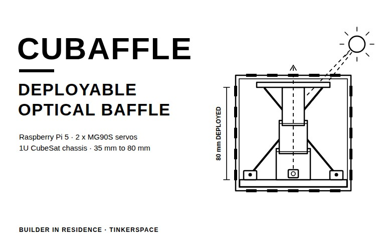
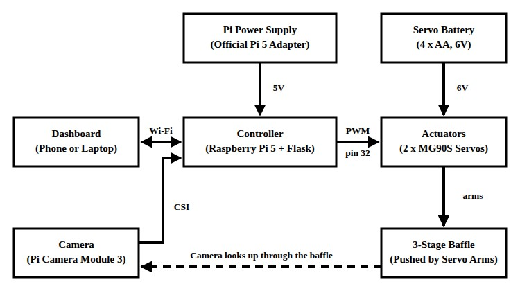
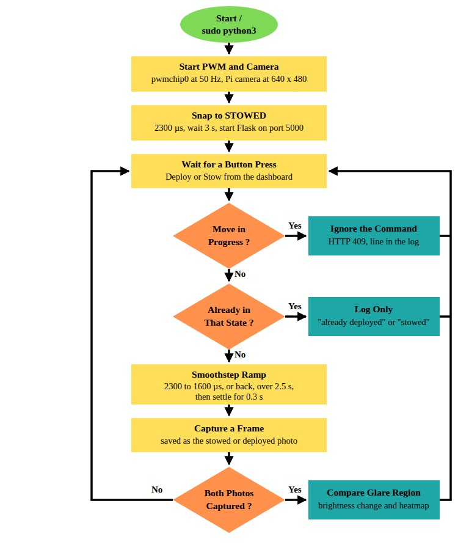
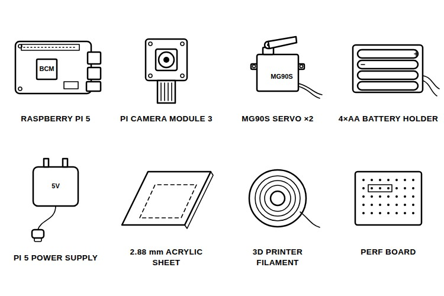
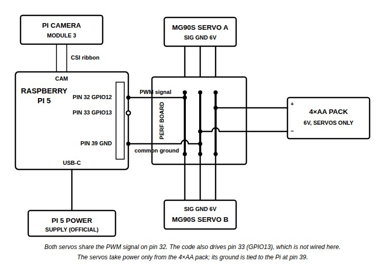
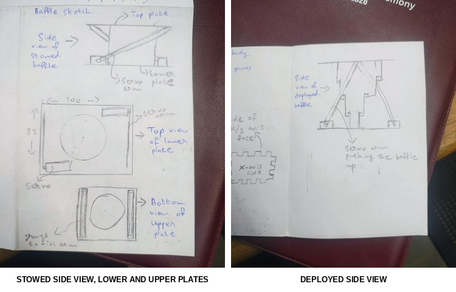
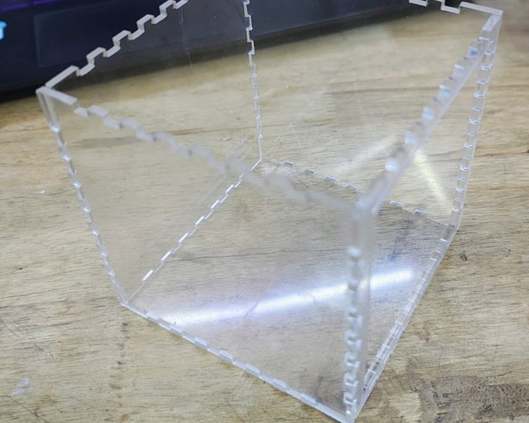
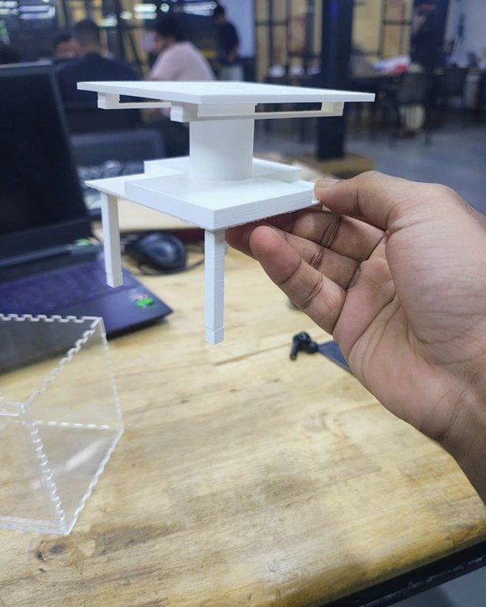
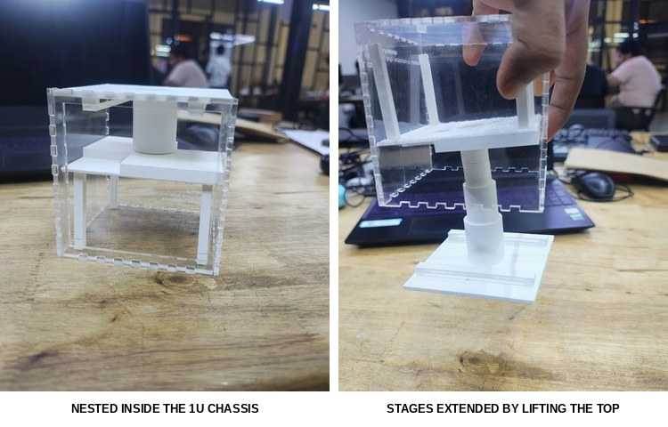
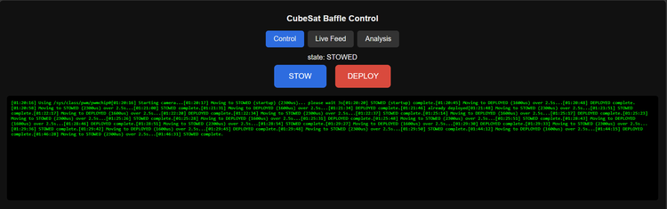

# How to Build a Deployable CubeSat Optical Baffle Using Raspberry Pi 5



Star trackers on small satellites have an awkward problem. A long baffle in front of the camera keeps stray sunlight out and makes the sensor more accurate, but a CubeSat has almost no spare room for a long tube. So, how do you fit one into a satellite that is a 10 cm cube? The usual answer is to keep the baffle packed down during launch and extend it once the satellite is in orbit.

In this project, I build CuBaffle, a ground demonstrator of a deployable optical baffle. Its three telescoping stages stow at 35 mm and extend to 80 mm, two MG90S servos push them open and pull them closed, and everything sits inside a laser-cut acrylic 1U CubeSat chassis. A Raspberry Pi 5 drives the servos, and its Flask dashboard lets any phone on the same Wi-Fi deploy the baffle and compare the camera view through it in both states. This guide covers everything needed to build it. The baffle deploys and stows smoothly but twists slightly as it rises, and the optical glare test and the CAD files are still to come. You can also check out similar [Raspberry Pi projects](https://circuitdigest.com/simple-raspberry-pi-projects-for-beginners) and [3D printing projects](https://circuitdigest.com/3d-printing-projects) done previously here at Circuit Digest.

> **Quick Answer: What is CuBaffle?**
>
> **CuBaffle** is a ground demonstrator of a **deployable optical baffle** for a **1U CubeSat**. Three 3D-printed telescoping stages stow at 35 mm and extend to 80 mm, pushed by **two MG90S servos** that a **Raspberry Pi 5** drives with hardware PWM. A Pi Camera and a Wi-Fi dashboard compare the view through the baffle in both states.

**Table of Contents**

- [What Is a Deployable Optical Baffle?](#what-is-a-deployable-optical-baffle)
- [Choosing the Deployment Mechanism](#choosing-the-deployment-mechanism)
- [How the Baffle Works](#how-does-the-deployable-cubesat-optical-baffle-work)
- [Components Required](#components-required-for-the-deployable-cubesat-optical-baffle)
- [Circuit Diagram](#circuit-diagram-of-the-deployable-cubesat-optical-baffle)
  - [Raspberry Pi 5 Pin Connections](#raspberry-pi-5-pin-connections)
- [Designing the Telescoping Baffle](#designing-the-telescoping-baffle)
- [Building the 1U Chassis](#building-the-1u-cubesat-chassis)
- [3D Printing and Assembly](#3d-printing-and-assembly-of-the-baffle)
- [Raspberry Pi Setup](#setting-up-hardware-pwm-and-the-dashboard-on-the-raspberry-pi-5)
- [Code Explanation](#code-explanation)
- [Live Demo](#live-video-demonstration)
- [Output](#output-testing-the-deployable-cubesat-baffle)
- [Troubleshooting](#troubleshooting-the-deployable-cubesat-baffle)
- [GitHub](#cubaffle-github-repository)

## What Is a Deployable Optical Baffle?

An optical baffle is a tube, usually with vanes inside, mounted in front of a camera or a telescope. Light from inside the field of view reaches the lens, while light from outside it, especially from the Sun, hits the walls and vanes and loses most of its energy before it gets close. A longer baffle rejects more stray light, and in a CubeSat every millimetre of that length comes out of the payload volume, so a deployable baffle stows short for launch and extends in orbit. CubeSats rarely use deployables for optics, as the alignment tolerances are tight. This build is a ground model of the mechanism, not flight hardware. For a look at a 1U satellite built for classrooms, do check out the [E-Cube nano-satellite kit](https://circuitdigest.com/news/e-cube-nano-satellite-kit-empowering-learners-to-build-and-operate-their-own-satellite-prototype) on Circuit Digest.

## Choosing the Deployment Mechanism

Six mechanisms were scored from 1 to 5 on ten weighted parameters, with buildability, repeatability and stowed volume weighted highest at 5, for a maximum of 185 points. The table below gives the result.

| S.No | Mechanism | Weighted Score | Normalised Score |
|---|---|---|---|
| 1. | Torsion spring + burn-wire release | 124 / 185 | 3.35 |
| 2. | Torsion spring + servo pin-puller | 152 / 185 | 4.11 |
| 3. | Torsion spring + solenoid latch | 141 / 185 | 3.81 |
| 4. | Torsion spring + servo string release | 133 / 185 | 3.59 |
| 5. | Three-stage screw side deployment | 119 / 185 | 3.22 |
| 6. | Direct servo arm | 177 / 185 | 4.78 |

The direct servo arm scored 5 on every parameter except energy use, where it got 3, and it can deploy and stow as many times as you like with no consumable parts. The design that came out of it is a dual-servo slotted lever, a Scotch yoke, with a servo on each side. A flight model would use a spring with a pin-puller or a burn wire, as both use very little power, but a burn wire has to be replaced after every test, which makes it a poor choice for a ground model.

## How Does the Deployable CubeSat Optical Baffle Work?

The working is easy. The baffle has three nested stages: the lower stage is glued to the base plate, the middle stage floats, and the upper stage is part of the top plate. Two MG90S servos sit on the base plate on opposite sides. When they turn, their arms push the top plate up and the stages slide out to 80 mm, and turning back brings them down to 35 mm. Both servos get the same PWM signal from pin 32 of the Raspberry Pi 5, so they move as one. Below is the block diagram of the deployable CubeSat optical baffle.



The servos run from a separate 4×AA pack at 6V, and the camera sits under the baffle, looking up through it. If you are new to driving servos from a Pi, here is the [Servo Motor Control with Raspberry Pi](https://circuitdigest.com/microcontroller-projects/raspberry-pi-servo-motor-control) tutorial on Circuit Digest.

Below is the flowchart of the dashboard program, baffle_phase3.py.



The program first snaps the servos to the stowed pulse of 2300 µs, since it cannot know where they are, and then waits for a button press. Each accepted press ramps the pulse to the target over 2.5 seconds and saves a camera frame for that state. Once both states have a frame, the Analysis tab is updated.

## Components Required for the Deployable CubeSat Optical Baffle

Below is the list of components required to build this project.



| S.No | Component | Description | Quantity |
|---|---|---|---|
| 1. | Raspberry Pi 5 | Controller and dashboard | 1 |
| 2. | Raspberry Pi Camera Module 3 | Looks up through the baffle | 1 |
| 3. | MG90S Micro Servo | Moves the baffle | 2 |
| 4. | 4×AA Battery Holder with Cells | Separate 6V supply for the servos | 1 |
| 5. | Official Raspberry Pi 5 Power Supply | Powers the Pi | 1 |
| 6. | Transparent Acrylic Sheet, 2.88mm | Laser-cut 1U chassis | As required |
| 7. | 3D Printer Filament (PLA or PETG) | Stages, plates and arms | As required |
| 8. | Perf Board and Jumper Wires | Wiring | 1 set |
| 9. | M2.5/M3 Screws, Super Glue, Dish Soap | Assembly and lubrication | As required |

The MG90S servos are small enough to sit in pockets in the 94 mm base plate. Use a 4×AA pack for them in place of a LiPo shared with the Pi, as servo current spikes can brown out the Pi. Print the stages in matte black if you want to run the optical test, as white plastic reflects stray light. Mine are white because that was the only spool I had. For how the pulse width sets a servo's angle, refer to our [servo motor with Arduino](https://circuitdigest.com/microcontroller-projects/interface-servo-motor-with-arduino) guide.

## Circuit Diagram of the Deployable CubeSat Optical Baffle

Below is the circuit diagram for the deployable CubeSat optical baffle.



Wire everything on a small perf board. Both servos mirror the same motion, so their signal wires join on the perf board and go to pin 32 of the Raspberry Pi 5, which is GPIO12 on hardware PWM channel 0. The servo power comes only from the 4×AA pack at 6V, and the pack's ground is tied to pin 39 of the Pi so that the PWM signal has a common reference. The scripts also enable GPIO13 (pin 33) as a second PWM channel and send it the same pulses, so the second servo can move to its own pin later without any code change. There is no power switch, so the servos power up as soon as the batteries go in. That is all about the circuit.

### Raspberry Pi 5 Pin Connections

| Device | Device Pin | Connects To |
|---|---|---|
| MG90S servos A and B | Signal | Pi pin 32 (GPIO12, PWM0) |
| MG90S servos A and B | V+ | 4×AA pack + (6V) |
| MG90S servos A and B | GND | 4×AA pack − and Pi pin 39 (GND) |
| Pi Camera Module 3 | Ribbon cable | Pi camera connector |
| Raspberry Pi 5 | USB-C | Official power supply |

## Designing the Telescoping Baffle

Placing the vanes first, from the field-of-view geometry, gets difficult for a nested baffle because of the wall thickness and the stop tabs between stages. So, I designed the mechanical structure first, around what a hobby 3D printer can do reliably, and left the vanes for later. Below are two of the design sketches.



The left sheet shows the stowed baffle and the two plates, with the servos on opposite corners and grooves for the arms, and the right sheet shows the arms pushing the baffle up. The table below gives the stage sizes for a 2mm wall and a 0.4mm sliding clearance between stages, which suits FDM printing. An 8 cm servo arm gives the 4.5 cm stroke, and the torque study found that two MG90S servos can lift the stack at that arm length.

| Stage | Inner Radius | Outer Radius |
|---|---|---|
| Innermost | 7.78mm | 9.78mm |
| Middle | 10.18mm | 12.18mm |
| Outermost | 12.58mm | 14.58mm |

The CAD was generated as parametric KCL scripts by the Zoo Design Studio AI agent from these dimensions, then checked as an assembly in Fusion. There are four parts. main.kcl is a 94 × 94 mm base plate, 8mm thick, with 35 × 35 mm recessed pockets that clamp the servos without glue. middle.kcl is the floating middle stage, topart.kcl is the top plate and upper stage with two 90mm slotted rails, and arm.kcl is an 80mm servo arm with a built-in 4mm pin. These files are listed in the README but are not in the CAD folder yet [TODO: publish the KCL, STEP and STL files], so for now, model the parts from these dimensions. If you want to add vanes later, the repository's docs folder has a plain-language guide to the deployable-baffle vane equations.

## Building the 1U CubeSat Chassis

Below is the 1U chassis, laser cut from 2.88mm transparent acrylic.



Generate a 10 × 10 × 10 cm finger-joint box with the open-source box generator from Hackerspace Bamberg, edit the SVG in Inkscape as needed and laser cut it. After allowing for the walls, the usable space inside is 94.4 × 94.4 mm, which is the hard limit for the stowed baffle and the base plate. The 8.5mm edge rails that the CubeSat Design Specification asks for are left out, as they only add work on a flat laser-cut ground model, and the clear acrylic lets you watch the mechanism. For another laser-cut acrylic build, refer to this [DIY wireless Bluetooth speaker](https://circuitdigest.com/electronic-circuits/how-to-make-amazing-wireless-bluetooth-speakers) project.

## 3D Printing and Assembly of the Baffle

Print the top plate with its upper stage, the middle stage, the base plate and the lower stage. Below are the printed parts.



**Step 1⇒ Print the Lower Stage Separately**

Print the lower stage as its own piece, apart from the base plate. My first print had them fused, and because of the overlapping lips on the tubes, there was no way to slide the middle stage over the lower one.

**Step 2⇒ Smooth the Sliding Surfaces**

Sand every sliding surface smooth. With only 0.4mm of clearance, printed layer lines catch and jam, especially when the stack twists. Then put a single drop of dish soap between the stages. Do not use Vaseline.

**Step 3⇒ Nest the Stages, Then Glue**

Slide the middle stage over the lower stage, nest the tubes, and only then super-glue the lower stage to the base plate. Below is the nested baffle in the chassis, and the stages pulled out by lifting the top.



**Step 4⇒ Fit the Servos and Arms**

Press the two MG90S servos into the base plate pockets and fit the arms. In the design, each arm's pin rides in a slotted rail on the top plate, but my 80mm arms jammed halfway up the rails and stalled both servos, even when shortened to 7.5 cm. So, the arms now push directly on the flat underside of the top plate. This deploys and stows smoothly, but with nothing guiding it, the baffle twists a little as it rises. If you want the rail version, redesign the rails before you print the top plate.

**Step 5⇒ Wire and Close Up**

Wire the servos and the camera as per the circuit diagram, and fit everything except the battery pack and the Pi's adapter inside the chassis. In addition to this build, here is a collection of [robotics projects](https://circuitdigest.com/robotics-projects) for reference.

## Setting Up Hardware PWM and the Dashboard on the Raspberry Pi 5

The steps below get the baffle running on the Raspberry Pi 5.

**Step 1⇒ Enable Hardware PWM**

Add the line below to /boot/firmware/config.txt and reboot. It puts GPIO12 and GPIO13 on the hardware PWM channels. With software PWM, the servos jitter whenever the CPU is busy.

```
dtoverlay=pwm-2chan,pin=12,func=4,pin2=13,func2=4
```

**Step 2⇒ Install the Packages**

The dashboard needs Flask, OpenCV and Picamera2, all available from apt.

```
sudo apt update
sudo apt install python3-flask python3-opencv python3-picamera2
```

**Step 3⇒ Find the Pulse Widths**

Copy the three scripts from the code folder to the Pi. Run `sudo python3 servo_hwpwm_tuner.py`, move each servo with the arrow keys in 50 µs or 5 µs steps, and note the pulse widths it prints when you quit. I got about 2300 µs for stowed and 1600 µs for deployed. Put your own values into `STOWED_US` and `DEPLOYED_US` in baffle_phase3.py.

**Step 4⇒ Run the Dashboard**

Run `sudo python3 baffle_phase3.py` and open `http://<pi-ip>:5000` from a phone or laptop on the same Wi-Fi. The scripts need sudo, as they write to /sys/class/pwm.

## Code Explanation

The code is written in Python for the Raspberry Pi 5. baffle_control.py is a simple command-line state machine that toggles between stowed and deployed, and baffle_phase3.py is the three-tab Flask dashboard. Below is the code explanation of the dashboard version.

**Pulse Widths and Motion Settings**

```python
STOWED_US = 2300
DEPLOYED_US = 1600

# ---- Smooth motion settings ----
MOVE_TIME_S = 2.5    # how long a deploy/stow takes (bigger = slower/smoother)
STEP_S = 0.02         # update interval; matches the 20ms PWM period (50Hz)
SETTLE_S = 0.3        # extra wait after the ramp so the servos finish arriving
STARTUP_WAIT_S = 3    # wait after the startup snap (position is unknown then)
```

These are the values from the tuning step. Stowed is the larger pulse, so the servos turn backwards to deploy, and `STEP_S` updates the pulse every 20 ms, one PWM period at 50 Hz. Further down, the `HWPWM` class writes each pulse in nanoseconds to the duty_cycle file under /sys/class/pwm, which needs root. `GLARE_ROI`, the region of the 640 × 480 frame used for the glare comparison, is still the placeholder (200, 150, 440, 330), so set it to the bright area in your own camera view.

**Smoothstep Motion**

```python
def ease(t):
    """Smoothstep: 0 -> 1 with zero velocity at both ends (S-curve)."""
    return t * t * (3 - 2 * t)


def move_smooth(target_us, duration_s):
    """Ramp every servo from its current pulse to target_us with easing."""
    starts = [sv.current_us for sv in servos]
    if any(s is None for s in starts):
        # Position unknown (nothing commanded yet) -> can't ramp, just snap.
        for sv in servos:
            sv.set_pulse(target_us)
        return

    t0 = time.monotonic()
    while True:
        frac = min((time.monotonic() - t0) / duration_s, 1.0)
        e = ease(frac)
        for sv, start in zip(servos, starts):
            sv.set_pulse(start + (target_us - start) * e)
        if frac >= 1.0:
            break
        time.sleep(STEP_S)
```

This is the heart of the motion. `ease()` is the smoothstep curve, 3t² − 2t³, which starts and ends at zero speed. `move_smooth()` works out how far into the 2.5 seconds it is, eases that fraction, and sets each servo to the matching point between its start and target pulse every 20 ms. The servos speed up gently, cruise and slow down at the end, which is easier on the printed parts than a sudden snap.

**Camera Thread and the 15-Second Buffer**

```python
def camera_loop():
    global latest_frame_jpeg
    interval = 1.0 / STREAM_FPS
    while True:
        try:
            frame_rgb = picam2.capture_array()
            frame_bgr = cv2.cvtColor(frame_rgb, cv2.COLOR_RGB2BGR)
            frame_bgr = cv2.resize(frame_bgr, (FRAME_W, FRAME_H))
            ok, jpeg = cv2.imencode(".jpg", frame_bgr, [cv2.IMWRITE_JPEG_QUALITY, 80])
            if ok:
                jpeg_bytes = jpeg.tobytes()
                with frame_lock:
                    latest_frame_jpeg = jpeg_bytes
                    ring_buffer.append(jpeg_bytes)
        except Exception as e:
            log(f"camera loop error: {e}")
        time.sleep(interval)
```

A background thread grabs frames from the Pi Camera, converts them to OpenCV's BGR order and encodes each one as a JPEG. The latest JPEG feeds the MJPEG stream in the Live Feed tab, and every frame also goes into a deque that holds 24 × 15 = 360 frames, which /download_clip writes into an MP4 when you press **Download last 15s**. For the Pi Camera basics, check out our tutorial on [interfacing the Pi Camera module](https://circuitdigest.com/microcontroller-projects/interfacing-pi-camera-module-with-raspberry-pi-zero-w).

**Glare Comparison**

```python
    stow_roi_gray = cv2.cvtColor(stow_img[y1:y2, x1:x2], cv2.COLOR_BGR2GRAY)
    dep_roi_gray = cv2.cvtColor(dep_img[y1:y2, x1:x2], cv2.COLOR_BGR2GRAY)
    stow_mean = float(stow_roi_gray.mean())
    dep_mean = float(dep_roi_gray.mean())
    pct_change = ((stow_mean - dep_mean) / stow_mean * 100) if stow_mean > 0.01 else 0.0

    diff = cv2.absdiff(stow_img, dep_img)
    diff_gray = cv2.cvtColor(diff, cv2.COLOR_BGR2GRAY)
    diff_heat = cv2.applyColorMap(diff_gray, cv2.COLORMAP_JET)
```

`update_comparison()` cuts the glare region out of the stowed and deployed frames, converts it to greyscale and compares the mean brightness. `pct_change` is how much darker the deployed frame is, in percent, so a positive value means the baffle blocked stray light. The function also writes a one-line verdict and a JET colour heatmap of the difference between the frames. When the program exits, `cleanup()` stows the baffle, the same habit as the command-line script.

## Live Video Demonstration

Below is the video demonstration of the deployable CubeSat optical baffle.

*Video not published yet.*

[TODO: video of the baffle deploying and stowing from the dashboard, with the Live Feed and Analysis tabs open]

## Output: Testing the Deployable CubeSat Baffle

To test the build, deploy and stow the baffle a few times from the Control tab and watch the log. Below is the Control tab of the dashboard after one of my test sessions.



The log under the buttons covers the whole session. It starts at 01:20:16 with "Using /sys/class/pwm/pwmchip0" and the startup snap to 2300 µs. Between 01:20 and 01:46, there are nine deploy and stow cycles, each logged as complete two to three seconds after the command, and one "already deployed" from a repeated press. The Analysis tab result is [TODO: stowed and deployed glare values and the verdict line from an Analysis tab run]. That optical measurement still needs a matte black print and a real glare region. If you like camera projects on the Pi, check out our [visitor monitoring system with the Pi Camera](https://circuitdigest.com/microcontroller-projects/visitor-monitoring-with-raspberry-pi-and-pi-camera) as well.

## Troubleshooting the Deployable CubeSat Baffle

| Symptom | Likely Cause | Fix |
|---|---|---|
| The middle stage will not slide over the lower stage | Lower stage printed fused to the base plate | Print the lower stage separately, nest the tubes, then glue it to the base plate |
| Stages bind or stop mid-travel | Layer lines catching in the 0.4mm clearance | Sand the sliding surfaces and add a single drop of dish soap; do not use Vaseline |
| Arms jam halfway up the rails and stall the servos | Slotted rail design | Push on the flat underside of the top plate, or redesign the rails and reprint the top plate |
| Servos jitter | Software PWM in use | Add the pwm-2chan overlay to /boot/firmware/config.txt and reboot |
| Pi resets when the servos move | Servos drawing power from the Pi | Run them from the separate 6V pack, with the ground shared on pin 39 |
| Baffle sits at an angle when deployed | Nothing guides the top plate without the rails | Known limitation of the workaround; the rail redesign fixes it |

## Conclusion

CuBaffle deploys and stows a three-stage optical baffle inside a 1U chassis, nine times in a row in one test session, and the dashboard shows the camera view in both states. There is still room for improvement, such as redesigned rails to remove the twist, a matte black print for the optical test, vanes inside the stages and a power switch on the servo pack. A flight-style version would move to a torsion spring with a pin-puller or a burn-wire release and add the CubeSat rails. Further, one can stream the camera to a phone in the same way as this [web controlled Raspberry Pi surveillance robot](https://circuitdigest.com/microcontroller-projects/web-controlled-raspberry-pi-surveillance-robot) on Circuit Digest.

## CuBaffle GitHub Repository

The CuBaffle repository has the three Python scripts (the hardware PWM tuner, the command-line controller and the dashboard), the build logs, the mechanism trade study and the research notes. CuBaffle was built by Vaishnav D Prabhath at Tinkerspace as part of the Builder in Residence programme.

[Code & Schematics (GitHub)](https://github.com/BuilderinResidencyTinkerspace/CuBaffle) · [Download Zip](https://github.com/BuilderinResidencyTinkerspace/CuBaffle/archive/refs/heads/main.zip)

## Frequently Asked Questions About the Deployable CubeSat Optical Baffle

**⇥ 1. Can two MG90S servos lift a three-stage baffle?**

Yes. The torque study showed that two MG90S servos can lift the stack with an 8 cm arm, and in the final build they deploy and stow it smoothly. The only stall came when the arms jammed in the slotted rails.

**⇥ 2. Why does the baffle twist when it deploys?**

The arms push directly on the flat underside of the top plate, with no rails to guide it. A top plate with redesigned rails holds it straight.

**⇥ 3. Why use a separate battery pack for the servos?**

Servo current spikes, especially at stall, can brown out or damage the Raspberry Pi 5. So, the servos get their own 6V from the 4×AA pack, and only the ground is shared.

## Raspberry Pi and Servo Projects

Explore more Raspberry Pi and servo builds, with circuit diagrams and code.

- **[Servo Motor Control with Raspberry Pi](https://circuitdigest.com/microcontroller-projects/raspberry-pi-servo-motor-control)**: *Raspberry Pi is an ARM architecture processor based board designed for electronic engineers and hobbyists, and this tutorial drives a servo from its PWM output.*
- **[DIY Web Controlled Raspberry Pi Surveillance Robotic Car](https://circuitdigest.com/microcontroller-projects/web-controlled-raspberry-pi-surveillance-robot)**: *In this DIY session we are building a web controlled surveillance robotic car using raspberry pi and a webcam.*
- **[Build an Arduino Dual Axis Solar Tracker System](https://circuitdigest.com/microcontroller-projects/dual-axis-solar-tracker-system-using-arduino)**: *Two micro servos and 3D-printed parts turn a solar panel on two axes to follow the light.*

## Complete Project Code

The complete code is in the code folder of the repository, in three files.

**code/baffle_phase3.py**

```python
#!/usr/bin/env python3
"""
CubeSat Baffle Controller — Phase 3 (3-tab GUI) + Smooth Motion
------------------------------------------------------------------
Tab 1: Control        — Stow / Deploy buttons + live log
Tab 2: Live Feed       — Pi Cam 3 MJPEG stream, auto-opens on deploy/stow,
                         "download last 15s" button (640x480 @24fps clip)
Tab 3: Analysis        — last-stowed vs last-deployed comparison: mean
                         brightness in a hardcoded glare ROI, diff heatmap,
                         one-line plain-English takeaway. Shows "no data
                         yet" until both states have been captured once.

Deploy/stow no longer snap instantly — the pulse width is ramped from the
current position to the target over MOVE_TIME_S using an eased
(smoothstep) curve, so the servos accelerate gently, cruise, and
decelerate gently. The comparison photo is captured right after the move
finishes settling, same as before.

PREREQUISITES:
    - pwm-2chan overlay already set up
    - Pi Cam 3 connected and enabled

INSTALL:
    sudo apt install python3-flask python3-opencv python3-picamera2

RUN:
    sudo python3 baffle_phase3.py

Then from a browser on the same WiFi:
    http://<pi-ip>:5000
"""

import atexit
import base64
import glob
import os
import sys
import threading
import time
from collections import deque
from datetime import datetime

import cv2
import numpy as np
from flask import Flask, Response, jsonify, render_template_string, request, send_file
from picamera2 import Picamera2

# ============================================================
# HARDCODED PWM VALUES — from your tuning session
# ============================================================
STOWED_US = 2300
DEPLOYED_US = 1600

# ---- Smooth motion settings ----
MOVE_TIME_S = 2.5    # how long a deploy/stow takes (bigger = slower/smoother)
STEP_S = 0.02         # update interval; matches the 20ms PWM period (50Hz)
SETTLE_S = 0.3        # extra wait after the ramp so the servos finish arriving
STARTUP_WAIT_S = 3    # wait after the startup snap (position is unknown then)
# ============================================================

FRAME_W, FRAME_H = 640, 480
STREAM_FPS = 24
CLIP_SECONDS = 15
RING_BUFFER_LEN = STREAM_FPS * CLIP_SECONDS

# Glare ROI in pixel coordinates (x1, y1, x2, y2) within a 640x480 frame.
# <<< REPLACE after you find where the stray light actually lands >>>
GLARE_ROI = (200, 150, 440, 330)

PERIOD_NS = 20_000_000
SYSFS_PWM_ROOT = "/sys/class/pwm"


def ease(t):
    """Smoothstep: 0 -> 1 with zero velocity at both ends (S-curve)."""
    return t * t * (3 - 2 * t)


# ---------------------------------------------------------------------
# Hardware PWM plumbing
# ---------------------------------------------------------------------
def find_pwmchip():
    candidates = sorted(glob.glob(f"{SYSFS_PWM_ROOT}/pwmchip*"))
    if not candidates:
        sys.exit("No pwmchip found. Check the pwm-2chan overlay and reboot.")
    for chip in candidates:
        try:
            with open(f"{chip}/npwm") as f:
                if int(f.read().strip()) >= 2:
                    return chip
        except (FileNotFoundError, ValueError):
            continue
    return candidates[0]


def write_sysfs(path, value):
    with open(path, "w") as f:
        f.write(str(value))


class HWPWM:
    def __init__(self, chip_path, channel, label):
        self.chip_path = chip_path
        self.channel = channel
        self.chan_path = f"{chip_path}/pwm{channel}"
        self.label = label
        self.current_us = None  # last commanded pulse; None = unknown yet
        self._export()
        write_sysfs(f"{self.chan_path}/period", PERIOD_NS)
        write_sysfs(f"{self.chan_path}/enable", 1)

    def _export(self):
        if not os.path.isdir(self.chan_path):
            write_sysfs(f"{self.chip_path}/export", self.channel)
            for _ in range(20):
                if os.path.isdir(self.chan_path):
                    break
                time.sleep(0.05)
            else:
                sys.exit(f"pwm{self.channel} did not appear after export.")

    def set_pulse(self, us):
        write_sysfs(f"{self.chan_path}/duty_cycle", int(us * 1000))
        self.current_us = us

    def close(self):
        try:
            write_sysfs(f"{self.chan_path}/enable", 0)
            write_sysfs(f"{self.chip_path}/unexport", self.channel)
        except OSError:
            pass


# ---------------------------------------------------------------------
# Shared state
# ---------------------------------------------------------------------
state_lock = threading.Lock()
state = "DEPLOYED"  # placeholder; forced STOWED at startup
busy = False
log_lines = []

frame_lock = threading.Lock()
latest_frame_jpeg = None
ring_buffer = deque(maxlen=RING_BUFFER_LEN)

comparison_lock = threading.Lock()
last_stowed_jpeg = None
last_deployed_jpeg = None
comparison_data = {"available": False}

servos = []
picam2 = None


def log(msg):
    ts = datetime.now().strftime("%H:%M:%S")
    log_lines.append(f"[{ts}] {msg}")
    print(f"[{ts}] {msg}")


# ---------------------------------------------------------------------
# Smooth motion
# ---------------------------------------------------------------------
def move_smooth(target_us, duration_s):
    """Ramp every servo from its current pulse to target_us with easing."""
    starts = [sv.current_us for sv in servos]
    if any(s is None for s in starts):
        # Position unknown (nothing commanded yet) -> can't ramp, just snap.
        for sv in servos:
            sv.set_pulse(target_us)
        return

    t0 = time.monotonic()
    while True:
        frac = min((time.monotonic() - t0) / duration_s, 1.0)
        e = ease(frac)
        for sv, start in zip(servos, starts):
            sv.set_pulse(start + (target_us - start) * e)
        if frac >= 1.0:
            break
        time.sleep(STEP_S)


# ---------------------------------------------------------------------
# Camera background thread
# ---------------------------------------------------------------------
def camera_loop():
    global latest_frame_jpeg
    interval = 1.0 / STREAM_FPS
    while True:
        try:
            frame_rgb = picam2.capture_array()
            frame_bgr = cv2.cvtColor(frame_rgb, cv2.COLOR_RGB2BGR)
            frame_bgr = cv2.resize(frame_bgr, (FRAME_W, FRAME_H))
            ok, jpeg = cv2.imencode(".jpg", frame_bgr, [cv2.IMWRITE_JPEG_QUALITY, 80])
            if ok:
                jpeg_bytes = jpeg.tobytes()
                with frame_lock:
                    latest_frame_jpeg = jpeg_bytes
                    ring_buffer.append(jpeg_bytes)
        except Exception as e:
            log(f"camera loop error: {e}")
        time.sleep(interval)


# ---------------------------------------------------------------------
# Comparison analysis (Tab 3)
# ---------------------------------------------------------------------
def decode_jpeg(jpeg_bytes):
    arr = np.frombuffer(jpeg_bytes, dtype=np.uint8)
    return cv2.imdecode(arr, cv2.IMREAD_COLOR)


def update_comparison():
    global comparison_data
    with comparison_lock:
        stow_bytes, dep_bytes = last_stowed_jpeg, last_deployed_jpeg

    if stow_bytes is None or dep_bytes is None:
        comparison_data = {"available": False}
        return

    stow_img = decode_jpeg(stow_bytes)
    dep_img = decode_jpeg(dep_bytes)
    x1, y1, x2, y2 = GLARE_ROI

    stow_roi_gray = cv2.cvtColor(stow_img[y1:y2, x1:x2], cv2.COLOR_BGR2GRAY)
    dep_roi_gray = cv2.cvtColor(dep_img[y1:y2, x1:x2], cv2.COLOR_BGR2GRAY)
    stow_mean = float(stow_roi_gray.mean())
    dep_mean = float(dep_roi_gray.mean())
    pct_change = ((stow_mean - dep_mean) / stow_mean * 100) if stow_mean > 0.01 else 0.0

    diff = cv2.absdiff(stow_img, dep_img)
    diff_gray = cv2.cvtColor(diff, cv2.COLOR_BGR2GRAY)
    diff_heat = cv2.applyColorMap(diff_gray, cv2.COLORMAP_JET)
    _, diff_jpeg = cv2.imencode(".jpg", diff_heat)

    direction = "dropped" if pct_change > 0 else "increased"
    sentence = (
        f"Stray light in the glare region {direction} by {abs(pct_change):.0f}% "
        f"when deployed compared to stowed."
    )

    comparison_data = {
        "available": True,
        "stow_mean": round(stow_mean, 1),
        "dep_mean": round(dep_mean, 1),
        "pct_change": round(pct_change, 1),
        "sentence": sentence,
        "stow_jpeg_b64": base64.b64encode(stow_bytes).decode(),
        "dep_jpeg_b64": base64.b64encode(dep_bytes).decode(),
        "diff_jpeg_b64": base64.b64encode(diff_jpeg.tobytes()).decode(),
        "roi": list(GLARE_ROI),
    }


def capture_state_photo(new_state):
    global last_stowed_jpeg, last_deployed_jpeg
    with frame_lock:
        frame_bytes = latest_frame_jpeg
    if frame_bytes is None:
        log("No camera frame available yet — skipping comparison capture.")
        return
    with comparison_lock:
        if new_state == "STOWED":
            last_stowed_jpeg = frame_bytes
        else:
            last_deployed_jpeg = frame_bytes
    update_comparison()


# ---------------------------------------------------------------------
# Servo move logic
# ---------------------------------------------------------------------
def drive_all(pulse_us, label, new_state, smooth=True):
    global busy, state
    busy = True
    try:
        if smooth:
            log(f"Moving to {label} ({pulse_us}us) over {MOVE_TIME_S}s...")
            move_smooth(pulse_us, MOVE_TIME_S)
            time.sleep(SETTLE_S)
        else:
            log(f"Moving to {label} ({pulse_us}us)... please wait {STARTUP_WAIT_S}s")
            for sv in servos:
                sv.set_pulse(pulse_us)
            time.sleep(STARTUP_WAIT_S)
        log(f"{label} complete.")
        with state_lock:
            state = new_state
        capture_state_photo(new_state)
    finally:
        busy = False


# ---------------------------------------------------------------------
# Flask app
# ---------------------------------------------------------------------
app = Flask(__name__)

PAGE = """
<!doctype html>
<html>
<head>
<meta name="viewport" content="width=device-width, initial-scale=1">
<title>Baffle Control</title>
<style>
  body { font-family: sans-serif; background: #111; color: #eee; text-align: center; padding: 10px; }
  h1 { font-size: 1.2em; }
  .tabs { display: flex; justify-content: center; margin-bottom: 10px; }
  .tab-btn {
    padding: 10px 18px; margin: 4px; border: none; border-radius: 6px;
    background: #333; color: #eee; cursor: pointer; font-size: 1em;
  }
  .tab-btn.active { background: #2d6cdf; }
  .tab-content { display: none; }
  .tab-content.active { display: block; }
  button.action {
    font-size: 1.1em; padding: 16px 28px; margin: 8px; border: none;
    border-radius: 8px; cursor: pointer; min-width: 120px;
  }
  #stow-btn { background: #2d6cdf; color: white; }
  #deploy-btn { background: #d94a3d; color: white; }
  button:disabled { opacity: 0.4; cursor: not-allowed; }
  #log {
    background: black; color: #0f0; text-align: left; padding: 10px;
    height: 220px; overflow-y: auto; border-radius: 6px; font-family: monospace;
    font-size: 0.8em; white-space: pre-wrap; margin-top: 10px;
  }
  img.feed { max-width: 100%; border-radius: 6px; }
  .cmp-imgs { display: flex; flex-wrap: wrap; justify-content: center; gap: 10px; margin-top: 10px; }
  .cmp-imgs div { text-align: center; }
  .cmp-imgs img { width: 260px; border-radius: 6px; }
  #sentence { font-size: 1.15em; margin: 14px 0; padding: 10px; background: #222; border-radius: 6px; }
  #download-btn { padding: 10px 16px; margin-top: 10px; border-radius: 6px; border: none; background: #2d6cdf; color: white; cursor: pointer; }
</style>
</head>
<body>
  <h1>CubeSat Baffle Control</h1>
  <div class="tabs">
    <button class="tab-btn active" onclick="showTab(1)">Control</button>
    <button class="tab-btn" onclick="showTab(2)">Live Feed</button>
    <button class="tab-btn" onclick="showTab(3)">Analysis</button>
  </div>

  <div id="tab1" class="tab-content active">
    <div id="state">state: ...</div>
    <div>
      <button class="action" id="stow-btn" onclick="sendCmd('stow')">STOW</button>
      <button class="action" id="deploy-btn" onclick="sendCmd('deploy')">DEPLOY</button>
    </div>
    <div id="log"></div>
  </div>

  <div id="tab2" class="tab-content">
    
    <div><button id="download-btn" onclick="downloadClip()">Download last 15s</button></div>
  </div>

  <div id="tab3" class="tab-content">
    <div id="cmp-placeholder">No data yet — deploy and stow at least once.</div>
    <div id="cmp-body" style="display:none;">
      <div id="sentence"></div>
      <div class="cmp-imgs">
        <div><div>Stowed</div></div>
        <div><div>Deployed</div></div>
        <div><div>Difference</div></div>
      </div>
    </div>
  </div>

<script>
let lastCount = 0;

function showTab(n) {
  for (let i = 1; i <= 3; i++) {
    document.getElementById('tab' + i).classList.toggle('active', i === n);
  }
  const btns = document.querySelectorAll('.tab-btn');
  btns.forEach((b, i) => b.classList.toggle('active', i === n - 1));
}

async function sendCmd(cmd) {
  showTab(2);  // auto-switch to live feed on any move
  document.getElementById('stow-btn').disabled = true;
  document.getElementById('deploy-btn').disabled = true;
  await fetch('/' + cmd, { method: 'POST' });
}

function downloadClip() {
  window.location = '/download_clip';
}

async function pollStatus() {
  const res = await fetch('/status?since=' + lastCount);
  const data = await res.json();
  document.getElementById('state').innerText = 'state: ' + data.state +
      (data.busy ? '  (moving...)' : '');
  const logDiv = document.getElementById('log');
  for (const line of data.new_logs) {
    logDiv.innerText += line + '\\n';
  }
  logDiv.scrollTop = logDiv.scrollHeight;
  lastCount = data.count;
  document.getElementById('stow-btn').disabled = data.busy;
  document.getElementById('deploy-btn').disabled = data.busy;
}

async function pollComparison() {
  const res = await fetch('/comparison_data');
  const data = await res.json();
  if (!data.available) {
    document.getElementById('cmp-placeholder').style.display = 'block';
    document.getElementById('cmp-body').style.display = 'none';
    return;
  }
  document.getElementById('cmp-placeholder').style.display = 'none';
  document.getElementById('cmp-body').style.display = 'block';
  document.getElementById('sentence').innerText = data.sentence +
      '  (stowed=' + data.stow_mean + ', deployed=' + data.dep_mean + ')';
  document.getElementById('stow-img').src = 'data:image/jpeg;base64,' + data.stow_jpeg_b64;
  document.getElementById('dep-img').src = 'data:image/jpeg;base64,' + data.dep_jpeg_b64;
  document.getElementById('diff-img').src = 'data:image/jpeg;base64,' + data.diff_jpeg_b64;
}

setInterval(pollStatus, 600);
setInterval(pollComparison, 2000);
pollStatus();
pollComparison();
</script>
</body>
</html>
"""


@app.route("/")
def index():
    return render_template_string(PAGE)


@app.route("/status")
def status():
    since = int(request.args.get("since", 0))
    with state_lock:
        new_logs = log_lines[since:]
        return jsonify(state=state, busy=busy, new_logs=new_logs, count=len(log_lines))


@app.route("/deploy", methods=["POST"])
def deploy():
    with state_lock:
        if busy:
            log("Command ignored — a move is already in progress.")
            return jsonify(ok=False), 409
        if state == "DEPLOYED":
            log("already deployed")
            return jsonify(ok=True)
    drive_all(DEPLOYED_US, "DEPLOYED", "DEPLOYED")
    return jsonify(ok=True)


@app.route("/stow", methods=["POST"])
def stow():
    with state_lock:
        if busy:
            log("Command ignored — a move is already in progress.")
            return jsonify(ok=False), 409
        if state == "STOWED":
            log("already stowed")
            return jsonify(ok=True)
    drive_all(STOWED_US, "STOWED", "STOWED")
    return jsonify(ok=True)


def gen_mjpeg():
    interval = 1.0 / STREAM_FPS
    while True:
        with frame_lock:
            frame = latest_frame_jpeg
        if frame is not None:
            yield (b"--frame\r\nContent-Type: image/jpeg\r\n\r\n" + frame + b"\r\n")
        time.sleep(interval)


@app.route("/video_feed")
def video_feed():
    return Response(gen_mjpeg(), mimetype="multipart/x-mixed-replace; boundary=frame")


@app.route("/download_clip")
def download_clip():
    with frame_lock:
        frames_copy = list(ring_buffer)
    if not frames_copy:
        return "No frames captured yet", 404

    tmp_path = f"/tmp/baffle_clip_{int(time.time())}.mp4"
    fourcc = cv2.VideoWriter_fourcc(*"mp4v")
    writer = cv2.VideoWriter(tmp_path, fourcc, STREAM_FPS, (FRAME_W, FRAME_H))
    for jpeg_bytes in frames_copy:
        img = decode_jpeg(jpeg_bytes)
        if img is not None:
            writer.write(img)
    writer.release()

    return send_file(tmp_path, as_attachment=True, download_name="last_15s.mp4")


@app.route("/comparison_data")
def comparison_data_endpoint():
    return jsonify(comparison_data)


def cleanup():
    log("Shutting down: driving to STOWED before exit...")
    with state_lock:
        cur_state = state
    if cur_state != "STOWED":
        drive_all(STOWED_US, "STOWED (shutdown)", "STOWED")
    else:
        log("Already stowed — no move needed before shutdown.")
    for sv in servos:
        sv.close()
    if picam2 is not None:
        picam2.stop()
    log("Shut down cleanly.")


def main():
    global servos, state, picam2

    if os.geteuid() != 0:
        sys.exit("This needs root to write to /sys/class/pwm. Run with: sudo python3 baffle_phase3.py")

    chip = find_pwmchip()
    log(f"Using {chip}")
    servos = [HWPWM(chip, 0, "servo A"), HWPWM(chip, 1, "servo B")]

    log("Starting camera...")
    picam2 = Picamera2()
    config = picam2.create_video_configuration(main={"size": (FRAME_W, FRAME_H), "format": "RGB888"})
    picam2.configure(config)
    picam2.start()
    time.sleep(1)  # let auto-exposure settle
    threading.Thread(target=camera_loop, daemon=True).start()

    # Startup: actively drive to STOWED, don't just assume it.
    # Position is unknown at this point, so this one move is a direct snap.
    drive_all(STOWED_US, "STOWED (startup)", "STOWED", smooth=False)

    atexit.register(cleanup)

    try:
        app.run(host="0.0.0.0", port=5000, threaded=True)
    except KeyboardInterrupt:
        pass


if __name__ == "__main__":
    main()
```

**code/servo_hwpwm_tuner.py**

```python
#!/usr/bin/env python3
"""
MG90S Manual PWM Tuner — Raspberry Pi 5, TRUE HARDWARE PWM
------------------------------------------------------------
Same idea as the earlier tuner, but drives the servos through the RP1's
dedicated PWM hardware blocks via the Linux sysfs pwm interface, instead
of gpiozero's software-timed PWM. This removes the CPU-load jitter you
saw with the lgpio-backed version.

PREREQUISITE — you must have already added this to /boot/firmware/config.txt
and rebooted:
    dtoverlay=pwm-2chan,pin=12,func=4,pin2=13,func2=4

That puts GPIO12 on hardware PWM channel 0, and GPIO13 on channel 1,
both under the same pwmchip (usually pwmchip0 or pwmchip2 depending on
firmware version — the script auto-detects it).

WIRING:
    Servo 1 signal -> GPIO12 (physical pin 32)  -> pwm channel 0
    Servo 2 signal -> GPIO13 (physical pin 33)  -> pwm channel 1
    Servo V+       -> external 5-6V supply, NOT the Pi's 5V rail
    Servo GND      -> common ground with the Pi AND the external supply

PERMISSIONS: writing to /sys/class/pwm requires root (or a udev rule).
Simplest for now:
    sudo python3 servo_hwpwm_tuner.py

RUN (live jog UI, default):
    sudo python3 servo_hwpwm_tuner.py

RUN (plain text input):
    sudo python3 servo_hwpwm_tuner.py --manual

Live-jog controls:
    1 / 2       select servo 1 or 2
    Up / Down   +/- coarse step (default 50us)
    Left/Right  +/- fine step (default 5us)
    [ / ]       decrease / increase the coarse step size
    c           center both (1500us)
    d           disable PWM on selected servo (no holding torque)
    r           re-enable PWM on selected servo
    s           print current values on screen as a snippet
    q           quit (prints final values, cleans up sysfs exports)
"""

import argparse
import curses
import glob
import os
import sys
import time

PERIOD_NS = 20_000_000  # 20ms = 50Hz, fixed for standard hobby servos
SYSFS_PWM_ROOT = "/sys/class/pwm"


def find_pwmchip():
    """Find the pwmchip exposing at least 2 channels (from pwm-2chan overlay)."""
    candidates = sorted(glob.glob(f"{SYSFS_PWM_ROOT}/pwmchip*"))
    if not candidates:
        sys.exit(
            "No pwmchip found under /sys/class/pwm.\n"
            "Did you add 'dtoverlay=pwm-2chan,pin=12,func=4,pin2=13,func2=4'\n"
            "to /boot/firmware/config.txt and reboot?"
        )
    for chip in candidates:
        try:
            with open(f"{chip}/npwm") as f:
                npwm = int(f.read().strip())
            if npwm >= 2:
                return chip
        except (FileNotFoundError, ValueError):
            continue
    # fall back to the first chip found even if npwm looked odd
    return candidates[0]


def write_sysfs(path, value):
    with open(path, "w") as f:
        f.write(str(value))


def read_sysfs(path):
    with open(path) as f:
        return f.read().strip()


class HWPWM:
    """Thin wrapper around one /sys/class/pwm/<chip>/pwm<N> channel."""

    def __init__(self, chip_path, channel, label, min_us, max_us, start_us):
        self.chip_path = chip_path
        self.channel = channel
        self.chan_path = f"{chip_path}/pwm{channel}"
        self.label = label
        self.min_us = min_us
        self.max_us = max_us
        self.pulse_us = start_us
        self.enabled = True

        self._export()
        write_sysfs(f"{self.chan_path}/period", PERIOD_NS)
        self.apply()
        write_sysfs(f"{self.chan_path}/enable", 1)

    def _export(self):
        if not os.path.isdir(self.chan_path):
            try:
                write_sysfs(f"{self.chip_path}/export", self.channel)
            except OSError as e:
                sys.exit(f"Failed exporting pwm channel {self.channel}: {e}")
            for _ in range(20):
                if os.path.isdir(self.chan_path):
                    break
                time.sleep(0.05)
            else:
                sys.exit(f"pwm{self.channel} did not appear after export.")

    def clamp(self, us):
        return max(self.min_us, min(self.max_us, us))

    def set_pulse(self, us):
        self.pulse_us = self.clamp(us)
        if self.enabled:
            self.apply()

    def apply(self):
        duty_ns = int(self.pulse_us * 1000)
        write_sysfs(f"{self.chan_path}/duty_cycle", duty_ns)

    def disable(self):
        self.enabled = False
        write_sysfs(f"{self.chan_path}/enable", 0)

    def enable(self):
        self.enabled = True
        write_sysfs(f"{self.chan_path}/enable", 1)
        self.apply()

    def close(self):
        try:
            write_sysfs(f"{self.chan_path}/enable", 0)
            write_sysfs(f"{self.chip_path}/unexport", self.channel)
        except OSError:
            pass


def run_curses(servos, coarse_step, fine_step):
    def main(stdscr):
        curses.curs_set(0)
        selected = 0
        step = coarse_step
        message = ""

        def draw():
            stdscr.clear()
            stdscr.addstr(0, 0, "MG90S Manual PWM Tuner (hardware PWM)  (q to quit)")
            stdscr.addstr(1, 0, "-" * 60)
            for i, sv in enumerate(servos):
                marker = ">" if i == selected else " "
                state = "ON " if sv.enabled else "OFF"
                stdscr.addstr(
                    3 + i, 0,
                    f"{marker} Servo {i+1} [{sv.label}] pwm{sv.channel}: "
                    f"{sv.pulse_us:7.1f} us  ({state})  "
                    f"range [{sv.min_us:.0f}-{sv.max_us:.0f}]"
                )
            row = 3 + len(servos)
            stdscr.addstr(row + 1, 0, f"Step size: {step:.0f} us   ( [ / ] to change )")
            stdscr.addstr(row + 3, 0,
                          "1/2 select | Up/Down +/- step | Left/Right +/- 5us fine")
            stdscr.addstr(row + 4, 0,
                          "c center-both | d disable | r enable | s snippet | q quit")
            if message:
                stdscr.addstr(row + 6, 0, message)
            stdscr.refresh()

        draw()
        while True:
            key = stdscr.getch()
            sv = servos[selected]
            message = ""
            if key in (ord('1'), ord('2')):
                idx = key - ord('1')
                if idx < len(servos):
                    selected = idx
            elif key == curses.KEY_UP:
                sv.set_pulse(sv.pulse_us + step)
            elif key == curses.KEY_DOWN:
                sv.set_pulse(sv.pulse_us - step)
            elif key == curses.KEY_RIGHT:
                sv.set_pulse(sv.pulse_us + fine_step)
            elif key == curses.KEY_LEFT:
                sv.set_pulse(sv.pulse_us - fine_step)
            elif key == ord('['):
                step = max(1, step - 5)
            elif key == ord(']'):
                step += 5
            elif key == ord('c'):
                for s in servos:
                    s.set_pulse(1500)
            elif key == ord('d'):
                sv.disable()
            elif key == ord('r'):
                sv.enable()
            elif key == ord('s'):
                message = "CURRENT: " + "  ".join(
                    f"S{i+1}={s.pulse_us:.0f}us" for i, s in enumerate(servos)
                )
            elif key == ord('q'):
                break
            draw()

    curses.wrapper(main)


def run_manual(servos):
    print("Manual mode. Commands:")
    print("  s1 <us>   set servo 1 pulse width, e.g.  s1 1230")
    print("  s2 <us>   set servo 2 pulse width")
    print("  center    set both to 1500us")
    print("  show      print current values")
    print("  d1 / d2   disable servo 1/2 (no holding torque)")
    print("  r1 / r2   re-enable servo 1/2")
    print("  q         quit")
    while True:
        try:
            cmd = input("> ").strip().lower()
        except (EOFError, KeyboardInterrupt):
            break
        if cmd in ("q", "quit", "exit"):
            break
        elif cmd == "center":
            for sv in servos:
                sv.set_pulse(1500)
        elif cmd == "show":
            for i, sv in enumerate(servos):
                print(f"  Servo {i+1}: {sv.pulse_us:.1f} us (enabled={sv.enabled})")
        elif cmd in ("d1", "d2"):
            servos[int(cmd[1]) - 1].disable()
        elif cmd in ("r1", "r2"):
            servos[int(cmd[1]) - 1].enable()
        elif cmd.startswith("s1 ") or cmd.startswith("s2 "):
            idx = int(cmd[1]) - 1
            try:
                us = float(cmd.split()[1])
            except (IndexError, ValueError):
                print("  usage: s1 1500")
                continue
            servos[idx].set_pulse(us)
            print(f"  Servo {idx+1} -> {servos[idx].pulse_us:.1f} us")
        else:
            print("  unknown command")


def main():
    if os.geteuid() != 0:
        sys.exit("This needs root to write to /sys/class/pwm. Run with: sudo python3 servo_hwpwm_tuner.py")

    parser = argparse.ArgumentParser(
        description="Manual HARDWARE PWM tuner for 2x MG90S servos on Raspberry Pi 5"
    )
    parser.add_argument("--chan1", type=int, default=0, help="pwm channel for servo 1 (default 0 = GPIO12)")
    parser.add_argument("--chan2", type=int, default=1, help="pwm channel for servo 2 (default 1 = GPIO13)")
    parser.add_argument("--min-us", type=float, default=500, help="minimum allowed pulse width (default 500)")
    parser.add_argument("--max-us", type=float, default=2500, help="maximum allowed pulse width (default 2500)")
    parser.add_argument("--start-us", type=float, default=1500, help="starting pulse width (default 1500)")
    parser.add_argument("--coarse-step", type=float, default=50, help="live-jog coarse step in us (default 50)")
    parser.add_argument("--fine-step", type=float, default=5, help="live-jog fine step in us (default 5)")
    parser.add_argument("--manual", action="store_true", help="plain text input instead of the live-jog UI")
    args = parser.parse_args()

    chip = find_pwmchip()
    print(f"Using {chip}")

    servos = [
        HWPWM(chip, args.chan1, "servo A", args.min_us, args.max_us, args.start_us),
        HWPWM(chip, args.chan2, "servo B", args.min_us, args.max_us, args.start_us),
    ]

    try:
        if args.manual:
            run_manual(servos)
        else:
            run_curses(servos, args.coarse_step, args.fine_step)
    finally:
        print("\nFinal pulse widths (write these down):")
        for i, sv in enumerate(servos):
            print(f"  Servo {i+1} (pwm{sv.channel}): {sv.pulse_us:.1f} us")
        for sv in servos:
            sv.close()


if __name__ == "__main__":
    main()
```

**code/baffle_control.py**

```python
#!/usr/bin/env python3
"""
CubeSat Baffle Deploy/Stow Controller — Iteration 1
------------------------------------------------------
State machine with two states: STOWED and DEPLOYED.
Both servos always move together to the same hardcoded pulse width
for a given state. Uses hardware PWM (RP1 pwm0/pwm1) for jitter-free
timing — same base as servo_hwpwm_tuner.py.

PREREQUISITE (already done):
    /boot/firmware/config.txt contains:
        dtoverlay=pwm-2chan,pin=12,func=4,pin2=13,func2=4
    and the Pi has been rebooted since.

>>> REPLACE THESE TWO VALUES with what you found using the tuner <<<
"""

import glob
import os
import sys
import time

PERIOD_NS = 20_000_000  # 20ms period = 50Hz, standard for hobby servos
SYSFS_PWM_ROOT = "/sys/class/pwm"

# ============================================================
# HARDCODED PWM VALUES — set these from your tuning session
# ============================================================
STOWED_US = 1500      # <- pulse width (us) that holds the baffle stowed
DEPLOYED_US = 2000    # <- pulse width (us) that holds the baffle deployed
MOVE_WAIT_S = 3        # seconds to block while the servos physically travel
# ============================================================


def find_pwmchip():
    """Find the pwmchip exposing at least 2 channels (from the pwm-2chan overlay)."""
    candidates = sorted(glob.glob(f"{SYSFS_PWM_ROOT}/pwmchip*"))
    if not candidates:
        sys.exit(
            "No pwmchip found under /sys/class/pwm.\n"
            "Check that the pwm-2chan overlay is in /boot/firmware/config.txt\n"
            "and that you've rebooted since adding it."
        )
    for chip in candidates:
        try:
            with open(f"{chip}/npwm") as f:
                npwm = int(f.read().strip())
            if npwm >= 2:
                return chip
        except (FileNotFoundError, ValueError):
            continue
    return candidates[0]


def write_sysfs(path, value):
    with open(path, "w") as f:
        f.write(str(value))


class HWPWM:
    """One /sys/class/pwm/<chip>/pwm<N> hardware PWM channel, fixed 50Hz."""

    def __init__(self, chip_path, channel, label):
        self.chip_path = chip_path
        self.channel = channel
        self.chan_path = f"{chip_path}/pwm{channel}"
        self.label = label
        self.pulse_us = None

        self._export()
        write_sysfs(f"{self.chan_path}/period", PERIOD_NS)
        write_sysfs(f"{self.chan_path}/enable", 1)

    def _export(self):
        if not os.path.isdir(self.chan_path):
            try:
                write_sysfs(f"{self.chip_path}/export", self.channel)
            except OSError as e:
                sys.exit(f"Failed exporting pwm channel {self.channel}: {e}")
            for _ in range(20):
                if os.path.isdir(self.chan_path):
                    break
                time.sleep(0.05)
            else:
                sys.exit(f"pwm{self.channel} did not appear after export.")

    def set_pulse(self, us):
        self.pulse_us = us
        write_sysfs(f"{self.chan_path}/duty_cycle", int(us * 1000))

    def close(self):
        try:
            write_sysfs(f"{self.chan_path}/enable", 0)
            write_sysfs(f"{self.chip_path}/unexport", self.channel)
        except OSError:
            pass


def drive_all(servos, pulse_us, label):
    print(f"Moving to {label} ({pulse_us}us)... please wait {MOVE_WAIT_S}s")
    for sv in servos:
        sv.set_pulse(pulse_us)
    time.sleep(MOVE_WAIT_S)
    print(f"{label} complete.")


def main():
    if os.geteuid() != 0:
        sys.exit("This needs root to write to /sys/class/pwm. Run with: sudo python3 baffle_control.py")

    chip = find_pwmchip()
    print(f"Using {chip}")

    servos = [
        HWPWM(chip, 0, "servo A"),
        HWPWM(chip, 1, "servo B"),
    ]

    state = "DEPLOYED"  # force the first drive_all below to actually move to STOWED
    try:
        # Startup: actively drive to STOWED, don't just assume it.
        drive_all(servos, STOWED_US, "STOWED (startup)")
        state = "STOWED"

        print("\nCommands: deploy | stow | status | quit\n")
        while True:
            cmd = input(f"[{state}] > ").strip().lower()

            if cmd in ("q", "quit", "exit"):
                break

            elif cmd == "deploy":
                if state == "DEPLOYED":
                    print("already deployed")
                else:
                    drive_all(servos, DEPLOYED_US, "DEPLOYED")
                    state = "DEPLOYED"

            elif cmd == "stow":
                if state == "STOWED":
                    print("already stowed")
                else:
                    drive_all(servos, STOWED_US, "STOWED")
                    state = "STOWED"

            elif cmd == "status":
                print(f"current state: {state}")

            else:
                print("commands: deploy | stow | status | quit")

    except KeyboardInterrupt:
        print("\n(Ctrl+C caught)")

    finally:
        # Shutdown: always leave the baffle stowed before closing.
        if state != "STOWED":
            drive_all(servos, STOWED_US, "STOWED (shutdown)")
        else:
            print("Already stowed — no move needed before shutdown.")
        for sv in servos:
            sv.close()
        print("Shut down cleanly.")


if __name__ == "__main__":
    main()
```
