# How to Build FIORA, a LiDAR Mapping Rover for Indoor Delivery Using Raspberry Pi 5

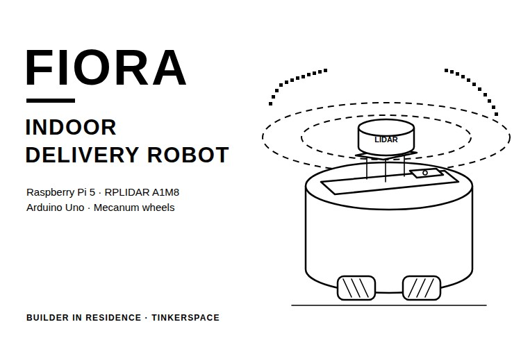

In a college or an office, someone is always walking a document or a small parcel from one room to another. It is a short trip, but it happens many times a day. So, could a small robot make those trips instead, while the person who needs the item asks for it from their desk? That is the job FIORA is being built for.

In this project, we show how to build FIORA, an indoor delivery robot base with a round foam-sheet body, four mecanum wheels and an RPLIDAR A1M8 on top. An Arduino Uno with an L293D Motor Driver Shield drives the four GB37 motors from a phone through an HC-05 Bluetooth module, and a Raspberry Pi 5 runs ROS 2 with the LiDAR to map a room in RViz2. Following this guide, you get a rover that you drive by hand and a LiDAR setup that maps the space around it. The indoor delivery robot does not deliver on its own yet. The link from ROS 2 to the motors, autonomous navigation and the Telegram bot for delivery requests are still being built, and the Arduino sketch and the ROS 2 settings are not in the repository yet. You can also check out similar [robotics projects](https://circuitdigest.com/robotics-projects) and [Raspberry Pi projects](https://circuitdigest.com/simple-raspberry-pi-projects-for-beginners) done previously here at Circuit Digest.

> **Quick Answer: What is FIORA?**
>
> **FIORA** is an **indoor delivery robot** prototype built on a round foam-sheet base with four **mecanum wheels** and **GB37 motors**, an **Arduino Uno with an L293D shield** for driving, and a **Raspberry Pi 5 with an RPLIDAR A1M8 and ROS 2** for mapping. Today it is driven by hand over Bluetooth and can map a room. Autonomous delivery is still being built.

**Table of Contents**

- [What Is FIORA?](#what-is-fiora)
- [How FIORA Works](#how-does-the-fiora-indoor-delivery-robot-work)
- [Components Required](#components-required-for-the-fiora-indoor-delivery-robot)
- [Wiring Diagram](#wiring-diagram-of-the-fiora-indoor-delivery-robot)
  - [Connection Table](#connection-table)
- [Base, Couplers and Motor Mounts](#building-the-base-couplers-and-motor-mounts)
- [Drive Electronics](#assembling-the-drive-electronics)
- [RPLIDAR and ROS 2 Setup](#setting-up-the-rplidar-a1m8-with-ros-2-on-the-raspberry-pi-5)
- [Body](#building-the-fiora-body)
- [Live Demo](#live-video-demonstration)
- [Output](#output-mapping-tinkerspace-with-fiora)
- [Troubleshooting](#troubleshooting-the-fiora-indoor-delivery-robot)
- [GitHub](#fiora-github-repository)

## What Is FIORA?

FIORA is meant to carry documents, materials and small packages between fixed points inside a building, such as an office, a warehouse, a hospital or a college. Its round base follows the look of Bella, a commercial delivery robot. The software plan is ROS 2 Jazzy, with SLAM Toolbox for mapping and Nav2 for navigation. The build is kept modular, so the base, the drive, the mapping and the user side can each be tested before the next part depends on it. If interested, do check out the [ESP32 self-driving robot with ROS2 and LiDAR](https://circuitdigest.com/news/esp32-self-driving-robot-with-arduino-ros2-lidar) on Circuit Digest, which already maps and drives itself.

## How Does the FIORA Indoor Delivery Robot Work?

The working is split into two halves that are not connected to each other yet. The drive half is an Arduino Uno with an L293D Motor Driver Shield stacked on it. A phone running a Bluetooth car controller app sends commands to the HC-05 module, the Arduino reads them, and the shield runs the four GB37 motors and their mecanum wheels. The sensing half is a Raspberry Pi 5 with the RPLIDAR A1M8 on USB. The Pi runs ROS 2, takes the 360-degree scans from the LiDAR and builds a map that you can watch in RViz2. Below is the block diagram of the FIORA indoor delivery robot.

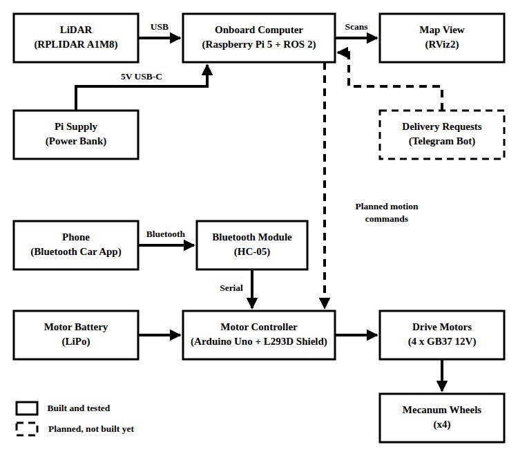

The dashed parts are planned. A Telegram bot will send delivery requests to the Pi, and the Pi will need a link to the Arduino so that ROS 2 can drive the motors.

Below is the delivery workflow the robot is being built towards, redrawn from the project README.

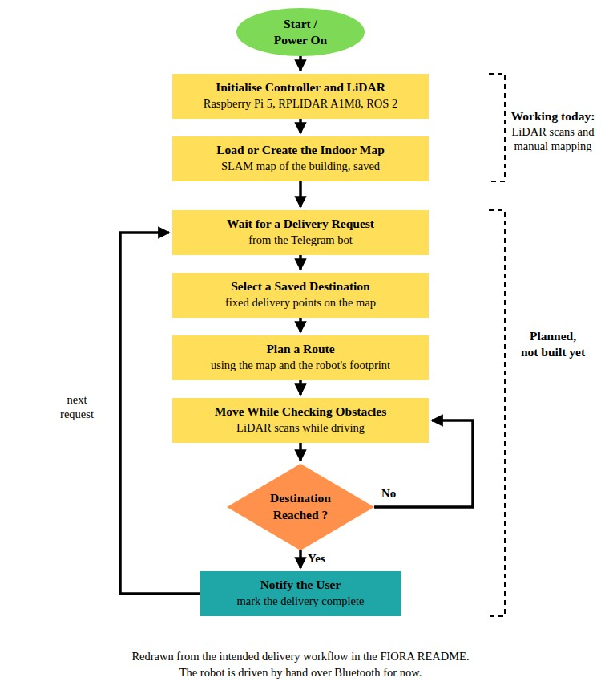

Only the first two steps work today. The Pi starts the LiDAR, and you can build a map by driving the robot around by hand. For delivery requests, we picked Telegram over WhatsApp, as the WhatsApp API goes through Meta's official setup, permissions and verification, while anyone can create a Telegram bot. The bot is not built yet. To see how a Telegram bot talks to a Pi, check out our [Telegram bot with Raspberry Pi](https://circuitdigest.com/microcontroller-projects/raspberry-pi-telegram-bot) tutorial.

## Components Required for the FIORA Indoor Delivery Robot

Below is the list of components used in this build.

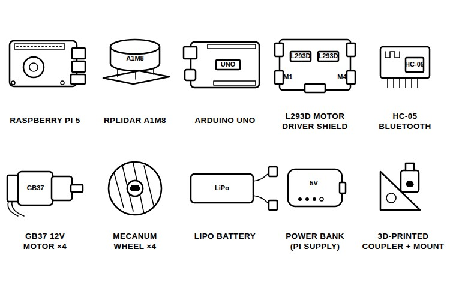

| S.No | Component | Description | Quantity |
|---|---|---|---|
| 1. | Raspberry Pi 5 | Onboard computer for the LiDAR and ROS 2 | 1 |
| 2. | SLAMTEC RPLIDAR A1M8 | 360-degree laser scanner, with its USB adapter | 1 |
| 3. | Arduino Uno | Motor controller | 1 |
| 4. | L293D Motor Driver Shield | Drives the four motors | 1 |
| 5. | HC-05 Bluetooth Module | Receives drive commands from the phone | 1 |
| 6. | GB37 12V 60 RPM Geared Motor with Encoder | Drive motor | 4 |
| 7. | Mecanum Wheel | Lets the chassis move in different directions | 4 |
| 8. | LiPo Battery [TODO: voltage and capacity] | Motor power | 1 |
| 9. | Supply for the Raspberry Pi 5 | We used a power bank; see the note below | 1 |
| 10. | 3D-Printed Coupler | Joins each motor shaft to its wheel hub | 4 |
| 11. | 3D-Printed Triangular Motor Mount | Holds each motor on the base | 4 |
| 12. | Foam Sheet | Base (80 cm across) and prototype body | As required |
| 13. | Phone with a Bluetooth Car Controller App | Manual driving | 1 |

The L293D shield is the driver we would pick again. It stacks straight onto the Uno, and it was the first setup that ran all four motors reliably, after two ESP32 boards failed and L298 boards ran very hot (see the drive electronics section). The RPLIDAR A1M8 replaced the YDLIDAR X2 from our first plan on our mentor's advice. The GB37 motors have encoders, but the encoder leads are not used yet. For the Pi, use a supply that meets the Pi 5's needs, as our power bank could not keep it running during mapping. Apart from these parts, you need a 3D printer for the couplers and mounts, a caliper, a sharp knife for the foam sheet and a screen to watch RViz2. If you like to see more builds around this board, check out our collection of [Arduino projects](https://circuitdigest.com/arduino-projects).

## Wiring Diagram of the FIORA Indoor Delivery Robot

Below is the wiring diagram for the FIORA indoor delivery robot.

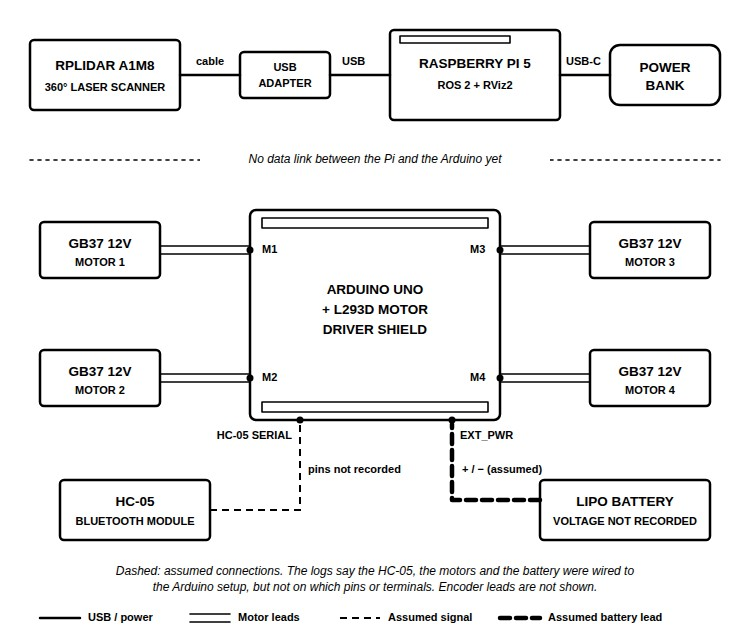

The robot has two separate circuits. On the sensing side, the RPLIDAR A1M8 connects to its small USB adapter board, and the adapter plugs into a USB port on the Raspberry Pi 5, which gets its power on the USB-C port. On the drive side, the L293D Motor Driver Shield sits on top of the Arduino Uno, and the four GB37 motors connect to its M1 to M4 terminals. The HC-05 connects to the Arduino's serial lines, and the LiPo powers the motors through the shield. Our logs do not record which pins the HC-05 uses, which terminal each motor sits on, or how the battery is connected, so those connections are drawn dashed as the usual way to wire this shield. That is all about the wiring. If you are wiring an HC-05 for the first time, the [Bluetooth controlled toy car using Arduino](https://circuitdigest.com/microcontroller-projects/bluetooth-controlled-robot-car-using-arduino) on Circuit Digest shows that side step by step.

### Connection Table

| Connection | From | To | Recorded in the Repo? |
|---|---|---|---|
| LiDAR data | RPLIDAR A1M8 | USB adapter board, then a USB port on the Pi 5 | Yes |
| Pi power | Power bank | Pi 5 USB-C | Yes, replace with a proper supply |
| Motor driver | L293D Motor Driver Shield | Stacked on the Arduino Uno | Yes |
| Motors | Four GB37 motors | Shield terminals M1 to M4 | Yes, order not recorded |
| Bluetooth | HC-05 | Arduino serial lines | Assumed, pins not recorded |
| Motor power | LiPo | Shield EXT_PWR terminal | Assumed |
| Encoders | GB37 encoder leads | Not connected | Yes |

## Building the Base, Couplers and Motor Mounts

Below are the base and motor-mount stages that the steps in this section go through.

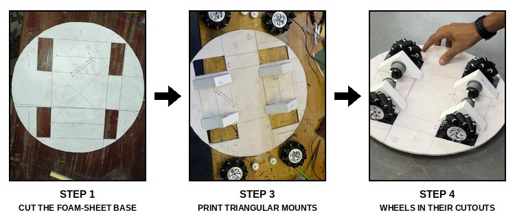

**Step 1⇒ Cut the Base**

Cut a circle with a radius of 40 cm from foam sheet, and cut a 90mm × 34mm slot for each mecanum wheel. The slot size comes from our wheel, so measure yours before cutting. Foam sheet is quick for a prototype, but it needs reinforcement around the motor mounting points.

**Step 2⇒ Print the Motor-to-Wheel Couplers**

Ready-made motor-to-wheel adapters either did not fit our wheel hub or cost too much, and a GrabCAD model we printed came out larger than the hub. So, measure the hexagonal hole in the wheel hub with a caliper and design a coupler that takes the motor shaft on one side and fills the hexagon on the other. Our prints came out about 1mm bigger or smaller than the CAD size, which is normal 3D-printing tolerance, as the printer, the material and the heat all change the final size. Reduce the measured size by about 1mm, print a test piece and adjust from there. Keep the walls thick, as our first thin coupler pushed in fine and broke very quickly. Below are some of the more than 15 versions we printed.

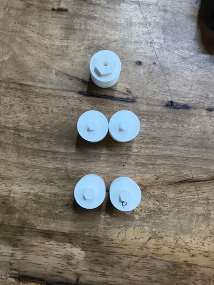

Once the shaft is in the coupler, check how much room is left towards the wheel adapter. We had about 4mm, and the coupler used only about 1mm of it, so we extended the hexagonal section further into the wheel's hexagonal hole. With that change, the wheel sat fully on the coupler. The coupler and mount CAD files are not in the repository yet [TODO: add the coupler and motor-mount CAD or STL files to the cad folder]. For more printed parts in real builds, take a look at the [3D printing projects](https://circuitdigest.com/3d-printing-projects) on Circuit Digest.

**Step 3⇒ Print the Triangular Motor Mounts**

Measure the motor's front face plate and print a small test part first, only to check that the motor fits into it. A full square mount held our motor too tightly and covered almost its whole length, and a smaller square mount was too small. The triangular shape in the middle panel above suited the round base best.

**Step 4⇒ Fit the Motors, Couplers and Wheels**

Put each motor in its mount, push the coupler onto the shaft and the wheel onto the coupler, and place the set on the base. Each wheel must sit inside its cutout. If the coupler is too long, the mounts have to move back until the left and right ones touch, and the wheels no longer line up with the slots, so fix the coupler length instead of moving the mounts.

## Assembling the Drive Electronics

Stack the L293D Motor Driver Shield on the Arduino Uno, connect the four GB37 motors to its motor terminals, and connect the HC-05 to the Arduino. Upload your motor sketch and test a single motor first from a Bluetooth car controller app on the phone. Once it responds correctly, connect all four motors, test them again, and then mount the Arduino, the shield, the HC-05 and the battery on the base and drive the rover. Our sketch is not in the repository yet, so for now you will need your own sketch that reads the app's commands from the HC-05 and drives the shield.

Below are the two controller setups we tried before the L293D shield.

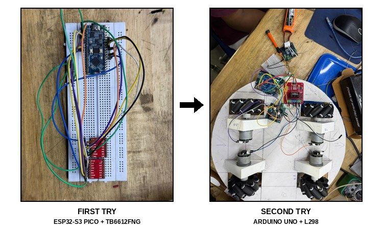

The ESP32-S3 Pico with a TB6612FNG driver ran the motors for a while, then stopped. The board became extremely hot, the data cable got hot as well, and the board was burned. An ESP32 DevKit then worked at first and also stopped. We suspected the power supply but never confirmed the cause, so if a board gets hot, disconnect it at once and check the power, grounding and wiring before you try again. The Arduino Uno with L298 driver boards worked, but the drivers became very hot and lost a lot of power. To learn how this driver works, refer to our [L298N motor driver with Arduino](https://circuitdigest.com/microcontroller-projects/interfacing-l298n-motor-driver-with-arduino) tutorial.

## Setting Up the RPLIDAR A1M8 with ROS 2 on the Raspberry Pi 5

Below is the RPLIDAR A1M8 with its USB adapter board, the 360-degree laser range finder that FIORA maps with.

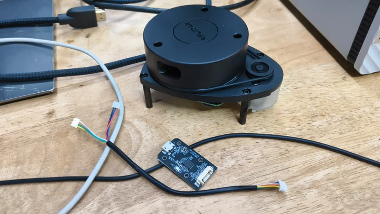

Start small. Get the raw scan data on the Pi first, and only then move on to mapping. Our own launch files and SLAM settings are not in the repository yet, so the steps below are the standard way to bring up an RPLIDAR A1 in ROS 2 Jazzy with Slamtec's [rplidar_ros](https://github.com/Slamtec/rplidar_ros/tree/ros2) package.

**Step 1⇒ Build the rplidar_ros Package**

```bash
mkdir -p ~/ros2_ws/src
cd ~/ros2_ws/src
git clone -b ros2 https://github.com/Slamtec/rplidar_ros.git
cd ~/ros2_ws/
source /opt/ros/jazzy/setup.bash
colcon build --symlink-install
source ./install/setup.bash
```

This makes a ROS 2 workspace, clones Slamtec's driver into it and builds it. ROS 2 Jazzy installs from binary packages on Ubuntu 24.04, which runs on the Raspberry Pi 5.

**Step 2⇒ Give Access to the Serial Port**

```bash
sudo chmod 777 /dev/ttyUSB0
```

The LiDAR's adapter shows up as a USB serial port, usually /dev/ttyUSB0. The chmod lasts until the next reboot, and the package also has a script, scripts/create_udev_rules.sh, that sets up a permanent rule.

**Step 3⇒ Launch the LiDAR in RViz2**

```bash
ros2 launch rplidar_ros view_rplidar_a1_launch.py
```

This starts the LiDAR node and opens RViz2 with the live scan. Once the scan looks right, a SLAM package can turn it into a map, and our plan names SLAM Toolbox for this.

**Step 4⇒ Account for the Robot's Size**

The LiDAR sits at the centre of the body, so an obstacle can touch the edge of the body before the LiDAR treats it as a collision. Give the robot's body dimensions to the software so that its size is taken into account. We added the prototype body's dimensions in RViz2 before mapping further.

**Step 5⇒ Map the Space and Save the Map**

Run SLAM, drive the robot around the space from the phone while the map grows, and save each map for later use. We mapped different areas of TinkerSpace this way and saved each one. For another ROS robot that maps with LiDAR SLAM, see the [autonomous UV robot with SLAM](https://circuitdigest.com/contest/india-automation-challenge-2021/Autonomous-UV-Robot-with-SLAM) entry on Circuit Digest.

## Building the FIORA Body

The body has to carry the LiDAR on top with a clear view all around. Below is the side-view sketch we worked from.

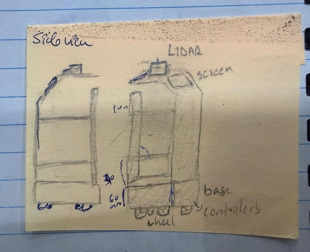

The sketch puts the LiDAR on top with a screen beside it, two levels in the middle, and a 60mm base that holds the wheels and the controllers. A foam-sheet prototype body is quick to make, and it is the body we mapped with. Our 3D-printed body design came out at least 4 feet tall, which would have taken several weeks and a lot of filament to print, so we started making it smaller. Check the overall size and the print time before you finish a printed body in CAD.

## Live Video Demonstration

Below is FIORA mapping TinkerSpace. One of us drives the robot from a phone over Bluetooth while the map grows on the laptop screen.

<video controls preload="metadata" width="360" poster="videos/FIORA-LiDAR-Mapping-Run.jpg">
<source src="videos/FIORA-LiDAR-Mapping-Run.mp4" type="video/mp4">
<source src="https://github.com/user-attachments/assets/bc92c07e-f1ff-470a-ac00-ad31e8d23390" type="video/mp4">
<a href="https://github.com/user-attachments/assets/bc92c07e-f1ff-470a-ac00-ad31e8d23390">FIORA LiDAR mapping run (MP4)</a>
</video>

The same clip is in the repository's [Week 7 log](https://github.com/BuilderinResidencyTinkerspace/FIORA/blob/main/docs/week-07.md).

## Output: Mapping TinkerSpace with FIORA

Below is the prototype body with the RPLIDAR A1M8 on its top deck.

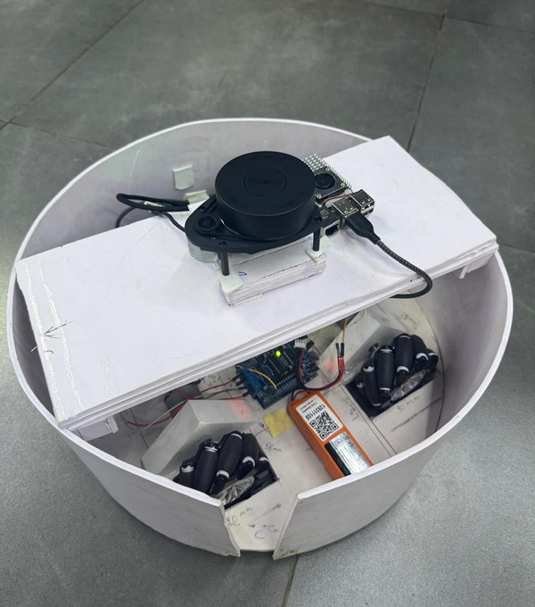

The LiDAR stands on a small block on the top deck with the Raspberry Pi 5 behind it, and the Arduino, the shield, the battery and the wheels sit inside the round body. Below is part of the TinkerSpace map in RViz2.

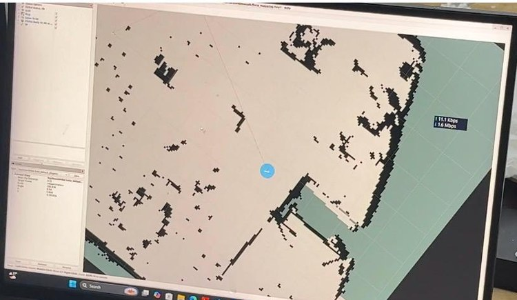

The light area is the space the LiDAR has seen as free, the black cells are obstacles that its laser hit, and the blue circle is the robot. During SLAM mapping, the Raspberry Pi kept turning off. We think the power bank could not supply enough current for the Pi 5, which made the mapping difficult. Localisation on a saved map, route planning and autonomous driving have not been done yet.

## Troubleshooting the FIORA Indoor Delivery Robot

| Symptom | Likely Cause | Fix |
|---|---|---|
| Printed coupler does not fit the wheel hub | The print is about 1mm off the CAD size | Reduce the measured size by about 1mm, print, test and adjust |
| Coupler breaks soon after fitting | Walls designed too thin | Make the coupler thicker and print it again |
| Wheel does not sit in its cutout | Coupler too long, so the mounts get pushed back until they touch | Extend the hexagonal section into the wheel hub instead of moving the mount |
| Controller gets very hot and stops | Not found in our case; check power, grounding and wiring | Disconnect at once and check the circuit before powering it again |
| L298 boards get very hot and the motors feel weak | Heat and power loss in the L298 driver | Use the L293D Motor Driver Shield on the Uno, as in this build |
| Raspberry Pi turns off during mapping | Power bank cannot supply enough current | Use a supply that meets the Pi 5's needs, such as the official 27W USB-C adapter |
| Body edge can hit obstacles the map misses | The LiDAR is at the centre of the body | Add the robot's body dimensions to the setup |

## Conclusion

With the steps above, you can build FIORA's base, drive it by hand over Bluetooth and map a space with the RPLIDAR A1M8, ROS 2 and RViz2. The base, the drive and the mapping each work, though separately. The parts that turn it into a delivery robot are still to come: a link between ROS 2 and the motor controller, the robot's footprint set up properly for navigation, a reliable supply for the Pi, named delivery points on a saved map, the Telegram bot and a smaller body that can be printed in time. Further, one can add a camera and a web dashboard, just like this [web-controlled Raspberry Pi surveillance robot](https://circuitdigest.com/microcontroller-projects/web-controlled-raspberry-pi-surveillance-robot) on Circuit Digest.

## FIORA GitHub Repository

The FIORA repository has the README and the build logs with the photos and the mapping video. The code and cad folders are still empty, so the Arduino sketch, the ROS 2 settings and the printed parts' files are not available there yet. FIORA was built by Alen Thomas K and Shamil at TinkerSpace as part of the Builder in Residence programme, with help from Devadath on the LiDAR and SLAM setup, and the repository is released under the GNU GPL v3 licence.

[Code & Schematics (GitHub)](https://github.com/BuilderinResidencyTinkerspace/FIORA) · [Download Zip](https://github.com/BuilderinResidencyTinkerspace/FIORA/archive/refs/heads/main.zip)

## Frequently Asked Questions About the FIORA Indoor Delivery Robot

**⇥ 1. Can FIORA deliver items on its own yet?**

No. It is driven by hand over Bluetooth, and the LiDAR has been used to build maps. Localisation, route planning, autonomous driving and the Telegram bot are still being built.

**⇥ 2. Why use mecanum wheels on an indoor delivery robot?**

Mecanum wheels let the chassis move in different directions, including sideways, which helps in corridors and small rooms. They also make odometry and keeping the four wheels in step harder, which our planning notes list as a challenge.

**⇥ 3. Why Telegram instead of WhatsApp for delivery requests?**

The WhatsApp API needs Meta's official setup, permissions and verification, while Telegram lets anyone create their own bot. That made Telegram the practical choice for a student prototype.

## Robotics and LiDAR Projects on Circuit Digest

Explore more robot and Raspberry Pi builds on Circuit Digest, with step-by-step guides, wiring diagrams and code.

- **[ESP32 Self-Driving Robot with Arduino, ROS2 and LiDAR](https://circuitdigest.com/news/esp32-self-driving-robot-with-arduino-ros2-lidar)**: *The Maker's Pet Robotics Kit is a DIY learning kit for robotics enthusiasts, students and hobbyists who want to explore autonomous navigation and mapping.*
- **[Bluetooth Controlled Toy Car using Arduino](https://circuitdigest.com/microcontroller-projects/bluetooth-controlled-robot-car-using-arduino)**: *In this project, we are going to develop a Bluetooth controlled robo car, using a Bluetooth module and an Android application.*
- **[Using Telegram Bot with Raspberry Pi: Sharing Text and Files](https://circuitdigest.com/microcontroller-projects/raspberry-pi-telegram-bot)**: *Raspberry Pi has always been fun and easy to build projects, and its Linux-based operating system helps in getting projects online quickly.*

## Complete Project Code

FIORA's code is not in the repository yet. The Arduino motor-control sketch and the ROS 2 launch files and SLAM settings are still to be added to the code folder. [TODO: add the Arduino motor-control sketch and the ROS 2 launch and SLAM settings to the repository]
