# We Built ARGUS, a Person-Tracking Drone Using Arduino UNO Q and YOLOv8n

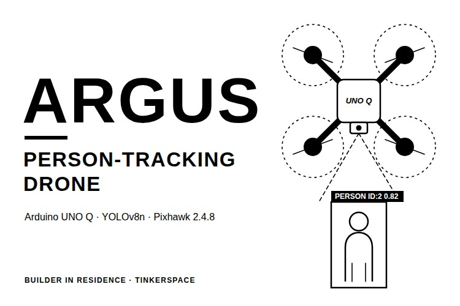

A camera drone that follows a person usually carries a companion computer such as a Raspberry Pi for the vision model, plus a microcontroller for the time-critical jobs. Both add weight and heat, and both run off the battery that keeps the drone in the air. So, can one board do both jobs? The Arduino UNO Q has a Qualcomm processor running Linux and an STM32 microcontroller on the same PCB, and ARGUS is our attempt to find out.

In this project, we built ARGUS, a quadcopter that carries an Arduino UNO Q and a USB webcam. The UNO Q finds people with a YOLOv8n model, gives each one a tracking ID and works out how the drone should move to follow the selected person, and the same code can read hand gestures once a pose model is loaded. The flight side is a standard Pixhawk quadcopter running PX4. The person-tracking drone flies under RC control with the camera on board, but its follow commands are only printed as JSON for now, as the link from the UNO Q to the Pixhawk is not built yet. You can also check out similar [Raspberry Pi projects](https://circuitdigest.com/simple-raspberry-pi-projects-for-beginners) and [drone projects](https://circuitdigest.com/drone-projects) done previously here at Circuit Digest.

> **Quick Answer: What is ARGUS?**
>
> **ARGUS** is a person-tracking drone built on an Arduino UNO Q and a Pixhawk running PX4. A YOLOv8n model finds people in the camera feed, a small tracker keeps their IDs, and a follow controller turns the target's position into limited yaw, forward and vertical commands, printed as JSON until the Pixhawk link is built.

**Table of Contents**

- [What Is ARGUS?](#what-is-argus)
  - [Arduino UNO Q or Raspberry Pi 5](#arduino-uno-q-or-raspberry-pi-5-for-the-vision-code)
- [How the Drone Works](#how-does-the-argus-person-tracking-drone-work)
  - [Gesture-to-Action Mapping](#gesture-to-action-mapping)
- [Components Required](#components-required-for-the-argus-drone)
- [Wiring Diagram](#wiring-diagram-of-the-argus-drone)
  - [Connection Table](#argus-connection-table)
- [Building the Frame](#building-the-argus-frame)
- [Hardware Assembly](#hardware-assembly-of-the-argus-drone)
- [Pixhawk Setup](#pixhawk-setup-with-px4-and-qgroundcontrol)
- [Vision Code Setup](#setting-up-the-argus-vision-code)
  - [Command-Line Options](#command-line-options)
- [Testing Before Flight](#testing-argus-before-flight)
- [Code Explanation](#argus-vision-code-explanation)
- [Live Demo](#live-video-demonstration)
- [Output](#output-of-the-argus-person-tracking-drone)
- [Troubleshooting](#troubleshooting-the-argus-drone)
- [GitHub](#argus-github-repository)

## What Is ARGUS?

ARGUS is a proof of concept for a drone that does its own computer vision on board. The work is split into separate features: person detection, tracking, following a selected person, gesture-mapped actions and Pixhawk-based flight control. The vision code is kept apart from the flight control, so it can be tested on the bench before it ever touches a drone, and any autonomous flight test should start tethered or caged. If you are new to YOLO, do check out our [object detection on Raspberry Pi tutorial](https://circuitdigest.com/microcontroller-projects/raspberry-pi-object-detection-using-circuitdigest-cloud) as well.

### Arduino UNO Q or Raspberry Pi 5 for the Vision Code

The same Python code runs on both boards. We developed it on a Raspberry Pi 5 first and then moved it to the UNO Q, and the table below compares the two, with the frame rates we saw on each.

| Parameter | Arduino UNO Q | Raspberry Pi 5 |
|---|---|---|
| Processor | Qualcomm Dragonwing QRB2210, quad-core Cortex-A53 | Broadcom BCM2712, quad-core Cortex-A76 |
| Real-time MCU | STM32U585 on the same board | None, needs a separate MCU |
| Pipeline speed we saw | About 0.9 FPS | About 3.0 to 3.5 FPS |

The Pi 5 was three to four times faster in our screenshots, though the two setups differ and this was not a controlled benchmark. If you are building this, get the code running on a Pi 5 first, as it is faster and easier to debug.

## How Does the ARGUS Person-Tracking Drone Work?

The working is split into two halves. The flight half is a normal quadcopter: the LiPo feeds the Matek PDB-XT60, the PDB powers four ESCs, and the Pixhawk running PX4 drives them from the RC receiver input. On top of that, the UNO Q reads webcam frames, runs YOLOv8n on every second frame, tracks the people it finds, checks them for gestures and prints one JSON line with the flight intent. Below is the block diagram of the ARGUS person-tracking drone.

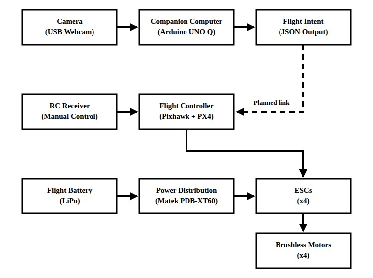

The dashed line is the link that is not built yet; once it is in place, the intent will go to the Pixhawk over MAVLink. Until then, the drone is flown by hand, and the intent output is tested on the bench with the motors off. Here is another tutorial on [connecting the LiteWing ESP32 drone to Betaflight](https://circuitdigest.com/tutorial/how-to-connect-the-litewing-esp32-drone-betaflight), where a drone's flight controller is configured step by step.

### Gesture-to-Action Mapping

| S.No | Gesture | Action |
|---|---|---|
| 1. | Right hand up | start_follow |
| 2. | Left hand up | stop_follow |
| 3. | Both hands up | land |

A gesture counts only after the same person holds it for 4 processed frames, and it is then ignored from that person for 2 seconds. Gestures also need a pose model, which the troubleshooting section explains.

## Components Required for the ARGUS Drone

Below is the list of components required to build this project.

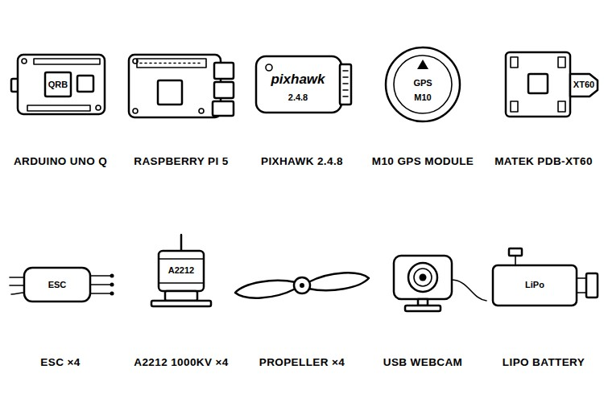

| S.No | Component | Description | Quantity |
|---|---|---|---|
| 1. | Arduino UNO Q | Onboard vision computer | 1 |
| 2. | Raspberry Pi 5 | For developing the vision code | 1 |
| 3. | Raspberry Pi Camera Module [TODO: version] | Camera for the Pi stage | 1 |
| 4. | USB 2.0 PC Webcam (generic) | Onboard camera | 1 |
| 5. | Powered USB Hub and Power Bank | Connect and power the webcam | 1 each |
| 6. | Pixhawk 2.4.8 | Flight controller running PX4 | 1 |
| 7. | M10 GPS Module | GPS for the Pixhawk | 1 |
| 8. | Matek PDB-XT60 | Power distribution, 3S to 4S LiPo | 1 |
| 9. | Electrolytic Capacitor [TODO: value] | On the PDB battery leads | 2 |
| 10. | ESC [TODO: current rating] | Motor driver | 4 |
| 11. | A2212/13T 1000KV Brushless Motor | Thrust | 4 |
| 12. | Propeller [TODO: size] | One per motor | 4 |
| 13. | F450-Style Quadcopter Frame | Ready-made frame | 1 |
| 14. | LiPo Battery [TODO: cells and capacity] | Flight power | 1 |
| 15. | RC Transmitter and Receiver [TODO: model] | Manual control | 1 set |

The UNO Q is the board that flies. The Pi 5 and its camera are only needed if you want to develop and test the vision code on a faster board first. The webcam goes through a powered USB hub with its own power bank, because that was the quickest way to get a camera on the drone with the parts we had. If you like to see more builds like this, check out our collection of [Arduino projects](https://circuitdigest.com/arduino-projects).

## Wiring Diagram of the ARGUS Drone

Below is the wiring diagram for the ARGUS drone.

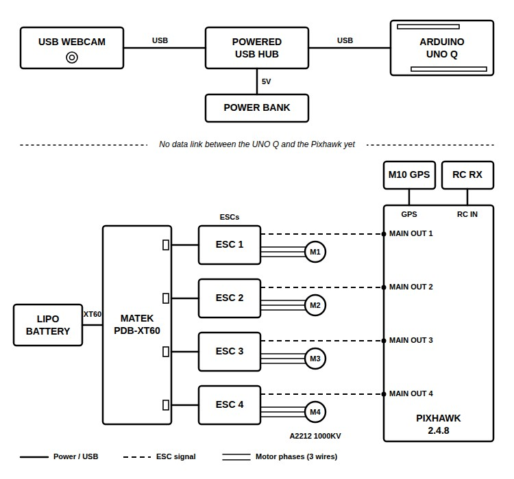

The flight side follows the standard Pixhawk quadcopter layout. The LiPo plugs into the XT60 input of the PDB, and the four ESCs take their power from it. Each ESC drives one brushless motor, and the ESC signal leads go to MAIN OUT 1 to 4 on the Pixhawk in the PX4 Quadrotor X order. On the vision side, the webcam plugs into the powered USB hub and the hub into the UNO Q. There is no data link between the UNO Q and the Pixhawk yet. That is all about the wiring.

### ARGUS Connection Table

| From | To | Note |
|---|---|---|
| LiPo battery | XT60 input of the Matek PDB-XT60 | Two electrolytic capacitors on the PDB battery leads |
| PDB battery pads | Power leads of ESC 1 to 4 | Standard wiring, not confirmed in the logs |
| ESC 1 to 4 | Brushless motors 1 to 4 | Three wires each |
| ESC 1 to 4 signal leads | Pixhawk MAIN OUT 1 to 4 | PX4 Quadrotor X order, check with the motor test |
| RC receiver | Pixhawk RC input | Standard wiring, receiver model not recorded |
| M10 GPS module | Pixhawk GPS port | Standard wiring for the Pixhawk 2.4.8 |
| Pixhawk power input | [TODO: power module or PDB 5V output] | Not recorded |
| USB webcam | Powered USB hub, then the UNO Q USB port | Power bank feeds the hub |
| Arduino UNO Q power | [TODO: UNO Q power source during flight] | Not recorded |

## Building the ARGUS Frame

The ARGUS that flies uses a ready-made F450-style quadcopter frame, and that is the frame we suggest. We first designed and printed our own frame, but we did not trust PLA arms with the loads and vibration of flight, the carbon-fibre-infused PETG we wanted was not available, and screws and fasteners were hard to find as well. So, we moved to a strong ready-made frame and strength-tested the parts we had replaced.

### Optional: The 3D-Printed Frame

If you want to try a printed frame, below is the CAD model of ours from Fusion 360. The CAD files are not in the repository.

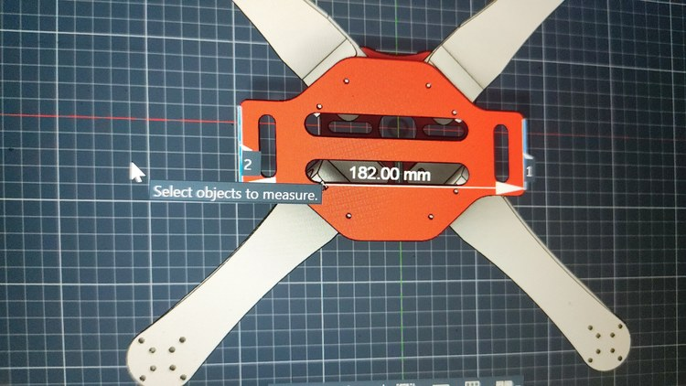

It has a 96 mm centre plate and a 182 mm bottom plate with four arms between them. Print one landing leg first and test its strength before printing the plates and arms. Below is the centre plate printing on a Bambu Lab printer.

<video controls preload="metadata" width="640" poster="images/3D-Printing-the-ARGUS-Centre-Plate.jpg">
<source src="videos/ARGUS-Printing-the-Centre-Plate.mp4" type="video/mp4">
<source src="https://github.com/user-attachments/assets/8d8be39d-6964-490f-861d-9866ee75ea14" type="video/mp4">
<a href="https://github.com/user-attachments/assets/8d8be39d-6964-490f-861d-9866ee75ea14">Printing the centre plate (MP4)</a>
</video>

The printed frame did come together with all four motors on it, as shown below.

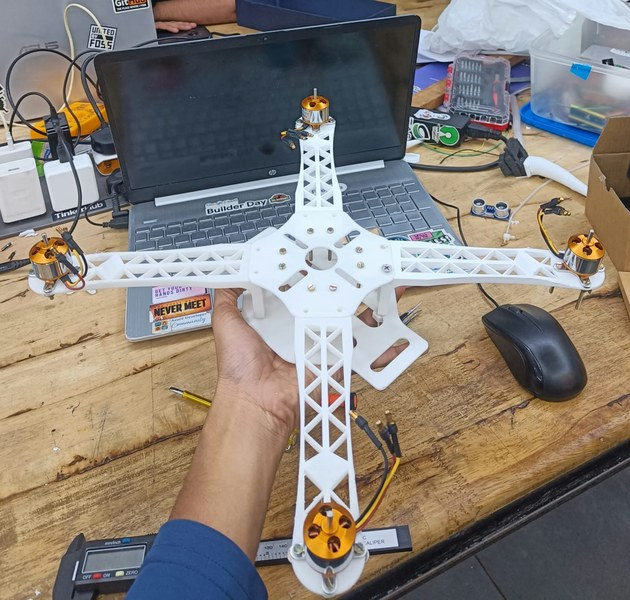

Check your filament stock before you start. PLA went out of stock for us, and the alternative filament we tried gave extrusion problems and had to be cleaned out of the printer by hand. The image below shows one of the failed prints.

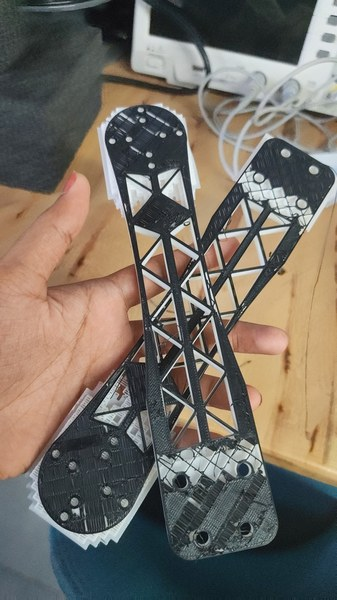

You can also check out our [robotics projects](https://circuitdigest.com/robotics-projects) for more mechanical builds.

## Hardware Assembly of the ARGUS Drone

Below is the drone during assembly, with the Pixhawk, the ESC wiring and the motors on the frame.

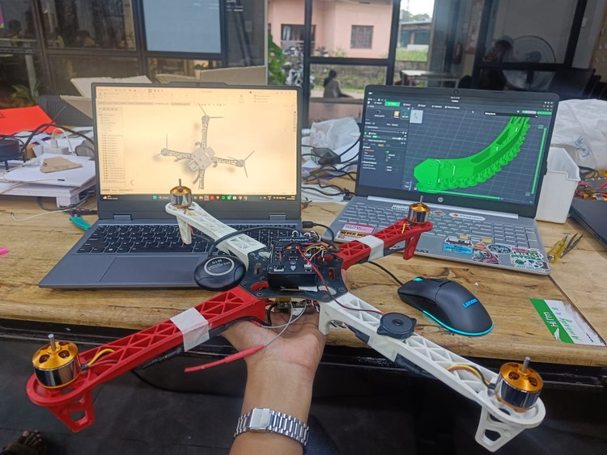

**Step 1⇒ Mount the Motors and ESCs**

Fix the four A2212 motors to the arms and the ESCs alongside them, then connect each ESC to its motor with the three motor wires.

**Step 2⇒ Wire the PDB with Its Capacitors**

Solder the ESC power leads and the battery lead to the Matek PDB-XT60, and fit the electrolytic capacitors on the battery leads before connecting a battery. Below is our PDB, with two capacitors on its battery leads.

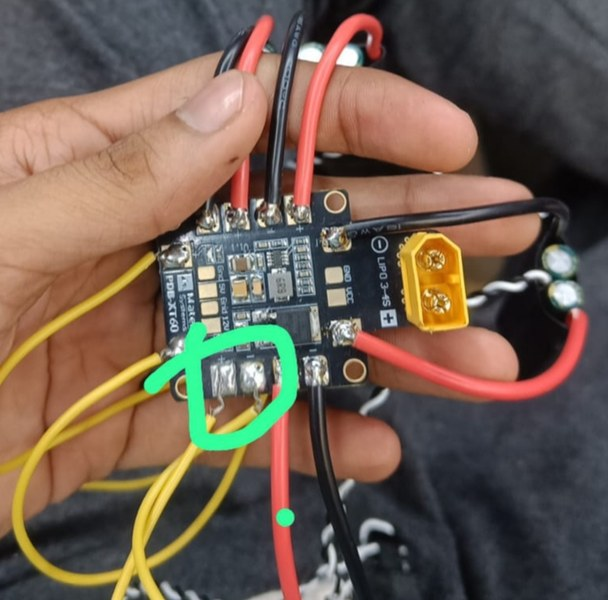

**Step 3⇒ Mount the Pixhawk, GPS and Receiver**

Fix the Pixhawk 2.4.8 on the frame, plug the ESC signal leads into MAIN OUT 1 to 4, and connect the M10 GPS and the RC receiver as per the connection table.

**Step 4⇒ Mount the Camera and the UNO Q**

Fix the USB webcam to the front of the frame and connect it to the UNO Q through the powered USB hub, as shown below.

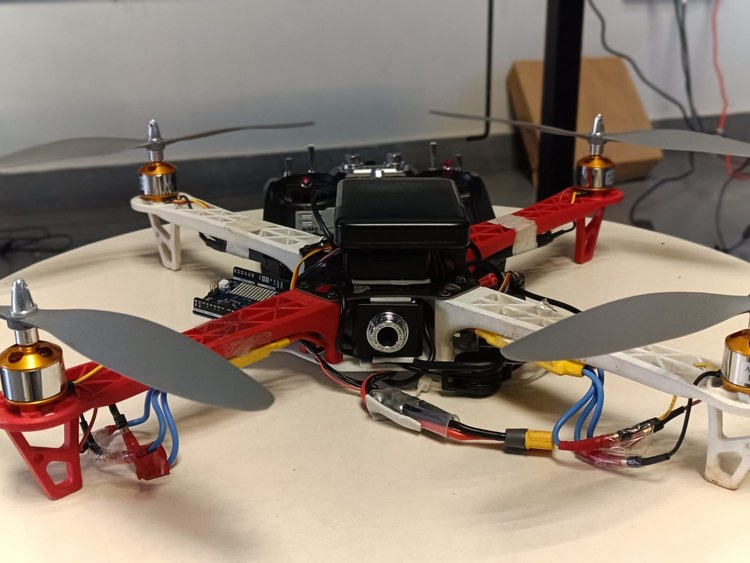

## Pixhawk Setup with PX4 and QGroundControl

Below are the flight controller setup steps that worked for us. We also tried ArduPilot with Mission Planner, but its calibration failed, so stay with PX4 and QGroundControl for this build.

**Step 1⇒ Flash the PX4 Firmware**

Connect the Pixhawk over USB, open QGroundControl and flash PX4 from **Vehicle Setup** > **Firmware**.

**Step 2⇒ Calibrate the Sensors**

Run the compass and accelerometer calibrations under **Sensors**. The accelerometer step asks for six orientations, one after another, and each box turns green once it is done. Below is our calibration run.

<video controls preload="metadata" width="640" poster="images/QGroundControl-Accelerometer-Calibration-for-ARGUS-Drone.jpg">
<source src="videos/ARGUS-QGroundControl-Calibration.mp4" type="video/mp4">
<source src="https://github.com/user-attachments/assets/80f877c4-87bd-496a-a729-3533ae22f998" type="video/mp4">
<a href="https://github.com/user-attachments/assets/80f877c4-87bd-496a-a729-3533ae22f998">QGroundControl calibration (MP4)</a>
</video>

**Step 3⇒ Calibrate the ESCs and Test Each Motor**

Calibrate the ESCs, then take the propellers off and spin one motor at a time with the motor test. If the wrong motor spins, the ESC signal leads are on the wrong MAIN OUT pins; this is how we found ours in the wrong order. Below is the motor test after ESC calibration.

<video controls preload="metadata" width="360" poster="images/ARGUS-Drone-Motor-Test-After-ESC-Calibration.jpg">
<source src="videos/ARGUS-ESC-Calibration-and-Motor-Test.mp4" type="video/mp4">
<source src="https://github.com/user-attachments/assets/969b4cbf-2a42-4c6a-8200-fe3666946242" type="video/mp4">
<a href="https://github.com/user-attachments/assets/969b4cbf-2a42-4c6a-8200-fe3666946242">ESC calibration and motor test (MP4)</a>
</video>

**Step 4⇒ Run the Pre-Flight Checks**

QGroundControl showed three warnings for our setup: low battery, no GPS and no safety switch. Do not ignore them to get airborne. Sort out the battery, GPS and safety-switch settings for your flight mode before arming.

## Setting Up the ARGUS Vision Code

The Python code needs Python 3.11 or newer with NumPy, ONNX Runtime and PyYAML. On Raspberry Pi OS, Picamera2 and OpenCV come from apt, so create the virtual environment with --system-site-packages, or it will not see them.

```bash
sudo apt install python3-picamera2 python3-opencv
git clone https://github.com/BuilderinResidencyTinkerspace/InfiniteInferno.git
cd InfiniteInferno/code
python3 -m venv --system-site-packages .venv
source .venv/bin/activate
python -m pip install -r requirements.txt
```

Then start the pipeline. The settings for the model, camera, tracker, gestures and controller all live in configs/config.yaml.

```bash
python -m src.main --auto-follow --display
```

On the UNO Q, use the OpenCV camera path with the webcam's device, for example `--camera opencv --source /dev/video2`. Our UNO Q needed a reset before it responded, and the Pi code was adapted for it with AI-assisted conversion and then fixed by hand. We ran it there with a small web dashboard (dashboard.py) on port 8080, which is not in the repository yet. For another Raspberry Pi build with a USB camera, refer to our [Raspberry Pi helmet detection](https://circuitdigest.com/microcontroller-projects/raspberry-pi-helmet-detection-using-circuitdigest-cloud) project.

### Command-Line Options

| Option | What It Does |
|---|---|
| --camera opencv --source 0 | Uses a USB webcam or a video file in place of Picamera2 |
| --target-id 1 | Follows one specific track ID |
| --auto-follow | Locks on to the largest person in the first frame with a confirmed track |
| --display | Shows the annotated preview window (needs a desktop) |
| --max-frames 100 | Stops after 100 frames |

--target-id and --auto-follow cannot be used together.

## Testing ARGUS Before Flight

Test the vision side on its own before anything flies. First, run the smoke test from the code folder. It runs one blank frame through the model and prints the shapes; an output of [1, 84, 8400] means a detection model.

```bash
python scripts/pi_smoke_test.py
```

Next, run the unit tests. They cover the camera, detector, pre and post-processing, tracker, gestures, controller and configuration. pytest is not in requirements.txt, so install it first.

```bash
python -m pip install pytest
python -m pytest
```

Then run the pipeline on the bench with --auto-follow --display --max-frames 100, step in front of the camera and check that the JSON lines switch from hover to follow. Keep the propellers off for every bench test, and fly the first flights by RC only, as the intents do not reach the Pixhawk yet.

## ARGUS Vision Code Explanation

The vision code is split into small Python modules under code/src, one per stage, with the settings in configs/config.yaml. Below is the program workflow of src/main.py.

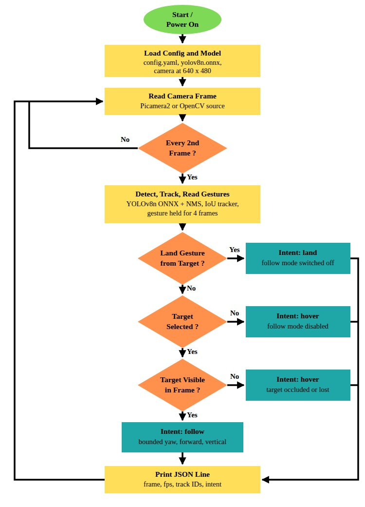

**Letterbox Preprocessing**

```python
scale = min(input_width / width, input_height / height)
resized_width, resized_height = max(1, round(width * scale)), max(1, round(height * scale))
...
canvas = np.full((input_height, input_width, 3), 114, dtype=np.uint8)
pad_x = (input_width - resized_width) // 2
pad_y = (input_height - resized_height) // 2
canvas[pad_y:pad_y + resized_height, pad_x:pad_x + resized_width] = resized
tensor = np.ascontiguousarray(canvas.transpose(2, 0, 1)[None], dtype=np.float32) / 255.0
return tensor, ImageTransform(scale, pad_x, pad_y, input_width, input_height, width, height)
```

The camera gives 640 x 480 frames, and the model wants 640 x 640. This function scales the frame without changing its aspect ratio and pads the rest with grey (114), which leaves an 80-pixel band at the top and bottom.

**ONNX Runtime Session**

```python
options = ort.SessionOptions()
options.graph_optimization_level = ort.GraphOptimizationLevel.ORT_ENABLE_ALL
options.intra_op_num_threads = max(1, threads)
options.inter_op_num_threads = 1
session = ort.InferenceSession(str(path), sess_options=options, providers=["CPUExecutionProvider"])
```

This sets up ONNX Runtime on the CPU with all graph optimisations on and 4 threads, one per core on both boards. Inference runs on every second frame only (inference_stride: 2).

**Decoding the YOLOv8 Output**

```python
for row in _rows(output):
    if row.size == 56:  # YOLOv8 pose: xywh, person score, 17*(x,y,confidence)
        score = float(row[4])
        keypoint_values = row[5:56]
    elif row.size >= 6:  # YOLOv8 detect: xywh followed by class scores
        class_scores = row[4:]
        class_id = int(np.argmax(class_scores))
        if class_id != 0:
            continue
        score = float(class_scores[class_id])
        keypoint_values = None
```

A detection model gives 84 values per candidate, four for the box and 80 class scores, and only class 0, person, is kept. A pose model gives 56: the box, a person score and 17 keypoints. Candidates under 0.45 confidence are dropped, and a greedy NMS at an IoU of 0.45 removes duplicates.

**Matching Detections to Tracks**

```python
for track_id, track in self._tracks.items():
    for detection_index, detection in enumerate(detections):
        overlap = box_iou(track.box, detection.box)
        dcx = (detection.box[0] + detection.box[2]) / 2 - track.center[0]
        dcy = (detection.box[1] + detection.box[3]) / 2 - track.center[1]
        distance = hypot(dcx, dcy) / max(diagonal, 1.0)
        if overlap >= self.iou_threshold or distance <= self.max_center_distance:
            candidates.append((overlap - distance * 0.25, track_id, detection_index))
```

Every track is compared with every detection, and a pair counts as a candidate if the boxes overlap by 0.20 IoU or more, or the centres are within 0.18 of the frame diagonal. A track is confirmed after 2 hits and survives 12 missed frames, so a person hidden for a moment keeps the same ID.

**Reading Hand Gestures from Keypoints**

```python
nose, left_shoulder, right_shoulder, left_wrist, right_wrist = points[[0, 5, 6, 9, 10]]
if min(nose[2], left_shoulder[2], right_shoulder[2]) < self.keypoint_threshold:
    return None
left_up = left_wrist[2] >= self.keypoint_threshold and left_wrist[1] < left_shoulder[1]
right_up = right_wrist[2] >= self.keypoint_threshold and right_wrist[1] < right_shoulder[1]
if left_up and right_up:
    return "both_hands_up"
if right_up:
    return "right_hand_up"
if left_up:
    return "left_hand_up"
return None
```

The gesture check uses five COCO keypoints: the nose, both shoulders and both wrists, each needing at least 0.35 confidence. A hand counts as raised when its wrist is higher in the image than the shoulder on that side, and both hands up wins over one.

**Turning the Target Position into a Flight Intent**

```python
frame_width, frame_height = frame_size
cx, cy = target.center
error_x = (cx - frame_width / 2) / (frame_width / 2)
error_y = (frame_height / 2 - cy) / (frame_height / 2)
area = (target.box[2] - target.box[0]) * (target.box[3] - target.box[1])
area_ratio = area / max(1, frame_width * frame_height)
distance_error = (self.target_area_ratio - area_ratio) / self.target_area_ratio

yaw = 0.0 if abs(error_x) <= self.deadband_x else _clamp(error_x * self.max_yaw, self.max_yaw)
vertical = 0.0 if abs(error_y) <= self.deadband_y else _clamp(error_y * self.max_vertical, self.max_vertical)
forward = 0.0 if abs(distance_error) <= 0.1 else _clamp(distance_error * self.max_forward, self.max_forward)
return FlightIntent(yaw, forward, vertical, "follow", target.track_id, "target locked")
```

The controller measures how far the target's centre is from the middle of the frame, from -1 to 1, and uses the box area as a rough distance, aiming for the person to fill 18% of the frame. Errors inside the deadbands (0.08 yaw, 0.10 vertical) are ignored, and the outputs are clamped to ±0.35 yaw, ±0.30 forward and ±0.25 vertical. If the target drops out, the intent becomes a hover, marked target temporarily occluded for the first 0.75 seconds and target lost after that. Once a target is locked, nobody else's gestures count.

## Live Video Demonstration

Below is the full ARGUS project demo that the team published on YouTube.

[](https://www.youtube.com/watch?v=kJqCdu2nPVA)

Below is the first flight, flown manually with the RC transmitter.

<video controls preload="metadata" width="360" poster="images/ARGUS-Drone-First-Flight.jpg">
<source src="videos/ARGUS-First-Flight.mp4" type="video/mp4">
<source src="https://github.com/user-attachments/assets/0514c2cd-242b-4a89-914a-78b446a4d80c" type="video/mp4">
<a href="https://github.com/user-attachments/assets/0514c2cd-242b-4a89-914a-78b446a4d80c">First flight (MP4)</a>
</video>

The drone also flew with the webcam on board while the UNO Q streamed its dashboard to a laptop, as shown below.

<video controls preload="metadata" width="360" poster="images/ARGUS-Week-10-Flight-with-Live-UNO-Q-Dashboard.jpg">
<source src="videos/ARGUS-Flight-with-Onboard-Camera.mp4" type="video/mp4">
<source src="https://github.com/user-attachments/assets/bfe29632-8ef9-4f3b-9863-a19614c59a34" type="video/mp4">
<a href="https://github.com/user-attachments/assets/bfe29632-8ef9-4f3b-9863-a19614c59a34">Flight with the onboard camera (MP4)</a>
</video>

The dashboard shows the onboard camera feed live at 0.9 FPS, with the action set to hover.

## Output of the ARGUS Person-Tracking Drone

Below is the person-detection test on the Raspberry Pi 5.

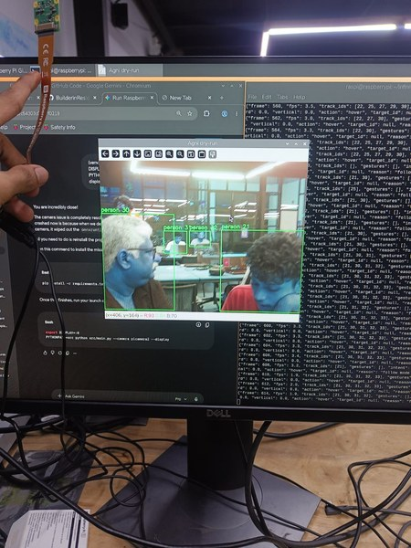

Each person gets a green box and a track ID, and the terminal prints one JSON line per processed frame. The fps field reads 3.0 to 3.5. No target was selected, so every line says hover.

Below is the UNO Q version with its web dashboard.

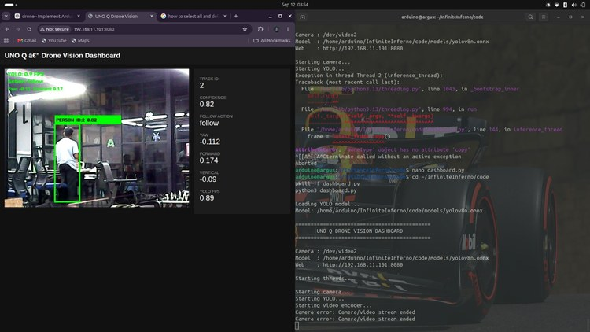

Track ID 2 is locked at 0.82 confidence, and the panel shows that frame's intent: yaw -0.112, forward 0.174 and vertical -0.09. YOLO runs at 0.89 FPS on the UNO Q here, which is the number to improve before these intents can steer a drone in flight. In addition to this drone, here is a collection of [AI projects](https://circuitdigest.com/ai-projects-and-tutorials) for reference.

## Troubleshooting the ARGUS Drone

| Symptom | Likely Cause | Fix |
|---|---|---|
| Gestures never trigger | The bundled yolov8n.onnx is a detection model with no keypoints | Use a YOLOv8 pose model, or pick the target with --auto-follow or --target-id |
| "Picamera2 is unavailable" | Picamera2 missing, or the venv cannot see apt packages | Install python3-picamera2 and use --system-site-packages, or run with --camera opencv |
| "Camera/video stream ended" on the UNO Q | Wrong /dev/video index, or the USB hub losing power | Check ls /dev/video* and pass the device with --source (ours was /dev/video2) |
| Wrong motor spins in the motor test | ESC signal leads on the wrong MAIN OUT pins | Rewire to the PX4 Quadrotor X order and test again |
| PDB burns out on the first power-up | No capacitor on the PDB | Fit a suitable capacitor before connecting the battery |
| Calibration fails in Mission Planner | ArduPilot calibration did not work on our board | Flash PX4 and calibrate in QGroundControl |

## Conclusion

The Arduino UNO Q can run the whole person-detection and tracking pipeline, and the drone has flown with the UNO Q and camera on board. At 0.89 FPS, though, it is too slow to steer the drone, and the intents do not reach the Pixhawk yet, so ARGUS is flown by hand for now. There is still room for improvement, such as a camera module wired straight to the UNO Q, power from the PDB through a regulator into its VIN pin, a MAVLink connection to the Pixhawk and faster inference. Further, one can extend this project to track objects in flight, just like this [ESP32 drone with object tracking using LiteWing](https://circuitdigest.com/microcontroller-projects/object-tracking-drone-using-litewing) on Circuit Digest.

## ARGUS GitHub Repository

The vision code, configuration, YOLOv8n model files, unit tests and build logs for ARGUS are all in the InfiniteInferno repository. ARGUS was built at Tinkerspace as part of Builder in Residence, the logs credit the work to Agnivesh, Amrutha and Abhinand, and the code is released under the MIT licence.

[Code & Schematics (GitHub)](https://github.com/BuilderinResidencyTinkerspace/InfiniteInferno) · [Download Zip](https://github.com/BuilderinResidencyTinkerspace/InfiniteInferno/archive/refs/heads/main.zip)

## Frequently Asked Questions About the ARGUS Drone

**⇥ 1. Does ARGUS follow a person on its own right now?**

No. The vision code works out the follow commands and prints them as JSON, but nothing sends them to the Pixhawk yet, and the flights so far were flown with the RC transmitter.

**⇥ 2. Why do the hand gestures not work with the default model?**

The yolov8n.onnx in the repository is a detection model, so it gives boxes but no body keypoints. Export a pose model with `yolo export model=yolov8n-pose.pt format=onnx imgsz=640` from the Ultralytics package and point model.path at it; the post-processing already reads the 56-value pose output.

**⇥ 3. Why use the UNO Q when the Pi 5 is faster?**

Its STM32 microcontroller is on the same board as the Qualcomm processor, so one board could cover both the vision work and the real-time jobs that a Pi needs a second microcontroller for. That should make the drone lighter and cooler, but we have not measured it yet.

## Drone and Computer Vision Projects

Explore more drone and computer vision builds, with step-by-step guides, wiring diagrams and code.

- **[How to Build an ESP32 Drone with Object Tracking Using LiteWing](https://circuitdigest.com/microcontroller-projects/object-tracking-drone-using-litewing)**: *We built this project to see if we could make a simple LiteWing drone behave intelligently using just a laptop and a basic camera.*
- **[DIY Gesture Control Drone using Python with LiteWing and ESP32](https://circuitdigest.com/microcontroller-projects/diy-gesture-controlled-drone-using-esp32-and-python-with-litewing)**: *Create a DIY gesture-controlled drone using ESP32, Python, and LiteWing for hands-free flight with real-time motion tracking and wireless control.*
- **[Build an ESP32 Voice-Controlled Drone with LiteWing using Python](https://circuitdigest.com/microcontroller-projects/esp32-voice-controlled-drone-using-litewing)**: *We built a voice-controlled drone using ESP32 for the LiteWing drone using Python and speech recognition tools.*

## Complete Project Code

The complete code is split across the files below, all inside the code folder of the repository.

**code/configs/config.yaml**

```yaml
model:
  path: models/yolov8n.onnx
  confidence: 0.45
  iou_threshold: 0.45
  threads: 4
  inference_stride: 2

camera:
  backend: picamera2
  source: 0
  width: 640
  height: 480

tracking:
  max_missed: 12
  min_hits: 2
  iou_threshold: 0.20
  max_center_distance: 0.18

gestures:
  hold_frames: 4
  cooldown_seconds: 2.0
  keypoint_threshold: 0.35
  actions:
    right_hand_up: start_follow
    left_hand_up: stop_follow
    both_hands_up: land

controller:
  target_area_ratio: 0.18
  deadband_x: 0.08
  deadband_y: 0.10
  max_yaw: 0.35
  max_forward: 0.30
  max_vertical: 0.25
  target_timeout_seconds: 0.75
```

**code/src/main.py**

```python
"""Agni command-line vision loop. Output is safe JSON intent, not motor control."""

from __future__ import annotations

import argparse
import json
import time
from dataclasses import asdict
from pathlib import Path

from .camera import Camera
from .config import load_config
from .controller import FollowController
from .detector import Detector
from .gestures import GestureRecognizer
from .postprocess import postprocess
from .preprocess import preprocess
from .tracker import PersonTracker


def build_parser() -> argparse.ArgumentParser:
    parser = argparse.ArgumentParser(description="Agni person following vision prototype")
    parser.add_argument("--config", default="configs/config.yaml")
    parser.add_argument("--camera", choices=("picamera2", "opencv"))
    parser.add_argument("--source", help="OpenCV camera index or video path")
    parser.add_argument("--display", action="store_true", help="Show an annotated local preview")
    target = parser.add_mutually_exclusive_group()
    target.add_argument("--target-id", type=int, help="Explicit session track ID to follow")
    target.add_argument("--auto-follow", action="store_true", help="Lock the largest first visible person")
    parser.add_argument("--max-frames", type=int, default=0, help="Stop after N frames (0 means run forever)")
    return parser


def run(args: argparse.Namespace) -> int:
    config = load_config(args.config)
    backend = args.camera or config.camera.backend
    source = args.source if args.source is not None else config.camera.source
    model_path = Path(args.config).resolve().parent.parent / config.model.path
    if not model_path.exists():
        model_path = Path(config.model.path)
    detector = Detector(model_path, config.model.threads)
    tracker = PersonTracker(**asdict(config.tracking))
    gestures = GestureRecognizer(
        config.gestures.hold_frames,
        config.gestures.cooldown_seconds,
        config.gestures.keypoint_threshold,
    )
    controller = FollowController(**asdict(config.controller), gesture_actions=config.gestures.actions)
    previous = time.monotonic()

    with Camera(backend, source, config.camera.width, config.camera.height) as camera:
        for frame_number in range(1, args.max_frames + 1 if args.max_frames else 2**63):
            try:
                frame = camera.read()
            except EOFError:
                break
            if frame_number % config.model.inference_stride != 0:
                continue
            tensor, transform = preprocess(frame, detector.input_size)
            output = detector.infer(tensor)
            detections = postprocess(output, transform, config.model.confidence, config.model.iou_threshold)
            tracks = tracker.update(detections, (frame.shape[1], frame.shape[0]))
            if not controller.following and controller.target_id is None:
                if args.target_id is not None and any(track.track_id == args.target_id for track in tracks):
                    controller.start_follow(args.target_id)
                elif args.auto_follow and tracks:
                    largest = max(tracks, key=lambda track: (track.box[2] - track.box[0]) * (track.box[3] - track.box[1]))
                    controller.start_follow(largest.track_id)
            events = gestures.update(tracks)
            intent = controller.update(tracks, events, (frame.shape[1], frame.shape[0]))
            now = time.monotonic()
            fps = 1.0 / max(now - previous, 1e-9)
            previous = now
            print(json.dumps({
                "frame": frame_number,
                "fps": round(fps, 1),
                "track_ids": [track.track_id for track in tracks],
                "gestures": [{"track_id": event.track_id, "name": event.name} for event in events],
                "intent": json.loads(intent.to_json()),
            }), flush=True)

            if args.display:
                try:
                    import cv2
                except ImportError as exc:
                    raise RuntimeError("--display requires OpenCV") from exc
                for track in tracks:
                    x1, y1, x2, y2 = map(int, track.box)
                    cv2.rectangle(frame, (x1, y1), (x2, y2), (0, 220, 120), 2)
                    cv2.putText(frame, f"person {track.track_id}", (x1, max(18, y1 - 6)), cv2.FONT_HERSHEY_SIMPLEX, 0.55, (0, 220, 120), 2)
                cv2.imshow("Agni dry-run", cv2.cvtColor(frame, cv2.COLOR_RGB2BGR))
                if cv2.waitKey(1) & 0xFF == ord("q"):
                    break
    if args.display:
        import cv2
        cv2.destroyAllWindows()
    return 0


def main() -> int:
    try:
        return run(build_parser().parse_args())
    except KeyboardInterrupt:
        return 130


if __name__ == "__main__":
    raise SystemExit(main())
```

**code/src/camera.py**

```python
"""Lazy camera backends so tests do not require Raspberry Pi packages."""

from __future__ import annotations

from typing import Any, Self

import numpy as np


class Camera:
    def __init__(self, backend: str = "picamera2", source: str | int = 0, width: int = 640, height: int = 480):
        self.backend = backend
        self.device: Any
        if backend == "picamera2":
            try:
                from picamera2 import Picamera2
            except ImportError as exc:
                raise RuntimeError("Picamera2 is unavailable; install python3-picamera2 or use --camera opencv") from exc
            self.device = Picamera2()
            config = self.device.create_video_configuration(main={"size": (width, height), "format": "RGB888"})
            self.device.configure(config)
            self.device.start()
        elif backend == "opencv":
            try:
                import cv2
            except ImportError as exc:
                raise RuntimeError("OpenCV is unavailable; install python3-opencv") from exc
            parsed_source: str | int = int(source) if str(source).isdigit() else str(source)
            self.device = cv2.VideoCapture(parsed_source)
            self.device.set(cv2.CAP_PROP_FRAME_WIDTH, width)
            self.device.set(cv2.CAP_PROP_FRAME_HEIGHT, height)
            if not self.device.isOpened():
                raise RuntimeError(f"Could not open camera/video source {source!r}")
        else:
            raise ValueError(f"Unknown camera backend: {backend}")

    def read(self) -> np.ndarray:
        if self.backend == "picamera2":
            return np.asarray(self.device.capture_array())
        ok, frame = self.device.read()
        if not ok or frame is None:
            raise EOFError("Camera/video stream ended")
        # OpenCV captures BGR; the exported YOLO model expects RGB.
        import cv2
        return cv2.cvtColor(frame, cv2.COLOR_BGR2RGB)

    def release(self) -> None:
        if self.backend == "picamera2":
            self.device.stop()
        else:
            self.device.release()

    def __enter__(self) -> Self:
        return self

    def __exit__(self, *_: object) -> None:
        self.release()
```

**code/src/preprocess.py**

```python
"""YOLO letterbox preprocessing without requiring OpenCV."""

from __future__ import annotations

from dataclasses import dataclass

import numpy as np


@dataclass(frozen=True)
class ImageTransform:
    scale: float
    pad_x: int
    pad_y: int
    input_width: int
    input_height: int
    original_width: int
    original_height: int


def _resize_nearest(image: np.ndarray, width: int, height: int) -> np.ndarray:
    y = np.minimum((np.arange(height) * image.shape[0] / height).astype(int), image.shape[0] - 1)
    x = np.minimum((np.arange(width) * image.shape[1] / width).astype(int), image.shape[1] - 1)
    return image[y[:, None], x[None, :]]


def preprocess(frame: np.ndarray, input_size: tuple[int, int] = (640, 640)) -> tuple[np.ndarray, ImageTransform]:
    if frame.ndim != 3 or frame.shape[2] != 3:
        raise ValueError("Expected an HxWx3 image")
    input_width, input_height = input_size
    height, width = frame.shape[:2]
    scale = min(input_width / width, input_height / height)
    resized_width, resized_height = max(1, round(width * scale)), max(1, round(height * scale))

    try:
        import cv2
        resized = cv2.resize(frame, (resized_width, resized_height), interpolation=cv2.INTER_LINEAR)
    except ImportError:
        resized = _resize_nearest(frame, resized_width, resized_height)

    canvas = np.full((input_height, input_width, 3), 114, dtype=np.uint8)
    pad_x = (input_width - resized_width) // 2
    pad_y = (input_height - resized_height) // 2
    canvas[pad_y:pad_y + resized_height, pad_x:pad_x + resized_width] = resized
    tensor = np.ascontiguousarray(canvas.transpose(2, 0, 1)[None], dtype=np.float32) / 255.0
    return tensor, ImageTransform(scale, pad_x, pad_y, input_width, input_height, width, height)
```

**code/src/detector.py**

```python
"""Small ONNX Runtime wrapper tuned for Raspberry Pi CPU inference."""

from __future__ import annotations

from pathlib import Path
from typing import Any

import numpy as np


class Detector:
    def __init__(self, model_path: str | Path, threads: int = 4, session: Any | None = None):
        if session is None:
            try:
                import onnxruntime as ort
            except ImportError as exc:
                raise RuntimeError("onnxruntime is required: python -m pip install -r requirements.txt") from exc
            path = Path(model_path)
            if not path.is_file() or path.stat().st_size == 0:
                raise FileNotFoundError(f"ONNX model not found or empty: {path}")
            options = ort.SessionOptions()
            options.graph_optimization_level = ort.GraphOptimizationLevel.ORT_ENABLE_ALL
            options.intra_op_num_threads = max(1, threads)
            options.inter_op_num_threads = 1
            session = ort.InferenceSession(str(path), sess_options=options, providers=["CPUExecutionProvider"])

        self.session = session
        input_info = session.get_inputs()[0]
        self.input_name = input_info.name
        self.output_name = session.get_outputs()[0].name
        shape = input_info.shape
        self.input_size = (
            int(shape[3]) if isinstance(shape[3], int) else 640,
            int(shape[2]) if isinstance(shape[2], int) else 640,
        )

    def infer(self, image: np.ndarray) -> np.ndarray:
        return np.asarray(self.session.run([self.output_name], {self.input_name: image})[0])
```

**code/src/postprocess.py**

```python
"""Decode YOLO detection or COCO-pose output into person observations."""

from __future__ import annotations

from dataclasses import dataclass

import numpy as np

from .preprocess import ImageTransform


@dataclass(frozen=True)
class Detection:
    box: tuple[float, float, float, float]  # x1, y1, x2, y2
    score: float
    keypoints: np.ndarray | None = None  # COCO shape (17, 3): x, y, confidence


def box_iou(a: tuple[float, float, float, float], b: tuple[float, float, float, float]) -> float:
    x1, y1 = max(a[0], b[0]), max(a[1], b[1])
    x2, y2 = min(a[2], b[2]), min(a[3], b[3])
    intersection = max(0.0, x2 - x1) * max(0.0, y2 - y1)
    area_a = max(0.0, a[2] - a[0]) * max(0.0, a[3] - a[1])
    area_b = max(0.0, b[2] - b[0]) * max(0.0, b[3] - b[1])
    union = area_a + area_b - intersection
    return intersection / union if union > 0 else 0.0


def _rows(output: np.ndarray) -> np.ndarray:
    array = np.asarray(output)
    if array.ndim == 3:
        array = array[0]
    if array.ndim != 2:
        raise ValueError(f"Unexpected YOLO output shape: {np.asarray(output).shape}")
    # Ultralytics COCO exports channels-first (84xN detect / 56xN pose).
    # Explicit channel counts also make one-candidate fixture/video outputs work.
    if array.shape[0] in (56, 84):
        array = array.T
    return array


def _unletterbox_xyxy(box: np.ndarray, transform: ImageTransform) -> tuple[float, float, float, float]:
    box[[0, 2]] = (box[[0, 2]] - transform.pad_x) / transform.scale
    box[[1, 3]] = (box[[1, 3]] - transform.pad_y) / transform.scale
    box[[0, 2]] = np.clip(box[[0, 2]], 0, transform.original_width)
    box[[1, 3]] = np.clip(box[[1, 3]], 0, transform.original_height)
    return tuple(float(value) for value in box)


def postprocess(
    output: np.ndarray,
    transform: ImageTransform,
    confidence_threshold: float = 0.45,
    nms_threshold: float = 0.45,
) -> list[Detection]:
    candidates: list[Detection] = []
    for row in _rows(output):
        if row.size == 56:  # YOLOv8 pose: xywh, person score, 17*(x,y,confidence)
            score = float(row[4])
            keypoint_values = row[5:56]
        elif row.size >= 6:  # YOLOv8 detect: xywh followed by class scores
            class_scores = row[4:]
            class_id = int(np.argmax(class_scores))
            if class_id != 0:
                continue
            score = float(class_scores[class_id])
            keypoint_values = None
        else:
            continue
        if score < confidence_threshold:
            continue

        cx, cy, width, height = (float(value) for value in row[:4])
        box = np.array([cx - width / 2, cy - height / 2, cx + width / 2, cy + height / 2], dtype=float)
        mapped_box = _unletterbox_xyxy(box, transform)
        if mapped_box[2] <= mapped_box[0] or mapped_box[3] <= mapped_box[1]:
            continue

        keypoints = None
        if keypoint_values is not None:
            keypoints = np.asarray(keypoint_values, dtype=float).reshape(17, 3).copy()
            keypoints[:, 0] = np.clip((keypoints[:, 0] - transform.pad_x) / transform.scale, 0, transform.original_width)
            keypoints[:, 1] = np.clip((keypoints[:, 1] - transform.pad_y) / transform.scale, 0, transform.original_height)
        candidates.append(Detection(mapped_box, score, keypoints))

    selected: list[Detection] = []
    for candidate in sorted(candidates, key=lambda item: item.score, reverse=True):
        if all(box_iou(candidate.box, kept.box) <= nms_threshold for kept in selected):
            selected.append(candidate)
    return selected
```

**code/src/tracker.py**

```python
"""Lightweight IoU/centroid person tracker with session-local IDs."""

from __future__ import annotations

from dataclasses import dataclass, replace
from math import hypot

import numpy as np

from .postprocess import Detection, box_iou


@dataclass(frozen=True)
class Track:
    track_id: int
    box: tuple[float, float, float, float]
    score: float
    keypoints: np.ndarray | None
    hits: int = 1
    missed: int = 0
    confirmed: bool = False

    @property
    def center(self) -> tuple[float, float]:
        return ((self.box[0] + self.box[2]) / 2, (self.box[1] + self.box[3]) / 2)


class PersonTracker:
    def __init__(self, max_missed: int = 12, min_hits: int = 2, iou_threshold: float = 0.2, max_center_distance: float = 0.18):
        self.max_missed = max_missed
        self.min_hits = min_hits
        self.iou_threshold = iou_threshold
        self.max_center_distance = max_center_distance
        self._tracks: dict[int, Track] = {}
        self._next_id = 1

    def update(self, detections: list[Detection], frame_size: tuple[int, int]) -> list[Track]:
        diagonal = hypot(*frame_size)
        candidates: list[tuple[float, int, int]] = []
        for track_id, track in self._tracks.items():
            for detection_index, detection in enumerate(detections):
                overlap = box_iou(track.box, detection.box)
                dcx = (detection.box[0] + detection.box[2]) / 2 - track.center[0]
                dcy = (detection.box[1] + detection.box[3]) / 2 - track.center[1]
                distance = hypot(dcx, dcy) / max(diagonal, 1.0)
                if overlap >= self.iou_threshold or distance <= self.max_center_distance:
                    candidates.append((overlap - distance * 0.25, track_id, detection_index))

        matched_tracks: set[int] = set()
        matched_detections: set[int] = set()
        for _, track_id, detection_index in sorted(candidates, reverse=True):
            if track_id in matched_tracks or detection_index in matched_detections:
                continue
            old = self._tracks[track_id]
            detection = detections[detection_index]
            hits = old.hits + 1
            self._tracks[track_id] = Track(track_id, detection.box, detection.score, detection.keypoints, hits, 0, hits >= self.min_hits)
            matched_tracks.add(track_id)
            matched_detections.add(detection_index)

        for track_id, track in list(self._tracks.items()):
            if track_id not in matched_tracks:
                missed = track.missed + 1
                if missed > self.max_missed:
                    del self._tracks[track_id]
                else:
                    self._tracks[track_id] = replace(track, missed=missed)

        for index, detection in enumerate(detections):
            if index in matched_detections:
                continue
            track_id = self._next_id
            self._next_id += 1
            self._tracks[track_id] = Track(
                track_id, detection.box, detection.score, detection.keypoints,
                confirmed=self.min_hits <= 1,
            )

        return sorted((track for track in self._tracks.values() if track.confirmed and track.missed == 0), key=lambda item: item.track_id)
```

**code/src/gestures.py**

```python
"""Debounced gestures from standard 17-point COCO pose keypoints."""

from __future__ import annotations

import time
from dataclasses import dataclass

from .tracker import Track


@dataclass(frozen=True)
class GestureEvent:
    track_id: int
    name: str
    timestamp: float


class GestureRecognizer:
    # COCO: nose=0, shoulders=5/6, wrists=9/10.
    def __init__(self, hold_frames: int = 4, cooldown_seconds: float = 2.0, keypoint_threshold: float = 0.35):
        self.hold_frames = hold_frames
        self.cooldown_seconds = cooldown_seconds
        self.keypoint_threshold = keypoint_threshold
        self._state: dict[int, tuple[str | None, int]] = {}
        self._last_emitted: dict[tuple[int, str], float] = {}

    def classify(self, track: Track) -> str | None:
        points = track.keypoints
        if points is None or points.shape != (17, 3):
            return None
        nose, left_shoulder, right_shoulder, left_wrist, right_wrist = points[[0, 5, 6, 9, 10]]
        if min(nose[2], left_shoulder[2], right_shoulder[2]) < self.keypoint_threshold:
            return None
        left_up = left_wrist[2] >= self.keypoint_threshold and left_wrist[1] < left_shoulder[1]
        right_up = right_wrist[2] >= self.keypoint_threshold and right_wrist[1] < right_shoulder[1]
        if left_up and right_up:
            return "both_hands_up"
        if right_up:
            return "right_hand_up"
        if left_up:
            return "left_hand_up"
        return None

    def update(self, tracks: list[Track], now: float | None = None) -> list[GestureEvent]:
        now = time.monotonic() if now is None else now
        events: list[GestureEvent] = []
        visible_ids = {track.track_id for track in tracks}
        for stale_id in set(self._state) - visible_ids:
            del self._state[stale_id]
        for track in tracks:
            gesture = self.classify(track)
            previous, count = self._state.get(track.track_id, (None, 0))
            count = count + 1 if gesture is not None and gesture == previous else (1 if gesture else 0)
            self._state[track.track_id] = (gesture, count)
            if gesture and count == self.hold_frames:
                key = (track.track_id, gesture)
                if now - self._last_emitted.get(key, float("-inf")) >= self.cooldown_seconds:
                    self._last_emitted[key] = now
                    events.append(GestureEvent(track.track_id, gesture, now))
        return events
```

**code/src/controller.py**

```python
"""Convert target geometry and gestures into bounded, autopilot-agnostic intents."""

from __future__ import annotations

import json
import time
from dataclasses import asdict, dataclass

from .gestures import GestureEvent
from .tracker import Track


def _clamp(value: float, limit: float) -> float:
    return max(-limit, min(limit, value))


@dataclass(frozen=True)
class FlightIntent:
    yaw: float = 0.0
    forward: float = 0.0
    vertical: float = 0.0
    action: str = "hover"
    target_id: int | None = None
    reason: str = "safe default"

    def to_json(self) -> str:
        return json.dumps(asdict(self), separators=(",", ":"))


class FollowController:
    def __init__(
        self,
        target_area_ratio: float = 0.18,
        deadband_x: float = 0.08,
        deadband_y: float = 0.10,
        max_yaw: float = 0.35,
        max_forward: float = 0.30,
        max_vertical: float = 0.25,
        target_timeout_seconds: float = 0.75,
        gesture_actions: dict[str, str] | None = None,
    ):
        self.target_area_ratio = target_area_ratio
        self.deadband_x = deadband_x
        self.deadband_y = deadband_y
        self.max_yaw = max_yaw
        self.max_forward = max_forward
        self.max_vertical = max_vertical
        self.target_timeout_seconds = target_timeout_seconds
        self.gesture_actions = gesture_actions or {}
        self.target_id: int | None = None
        self.following = False
        self._last_seen: float | None = None

    def _apply_gestures(self, gestures: list[GestureEvent]) -> str | None:
        for event in gestures:
            action = self.gesture_actions.get(event.name)
            if action == "start_follow":
                # Once locked, another bystander cannot silently steal control.
                if self.target_id is None or self.target_id == event.track_id:
                    self.target_id, self.following = event.track_id, True
                    self._last_seen = None
            elif action in {"stop_follow", "hover"}:
                if self.target_id is None or self.target_id == event.track_id:
                    self.following = False
            elif action == "land" and (self.target_id is None or self.target_id == event.track_id):
                self.following = False
                return "land"
        return None

    def start_follow(self, track_id: int) -> None:
        """Explicit operator selection for detection-only models."""
        self.target_id = track_id
        self.following = True
        self._last_seen = None

    def update(self, tracks: list[Track], gestures: list[GestureEvent], frame_size: tuple[int, int], now: float | None = None) -> FlightIntent:
        now = time.monotonic() if now is None else now
        immediate = self._apply_gestures(gestures)
        if immediate == "land":
            return FlightIntent(action="land", target_id=self.target_id, reason="confirmed gesture")
        if not self.following or self.target_id is None:
            return FlightIntent(target_id=self.target_id, reason="follow mode disabled")

        target = next((track for track in tracks if track.track_id == self.target_id), None)
        if target is None:
            elapsed = float("inf") if self._last_seen is None else now - self._last_seen
            reason = "target lost" if elapsed >= self.target_timeout_seconds else "target temporarily occluded"
            return FlightIntent(target_id=self.target_id, reason=reason)
        self._last_seen = now

        frame_width, frame_height = frame_size
        cx, cy = target.center
        error_x = (cx - frame_width / 2) / (frame_width / 2)
        error_y = (frame_height / 2 - cy) / (frame_height / 2)
        area = (target.box[2] - target.box[0]) * (target.box[3] - target.box[1])
        area_ratio = area / max(1, frame_width * frame_height)
        distance_error = (self.target_area_ratio - area_ratio) / self.target_area_ratio

        yaw = 0.0 if abs(error_x) <= self.deadband_x else _clamp(error_x * self.max_yaw, self.max_yaw)
        vertical = 0.0 if abs(error_y) <= self.deadband_y else _clamp(error_y * self.max_vertical, self.max_vertical)
        forward = 0.0 if abs(distance_error) <= 0.1 else _clamp(distance_error * self.max_forward, self.max_forward)
        return FlightIntent(yaw, forward, vertical, "follow", target.track_id, "target locked")
```

**code/src/config.py**

```python
"""Typed configuration with conservative defaults."""

from __future__ import annotations

from dataclasses import dataclass, field, fields, is_dataclass
from pathlib import Path
from typing import Any


@dataclass
class ModelConfig:
    path: str = "models/yolov8n.onnx"
    confidence: float = 0.45
    iou_threshold: float = 0.45
    threads: int = 4
    inference_stride: int = 2


@dataclass
class CameraConfig:
    backend: str = "picamera2"
    source: str | int = 0
    width: int = 640
    height: int = 480


@dataclass
class TrackingConfig:
    max_missed: int = 12
    min_hits: int = 2
    iou_threshold: float = 0.20
    max_center_distance: float = 0.18


@dataclass
class GestureConfig:
    hold_frames: int = 4
    cooldown_seconds: float = 2.0
    keypoint_threshold: float = 0.35
    actions: dict[str, str] = field(default_factory=lambda: {
        "right_hand_up": "start_follow",
        "left_hand_up": "stop_follow",
        "both_hands_up": "land",
    })


@dataclass
class ControllerConfig:
    target_area_ratio: float = 0.18
    deadband_x: float = 0.08
    deadband_y: float = 0.10
    max_yaw: float = 0.35
    max_forward: float = 0.30
    max_vertical: float = 0.25
    target_timeout_seconds: float = 0.75


@dataclass
class AppConfig:
    model: ModelConfig = field(default_factory=ModelConfig)
    camera: CameraConfig = field(default_factory=CameraConfig)
    tracking: TrackingConfig = field(default_factory=TrackingConfig)
    gestures: GestureConfig = field(default_factory=GestureConfig)
    controller: ControllerConfig = field(default_factory=ControllerConfig)


def _update_dataclass(instance: Any, values: dict[str, Any]) -> None:
    valid = {item.name: item for item in fields(instance)}
    unknown = set(values) - set(valid)
    if unknown:
        raise ValueError(f"Unknown configuration keys: {sorted(unknown)}")
    for name, value in values.items():
        current = getattr(instance, name)
        if is_dataclass(current):
            if not isinstance(value, dict):
                raise ValueError(f"Configuration section {name!r} must be a mapping")
            _update_dataclass(current, value)
        else:
            setattr(instance, name, value)


def load_config(path: str | Path) -> AppConfig:
    try:
        import yaml
    except ImportError as exc:  # pragma: no cover - dependency error is actionable
        raise RuntimeError("PyYAML is required: python -m pip install -r requirements.txt") from exc

    config = AppConfig()
    config_path = Path(path)
    data = yaml.safe_load(config_path.read_text(encoding="utf-8")) or {}
    if not isinstance(data, dict):
        raise TypeError("Configuration root must be a mapping")
    _update_dataclass(config, data)
    _validate(config)
    return config


def _validate(config: AppConfig) -> None:
    if not 0.0 < config.model.confidence <= 1.0:
        raise ValueError("model.confidence must be in (0, 1]")
    if config.model.inference_stride < 1:
        raise ValueError("model.inference_stride must be at least 1")
    if config.camera.width <= 0 or config.camera.height <= 0:
        raise ValueError("camera dimensions must be positive")
    if config.tracking.max_missed < 0 or config.tracking.min_hits < 1:
        raise ValueError("tracking max_missed/min_hits are invalid")
    allowed = {"start_follow", "stop_follow", "hover", "land"}
    invalid = set(config.gestures.actions.values()) - allowed
    if invalid:
        raise ValueError(f"Unsafe/unknown gesture actions: {sorted(invalid)}")
```
