# How to Build MARS, a Modular Rover Using Arduino Uno and Raspberry Pi 5

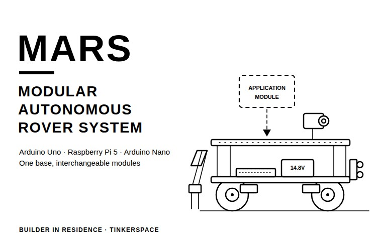

Most student rovers are built for one job. A delivery rover needs something to carry the load, an inspection rover needs a camera, and a search rover needs more sensors again. So, could one rover base carry whichever module a job needs and swap it for the next job? That question became MARS, the Modular Autonomous Rover System.

In this project, we show how to build MARS, a modular rover with a 3D-printed two-deck chassis. The base rover runs on an Arduino Uno with an L298N motor driver, takes commands from a phone over an HC-05 Bluetooth module, and stops for obstacles using three HC-SR04 ultrasonic sensors at the front. On top of it sit two modules. The camera module streams live video from a USB webcam through a Raspberry Pi 5, and the environmental module uses an Arduino Nano with a gas sensor, a DHT11 and a soil-moisture probe on a servo lift. The modular rover drives and stops for obstacles, and both modules work, but each module still runs on its own controller, mapping and full autonomy were not reached, and the code for all three controllers is not in the repository yet. You can also check out similar [robotics projects](https://circuitdigest.com/robotics-projects) and [Arduino projects](https://circuitdigest.com/arduino-projects) done previously here at Circuit Digest.

> **Quick Answer: What is MARS?**
>
> **MARS** is a **modular rover** with a 3D-printed two-deck chassis. The base rover uses an **Arduino Uno**, an **L298N**, an **HC-05** and three **HC-SR04** sensors for Bluetooth driving and obstacle stops, and the upper deck takes swappable modules: a **Raspberry Pi 5** camera module for live video and an **Arduino Nano** environmental module with gas, temperature, humidity and soil sensors.

**Table of Contents**

- [What Is MARS?](#what-is-mars)
- [How MARS Works](#how-does-the-mars-modular-rover-work)
- [Components Required](#components-required-for-the-mars-modular-rover)
- [Wiring Diagram](#wiring-diagram-of-the-mars-base-rover)
  - [Connection Table](#connection-table)
- [3D Printing the Chassis](#3d-printing-the-mars-chassis-and-probe-lift)
- [Assembling the Base Rover](#assembling-the-mars-base-rover)
- [Controller Setup](#setting-up-the-three-controllers)
- [Application Modules](#building-the-application-modules)
- [Testing and Calibration](#testing-and-calibrating-the-mars-modular-rover)
- [Live Demo](#live-video-demonstration)
- [Troubleshooting](#troubleshooting-the-mars-rover)
- [GitHub](#mars-github-repository)

## What Is MARS?

Disaster search, package delivery and remote inspection each need different hardware on a rover. Instead of a separate rover for every job, MARS uses one common base for movement, power and obstacle sensing, with an application module on top that changes with the task. To keep the build achievable, it has two modules: a camera module and an environmental monitoring module. Circuit Digest has also built a [Mars rover robot using Arduino](https://circuitdigest.com/microcontroller-projects/build-your-own-mars-rover-robot-using-arduino) with six BO motors and Bluetooth control. If interested, do check it out.

## How Does the MARS Modular Rover Work?

The working is split between the base rover and the modules. On the base, a Bluetooth serial terminal app on the phone sends movement commands to the HC-05, which passes them to the Arduino Uno over serial, and the Uno drives four BO gear motors through the L298N. The three HC-SR04 sensors face forward, one at the centre and the other two at about +25° and −25°. When they see an obstacle, the rover stops and waits until it moves away. Below is the block diagram of the MARS modular rover.

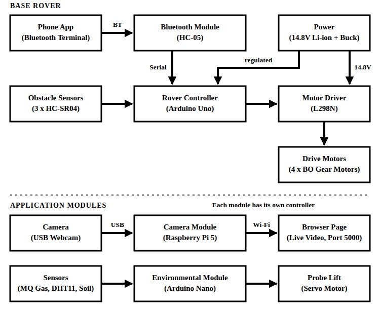

The two modules sit on the upper deck and run on their own controllers. The camera module streams video from the webcam over Wi-Fi to a browser page, and the environmental module reads its sensors and moves the soil probe with a servo. There is no data link between a module and the base yet. Here is another [web-controlled Raspberry Pi surveillance robotic car](https://circuitdigest.com/microcontroller-projects/web-controlled-raspberry-pi-surveillance-robot) that pairs a Pi and a webcam with a rover.

Below is the flowchart of the base rover's control loop.

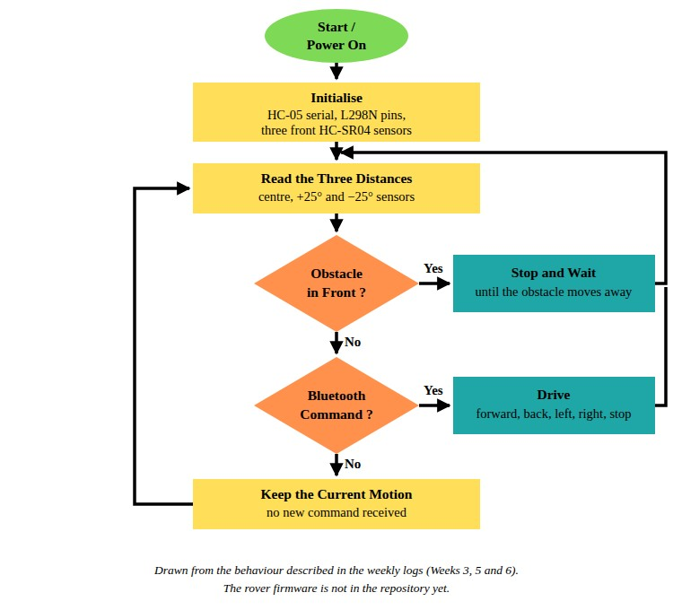

The rover firmware is not in the repository, so this flowchart follows the behaviour described in the build logs. Each pass reads the three distances first. An obstacle in front stops the rover until the path is clear, and otherwise the latest Bluetooth command sets the direction.

## Components Required for the MARS Modular Rover

Below is the list of components used to build the base rover and the two modules.

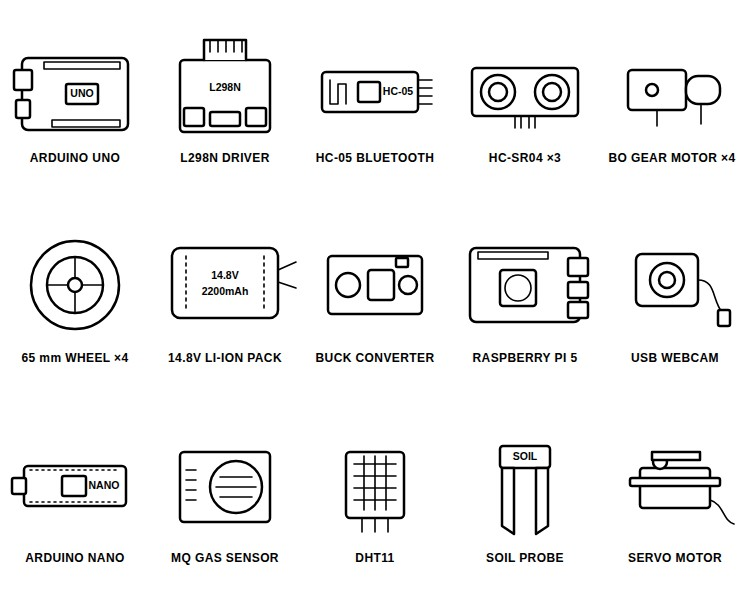

| S.No | Component | Description | Quantity |
|---|---|---|---|
| 1. | Arduino Uno | Base rover controller | 1 |
| 2. | L298N Motor Driver | Drives the four motors | 1 |
| 3. | HC-05 Bluetooth Module | Commands from the phone | 1 |
| 4. | HC-SR04 Ultrasonic Sensor | Obstacle detection at the front | 3 |
| 5. | BO Gear Motor [TODO: voltage and RPM] | Drive | 4 |
| 6. | 65 mm Universal Hub Tyre | Wheels | 4 |
| 7. | 14.8V 2200mAh Li-ion Pack | Main battery, 4S1P 18650 | 1 |
| 8. | Buck Converter | Supply for the electronics | 1 |
| 9. | Perfboard and Wires | Permanent circuit | As required |
| 10. | 3D-Printed Decks and Lift Parts | Chassis and probe lift, five STL files | 1 set |
| 11. | Raspberry Pi 5 with Active Cooler | Camera module computer | 1 |
| 12. | USB Webcam | Live video | 1 |
| 13. | Arduino Nano | Environmental module controller | 1 |
| 14. | MQ Gas Sensor [TODO: MQ model] | Gas detection | 1 |
| 15. | DHT11 | Temperature and humidity | 1 |
| 16. | Soil Moisture Probe | Soil moisture | 1 |
| 17. | Servo Motor | Raises and lowers the probe | 1 |

Below are the battery pack and the Uno board we used.

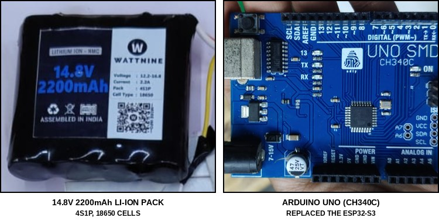

The pack is a Wattnine 14.8V 2200mAh Li-ion pack, built as 4S1P from 18650 cells and rated for 12.2V to 16.8V. Our Arduino Uno is a CH340C-based UNO SMD board. We started on an ESP32-S3 with its own Wi-Fi control page, but it was damaged by a short circuit while the motor driver was being tested with the battery connected, so the build moved to the Uno and, since the Uno has no Wi-Fi, to an HC-05 for Bluetooth control. Use wheels made for your motors. The 65 mm Universal Hub tyres fit our motors better than the first wheels and made the rover more stable. The gas sensor is a blue MQ-series module, but its model is not marked in any of the photos. Apart from these parts, you need a 3D printer, a soldering iron and a multimeter. To learn how the L298N works, refer to our [L298N motor driver with Arduino](https://circuitdigest.com/microcontroller-projects/interfacing-l298n-motor-driver-with-arduino) tutorial.

## Wiring Diagram of the MARS Base Rover

Below is the wiring diagram of the MARS base rover.

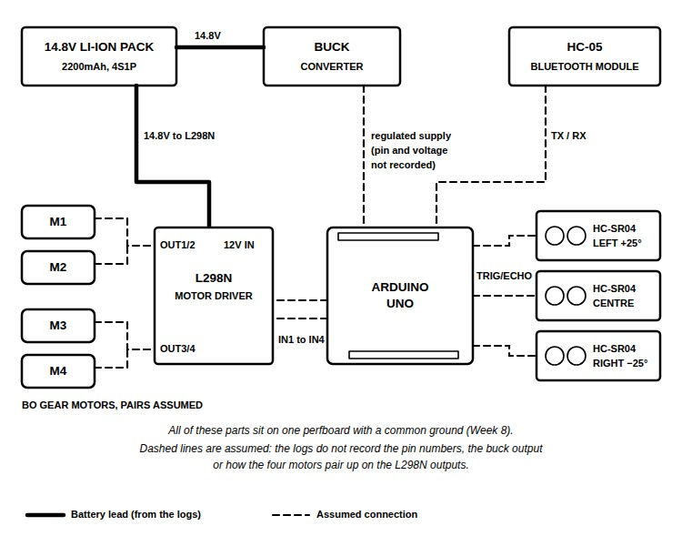

The brain of the base rover is the Arduino Uno. The 14.8V Li-ion pack feeds the L298N's motor supply directly and also feeds the buck converter, which supplies the low-voltage electronics. Commands from the HC-05 reach the Uno over serial, and each HC-SR04 has a trigger and an echo line to the Uno. On the output side, the Uno drives the L298N's IN1 to IN4 inputs, and the four BO motors connect to the OUT1/OUT2 and OUT3/OUT4 terminals. All of this is soldered on one perfboard with a common ground. The build logs do not record the pin numbers, the buck converter's output voltage or which motors share an output, so those lines are dashed in the diagram. Choose your own pins and check each line with a multimeter before connecting the battery. That is all about the wiring. For three HC-SR04 sensors on one Arduino, the [human following robot](https://circuitdigest.com/microcontroller-projects/human-following-robot-using-arduino-and-ultrasonic-sensor) on Circuit Digest uses a similar arrangement.

### Connection Table

| Connection | From | To | Recorded in the Repo? |
|---|---|---|---|
| Motor supply | 14.8V pack | L298N motor supply input | Yes |
| Logic supply | 14.8V pack through the buck converter | Arduino Uno and sensors | Yes, output voltage and pin not recorded |
| Bluetooth | HC-05 TX/RX | Arduino Uno serial pins | Assumed, pins not recorded |
| Obstacle sensors | Three HC-SR04 TRIG/ECHO | Arduino Uno digital pins | Assumed, pins not recorded |
| Motor control | Arduino Uno | L298N IN1 to IN4 | Assumed, pins not recorded |
| Motors | Four BO motors | L298N OUT1/OUT2 and OUT3/OUT4 | Yes, pairing not recorded |
| Ground | Every board | Common ground on the perfboard | Yes |

## 3D Printing the MARS Chassis and Probe Lift

The base was designed in Zoo Keeper and Fusion 360 at about 21 × 18 cm, with places for the battery holder, the ultrasonic sensor holders and a module area. Below are the printed parts, rendered from the STL files in the repository's cad folder.

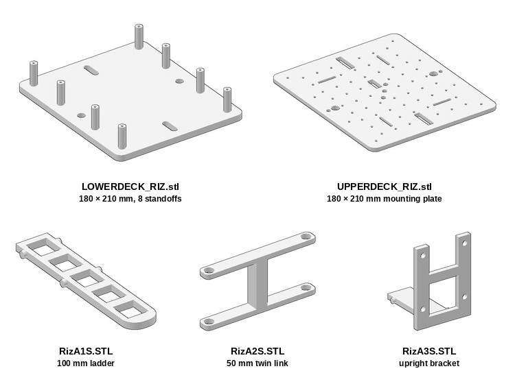

The table below lists the five files and what each one is.

| File in cad/ | Part | Size |
|---|---|---|
| LOWERDECK_RIZ.stl | Lower deck with eight standoffs for the drive electronics | 180 × 210 mm |
| UPPERDECK_RIZ.stl | Perforated upper deck where the modules mount | 180 × 210 mm |
| RizA1S.STL | Ladder that holds the soil probe | 100 mm long |
| RizA2S.STL | Pair of links for the probe lift | 50 mm |
| RizA3S.STL | Upright bracket for the probe lift | - |

The roles of the three small parts are read from their shapes, as the repository does not name them. Print settings are not recorded in the repository [TODO: print material, layer height and infill]. Measure your own battery, sensors and boards before printing, as the printed size does not always match the CAD size. We corrected the deck dimensions a few times against the real parts before the final print. For more printed parts in real builds, take a look at the [3D printing projects](https://circuitdigest.com/3d-printing-projects) on Circuit Digest.

## Assembling the MARS Base Rover

**Step 1⇒ Try the Layout on Foam Board**

Before printing anything, lay the parts out on a 30 × 30 cm piece of foam board to find where the motors, the controller and the battery go. Foam board is cheap and easy to cut. Below is our first layout.

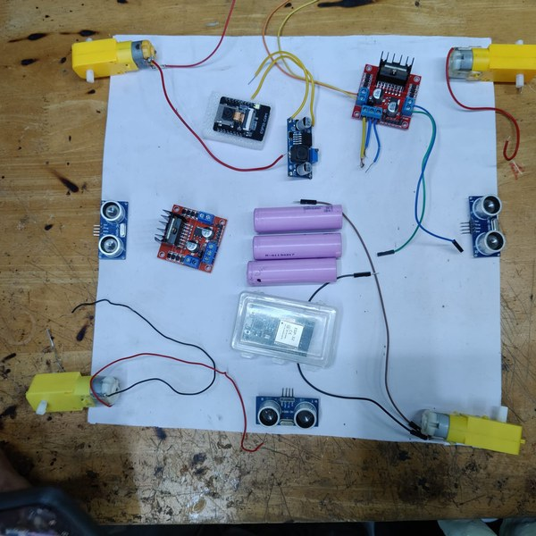

This layout still has the ESP32-S3 we started with. If you cannot find a holder for your battery, soldering its leads directly works as a temporary fix, but insulate every joint.

**Step 2⇒ Test Each Part on Its Own**

Test the controller, the ultrasonic sensors, the motor driver, the motors and the buck converter one by one before connecting them together. Check that both channels of the L298N get equal voltage with a multimeter, and keep the battery disconnected while you probe the circuit. A short during this kind of testing is what damaged our ESP32-S3.

**Step 3⇒ Solder the Perfboard**

Move the circuit from the breadboard to a perfboard, with the L298N, the buck converter and the Uno on one board and a common ground. Every joint has to be soldered and checked, with a lot of wires in a small space.

**Step 4⇒ Fit Everything on the Printed Base**

Mount the four BO motors and the 65 mm wheels on the lower deck, and fix the perfboard and the battery in place. Then power the board from the 14.8V pack and check the Bluetooth link, the motor driver and the motors one after the other. Below are the perfboard and the base it went into.

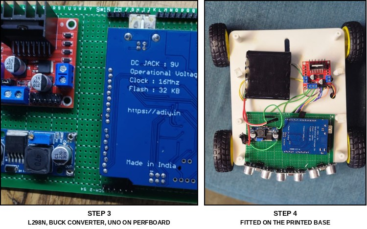

**Step 5⇒ Mount the Three Ultrasonic Sensors at the Front**

Put all three HC-SR04 sensors at the front of the lower deck, one at the centre and two at about +25° and −25°. With one sensor each at the front, left and right, our rover did not respond reliably. To try the ultrasonic side on its own first, refer to our [HC-SR04 with ESP32](https://circuitdigest.com/microcontroller-projects/interfacing-hcsr04-ultrasonic-sensor-module-with-esp32) guide.

## Setting Up the Three Controllers

MARS has three programs, one for each controller, and none of them is in the repository yet [TODO: add the Uno, Raspberry Pi and Nano code to the code folder]. Until they are published, write each one to the behaviour below.

On the Arduino Uno, the program reads commands from the Bluetooth serial terminal app for forward, backward, left and right, reads the three HC-SR04 sensors on every pass, and stops the motors whenever an obstacle is in front. Pair the phone with the HC-05, open the serial terminal app and send the commands from there. Circuit Digest has a [DIY Arduino Bluetooth car controlled by a mobile app](https://circuitdigest.com/microcontroller-projects/diy-arduino-bluetooth-robot-car) with a similar HC-05 and L298N setup.

On the Raspberry Pi 5, install the OS, join the Pi to your network and connect the USB webcam. The Pi serves the webcam's video on a browser page on port 5000, which a phone on the same network can open.

On the Arduino Nano, the program reads the gas sensor, the DHT11 and the soil-moisture probe, and drives the servo that raises and lowers the probe. For how a servo is driven from an Arduino, refer to our [Arduino servo motor control](https://circuitdigest.com/microcontroller-projects/arduino-servo-motor-control-code-and-circuit) tutorial.

## Building the Application Modules

Each module mounts on the perforated upper deck with its own controller. Below are the Raspberry Pi 5 with its USB webcam and the MARS ROVER page it serves.

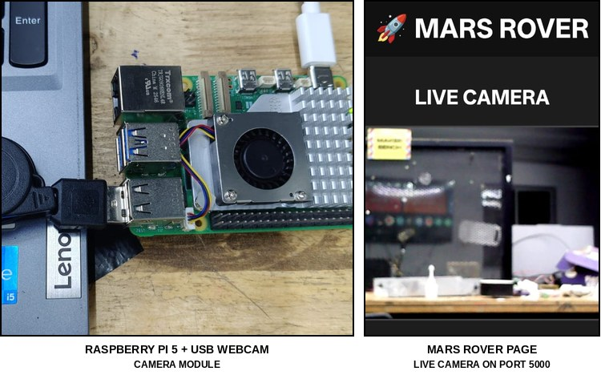

The page streams the webcam's video from port 5000. It also has rover control buttons, but the build logs only describe the video stream, so how those buttons reach the base is [TODO: link between the camera page and the base rover]. For another Pi and webcam build, do check out our [Raspberry Pi surveillance robotic car](https://circuitdigest.com/microcontroller-projects/web-controlled-raspberry-pi-surveillance-robot) as well.

The second module is the environmental module. Below are its sensors and the servo-driven lift for the soil probe.

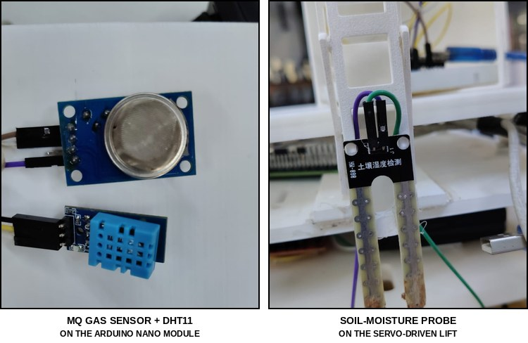

The Arduino Nano reads the gas sensor, the DHT11 and the soil-moisture probe. The probe sits on the printed ladder, and the servo raises and lowers it, so the probe goes into the soil only when a reading is needed. The [air quality monitoring system](https://circuitdigest.com/microcontroller-projects/arduino-based-air-quality-monitoring-system) on Circuit Digest reads an MQ gas sensor and a DHT11 with an Arduino in a similar way.

## Testing and Calibrating the MARS Modular Rover

Test the ultrasonic sensors in a real room before you rely on them. Below is the rover during that testing.

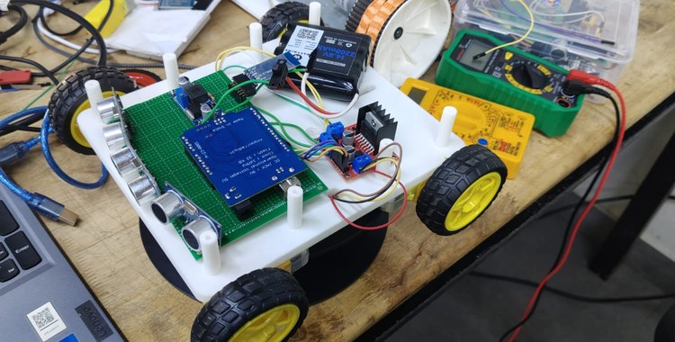

Place the rover at different spots and distances from walls and objects, and compare the readings. This also shows up small problems with the wiring, the sensor positions and the component placement, which are easier to fix at this stage. For point-to-point runs, measure the room and draw a map. Below is ours, next to the Wi-Fi control page from our first ESP32-S3 controller.

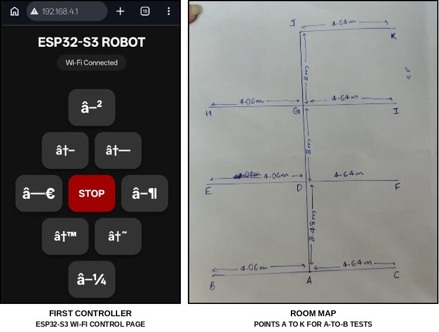

The map has points A to K along a central line, with branches of 4.06 m on one side and 4.64 m on the other. We gave the Uno program the room dimensions and layout from this map, ran commands such as A to B, and adjusted the movement several times to get the path and the final position right. Then calibrate the sensors and the movement in a loop of testing, finding the error, adjusting and testing again. Check the camera module for streaming, and the environmental module for its sensors and the servo lift. Below is MARS with both modules on it.

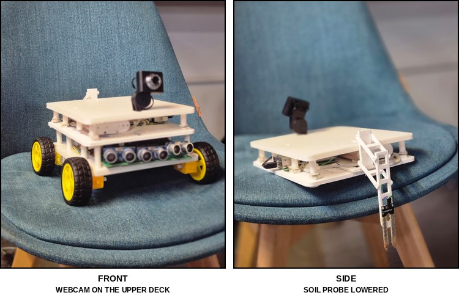

The webcam sits on the upper deck, the three ultrasonic sensors look out from the front of the lower deck, and the soil probe hangs down on its lift at the side. The build logs record no sensor readings or test numbers [TODO: sample readings and A-to-B accuracy]. Mapping and fully autonomous navigation were planned as the next stage and were not reached.

## Live Video Demonstration

Below is the video demonstration of MARS.

*Video not published yet.*

[TODO: video of MARS driving on Bluetooth, stopping for an obstacle, streaming from the camera module and lowering the soil probe]

## Troubleshooting the MARS Rover

| Symptom | Likely Cause | Fix |
|---|---|---|
| Controller dies when the 14.8V pack is connected | A short while testing with the battery connected | Disconnect the battery before probing, and check the board for shorts before powering it |
| The two L298N channels get different voltages | Not recorded in the logs | Measure both channels with a multimeter before the controller is connected |
| Obstacles at the sides are missed or the rover reacts late | Sensors spread to the front, left and right | Put all three at the front, at the centre and about ±25° |
| Wheels do not sit on the motor shafts | Wheel and shaft mismatch | Use wheels made for the motors, such as the 65 mm Universal Hub tyres |
| Printed parts do not fit the components | CAD size differs from the printed size | Measure the real parts, correct the CAD and allow for print tolerance |
| Bluetooth control does not work | Wrong connections, wrong pairing or serial settings | Check the HC-05 wiring, pair with the right device and check the serial settings and commands |
| Ultrasonic readings are wrong | Wiring, supply or a blocked path | Check the wiring and supply, give each sensor a clear path and check the distance logic |
| Environmental readings are unstable | Loose connections or sensors not yet settled | Check the connections and supply voltage, let the sensors stabilise and calibrate them |

## Conclusion

With these steps, you can build a MARS base that drives on Bluetooth commands and stops for obstacles, a Raspberry Pi 5 module that streams live video and an Arduino Nano module that reads its sensors and lowers the soil probe. The modules work, but each one still runs on its own controller. There is still room for improvement, such as a standard module mount with power and data connections, a link between the modules and the base, battery monitoring, and the mapping and autonomous navigation that were planned next. Further, one can make the base avoid obstacles instead of only stopping, just like this [obstacle avoiding robot using Arduino and ultrasonic sensor](https://circuitdigest.com/microcontroller-projects/arduino-obstacle-avoding-robot) on Circuit Digest.

## MARS GitHub Repository

The MARS repository has the README, the build logs with their photos, and five STL files: the lower deck, the upper deck and three parts of the soil probe lift. The code folder only has a README for now. MARS was built at Tinkerspace by Riz Mariya Davis as part of the Builder in Residence programme, and the repository is released under the GNU GPL v3 licence.

[Code & Schematics (GitHub)](https://github.com/BuilderinResidencyTinkerspace/MARS-Modular-Autonomous-Rover-System) · [Download Zip](https://github.com/BuilderinResidencyTinkerspace/MARS-Modular-Autonomous-Rover-System/archive/refs/heads/main.zip)

## Frequently Asked Questions About the MARS Modular Rover

**⇥ 1. Why does MARS use an Arduino Uno and not an ESP32?**

The first controller was an ESP32-S3, and it was damaged by a short circuit while the motor driver was being tested with the 14.8V pack connected. The Uno replaced it, and since the Uno has no Wi-Fi, the rover moved to Bluetooth control with an HC-05.

**⇥ 2. Why are all three ultrasonic sensors at the front?**

With sensors at the front, left and right, the rover did not respond reliably. Placing all three at the front, at the centre and about ±25°, gave better coverage in the direction the rover moves.

**⇥ 3. Can the modules be swapped while the rover is running?**

Not yet. Each module has its own controller and sits on the perforated upper deck, but there is no standard mount or shared power and data connection, which is one of the planned improvements.

**⇥ 4. Does MARS navigate on its own?**

Partly. It stops for obstacles and was tested on A-to-B runs using a measured room map, with the movement adjusted by hand several times. Mapping and full autonomous navigation were not reached.

## Rover and Robotics Projects

Explore more rover builds, from Bluetooth driving to a Pi camera on wheels and an obstacle-avoiding robot.

- **[Build your own Mars Rover Robot using Arduino](https://circuitdigest.com/microcontroller-projects/build-your-own-mars-rover-robot-using-arduino)**: *The planet Mars has captivated our imagination for centuries, and this build makes a small Mars rover of our own with an Arduino.*
- **[DIY Web Controlled Raspberry Pi Surveillance Robotic Car](https://circuitdigest.com/microcontroller-projects/web-controlled-raspberry-pi-surveillance-robot)**: *In this DIY session we are building a web controlled surveillance robotic car using raspberry pi and a webcam.*
- **[Obstacle Avoiding Robot using Arduino and Ultrasonic Sensor](https://circuitdigest.com/microcontroller-projects/arduino-obstacle-avoding-robot)**: *An Arduino obstacle avoiding robot is a smart, autonomous robot that detects obstacles on its path using sensors and then navigates around the obstacle by changing direction.*

## Complete Project Code

The code for MARS is not in the repository yet. The code folder holds only a README, so there is no firmware to list here [TODO: add the complete code once it is published].
