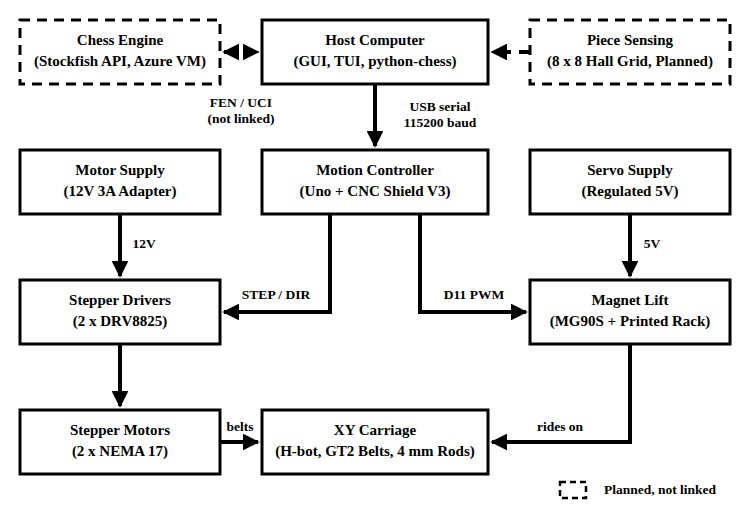
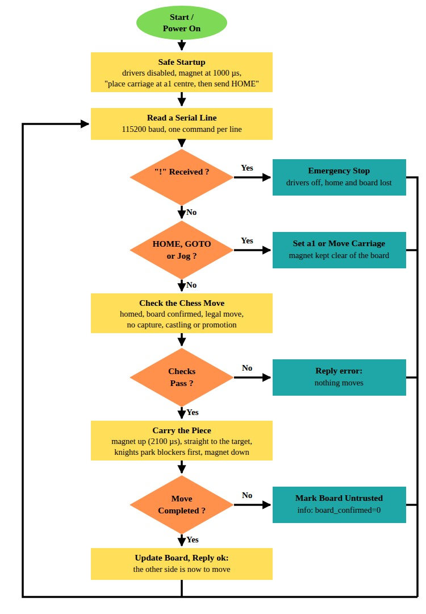
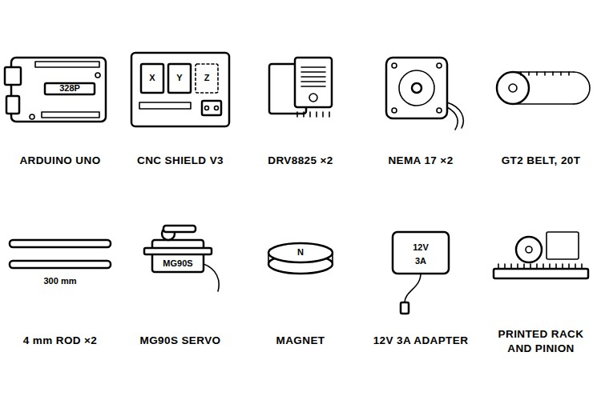
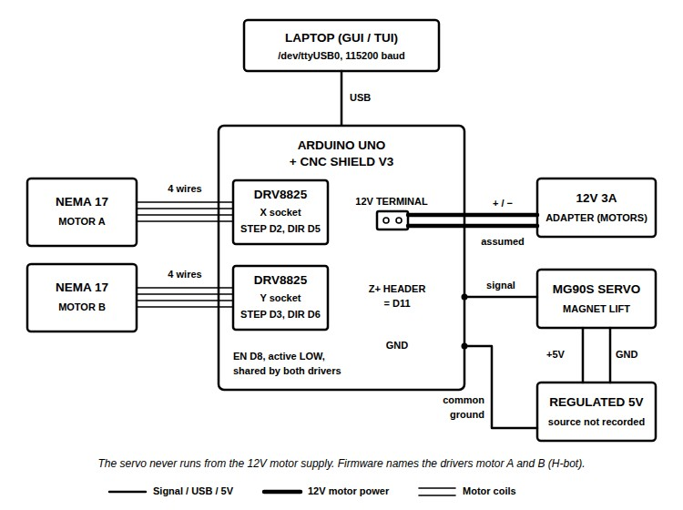
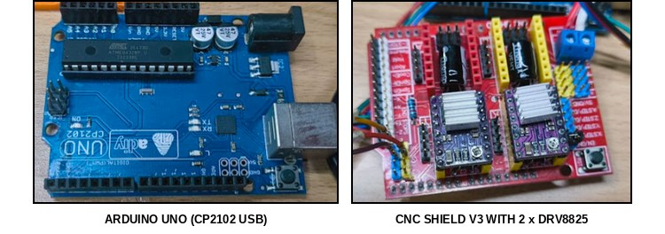
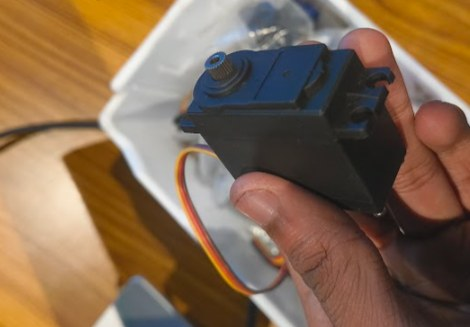
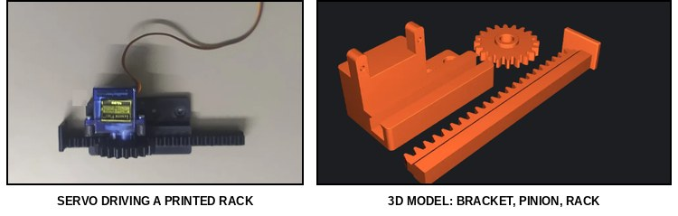
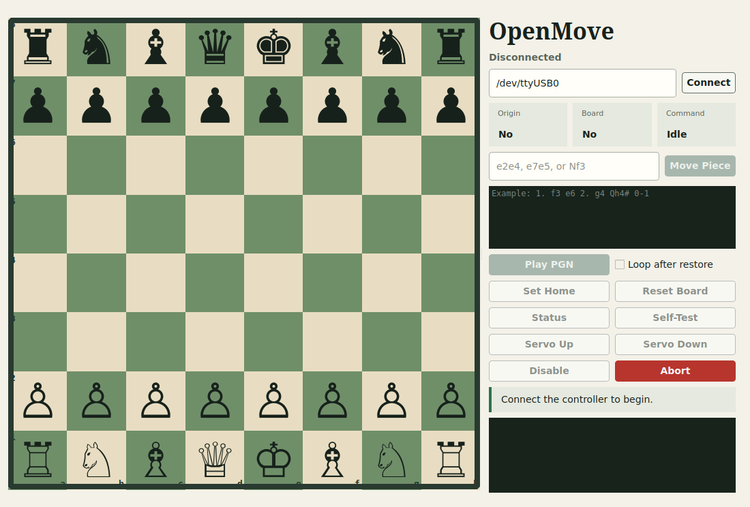
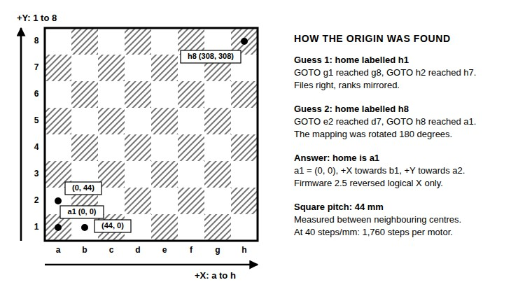

OpenMove started with the moving chess pieces from Harry Potter and one question: could a real chessboard understand what is happening on it, think about the next move, and push a piece on its own? A magnet under the board can drag a piece across the squares, so the job comes down to moving that magnet accurately.

In this project, I am building OpenMove, an automatic chessboard prototype where a magnet under the board moves the pieces. An Arduino Uno with a CNC Shield V3 drives two NEMA 17 motors through DRV8825 drivers, an MG90S servo lifts a magnet up to the underside of the board, and a desktop app on a laptop sends the moves over USB. Stockfish runs separately as a small web service. Right now the automatic chessboard is an XY motion prototype. The carriage jogs in the right directions from a1, but it has not moved a real piece yet, so this guide covers the motion, calibration and software in full, and the pickup as far as it has been tested. You can also check out similar [Arduino projects](https://circuitdigest.com/arduino-projects) and [robotics projects](https://circuitdigest.com/robotics-projects) done previously here at Circuit Digest.

<div style="background-color:#e8f4fd;border-left:4px solid #1a73e8;border-radius:4px;margin:1em 0 1.5em;padding:14px 18px;" role="note" aria-label="Quick Answer"><strong style="display:block;margin-bottom:6px;">Quick Answer: What is OpenMove?</strong><strong>OpenMove</strong> is an <strong>automatic chessboard prototype</strong> that moves pieces from underneath with a servo-lifted magnet on an XY carriage. An <strong>Arduino Uno and CNC Shield V3</strong> drive two <strong>NEMA 17</strong> motors, a PySide6 desktop app sends moves over USB, and a Stockfish API runs on an Azure VM. Small jogs work; piece pickup and full games are not validated yet.</div>

<div class="toc" style="background-color:#EBF2FA;border-radius:4px;margin:20px 0;max-width:800px;padding:20px;"><h3 style="color:#333;font-size:1.2em;margin:0 0 15px 0;"><strong>Table of Contents</strong></h3><ul style="list-style-type:none;margin:0;padding-left:0;">
<li><a href="#what-is-openmove"><strong>What Is OpenMove?</strong></a></li>
<li><a href="#how-does-the-openmove-automatic-chessboard-work"><strong>How OpenMove Works</strong></a></li>
<li><a href="#components-required-for-the-openmove-chessboard"><strong>Components Required</strong></a></li>
<li><a href="#wiring-diagram-of-the-openmove-chessboard"><strong>Wiring Diagram</strong></a></li>
<li style="margin-left:20px;"><a href="#cnc-shield-v3-pin-connections"><strong>└ CNC Shield V3 Pin Connections</strong></a></li>
<li><a href="#testing-the-motion-electronics-on-the-bench"><strong>Bench Testing the Electronics</strong></a></li>
<li><a href="#building-the-magnet-lift"><strong>Building the Magnet Lift</strong></a></li>
<li><a href="#uploading-the-firmware-and-running-the-desktop-gui"><strong>Firmware Upload and GUI</strong></a></li>
<li style="margin-left:20px;"><a href="#openmove-serial-commands"><strong>└ Serial Commands</strong></a></li>
<li><a href="#calibrating-the-board-mapping"><strong>Calibrating the Board Mapping</strong></a></li>
<li><a href="#running-the-stockfish-api"><strong>Running the Stockfish API</strong></a></li>
<li><a href="#openmove-code-explanation"><strong>Code Explanation</strong></a></li>
<li><a href="#live-video-demonstration"><strong>Live Demo</strong></a></li>
<li><a href="#output-testing-the-openmove-prototype"><strong>Output</strong></a></li>
<li><a href="#troubleshooting-the-openmove-chessboard"><strong>Troubleshooting</strong></a></li>
<li><a href="#lessons-from-our-build"><strong>Lessons From Our Build</strong></a></li>
<li><a href="#openmove-github-repository"><strong>GitHub</strong></a></li>
</ul></div>

### What Is OpenMove?

OpenMove has a mechanism under the board that moves a piece, a Stockfish engine that picks a reply, and a planned 8 × 8 grid of Hall-effect sensors to find the pieces. The Arduino handles pins, steps and the magnet, while the laptop owns the chess rules, the game state and the engine, and a move from Stockfish should never reach the motors until the host has checked it against the board. If you build your own, start with the motion. Circuit Digest has also covered an [autonomous chessboard that uses an ESP32 and Stockfish](https://circuitdigest.com/news/autonomous-chessboard-uses-esp32-and-stockfish-for-intelligent-gameplay). If interested, do check it out.

### How Does the OpenMove Automatic Chessboard Work?

The working is split between the laptop and the Arduino. The desktop app keeps the game state with python-chess and sends one move at a time over USB serial at 115200 baud. The Uno turns that move into square coordinates, and the two DRV8825 drivers on the CNC Shield step the NEMA 17 motors, which pull the carriage on GT2 belts in an H-bot layout. On the carriage, an MG90S servo raises a magnet to the underside of the board to catch a piece and lowers it again to let go. Below is the block diagram of the OpenMove automatic chessboard.



The dashed boxes are not connected yet. The Stockfish API works on its own, and the Hall-effect grid is still an idea. The servo-and-carriage idea is close to the pen lift in the Circuit Digest [Arduino CNC plotter](https://circuitdigest.com/microcontroller-projects/arduino-cnc-machine-project-code), where a mini servo raises and lowers the pen.

Below is the flowchart of the firmware running on the Uno.



The firmware starts with the drivers switched off and waits for you to place the carriage at the centre of a1 and send HOME. A chess move only runs if the carriage is homed, the board has been confirmed with RESETBOARD, and the move is legal and free of captures, castling, en passant and promotion. If a move fails halfway, the firmware marks the board as untrusted, because the pieces may no longer match its stored position.

### Components Required for the OpenMove Chessboard

Below is the list of components required to build this project.



| S.No | Component | Description | Quantity |
|---|---|---|---|
| 1. | Arduino Uno (CP2102 USB) | Low-level motion controller | 1 |
| 2. | CNC Shield V3 | Driver sockets, STEP/DIR/ENABLE breakout | 1 |
| 3. | DRV8825 Stepper Driver | 1/8 microstepping, VREF about 0.65V | 2 |
| 4. | NEMA 17 Stepper Motor | 1.8° steps, drives the belts | 2 |
| 5. | GT2 Belt with 20-Tooth Pulleys | H-bot transmission | As required |
| 6. | Stainless-Steel Rod, 4mm × 300mm | Linear support | 2 |
| 7. | MG90S Servo | Raises and lowers the magnet | 1 |
| 8. | Permanent Magnet [TODO: size and grade] | Catches a piece through the board | 1 |
| 9. | 3D-Printed Rack and Pinion | Turns servo rotation into vertical travel | 1 set |
| 10. | 12V 3A Adapter | Motor power | 1 |
| 11. | Regulated 5V Supply [TODO: model] | Servo power | 1 |
| 12. | Chessboard and Pieces [TODO: board thickness and piece base] | 44mm between square centres | 1 set |
| 13. | Laptop with Python 3 | Desktop GUI, terminal UI, python-chess | 1 |

The Uno in my photos is an Adiy board with a CP2102 USB chip, which is why it shows up as /dev/ttyUSB0 on Linux. The firmware's 40 steps per millimetre comes from the 1.8° motors, the DRV8825s set to 1/8 microstepping, and a GT2 belt on 20-tooth pulleys, so keep those three the same or recalculate `MOTOR_STEPS_PER_MM`. For a first look at this motor and driver pair, refer to the [NEMA 17 with Arduino and DRV8825](https://circuitdigest.com/microcontroller-projects/control-nema-17-stepper-motor-with-arduino-using-drv8825-stepper-motor-driver) tutorial on Circuit Digest.

### Wiring Diagram of the OpenMove Chessboard

Below is the wiring diagram for the OpenMove chessboard.



The CNC Shield sits on top of the Uno, and the two DRV8825 drivers plug into its X and Y sockets, as per the table below. The firmware names the motors A and B, as both of them work together on every move in an H-bot. The servo signal goes to the shield's Z+ limit-switch header, which is D11 on the Uno. Power the servo from a separate regulated 5V supply with its ground tied to the shield ground, and never connect it to the 12V motor supply. The 12V 3A adapter feeds the motor side, and a motor should never be plugged in or pulled out while that supply is on. That is all about the wiring. If you are new to servos, do check out our [servo motor with Arduino](https://circuitdigest.com/microcontroller-projects/interface-servo-motor-with-arduino) guide.

#### CNC Shield V3 Pin Connections

| Device | CNC Shield V3 Connection | Arduino Pin |
|---|---|---|
| Motor A driver STEP / DIR | X socket | D2 / D5 |
| Motor B driver STEP / DIR | Y socket | D3 / D6 |
| Shared driver ENABLE | Shield enable, active LOW | D8 |
| MG90S servo signal | Z+ limit-switch header | D11 |

### Testing the Motion Electronics on the Bench

Test the electronics on the desk before building any mechanics. Below are the Uno and the CNC Shield with its two DRV8825 drivers.



Set the driver current first. Both of my drivers measured about 0.65V on VREF, but the current limit also depends on the sense resistors on each driver board, so read their markings and set VREF from them. I have not done that yet, so my actual limit is still unknown.

Then upload code/hardware_smoke_test/hardware_smoke_test.ino. It sends 100 pulses to both motors together at about 50 steps per second, pauses, reverses, and swings the servo between 30 and 120 degrees, over and over. Both of my motors moved and reversed together, and the servo followed. Below is the servo from that test.



This test proves the whole chain is alive, but it does not check each motor on its own or any movement under load, so test each motor alone as well.

### Building the Magnet Lift

A magnet sitting at one height cannot choose whether to hold a piece or let it go, so it needs a way to move up and down. A servo rotates and the magnet has to travel vertically, so a 3D-printed rack and pinion sits between them. Below are the linear servo mechanism and its 3D model.



The repository's cad folder has only a README so far, so model and print your own bracket, pinion and rack. The magnet has to come close enough to carry a piece through the board, and drop far enough away to leave it behind. In the firmware, a 2100 µs pulse puts the magnet against the underside of the board, which I checked by eye, and 1000 µs takes it clear. The servo gets 500 ms to settle before the carriage moves, since nothing measures its position. I have not done a successful piece transfer yet, so tune the magnet and the two pulse widths on your own board. In addition to this build, here is a collection of [3D printing projects](https://circuitdigest.com/3d-printing-projects) for reference.

### Uploading the Firmware and Running the Desktop GUI

The steps below set up the firmware and the desktop controller on a Linux laptop.

**Step 1⇒ Upload the Firmware**

The sketch is code/openmove_chess/openmove_chess.ino. Compile and upload it for the Uno with the Arduino IDE or with arduino-cli, as shown below. Close the GUI first, as it holds the serial port.

```bash
arduino-cli compile --fqbn arduino:avr:uno code/openmove_chess
arduino-cli upload --port /dev/ttyUSB0 --fqbn arduino:avr:uno code/openmove_chess
```

**Step 2⇒ Start the Desktop GUI**

Install the GUI requirements, PySide6 and python-chess, in a virtual environment and start it with the serial port.

```bash
python -m venv .venv
source .venv/bin/activate
pip install -r code/requirements-gui.txt
python code/openmove_gui.py --port /dev/ttyUSB0
```

The terminal UI needs only Python's standard library, and `python code/openmove_tui.py --port /dev/ttyUSB0` starts it, with `--home` and `--reset` to send HOME and RESETBOARD at startup. Below is the GUI before connecting. Its move controls stay disabled until the controller reports protocol 7, the a1 mapping, a home and a confirmed board.



**Step 3⇒ Set Home and Reset Board**

An upload clears both confirmations. Move the carriage by hand to the centre of a1 and press **Set Home**. Then arrange the pieces in the starting position and press **Reset Board**. These buttons only record what you did. They do not move anything back for you.

**Step 4⇒ Start with Small Jogs**

Use the 1 mm and 10 mm jogs to check both directions before trying GOTO, a move or a PGN.

#### OpenMove Serial Commands

| Command | What It Does |
|---|---|
| HOME | Sets the current carriage position as a1 and enables the drivers |
| RESETBOARD | Confirms the standard starting position |
| STATUS, SELFTEST | Report the mapping, home, trust and stop state |
| JOGX+1, JOGX-10, JOGY+1, JOGY-10 (and the other signs) | Move 1 mm or 10 mm along one axis |
| GOTO e4 | Moves the carriage to the centre of a square |
| e2e4, Nf3 | Plays a legal, non-capturing chess move |
| RETURN e4e2 | Moves a piece back without the rules check, for PGN restore |
| MAGNET90, MAGNET0 | Raises the magnet to the board or takes it clear |
| DISABLE | Switches the drivers off and clears home |
| ! or Ctrl-X | Emergency stop |

Commands are not case-sensitive.

### Calibrating the Board Mapping

The Arduino does not know where the carriage is when it starts, and there is no limit switch, so the mapping between squares and motor steps has to be checked on the real board. Below is the coordinate mapping I ended up with, next to the two wrong guesses that came before it.



Measure the distance between neighbouring square centres first. Mine is 44 mm, which puts h8 at (308, 308) with a1 at (0, 0). Then home at a1 and check that a small positive X jog moves towards b1 and a positive Y jog towards a2. After that, test GOTO on squares far from a1. My first origin label, h1, sent GOTO g1 to g8, and the second, h8, sent GOTO e2 to d7, which meant the mapping was rotated by 180 degrees and the real origin was a1. Firmware 2.5 fixed this by reversing only the logical X axis with `REVERSE_LOGICAL_X`. Finally, check the travel, as seven 44 mm gaps add up to 308 mm while my rods are 300 mm long.

### Running the Stockfish API

The engine lives in the stockfiash folder of the repository as a small FastAPI app in a Docker container. It takes a full FEN position and a search time between 50 and 5000 ms, checks an API key, and replies with a best move in UCI notation, such as e2e4. To run it locally, put a long random key in the environment file and start the container.

```bash
cd stockfiash
cp .env.example .env              # set OPENMOVE_API_KEY, e.g. openssl rand -hex 32
docker compose up --build
curl http://localhost:8080/health
```

The container is limited to one CPU and 512 MiB of memory and runs on a read-only filesystem. Mine runs on an Azure VM, bound to 127.0.0.1:8080, so I reach it through an SSH tunnel, and public DNS and TLS are still pending. The recorded warm responses on the VM are below.

| Search Time | Response Time on the VM |
|---|---|
| 50 ms | About 59 ms |
| 250 ms | About 255 ms |
| 500 ms | About 506 ms |

These timings are for the service on the VM, not a round trip from the board. Five API tests pass, with the success test using a mock engine. A more basic electronic chessboard is the [DIY computer chess board using Raspberry Pi](https://circuitdigest.com/project/raspberry-pi-chess-board) on Circuit Digest.

### OpenMove Code Explanation

The firmware is written in the Arduino IDE for the Uno. Version 2.7 in the repository speaks serial protocol 7 at 115200 baud, and the desktop GUI is written in Python with PySide6 and python-chess. Below are the main parts.

**Pins and Calibration**

```cpp
const uint8_t A_STEP_PIN = 2;
const uint8_t B_STEP_PIN = 3;
const uint8_t A_DIR_PIN = 5;
const uint8_t B_DIR_PIN = 6;
const uint8_t ENABLE_PIN = 8;  // Active LOW.
const uint8_t ACTUATOR_PIN = 11;  // CNC Shield Z+ header; PWM signal only.
const float MOTOR_STEPS_PER_MM = 40.0f;
const float SQUARE_SIZE_MM = 44.0f; // User-measured adjacent square centres.
const bool REVERSE_LOGICAL_X = true;
const int ACTUATOR_RETRACT_US = 1000; // Magnet raised / piece released.
const int ACTUATOR_EXTEND_US = 2100; // Confirmed surface contact.
```

These constants hold the pin map and the numbers measured on the real board, so change `SQUARE_SIZE_MM` and `MOTOR_STEPS_PER_MM` for your own board and drive. The comment on 1000 µs says "raised", while my build notes describe the magnet going up to grab a piece, so check the direction on your own build.

**Turning X and Y into Two Motors**

```cpp
float logicalX = REVERSE_LOGICAL_X ? -x : x;
float mappedX = SWAP_X_Y ? y : logicalX;
float mappedY = SWAP_X_Y ? logicalX : y;
long targetA = lroundf((mappedX + mappedY) * MOTOR_STEPS_PER_MM);
long targetB = lroundf((mappedY - mappedX) * MOTOR_STEPS_PER_MM);
if (!moveMotors(targetA, targetB)) return false;
```

The `moveTo()` function converts a position in millimetres into step targets. In this H-bot mapping, motor A follows X plus Y and motor B follows Y minus X, so a straight move along one axis turns both motors.

**Carrying a Piece**

```cpp
bool pickupSquare(uint8_t file, uint8_t rank) {
  releaseMagnet();
  if (!moveTo(squareX(file), squareY(rank))) return false;
  engageMagnet();
  return !motionAborted;
}
```

To move a piece, the carriage goes to the source square with the magnet clear, raises the magnet, travels to the destination and lowers it. Most pieces travel in a straight line between square centres, since a legal move already has a clear path. The magnet cannot jump, so for a knight, `planKnightMove()` tries three square-by-square routes, parks up to two blocking pieces on empty squares, moves the knight, and then puts the blockers back. This planner has not been tested on the board yet.

**Checking a PGN Before Replay**

```python
for move in moves:
    if board.is_capture(move):
        raise ValueError("PGN captures are not physically supported yet")
    if board.is_castling(move):
        raise ValueError("PGN castling is not physically supported yet")
    if move.promotion:
        raise ValueError("PGN promotions are not physically supported yet")
    board.push(move)
```

`parse_replayable_pgn()` in the GUI walks through every move of the PGN before anything is sent, so an unsupported move cannot turn up halfway through a replay.

**Restoring the Board with RETURN**

```python
move = self.playback_moves[self.playback_index - 1]
reverse_move = chess.square_name(move.to_square) + chess.square_name(move.from_square)
self._send(f"RETURN {reverse_move}", success=self._pgn_return_completed,
           timeout=120.0, playback=True)
```

After the last move, the GUI waits 10 seconds and plays the moves backwards with `RETURN`, so e2e4 comes back as `RETURN e4e2`. RETURN skips the rules check, as a pawn moving backwards would fail it. With **Loop after restore** ticked, it checks the controller status and plays the PGN again, or stops if home or board trust was lost.

### Live Video Demonstration

Below is the video demonstration of OpenMove.

<iframe width="750" height="422" src="https://www.youtube.com/embed/VIDEO_ID" title="OpenMove Automatic Chessboard" frameborder="0" allowfullscreen></iframe>

[TODO: video of the carriage jogging from a1, a GOTO test and the GUI connected to the controller]

### Output: Testing the OpenMove Prototype

Below is what the controller prints when it starts, taken from the firmware's `setup()`.

```text
OpenMove chess motion controller 2.7
mapping:home=a1,+x=a-to-h,+y=1-to-8,white=ranks-1-2
mode:white-and-black automation; captures disabled
ready:place carriage at a1 centre, then send HOME
```

The smoke test ran on the hardware, and both motors and the servo moved. After firmware 2.5, the small positive X and Y jogs matched a1 to b1 and a1 to a2 on the board. Firmware 2.6 compiled to 19,146 bytes of flash and 858 bytes of RAM, uploaded, and a read-only status query confirmed protocol 7 and the a1 mapping. The records disagree on whether 2.7 was uploaded, so the installed version still needs checking. No full-square accuracy test, piece pickup or physical PGN replay has been done yet.

### Troubleshooting the OpenMove Chessboard

| Symptom | Likely Cause | Fix |
|---|---|---|
| GOTO g1 goes to g8 | The origin label does not match the real corner | Test GOTO from the real a1, then fix the mapping in firmware |
| One motor hums, or the Y driver runs warmer | Current limit or wiring not verified | Read the sense resistors, set VREF from them, and test each motor alone |
| Upload fails because the port is busy | The GUI still holds /dev/ttyUSB0 | Disconnect the GUI before arduino-cli upload |
| GUI shows Mapping mismatch and moves are disabled | Firmware reports a different protocol or origin | Upload firmware that reports protocol 7 and the a1 mapping |
| error:not-homed or error:confirm-standard-physical-board | Home or board trust lost after an upload, a stop or a failed move | Put the carriage at a1, press Set Home, set up the pieces, press Reset Board |
| The carriage stops short of the h-file or the 8th rank | 300 mm rods for 308 mm of travel between a1 and h8 | Measure the real travel before full-board moves |

### Lessons From Our Build

Keep motor direction and board direction as separate settings. In an H-bot, both motors turn for every straight move, so flipping one motor does something different from flipping the board's X axis, and mixing the two makes a test hard to read.

Test the mapping with GOTO on far squares as well as one-square jogs. Both of my wrong origin labels showed up in GOTO tests across the board, and the second set of tests showed that the whole mapping was rotated by 180 degrees.

Do not trust VREF alone on clone drivers, as the same reading can mean a different current limit when the sense resistors differ. After one fast test, one of my motors hummed and the Y driver ran warmer than the X driver, and I have not found the cause yet.

### Conclusion

OpenMove has the electronics, the firmware, a desktop controller and a Stockfish service, and the carriage jogs in the right directions from a properly labelled a1, but the hard part is still the mechanism. The next milestone is a repeatable full-square move from a1, then homing, then a magnet that moves exactly one piece and leaves it behind. There is still room for improvement, such as automatic homing, measured driver current limits and the 8 × 8 Hall-effect grid for finding pieces. Further, one can start that sensing work with this [Hall effect sensor with Arduino](https://circuitdigest.com/microcontroller-projects/arduino-hall-effect-sensor) tutorial on Circuit Digest.

### OpenMove GitHub Repository

The OpenMove repository has the Uno firmware, the desktop GUI and terminal UI, the hardware smoke test, the Stockfish API with its Dockerfile and tests, and the build notes. OpenMove is built by Mishal at Tinkerspace for Builder in Residence, with a replay trust fix contributed by arxhr007. The repository has no licence file.

[Code & Schematics (GitHub)](https://github.com/BuilderinResidencyTinkerspace/OpenMove) · [Download Zip](https://github.com/BuilderinResidencyTinkerspace/OpenMove/archive/refs/heads/main.zip)

### Frequently Asked Questions About OpenMove

**⇥ 1. Can OpenMove play a full game of chess yet?**

No. Captures, castling, en passant, promotion and automatic homing are not supported, and no piece has been moved on the board yet. The firmware and GUI only allow non-capturing moves.

**⇥ 2. Why does the Arduino not run Stockfish itself?**

The Uno already handles the pins, steps and magnet timing, so Stockfish runs on a server, and the host checks its move against the board before the Arduino moves anything.

**⇥ 3. How does OpenMove know where the pieces are?**

It does not sense them yet. You set up the starting position by hand and confirm it with RESETBOARD, and the firmware tracks the moves from there.

### Chess and Motion Projects

Explore more Arduino builds with stepper motors, servos and magnetic sensing, with circuits and code.

- **[DIY Arduino Based CNC Plotter Machine](https://circuitdigest.com/microcontroller-projects/arduino-cnc-machine-project-code)**: *CNC machines are computerised numerical control machines used to draw anything or design any mechanical part, and the controller can be a computer or a microcontroller.*
- **[Control a NEMA 17 Stepper Motor with Arduino and DRV8825](https://circuitdigest.com/microcontroller-projects/control-nema-17-stepper-motor-with-arduino-using-drv8825-stepper-motor-driver)**: *A stepper motor is a type of DC motor that works in discrete steps, and the NEMA 17 takes 200 steps for one full rotation.*
- **[Interfacing Hall Effect Sensor with Arduino](https://circuitdigest.com/microcontroller-projects/arduino-hall-effect-sensor)**: *Sensors convert real-world data into digital data that electronics can process, and this tutorial uses a Hall effect sensor to detect a magnet.*

### Complete Project Code

The complete Uno firmware, the hardware smoke test and the Stockfish API are below. The desktop GUI (code/openmove_gui.py) and the terminal UI (code/openmove_tui.py) are in the code folder of the repository.

**code/openmove_chess/openmove_chess.ino**

```cpp
#include <Servo.h>
#include <math.h>
#include <string.h>

// Coordinate contract shared with every host controller. Do not change one
// field independently: a1 is the only manual home, white starts on ranks 1-2,
// +X advances files a->h, and +Y advances ranks 1->8.
const uint8_t PROTOCOL_VERSION = 7;
const char FIRMWARE_VERSION[] = "2.7";

// Confirmed CNC Shield V3 wiring.
const uint8_t A_STEP_PIN = 2;
const uint8_t B_STEP_PIN = 3;
const uint8_t A_DIR_PIN = 5;
const uint8_t B_DIR_PIN = 6;
const uint8_t ENABLE_PIN = 8;  // Active LOW.
const uint8_t ACTUATOR_PIN = 11;  // CNC Shield Z+ header; PWM signal only.

// Confirmed mechanics: 1.8 degree motors, GT2 belt, 20-tooth pulley,
// and DRV8825 drivers configured for 1/8 microstepping.
const float MOTOR_STEPS_PER_MM = 40.0f;
const float SQUARE_SIZE_MM = 44.0f; // User-measured adjacent square centres.
const float PLAYABLE_SIZE_MM = SQUARE_SIZE_MM * 8.0f;
const float HALF_SQUARE_MM = SQUARE_SIZE_MM / 2.0f;
// a1 is (0, 0), h8 is (308, 308), and the positive playable edges are at
// (330, 330). Remaining travel is reserved for edge operations.
const float MAX_X_MM = PLAYABLE_SIZE_MM;
const float MAX_Y_MM = PLAYABLE_SIZE_MM;
// Change only after measuring the physical jog directions.
const bool INVERT_A_DIR = true;
const bool INVERT_B_DIR = true;
const bool SWAP_X_Y = false;
// Physical test: the previous logical X+ moved b1->a1. Reverse X so logical
// X+ moves a1->b1. Y is not reversed: Y+ already moved a1->a2.
const bool REVERSE_LOGICAL_X = true;

// MG90S with a custom 3D-printed linear mechanism. These are pulse widths.
// User confirmed surface contact at 2100 us on 2026-09-17; 1000 us was clear
// of the surface. Contact is visually calibrated, not sensed by the controller.
const int ACTUATOR_RETRACT_US = 1000; // Magnet raised / piece released.
const int ACTUATOR_EXTEND_US = 2100; // Confirmed surface contact.
const int ACTUATOR_MIN_US = ACTUATOR_RETRACT_US;
const int ACTUATOR_MAX_US = ACTUATOR_EXTEND_US;
// Direct endpoint commands let the servo move at its native maximum speed.
// Rated unloaded travel is ~300 ms over 180 degrees at 4.8 V. Allow 500 ms
// before XY motion for the printed mechanism/load; this is not position feedback.
const unsigned long ACTUATOR_SETTLE_MS = 500;

// Conservative initial motion values. These require physical validation.
const float START_STEP_RATE = 80.0f;
const float MAX_STEP_RATE = 2500.0f;
const float STEP_ACCELERATION = 6000.0f;
const unsigned int STEP_HIGH_US = 10;

Servo magnetActuator;

long motorAPosition = 0;
long motorBPosition = 0;
float carriageX = 0.0f;
float carriageY = 0.0f;
bool manuallyHomed = false;
bool motionAborted = false;
bool emergencyStopLatched = false;
bool emergencyDuringCommand = false;
int actuatorPulseUs = ACTUATOR_RETRACT_US;
bool actuatorSettled = false; // True only after the travel wait completes.

char board[8][8];
char inputLine[32];
uint8_t inputLength = 0;
bool discardLine = false;
bool boardTrusted = false;
bool whiteToMove = true;

struct RelocationPlan {
  char piece;
  uint8_t source;
  uint8_t parking;
  uint8_t pathLength;
  uint8_t path[64];
};

struct KnightPlan {
  bool valid;
  uint8_t route[3];
  uint8_t relocationCount;
  uint16_t loadedSteps;
  RelocationPlan relocations[2];
};

KnightPlan knightPlan;
int8_t plannerParent[64];
uint8_t plannerQueue[64];

// Host UIs cache status; report every loss of trust so they never go stale.
void announceTrustState() {
  Serial.print(F("info:homed="));
  Serial.print(manuallyHomed ? 1 : 0);
  Serial.print(F(",board_confirmed="));
  Serial.println(boardTrusted ? 1 : 0);
}

void stopController() {
  digitalWrite(ENABLE_PIN, HIGH);
  magnetActuator.writeMicroseconds(ACTUATOR_RETRACT_US);
  actuatorPulseUs = ACTUATOR_RETRACT_US;
  actuatorSettled = false;
  manuallyHomed = false;
  boardTrusted = false;
  motionAborted = true;
  emergencyStopLatched = true;
  emergencyDuringCommand = true;
  inputLength = 0;
  discardLine = true;
  announceTrustState();
}

bool emergencyRequested();

void settleActuator() {
  unsigned long started = millis();
  while (millis() - started < ACTUATOR_SETTLE_MS) {
    if (emergencyRequested()) { stopController(); return; }
    delay(1);
  }
  actuatorSettled = true;
}

void resetBoardState() {
  const char backRankWhite[8] = {'R', 'N', 'B', 'Q', 'K', 'B', 'N', 'R'};
  const char backRankBlack[8] = {'r', 'n', 'b', 'q', 'k', 'b', 'n', 'r'};

  for (uint8_t file = 0; file < 8; file++) {
    board[file][0] = backRankWhite[file];
    board[file][1] = 'P';
    for (uint8_t rank = 2; rank < 6; rank++) board[file][rank] = 0;
    board[file][6] = 'p';
    board[file][7] = backRankBlack[file];
  }
  whiteToMove = true;
}

void setActuatorPosition(int pulseUs) {
  if (motionAborted) return;
  if (actuatorSettled && actuatorPulseUs == pulseUs) return;
  actuatorSettled = false;
  magnetActuator.writeMicroseconds(pulseUs);
  actuatorPulseUs = pulseUs;
  settleActuator();
}

void releaseMagnet() {
  setActuatorPosition(ACTUATOR_RETRACT_US);
}

void engageMagnet() {
  setActuatorPosition(ACTUATOR_EXTEND_US);
}

void waitMicros(unsigned long duration) {
  if (duration >= 1000UL) {
    delay(duration / 1000UL);
    duration %= 1000UL;
  }
  if (duration) delayMicroseconds((unsigned int)duration);
}

bool emergencyRequested() {
  while (Serial.available()) {
    int incoming = Serial.read();
    if (incoming == '!' || incoming == 0x18) return true;
    // Commands received during execution are rejected, never partly executed.
    if (incoming == '\n' || incoming == '\r') {
      if (discardLine) Serial.println(F("warning:command-discarded-while-busy"));
      discardLine = false;
    } else discardLine = true;
  }
  return false;
}

void setDirection(uint8_t pin, long delta) {
  bool inverted = pin == A_DIR_PIN ? INVERT_A_DIR : INVERT_B_DIR;
  digitalWrite(pin, ((delta >= 0) != inverted) ? HIGH : LOW);
}

bool moveMotors(long targetA, long targetB) {
  if (motionAborted || !manuallyHomed) return false;
  long deltaA = targetA - motorAPosition;
  long deltaB = targetB - motorBPosition;
  unsigned long stepsA = labs(deltaA);
  unsigned long stepsB = labs(deltaB);
  unsigned long totalEvents = max(stepsA, stepsB);

  if (totalEvents == 0) return true;

  setDirection(A_DIR_PIN, deltaA);
  setDirection(B_DIR_PIN, deltaB);
  delayMicroseconds(20);

  unsigned long errorA = totalEvents / 2;
  unsigned long errorB = totalEvents / 2;

  for (unsigned long event = 0; event < totalEvents; event++) {
    if (emergencyRequested()) {
      stopController();
      return false;
    }

    bool stepA = false;
    bool stepB = false;
    errorA += stepsA;
    errorB += stepsB;
    if (errorA >= totalEvents) {
      errorA -= totalEvents;
      stepA = true;
    }
    if (errorB >= totalEvents) {
      errorB -= totalEvents;
      stepB = true;
    }

    unsigned long fromEnd = min(event, totalEvents - 1UL - event);
    float rate = sqrt(START_STEP_RATE * START_STEP_RATE +
                      2.0f * STEP_ACCELERATION * (float)fromEnd);
    if (rate > MAX_STEP_RATE) rate = MAX_STEP_RATE;
    unsigned long period = (unsigned long)(1000000.0f / rate);

    if (stepA) digitalWrite(A_STEP_PIN, HIGH);
    if (stepB) digitalWrite(B_STEP_PIN, HIGH);
    delayMicroseconds(STEP_HIGH_US);
    if (stepA) digitalWrite(A_STEP_PIN, LOW);
    if (stepB) digitalWrite(B_STEP_PIN, LOW);
    waitMicros(period > STEP_HIGH_US ? period - STEP_HIGH_US : 1UL);

    if (stepA) motorAPosition += deltaA >= 0 ? 1 : -1;
    if (stepB) motorBPosition += deltaB >= 0 ? 1 : -1;
  }
  return true;
}

bool moveTo(float x, float y) {
  if (x < 0.0f || x > MAX_X_MM || y < 0.0f || y > MAX_Y_MM) {
    Serial.println(F("error:target-outside-configured-workspace"));
    return false;
  }

  // Selected H-bot mapping. Both physical directions and scale need measurement.
  float logicalX = REVERSE_LOGICAL_X ? -x : x;
  float mappedX = SWAP_X_Y ? y : logicalX;
  float mappedY = SWAP_X_Y ? logicalX : y;
  long targetA = lroundf((mappedX + mappedY) * MOTOR_STEPS_PER_MM);
  long targetB = lroundf((mappedY - mappedX) * MOTOR_STEPS_PER_MM);
  if (!moveMotors(targetA, targetB)) return false;
  carriageX = x;
  carriageY = y;
  return true;
}

// The manually established origin is the centre of a1.
float squareX(uint8_t file) { return file * SQUARE_SIZE_MM; }
float squareY(uint8_t rank) { return rank * SQUARE_SIZE_MM; }

uint8_t squareIndex(uint8_t file, uint8_t rank) { return rank * 8 + file; }
uint8_t indexFile(uint8_t index) { return index % 8; }
uint8_t indexRank(uint8_t index) { return index / 8; }

bool routeContains(const uint8_t *route, uint8_t square) {
  return route[0] == square || route[1] == square || route[2] == square;
}

bool findEmptyPath(char state[8][8], uint8_t source, uint8_t destination,
                   const uint8_t *forbiddenRoute, uint8_t *path, uint8_t &pathLength) {
  memset(plannerParent, -1, sizeof(plannerParent));
  uint8_t head = 0;
  uint8_t tail = 0;
  plannerQueue[tail++] = source;
  plannerParent[source] = source;

  const int8_t fileSteps[4] = {1, -1, 0, 0};
  const int8_t rankSteps[4] = {0, 0, 1, -1};
  while (head < tail && plannerParent[destination] < 0) {
    uint8_t current = plannerQueue[head++];
    int currentFile = indexFile(current);
    int currentRank = indexRank(current);
    for (uint8_t direction = 0; direction < 4; direction++) {
      int nextFile = currentFile + fileSteps[direction];
      int nextRank = currentRank + rankSteps[direction];
      if (nextFile < 0 || nextFile > 7 || nextRank < 0 || nextRank > 7) continue;
      uint8_t next = squareIndex(nextFile, nextRank);
      if (plannerParent[next] >= 0 ||
          (next != destination && state[nextFile][nextRank]) ||
          (next != source && next == forbiddenRoute[2])) continue;
      plannerParent[next] = current;
      plannerQueue[tail++] = next;
    }
  }
  if (plannerParent[destination] < 0) return false;

  pathLength = 0;
  uint8_t current = destination;
  while (current != source) {
    path[pathLength++] = current;
    current = plannerParent[current];
  }
  path[pathLength++] = source;
  for (uint8_t left = 0, right = pathLength - 1; left < right; left++, right--) {
    uint8_t temporary = path[left];
    path[left] = path[right];
    path[right] = temporary;
  }
  return true;
}

void buildKnightRoute(uint8_t sourceFile, uint8_t sourceRank,
                      uint8_t destinationFile, uint8_t destinationRank,
                      uint8_t sequence, uint8_t *route) {
  int8_t fileStep = destinationFile > sourceFile ? 1 : -1;
  int8_t rankStep = destinationRank > sourceRank ? 1 : -1;
  uint8_t file = sourceFile;
  uint8_t rank = sourceRank;
  bool longFileAxis = abs((int)destinationFile - sourceFile) == 2;

  for (uint8_t step = 0; step < 3; step++) {
    bool moveLongAxis = sequence == 0 ? step < 2 : sequence == 1 ? step != 1 : step > 0;
    if (longFileAxis == moveLongAxis) file += fileStep;
    else rank += rankStep;
    route[step] = squareIndex(file, rank);
  }
}

bool candidateParkingPath(char state[8][8], uint8_t blocker, const uint8_t *route,
                          uint8_t skipCandidates, uint8_t *parking,
                          uint8_t *path, uint8_t &pathLength) {
  uint8_t blockerFile = indexFile(blocker);
  uint8_t blockerRank = indexRank(blocker);
  for (uint8_t distance = 1; distance <= 14; distance++) {
    for (uint8_t rank = 0; rank < 8; rank++) {
      for (uint8_t file = 0; file < 8; file++) {
        if (emergencyRequested()) {
          stopController();
          return false;
        }
        uint8_t candidate = squareIndex(file, rank);
        if (state[file][rank] || routeContains(route, candidate) ||
            abs((int)file - blockerFile) + abs((int)rank - blockerRank) != distance) continue;
        if (findEmptyPath(state, blocker, candidate, route, path, pathLength)) {
          if (skipCandidates) {
            skipCandidates--;
            continue;
          }
          *parking = candidate;
          return true;
        }
      }
    }
  }
  return false;
}

uint8_t gridDistance(uint8_t first, uint8_t second) {
  return abs((int)indexFile(first) - indexFile(second)) +
         abs((int)indexRank(first) - indexRank(second));
}

uint16_t carriageDistanceTo(uint8_t square) {
  float distance = fabs(carriageX - squareX(indexFile(square))) +
                   fabs(carriageY - squareY(indexRank(square)));
  return lroundf(distance / SQUARE_SIZE_MM);
}

bool buildRelocationPlan(const uint8_t *route, const uint8_t *blockers,
                         uint8_t blockerCount, bool reverseOrder, uint8_t knightSource,
                         KnightPlan &candidate) {
  candidate.relocationCount = blockerCount;
  candidate.loadedSteps = 3 + carriageDistanceTo(knightSource);
  if (!blockerCount) return true;

  uint8_t firstBlockerIndex = reverseOrder ? blockerCount - 1 : 0;
  uint8_t firstBlocker = blockers[firstBlockerIndex];
  bool found = false;
  uint16_t bestLoadedSteps = 0;
  for (uint8_t skippedFirst = 0; skippedFirst < 64; skippedFirst++) {
    char state[8][8];
    memcpy(state, board, sizeof(state));
    state[indexFile(route[2])][indexRank(route[2])] = 0;

    RelocationPlan first;
    first.piece = state[indexFile(firstBlocker)][indexRank(firstBlocker)];
    first.source = firstBlocker;
    if (!candidateParkingPath(state, firstBlocker, route, skippedFirst, &first.parking,
                              first.path, first.pathLength)) break;
    state[indexFile(firstBlocker)][indexRank(firstBlocker)] = 0;
    state[indexFile(first.parking)][indexRank(first.parking)] = first.piece;

    RelocationPlan second;
    uint16_t loadedSteps = 3 + 2 * (first.pathLength - 1) +
                 carriageDistanceTo(first.source) +
                 gridDistance(first.parking, knightSource) +
                 gridDistance(route[2], first.parking);
    if (blockerCount == 2) {
      uint8_t secondBlockerIndex = reverseOrder ? 0 : 1;
      uint8_t secondBlocker = blockers[secondBlockerIndex];
      second.piece = state[indexFile(secondBlocker)][indexRank(secondBlocker)];
      second.source = secondBlocker;
      if (!candidateParkingPath(state, secondBlocker, route, 0, &second.parking,
                                second.path, second.pathLength)) continue;
      loadedSteps += 2 * (second.pathLength - 1);
      loadedSteps -= gridDistance(first.parking, knightSource) +
             gridDistance(route[2], first.parking);
      loadedSteps += gridDistance(first.parking, second.source) +
             gridDistance(second.parking, knightSource) +
             gridDistance(route[2], second.parking) +
             gridDistance(second.source, first.parking);
    }

    if (!found || loadedSteps < bestLoadedSteps) {
      found = true;
      bestLoadedSteps = loadedSteps;
      candidate.relocations[0] = first;
      if (blockerCount == 2) candidate.relocations[1] = second;
    }
  }
  candidate.loadedSteps = bestLoadedSteps;
  return found;
}

bool planKnightMove(uint8_t sourceFile, uint8_t sourceRank,
                    uint8_t destinationFile, uint8_t destinationRank) {
  knightPlan.valid = false;
  uint8_t knightSource = squareIndex(sourceFile, sourceRank);
  for (uint8_t sequence = 0; sequence < 3; sequence++) {
    uint8_t route[3];
    buildKnightRoute(sourceFile, sourceRank, destinationFile, destinationRank, sequence, route);
    uint8_t blockers[2];
    uint8_t blockerCount = 0;
    for (uint8_t step = 0; step < 2; step++) {
      if (board[indexFile(route[step])][indexRank(route[step])]) blockers[blockerCount++] = route[step];
    }

    uint8_t orderCount = blockerCount == 2 ? 2 : 1;
    for (uint8_t order = 0; order < orderCount; order++) {
      KnightPlan candidate;
      candidate.valid = true;
      memcpy(candidate.route, route, sizeof(route));
      if (!buildRelocationPlan(route, blockers, blockerCount, order == 1,
               knightSource, candidate)) continue;
      if (!knightPlan.valid || candidate.relocationCount < knightPlan.relocationCount ||
          (candidate.relocationCount == knightPlan.relocationCount &&
           candidate.loadedSteps < knightPlan.loadedSteps)) {
        knightPlan = candidate;
      }
    }
  }
  return knightPlan.valid;
}

bool carryAlongPath(const uint8_t *path, uint8_t pathLength, bool reverse) {
  uint8_t source = reverse ? path[pathLength - 1] : path[0];
  if (!pickupSquare(indexFile(source), indexRank(source))) return false;
  for (uint8_t step = 1; step < pathLength; step++) {
    uint8_t index = reverse ? path[pathLength - 1 - step] : path[step];
    if (!moveTo(squareX(indexFile(index)), squareY(indexRank(index)))) {
      releaseMagnet();
      return false;
    }
  }
  releaseMagnet();
  return !motionAborted;
}

bool executeKnightPlan(uint8_t sourceFile, uint8_t sourceRank,
                       uint8_t destinationFile, uint8_t destinationRank) {
  char knight = board[sourceFile][sourceRank];
  for (uint8_t relocation = 0; relocation < knightPlan.relocationCount; relocation++) {
    RelocationPlan &planned = knightPlan.relocations[relocation];
    if (!carryAlongPath(planned.path, planned.pathLength, false)) return false;
    board[indexFile(planned.source)][indexRank(planned.source)] = 0;
    board[indexFile(planned.parking)][indexRank(planned.parking)] = planned.piece;
  }

  if (!pickupSquare(sourceFile, sourceRank)) return false;
  for (uint8_t step = 0; step < 3; step++) {
    uint8_t target = knightPlan.route[step];
    if (!moveTo(squareX(indexFile(target)), squareY(indexRank(target)))) {
      releaseMagnet();
      return false;
    }
  }
  releaseMagnet();
  if (motionAborted) return false;
  board[sourceFile][sourceRank] = 0;
  board[destinationFile][destinationRank] = knight;

  for (int8_t relocation = knightPlan.relocationCount - 1; relocation >= 0; relocation--) {
    RelocationPlan &planned = knightPlan.relocations[relocation];
    if (!carryAlongPath(planned.path, planned.pathLength, true)) return false;
    board[indexFile(planned.parking)][indexRank(planned.parking)] = 0;
    board[indexFile(planned.source)][indexRank(planned.source)] = planned.piece;
  }
  return true;
}

float departureLaneY(uint8_t sourceRank, uint8_t destinationRank) {
  if (destinationRank > sourceRank) return squareY(sourceRank) + HALF_SQUARE_MM;
  if (destinationRank < sourceRank) return squareY(sourceRank) - HALF_SQUARE_MM;
  if (sourceRank == 7) return squareY(sourceRank) - HALF_SQUARE_MM;
  return squareY(sourceRank) + HALF_SQUARE_MM;
}

float arrivalLaneY(uint8_t sourceRank, uint8_t destinationRank) {
  if (destinationRank > sourceRank) return squareY(destinationRank) - HALF_SQUARE_MM;
  if (destinationRank < sourceRank) return squareY(destinationRank) + HALF_SQUARE_MM;
  return departureLaneY(sourceRank, destinationRank);
}

float safeVerticalLane(uint8_t sourceFile, uint8_t destinationFile) {
  if (sourceFile == 7) return squareX(sourceFile) - HALF_SQUARE_MM;
  if (destinationFile >= sourceFile) return squareX(sourceFile) + HALF_SQUARE_MM;
  return squareX(sourceFile) - HALF_SQUARE_MM;
}

bool carryBetweenSquares(uint8_t sourceFile, uint8_t sourceRank,
                         uint8_t destinationFile, uint8_t destinationRank) {
  int fileDistance = abs((int)destinationFile - (int)sourceFile);
  int rankDistance = abs((int)destinationRank - (int)sourceRank);
  bool straightMove = sourceFile == destinationFile || sourceRank == destinationRank;
  bool diagonalMove = fileDistance == rankDistance;
  if (straightMove || diagonalMove) {
    return moveTo(squareX(destinationFile), squareY(destinationRank));
  }

  float sourceX = squareX(sourceFile);
  float sourceLaneY = departureLaneY(sourceRank, destinationRank);
  float laneX = safeVerticalLane(sourceFile, destinationFile);
  float destinationLaneY = arrivalLaneY(sourceRank, destinationRank);
  float destinationX = squareX(destinationFile);

  return moveTo(sourceX, sourceLaneY) &&
         moveTo(laneX, sourceLaneY) &&
         moveTo(laneX, destinationLaneY) &&
         moveTo(destinationX, destinationLaneY) &&
         moveTo(destinationX, squareY(destinationRank));
}

bool pickupSquare(uint8_t file, uint8_t rank) {
  releaseMagnet();
  if (!moveTo(squareX(file), squareY(rank))) return false;
  engageMagnet();
  return !motionAborted;
}

bool mechanicallyMovePiece(uint8_t sourceFile, uint8_t sourceRank,
                           uint8_t destinationFile, uint8_t destinationRank) {
  if (board[sourceFile][sourceRank] == 'N' || board[sourceFile][sourceRank] == 'n') {
    return executeKnightPlan(sourceFile, sourceRank, destinationFile, destinationRank);
  }
  if (!pickupSquare(sourceFile, sourceRank)) return false;
  if (!carryBetweenSquares(sourceFile, sourceRank, destinationFile, destinationRank)) {
    releaseMagnet();
    return false;
  }
  releaseMagnet();
  return !motionAborted;
}

bool isWhite(char piece) { return piece >= 'A' && piece <= 'Z'; }
bool isBlack(char piece) { return piece >= 'a' && piece <= 'z'; }

bool pathIsClear(uint8_t sourceFile, uint8_t sourceRank,
                 uint8_t destinationFile, uint8_t destinationRank) {
  int fileStep = destinationFile > sourceFile ? 1 : destinationFile < sourceFile ? -1 : 0;
  int rankStep = destinationRank > sourceRank ? 1 : destinationRank < sourceRank ? -1 : 0;
  int file = (int)sourceFile + fileStep;
  int rank = (int)sourceRank + rankStep;

  while (file != destinationFile || rank != destinationRank) {
    if (board[file][rank]) return false;
    file += fileStep;
    rank += rankStep;
  }
  return true;
}

bool pieceAttacksSquare(char piece, uint8_t sourceFile, uint8_t sourceRank,
                        uint8_t destinationFile, uint8_t destinationRank) {
  int fileDelta = (int)destinationFile - (int)sourceFile;
  int rankDelta = (int)destinationRank - (int)sourceRank;
  int absoluteFileDelta = abs(fileDelta);
  int absoluteRankDelta = abs(rankDelta);
  char pieceType = isWhite(piece) ? piece + ('a' - 'A') : piece;

  if (pieceType == 'p') {
    int direction = isWhite(piece) ? 1 : -1;
    return absoluteFileDelta == 1 && rankDelta == direction;
  }
  if (pieceType == 'n') {
    return (absoluteFileDelta == 1 && absoluteRankDelta == 2) ||
           (absoluteFileDelta == 2 && absoluteRankDelta == 1);
  }
  if (pieceType == 'k') return max(absoluteFileDelta, absoluteRankDelta) == 1;
  if (pieceType == 'b') {
    return absoluteFileDelta == absoluteRankDelta &&
           pathIsClear(sourceFile, sourceRank, destinationFile, destinationRank);
  }
  if (pieceType == 'r') {
    return (fileDelta == 0 || rankDelta == 0) &&
           pathIsClear(sourceFile, sourceRank, destinationFile, destinationRank);
  }
  if (pieceType == 'q') {
    bool straight = fileDelta == 0 || rankDelta == 0;
    bool diagonal = absoluteFileDelta == absoluteRankDelta;
    return (straight || diagonal) &&
           pathIsClear(sourceFile, sourceRank, destinationFile, destinationRank);
  }
  return false;
}

bool pieceMoveIsValid(char piece, uint8_t sourceFile, uint8_t sourceRank,
                      uint8_t destinationFile, uint8_t destinationRank) {
  char destinationPiece = board[destinationFile][destinationRank];
  char pieceType = isWhite(piece) ? piece + ('a' - 'A') : piece;
  int fileDelta = (int)destinationFile - (int)sourceFile;
  int rankDelta = (int)destinationRank - (int)sourceRank;

  if (pieceType != 'p') {
    return pieceAttacksSquare(piece, sourceFile, sourceRank, destinationFile, destinationRank);
  }

  int direction = isWhite(piece) ? 1 : -1;
  uint8_t startingRank = isWhite(piece) ? 1 : 6;
  if (fileDelta == 0 && !destinationPiece) {
    if (rankDelta == direction) return true;
    if (sourceRank == startingRank && rankDelta == 2 * direction) {
      return !board[sourceFile][sourceRank + direction];
    }
  }
  return abs(fileDelta) == 1 && rankDelta == direction && destinationPiece;
}

bool moveLeavesKingInCheck(char movingPiece, uint8_t sourceFile, uint8_t sourceRank,
                           uint8_t destinationFile, uint8_t destinationRank) {
  char destinationPiece = board[destinationFile][destinationRank];
  board[sourceFile][sourceRank] = 0;
  board[destinationFile][destinationRank] = movingPiece;

  char king = isWhite(movingPiece) ? 'K' : 'k';
  uint8_t kingFile = 0;
  uint8_t kingRank = 0;
  bool kingFound = false;
  for (uint8_t file = 0; file < 8 && !kingFound; file++) {
    for (uint8_t rank = 0; rank < 8; rank++) {
      if (board[file][rank] == king) {
        kingFile = file;
        kingRank = rank;
        kingFound = true;
        break;
      }
    }
  }

  bool attacked = !kingFound;
  for (uint8_t file = 0; file < 8 && !attacked; file++) {
    for (uint8_t rank = 0; rank < 8; rank++) {
      char attacker = board[file][rank];
      if (attacker && isWhite(attacker) != isWhite(movingPiece) &&
          pieceAttacksSquare(attacker, file, rank, kingFile, kingRank)) {
        attacked = true;
        break;
      }
    }
  }

  board[sourceFile][sourceRank] = movingPiece;
  board[destinationFile][destinationRank] = destinationPiece;
  return attacked;
}

bool parseSquare(const char *text, uint8_t &file, uint8_t &rank) {
  if (text[0] < 'a' || text[0] > 'h' || text[1] < '1' || text[1] > '8') return false;
  file = text[0] - 'a';
  rank = text[1] - '1';
  return true;
}

char lowerAscii(char value) {
  return value >= 'A' && value <= 'Z' ? value + ('a' - 'A') : value;
}

bool normalizeMoveNotation(const char *notation, char *coordinateMove) {
  size_t length = strlen(notation);
  if (length == 4 || length == 5) {
    coordinateMove[0] = lowerAscii(notation[0]);
    coordinateMove[1] = notation[1];
    coordinateMove[2] = lowerAscii(notation[2]);
    coordinateMove[3] = notation[3];
    coordinateMove[4] = length == 5 ? lowerAscii(notation[4]) : 0;
    coordinateMove[5] = 0;
    uint8_t ignoredFile, ignoredRank;
    if (parseSquare(coordinateMove, ignoredFile, ignoredRank) &&
        parseSquare(coordinateMove + 2, ignoredFile, ignoredRank)) return true;
  }

  if (length && (notation[length - 1] == '+' || notation[length - 1] == '#')) return false;
  char promotion = 0;
  if (length >= 2 && notation[length - 2] == '=') {
    promotion = lowerAscii(notation[length - 1]);
    length -= 2;
  }
  if (length < 2) return false;

  char destinationText[3] = {lowerAscii(notation[length - 2]), notation[length - 1], 0};
  uint8_t destinationFile, destinationRank;
  if (!parseSquare(destinationText, destinationFile, destinationRank)) return false;

  char requestedType = 'P';
  size_t index = 0;
  if (notation[0] == 'K' || notation[0] == 'Q' || notation[0] == 'R' ||
      notation[0] == 'B' || notation[0] == 'N') {
    requestedType = notation[0];
    index = 1;
  }
  size_t qualifierStart = index;

  int requestedFile = -1;
  int requestedRank = -1;
  bool captureMarked = false;
  for (; index < length - 2; index++) {
    char symbol = notation[index];
    if (symbol == 'x' || symbol == 'X') captureMarked = true;
    else if (symbol >= 'a' && symbol <= 'h' && requestedFile < 0) requestedFile = symbol - 'a';
    else if (symbol >= '1' && symbol <= '8' && requestedRank < 0) requestedRank = symbol - '1';
    else return false;
  }

  size_t qualifierLength = length - 2 - qualifierStart;
  if (requestedType == 'P') {
    if (captureMarked) {
      if (qualifierLength != 2 || requestedFile < 0 || requestedRank >= 0) return false;
    } else if (qualifierLength != 0 || requestedFile >= 0 || requestedRank >= 0) {
      return false;
    }
  }

  bool destinationOccupied = board[destinationFile][destinationRank] != 0;
  if (captureMarked != destinationOccupied) return false;

  if (!whiteToMove) requestedType += 'a' - 'A';
  char boardPiece = requestedType;
  uint8_t sourceFile = 0;
  uint8_t sourceRank = 0;
  uint8_t candidates = 0;
  for (uint8_t file = 0; file < 8; file++) {
    for (uint8_t rank = 0; rank < 8; rank++) {
      if (board[file][rank] != boardPiece ||
          (requestedFile >= 0 && requestedFile != file) ||
          (requestedRank >= 0 && requestedRank != rank)) continue;
      if (pieceMoveIsValid(boardPiece, file, rank, destinationFile, destinationRank) &&
          !moveLeavesKingInCheck(boardPiece, file, rank, destinationFile, destinationRank)) {
        sourceFile = file;
        sourceRank = rank;
        candidates++;
      }
    }
  }
  if (candidates != 1) return false;

  coordinateMove[0] = 'a' + sourceFile;
  coordinateMove[1] = '1' + sourceRank;
  coordinateMove[2] = 'a' + destinationFile;
  coordinateMove[3] = '1' + destinationRank;
  coordinateMove[4] = promotion;
  coordinateMove[5] = 0;
  return true;
}

void runSelfTest() {
  char savedBoard[8][8];
  memcpy(savedBoard, board, sizeof(board));
  bool savedWhiteToMove = whiteToMove;
  resetBoardState();

  char coordinateMove[6];
  bool passed = normalizeMoveNotation("e4", coordinateMove) &&
                !strcmp(coordinateMove, "e2e4") &&
                normalizeMoveNotation("Nf3", coordinateMove) &&
                !strcmp(coordinateMove, "g1f3") &&
                !normalizeMoveNotation("Nxe5", coordinateMove) &&
                !normalizeMoveNotation("xd5", coordinateMove) &&
                !normalizeMoveNotation("ed5", coordinateMove) &&
                !normalizeMoveNotation("e4+", coordinateMove) &&
                planKnightMove(1, 0, 2, 2) &&
                knightPlan.relocationCount == 1;

  memcpy(board, savedBoard, sizeof(board));
  whiteToMove = savedWhiteToMove;
  Serial.println(passed ? F("ok:selftest-passed; no-motion") : F("error:selftest-failed; no-motion"));
}

void rejectChessMove(const __FlashStringHelper *message) {
  Serial.println(message);
}

void executeChessMove(const char *moveText) {
  if (!boardTrusted) {
    rejectChessMove(F("error:confirm-standard-physical-board-with-RESETBOARD"));
    return;
  }
  if (!manuallyHomed) {
    rejectChessMove(F("error:not-homed; place carriage at a1 centre and send HOME"));
    return;
  }

  char coordinateMove[6];
  if (!normalizeMoveNotation(moveText, coordinateMove)) {
    rejectChessMove(F("error:invalid-or-ambiguous-move; use e2e4, Nf3, or Nxe5"));
    return;
  }
  moveText = coordinateMove;

  size_t length = strlen(moveText);
  if (length != 4 && length != 5) {
    rejectChessMove(F("error:use coordinate move such as e2e4 or e7e8q"));
    return;
  }

  uint8_t sourceFile, sourceRank, destinationFile, destinationRank;
  if (!parseSquare(moveText, sourceFile, sourceRank) ||
      !parseSquare(moveText + 2, destinationFile, destinationRank)) {
    rejectChessMove(F("error:invalid-square"));
    return;
  }

  char movingPiece = board[sourceFile][sourceRank];
  char destinationPiece = board[destinationFile][destinationRank];
  if (!movingPiece) {
    rejectChessMove(F("error:source-square-empty-in-internal-board-state"));
    return;
  }
  if (destinationPiece &&
      ((isWhite(movingPiece) && isWhite(destinationPiece)) ||
       (isBlack(movingPiece) && isBlack(destinationPiece)))) {
    rejectChessMove(F("error:destination-has-same-colour-piece"));
    return;
  }
  if (whiteToMove != isWhite(movingPiece)) {
    rejectChessMove(F("error:wrong-side-to-move"));
    return;
  }
  if (destinationPiece == 'K' || destinationPiece == 'k') {
    rejectChessMove(F("error:capturing-a-king-is-not-a-legal-chess-move"));
    return;
  }

  char promotion = 0;
  bool lastRank = (movingPiece == 'P' && destinationRank == 7) ||
                  (movingPiece == 'p' && destinationRank == 0);
  if (lastRank != (length == 5)) {
    rejectChessMove(F("error:promotion-suffix-required-only-on-final-rank"));
    return;
  }
  if (length == 5) {
    promotion = moveText[4];
    if (promotion >= 'A' && promotion <= 'Z') promotion += 'a' - 'A';
    if ((movingPiece != 'P' && movingPiece != 'p') ||
        (promotion != 'q' && promotion != 'r' && promotion != 'b' && promotion != 'n')) {
      rejectChessMove(F("error:invalid-promotion"));
      return;
    }
    rejectChessMove(F("error:promotion-not-validated; replace-piece-and-state-manually"));
    return;
  }

  // En passant: diagonal pawn move to an empty destination.
  bool enPassant = (movingPiece == 'P' || movingPiece == 'p') &&
                   sourceFile != destinationFile && !destinationPiece;

  // These special actions need history/physical confirmation. Reject before motion.
  if (enPassant) {
    rejectChessMove(F("error:en-passant-not-validated"));
    return;
  }
  if ((movingPiece == 'K' || movingPiece == 'k') &&
      abs((int)destinationFile - (int)sourceFile) == 2) {
    rejectChessMove(F("error:castling-not-validated"));
    return;
  }
  if (!pieceMoveIsValid(movingPiece, sourceFile, sourceRank,
                        destinationFile, destinationRank)) {
    rejectChessMove(F("error:illegal-piece-movement-or-blocked-path"));
    return;
  }
  if (moveLeavesKingInCheck(movingPiece, sourceFile, sourceRank,
                            destinationFile, destinationRank)) {
    rejectChessMove(F("error:move-leaves-king-in-check"));
    return;
  }
  if (destinationPiece) {
    rejectChessMove(F("error:captures-not-validated; remove-piece-manually"));
    return;
  }
  if ((movingPiece == 'N' || movingPiece == 'n') &&
      !planKnightMove(sourceFile, sourceRank, destinationFile, destinationRank)) {
    rejectChessMove(F("error:no-reversible-knight-relocation-plan"));
    return;
  }

  Serial.print(F("busy:"));
  Serial.println(moveText);

  if (!mechanicallyMovePiece(sourceFile, sourceRank, destinationFile, destinationRank)) {
    boardTrusted = false;
    if (motionAborted) return;
    announceTrustState();
    Serial.println(F("error:piece-move-failed; physical-state-may-be-uncertain"));
    return;
  }

  board[sourceFile][sourceRank] = 0;
  board[destinationFile][destinationRank] = movingPiece;
  whiteToMove = !isWhite(movingPiece);

  Serial.print(F("ok:"));
  Serial.println(moveText);
}

void returnPiece(const char *moveText) {
  if (!boardTrusted) {
    Serial.println(F("error:confirm-standard-physical-board-with-RESETBOARD"));
    return;
  }
  if (!manuallyHomed) {
    Serial.println(F("error:not-homed; place carriage at a1 centre and send HOME"));
    return;
  }
  if (strlen(moveText) != 4) {
    Serial.println(F("error:use RETURN followed by a coordinate move such as e4e2"));
    return;
  }

  uint8_t sourceFile, sourceRank, destinationFile, destinationRank;
  if (!parseSquare(moveText, sourceFile, sourceRank) ||
      !parseSquare(moveText + 2, destinationFile, destinationRank)) {
    Serial.println(F("error:invalid-square"));
    return;
  }
  char movingPiece = board[sourceFile][sourceRank];
  if (!movingPiece) {
    Serial.println(F("error:return-source-square-empty-in-internal-board-state"));
    return;
  }
  if (board[destinationFile][destinationRank]) {
    Serial.println(F("error:return-destination-not-empty-in-internal-board-state"));
    return;
  }
  if ((movingPiece == 'N' || movingPiece == 'n') &&
      !planKnightMove(sourceFile, sourceRank, destinationFile, destinationRank)) {
    Serial.println(F("error:no-reversible-knight-relocation-plan"));
    return;
  }

  Serial.print(F("busy:return-"));
  Serial.println(moveText);
  if (!mechanicallyMovePiece(sourceFile, sourceRank, destinationFile, destinationRank)) {
    boardTrusted = false;
    if (motionAborted) return;
    announceTrustState();
    Serial.println(F("error:return-piece-failed; physical-state-may-be-uncertain"));
    return;
  }
  board[sourceFile][sourceRank] = 0;
  board[destinationFile][destinationRank] = movingPiece;
  whiteToMove = isWhite(movingPiece);
  Serial.print(F("ok:return-"));
  Serial.println(moveText);
}

void gotoSquare(const char *squareText) {
  if (!manuallyHomed) {
    Serial.println(F("error:not-homed; run HOME first"));
    return;
  }

  uint8_t file, rank;
  if (!parseSquare(squareText, file, rank) || squareText[2] != 0) {
    Serial.println(F("error:use GOTO followed by a square, for example GOTO e3"));
    return;
  }

  releaseMagnet();
  if (motionAborted) return;
  if (moveTo(squareX(file), squareY(rank))) {
    Serial.print(F("ok:goto-"));
    Serial.println(squareText);
  }
}

void printStatus() {
  Serial.print(F("status:homed="));
  Serial.print(manuallyHomed ? 1 : 0);
  Serial.print(F(",x="));
  Serial.print(carriageX, 2);
  Serial.print(F(",y="));
  Serial.print(carriageY, 2);
  Serial.print(F(",actuator_pulse_us="));
  Serial.print(actuatorPulseUs);
  Serial.print(F(",steps_per_mm="));
  Serial.println(MOTOR_STEPS_PER_MM, 1);
  Serial.print(F("info:max_step_rate="));
  Serial.print(MAX_STEP_RATE, 1);
  Serial.print(F(",step_acceleration="));
  Serial.println(STEP_ACCELERATION, 1);
  Serial.print(F("info:board_confirmed="));
  Serial.println(boardTrusted ? 1 : 0);
  Serial.print(F("info:protocol="));
  Serial.print(PROTOCOL_VERSION);
  Serial.println(F(",home_square=a1,x_axis=a-to-h,y_axis=1-to-8,white_ranks=1-2,x_motor_direction=reverse"));
  Serial.print(F("info:side_to_move="));
  Serial.println(whiteToMove ? F("white") : F("black"));
  Serial.println(F("info:motion_side=white-and-black; captures-disabled"));
  Serial.print(F("info:actuator_release_us="));
  Serial.print(ACTUATOR_RETRACT_US);
  Serial.print(F(",actuator_engage_us="));
  Serial.print(ACTUATOR_EXTEND_US);
  Serial.print(F(",actuator_settle_ms="));
  Serial.println(ACTUATOR_SETTLE_MS);
  Serial.print(F("info:square_mm="));
  Serial.print(SQUARE_SIZE_MM, 2);
  Serial.print(F(",invert_a="));
  Serial.print(INVERT_A_DIR ? 1 : 0);
  Serial.print(F(",invert_b="));
  Serial.print(INVERT_B_DIR ? 1 : 0);
  Serial.print(F(",swap_xy="));
  Serial.print(SWAP_X_Y ? 1 : 0);
  Serial.print(F(",reverse_logical_x="));
  Serial.println(REVERSE_LOGICAL_X ? 1 : 0);
  Serial.print(F("info:emergency_stop_latched="));
  Serial.println(emergencyStopLatched ? 1 : 0);
  Serial.println(F("info:knight_planner=temporary-blocker-relocation"));
  Serial.println(F("ok:status"));
}

void processCommand(char *command) {
  char originalCommand[sizeof(inputLine)];
  strncpy(originalCommand, command, sizeof(originalCommand));
  originalCommand[sizeof(originalCommand) - 1] = 0;
  for (char *p = command; *p; p++) {
    if (*p >= 'A' && *p <= 'Z') *p += 'a' - 'A';
  }

  if (emergencyStopLatched && strcmp(command, "home") && strcmp(command, "status") &&
      strcmp(command, "selftest")) {
    Serial.println(F("error:emergency-stop-latched; place carriage at a1 centre and send HOME"));
    return;
  }

  if (!strcmp(command, "home")) {
    emergencyStopLatched = false;
    motionAborted = false;
    releaseMagnet();
    if (motionAborted) return;
    motorAPosition = 0;
    motorBPosition = 0;
    carriageX = 0.0f;
    carriageY = 0.0f;
    manuallyHomed = true;
    digitalWrite(ENABLE_PIN, LOW);
    Serial.println(F("ok:manual-home-set-at-a1-centre; motors-enabled"));
  } else if (!strcmp(command, "status")) {
    printStatus();
  } else if (!strcmp(command, "selftest")) {
    runSelfTest();
  } else if (!strcmp(command, "actuator_retract") || !strcmp(command, "magnet0")) {
    releaseMagnet();
    if (motionAborted) return;
    Serial.println(F("ok:actuator-retracted; magnet-released"));
  } else if (!strcmp(command, "actuator_extend") || !strcmp(command, "magnet90")) {
    engageMagnet();
    if (motionAborted) return;
    Serial.println(F("ok:actuator-extended; magnet-engaged"));
  } else if (!strncmp(command, "goto ", 5)) {
    gotoSquare(command + 5);
  } else if (!strncmp(command, "return ", 7)) {
    returnPiece(command + 7);
  } else if (!strcmp(command, "jogx+10") || !strcmp(command, "jogx-10") ||
             !strcmp(command, "jogy+10") || !strcmp(command, "jogy-10") ||
             !strcmp(command, "jogx+1") || !strcmp(command, "jogx-1") ||
             !strcmp(command, "jogy+1") || !strcmp(command, "jogy-1")) {
    if (!manuallyHomed) {
      Serial.println(F("error:not-homed; run HOME first"));
      return;
    }
    releaseMagnet();
    if (motionAborted) return;
    float targetX = carriageX;
    float targetY = carriageY;
    float distance = command[6] == '0' ? 10.0f : 1.0f;
    if (command[4] == '-') distance = -distance;
    if (command[3] == 'x') targetX += distance;
    else targetY += distance;
    if (moveTo(targetX, targetY)) Serial.println(F("ok:jog-complete"));
  } else if (!strcmp(command, "resetboard")) {
    resetBoardState();
    boardTrusted = true;
    Serial.println(F("ok:internal-board-reset-to-standard-starting-position"));
  } else if (!strcmp(command, "disable")) {
    digitalWrite(ENABLE_PIN, HIGH);
    manuallyHomed = false;
    if (actuatorPulseUs != ACTUATOR_RETRACT_US) boardTrusted = false;
    releaseMagnet();
    if (motionAborted) return;
    announceTrustState();
    Serial.println(F("ok:motors-disabled; position-lost; run HOME before moves"));
  } else {
    executeChessMove(originalCommand);
  }
}

void setup() {
  digitalWrite(ENABLE_PIN, HIGH); // Set latch before output mode: avoid enable glitch.
  pinMode(A_STEP_PIN, OUTPUT);
  pinMode(B_STEP_PIN, OUTPUT);
  pinMode(A_DIR_PIN, OUTPUT);
  pinMode(B_DIR_PIN, OUTPUT);
  pinMode(ENABLE_PIN, OUTPUT);

  digitalWrite(A_STEP_PIN, LOW);
  digitalWrite(B_STEP_PIN, LOW);
  digitalWrite(ENABLE_PIN, HIGH); // Safe startup: motors disabled until manual HOME.

  Serial.begin(115200);
  magnetActuator.writeMicroseconds(ACTUATOR_RETRACT_US);
  magnetActuator.attach(ACTUATOR_PIN, ACTUATOR_MIN_US, ACTUATOR_MAX_US);
  settleActuator();
  resetBoardState();

  Serial.print(F("OpenMove chess motion controller "));
  Serial.println(FIRMWARE_VERSION);
  Serial.println(F("mapping:home=a1,+x=a-to-h,+y=1-to-8,white=ranks-1-2"));
  Serial.println(F("mode:white-and-black automation; captures disabled"));
  Serial.println(F("ready:place carriage at a1 centre, then send HOME"));
}

void loop() {
  while (Serial.available()) {
    char incoming = Serial.read();
    if (incoming == '\r' || incoming == '\n') {
      if (discardLine) { discardLine = false; inputLength = 0; continue; }
      if (inputLength) {
        inputLine[inputLength] = 0;
        emergencyDuringCommand = false;
        processCommand(inputLine);
        if (emergencyDuringCommand) {
          Serial.println(F("error:emergency-stop; position-and-board-uncertain"));
        }
        inputLength = 0;
      }
    } else if (incoming == '!' || incoming == 0x18) {
      stopController();
      Serial.println(F("error:emergency-stop; position-lost; run HOME"));
    } else if (discardLine) {
      continue;
    } else if (inputLength < sizeof(inputLine) - 1) {
      inputLine[inputLength++] = incoming;
    } else {
      inputLength = 0;
      discardLine = true;
      Serial.println(F("error:command-too-long"));
    }
  }
}
```

**code/hardware_smoke_test/hardware_smoke_test.ino**

```cpp
#include <Servo.h>

const byte X_STEP_PIN = 2;
const byte Y_STEP_PIN = 3;
const byte X_DIR_PIN = 5;
const byte Y_DIR_PIN = 6;
const byte ENABLE_PIN = 8;
const byte SERVO_PIN = 11;

Servo testServo;

const int STEPS_PER_MOVE = 100;
const unsigned int STEP_LOW_TIME_US = 19990;  // 20 ms period: 50 steps/second

void stepMotorsTogether(int numberOfSteps) {
  for (int step = 0; step < numberOfSteps; step++) {
    digitalWrite(X_STEP_PIN, HIGH);
    digitalWrite(Y_STEP_PIN, HIGH);
    delayMicroseconds(10);
    digitalWrite(X_STEP_PIN, LOW);
    digitalWrite(Y_STEP_PIN, LOW);
    delayMicroseconds(STEP_LOW_TIME_US);
  }
}

void setup() {
  pinMode(ENABLE_PIN, OUTPUT);
  pinMode(X_STEP_PIN, OUTPUT);
  pinMode(Y_STEP_PIN, OUTPUT);
  pinMode(X_DIR_PIN, OUTPUT);
  pinMode(Y_DIR_PIN, OUTPUT);

  digitalWrite(X_STEP_PIN, LOW);
  digitalWrite(Y_STEP_PIN, LOW);
  digitalWrite(X_DIR_PIN, LOW);
  digitalWrite(Y_DIR_PIN, LOW);
  digitalWrite(ENABLE_PIN, LOW);  // CNC Shield V3/DRV8825 enable is active LOW

  testServo.attach(SERVO_PIN);
  testServo.write(30);
  delay(1000);
}

void loop() {
  testServo.write(30);
  digitalWrite(X_DIR_PIN, LOW);
  digitalWrite(Y_DIR_PIN, LOW);
  delay(10);  // Direction setup time before stepping
  stepMotorsTogether(STEPS_PER_MOVE);

  delay(2000);

  testServo.write(120);
  digitalWrite(X_DIR_PIN, HIGH);
  digitalWrite(Y_DIR_PIN, HIGH);
  delay(10);
  stepMotorsTogether(STEPS_PER_MOVE);

  delay(2000);
}
```

**stockfiash/app/main.py**

```python
import hmac
import os
from contextlib import asynccontextmanager

import chess
from fastapi import Depends, FastAPI, Header, HTTPException, status
from pydantic import BaseModel, Field

from app.engine import StockfishService


engine = StockfishService()


@asynccontextmanager
async def lifespan(_: FastAPI):
    yield
    await engine.close()


app = FastAPI(title="OpenMove Stockfish API", version="0.1.0", lifespan=lifespan)


class MoveRequest(BaseModel):
    fen: str = Field(description="A complete six-field Forsyth-Edwards Notation position")
    time_ms: int = Field(default=500, ge=50, le=5_000)


class MoveResponse(BaseModel):
    best_move: str
    ponder: str | None


def require_api_key(x_api_key: str | None = Header(default=None)) -> None:
    expected = os.getenv("OPENMOVE_API_KEY")
    if not expected:
        raise HTTPException(
            status_code=status.HTTP_503_SERVICE_UNAVAILABLE,
            detail="server API key is not configured",
        )
    if x_api_key is None or not hmac.compare_digest(x_api_key, expected):
        raise HTTPException(
            status_code=status.HTTP_401_UNAUTHORIZED,
            detail="invalid API key",
        )


@app.get("/health")
def health() -> dict[str, str]:
    return {"status": "ok"}


@app.post(
    "/v1/best-move",
    response_model=MoveResponse,
    dependencies=[Depends(require_api_key)],
)
async def best_move(request: MoveRequest) -> MoveResponse:
    try:
        board = chess.Board(request.fen)
    except ValueError as exc:
        raise HTTPException(status_code=422, detail="invalid FEN") from exc

    if not board.is_valid():
        raise HTTPException(status_code=422, detail="illegal chess position")
    if board.is_game_over():
        raise HTTPException(status_code=409, detail="the game is already over")

    try:
        result = await engine.play(board, request.time_ms)
    except (ValueError, OSError, TimeoutError) as exc:
        raise HTTPException(status_code=503, detail="engine unavailable") from exc
    return MoveResponse(best_move=result.best_move, ponder=result.ponder)
```

**stockfiash/app/engine.py**

```python
import asyncio
import os
from dataclasses import dataclass

import chess
import chess.engine


@dataclass(frozen=True)
class MoveResult:
    best_move: str
    ponder: str | None


class StockfishService:
    """Own one Stockfish process and allow one search at a time."""

    def __init__(self) -> None:
        self._path = os.getenv("STOCKFISH_PATH", "/usr/local/bin/stockfish")
        self._engine: chess.engine.SimpleEngine | None = None
        self._lock = asyncio.Lock()

    def _start(self) -> chess.engine.SimpleEngine:
        engine = chess.engine.SimpleEngine.popen_uci(self._path, timeout=5.0)
        engine.configure(
            {
                "Threads": int(os.getenv("STOCKFISH_THREADS", "1")),
                "Hash": int(os.getenv("STOCKFISH_HASH_MB", "64")),
            }
        )
        return engine

    def _play_blocking(self, board: chess.Board, time_ms: int) -> MoveResult:
        if self._engine is None:
            self._engine = self._start()
        try:
            result = self._engine.play(
                board,
                chess.engine.Limit(time=time_ms / 1000),
                game=object(),
            )
        except (chess.engine.EngineError, chess.engine.EngineTerminatedError):
            self._engine = self._start()
            result = self._engine.play(
                board,
                chess.engine.Limit(time=time_ms / 1000),
                game=object(),
            )
        if result.move is None:
            raise ValueError("the position has no legal move")
        return MoveResult(
            best_move=result.move.uci(),
            ponder=result.ponder.uci() if result.ponder else None,
        )

    async def play(self, board: chess.Board, time_ms: int) -> MoveResult:
        async with self._lock:
            return await asyncio.to_thread(self._play_blocking, board, time_ms)

    async def close(self) -> None:
        async with self._lock:
            if self._engine is not None:
                await asyncio.to_thread(self._engine.quit)
                self._engine = None
```
