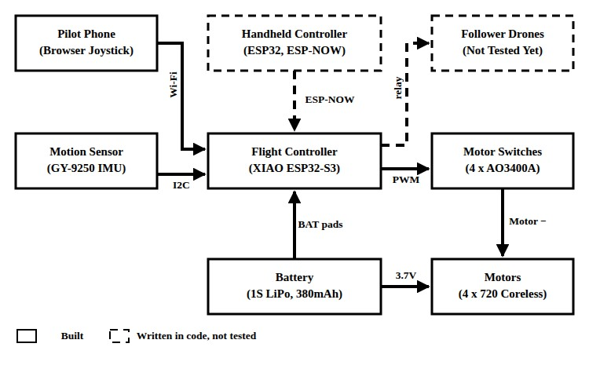
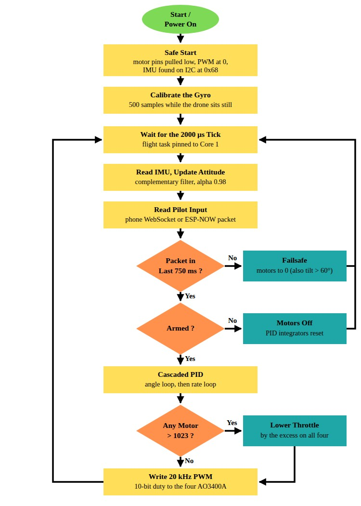
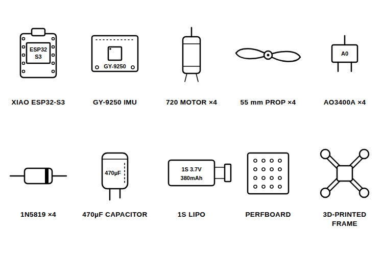
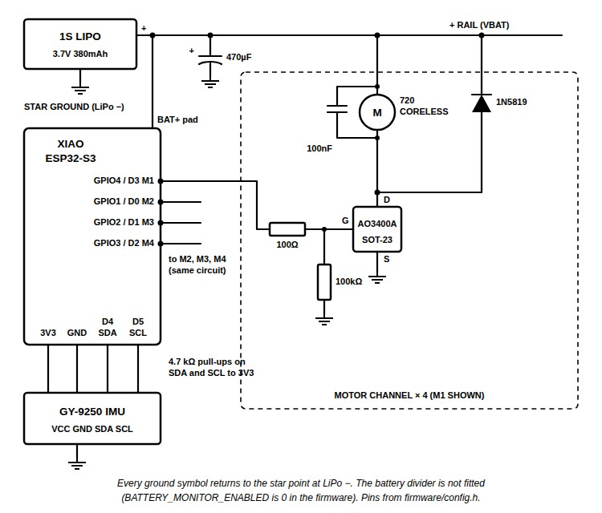
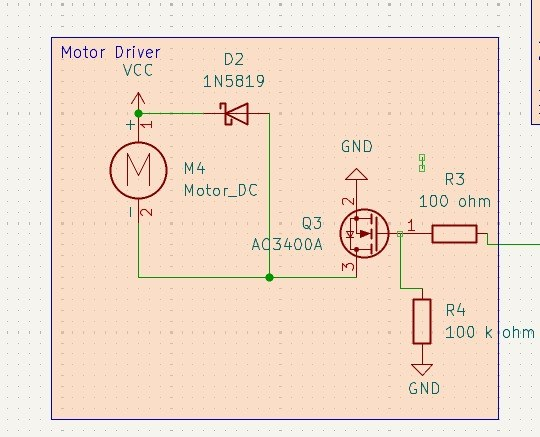
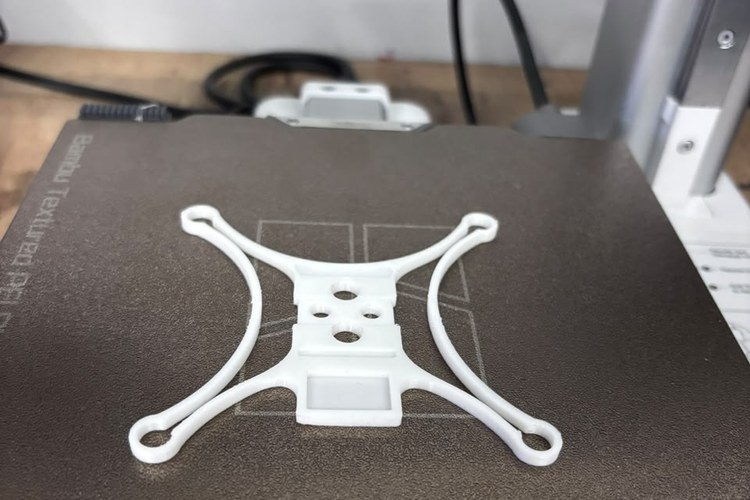
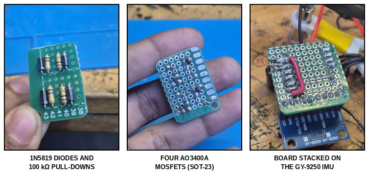
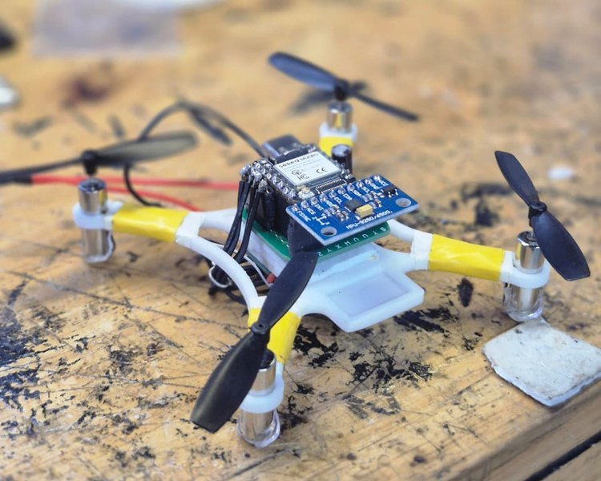

Drone swarms usually make the news with hundreds of expensive aircraft and a ground station to match. Losing one of those drones is a real loss, so they are rarely sent into a collapsed building or a smoke-filled corridor. So, what if each drone in the swarm was cheap enough that losing one did not matter, and the rest of the swarm simply carried on?

In this project, we built ResQmesh, a micro quadcopter meant to be one node of such a swarm, and this article shows how to build one. It runs on a Seeed Studio XIAO ESP32-S3 with an MPU9250 IMU, four 720 coreless motors switched by AO3400A MOSFETs and a 3D-printed frame, and the parts come to ₹2,224 per drone. Our own firmware runs a 500 Hz flight loop on one core and the radio on the other. The micro quadcopter has reached the hand-test stage: it pushes back when tilted, as it should, but it has not flown free yet, and the swarm code has not been tried on more than one drone. You can also check out similar [drone projects](https://circuitdigest.com/drone-projects) and [ESP32 projects](https://circuitdigest.com/esp32-projects) done previously here at Circuit Digest.

<div style="background-color:#e8f4fd;border-left:4px solid #1a73e8;border-radius:4px;margin:1em 0 1.5em;padding:14px 18px;" role="note" aria-label="Quick Answer"><strong style="display:block;margin-bottom:6px;">Quick Answer: What is ResQmesh?</strong><strong>ResQmesh</strong> is a low-cost <strong>micro quadcopter</strong> built around a <strong>Seeed XIAO ESP32-S3</strong>, an <strong>MPU9250</strong> IMU and four <strong>720 coreless motors</strong> driven by AO3400A MOSFETs. Its own firmware runs a 500 Hz flight loop on one core and Wi-Fi and ESP-NOW on the other, so a phone can fly it and later relay commands to follower drones. It costs ₹2,224 in parts and has been hand-tested so far.</div>

<div class="toc" style="background-color:#EBF2FA;border-radius:4px;margin:20px 0;max-width:800px;padding:20px;"><h3 style="color:#333;font-size:1.2em;margin:0 0 15px 0;"><strong>Table of Contents</strong></h3><ul style="list-style-type:none;margin:0;padding-left:0;">
<li><a href="#what-is-resqmesh"><strong>What Is ResQmesh?</strong></a></li>
<li><a href="#how-does-the-resqmesh-micro-quadcopter-work"><strong>How ResQmesh Works</strong></a></li>
<li><a href="#components-required-for-the-resqmesh-micro-quadcopter"><strong>Components Required</strong></a></li>
<li><a href="#circuit-diagram-of-the-resqmesh-micro-quadcopter"><strong>Circuit Diagram</strong></a></li>
<li style="margin-left:20px;"><a href="#xiao-esp32-s3-pin-connections"><strong>└ XIAO ESP32-S3 Pin Connections</strong></a></li>
<li><a href="#3d-printing-the-resqmesh-frame"><strong>3D Printing the Frame</strong></a></li>
<li><a href="#assembling-the-resqmesh-micro-quadcopter"><strong>Assembly</strong></a></li>
<li><a href="#flashing-the-resqmesh-firmware"><strong>Flashing the Firmware</strong></a></li>
<li><a href="#bench-testing-and-calibration"><strong>Bench Testing and Calibration</strong></a></li>
<li><a href="#resqmesh-firmware-code-explanation"><strong>Code Explanation</strong></a></li>
<li><a href="#live-video-demonstration"><strong>Live Demo</strong></a></li>
<li><a href="#output-testing-the-resqmesh-micro-quadcopter"><strong>Output</strong></a></li>
<li><a href="#troubleshooting-the-resqmesh-micro-quadcopter"><strong>Troubleshooting</strong></a></li>
<li><a href="#lessons-from-our-build"><strong>Lessons From Our Build</strong></a></li>
<li><a href="#resqmesh-github-repository"><strong>GitHub</strong></a></li>
</ul></div>

### What Is ResQmesh?

ResQmesh is a swarm drone platform where every node is small and cheap. The design rule was that each drone must cost less than ₹3,000. That rules out brushless motors with ESCs, STM32 flight controllers and GPS, and points at the XIAO ESP32-S3, which has two 240 MHz cores, Wi-Fi and ESP-NOW on a board about the size of a postage stamp. Circuit Digest has also built a [low-cost drone using ESP32](https://circuitdigest.com/microcontroller-projects/DIY-wifi-controlled-drone) with the same 720 coreless motors. If interested, do check it out.

### How Does the ResQmesh Micro Quadcopter Work?

The working is split between the two cores of the ESP32-S3. Core 1 runs the flight loop every 2000 µs: it reads the MPU9250 over 400 kHz I2C, works out the roll and pitch with a complementary filter, runs the PID loops and sets the PWM for the four MOSFETs. Core 0 runs the Wi-Fi access point, the web page for the phone, ESP-NOW and the USB serial console. The pilot joins the drone's own Wi-Fi network, opens its web page and flies with two on-screen joysticks. Below is the block diagram of the ResQmesh micro quadcopter.



The dashed boxes are written in code but not tested yet. The leader drone re-broadcasts each phone command over ESP-NOW for follower drones, and code/ESP32-CONTROLLER has firmware for a handheld two-gimbal transmitter, which the logs do not mention being built. The [ESP32 water level monitor using ESP-NOW](https://circuitdigest.com/microcontroller-projects/contactless-water-level-monitoring-with-esp-now) on Circuit Digest is a simpler place to see how ESP-NOW sends data between two boards.

Below is the flowchart of the flight loop.



If no control packet arrives for 750 ms, or the drone tilts past 60°, the loop goes to failsafe and the motors drop to zero. When armed, the angle loop turns the stick angle into a target rotation rate, the rate loop turns that into a correction for each axis, and the mixer combines them into four motor values.

### Components Required for the ResQmesh Micro Quadcopter

Below is the list of components required to build one drone, with the prices from our bill of materials.



| S.No | Component | Description | Quantity | Cost (₹) |
|---|---|---|---|---|
| 1. | Seeed Studio XIAO ESP32-S3 | Flight controller and radio | 1 | 850 |
| 2. | MPU9250 IMU (GY-9250 board) | Gyro and accelerometer on I2C | 1 | 420 |
| 3. | 720 Coreless Motor | Two CW and two CCW | 4 | 300 |
| 4. | 55 mm Propeller | Two CW and two CCW | 4 | 80 |
| 5. | AO3400A N-Channel MOSFET | Low-side motor switch, SOT-23 | 4 | 48 |
| 6. | 1N5819 Schottky Diode | Flyback protection | 4 | 16 |
| 7. | Passives | 470µF bulk capacitor, 100nF caps, 100Ω and 100kΩ resistors, 4.7kΩ I2C pull-ups | 1 set | 60 |
| 8. | 1S LiPo, 3.7V 380mAh | Flight battery, 25C | 1 | 320 |
| 9. | 3D-Printed Frame | PLA | 1 | 80 |
| 10. | Wire, JST Connector, Perfboard | 30 AWG silicone wire, harness and driver board | 1 set | 50 |
| | **Total** | | | **2,224** |

The AO3400A is the part that makes the price work. Its gate threshold is between 0.65V and 1.45V, so the ESP32's 3.3V pins switch it fully on without a gate driver IC. We chose the 380mAh pack because each extra 50mAh adds 2 to 3 grams, and our estimate with it was about 4.5 minutes of hover. Leave LoRa off the drone itself: an SX1262 breakout weighs 6.8 grams, close to the whole 7.4 gram frame, so we moved it to the plan for ground relay stations. For how long a pack like this lasts, refer to our article on [calculating the run time of a drone LiPo battery](https://circuitdigest.com/article/calculating-the-energy-run-time-and-charge-of-a-drone-lipo-battery).

### Circuit Diagram of the ResQmesh Micro Quadcopter

Below is the circuit diagram for the ResQmesh micro quadcopter.



The brain of the drone is the XIAO ESP32-S3, powered from the LiPo through its BAT+ pad on the back. Each motor has the same channel: the motor's + lead goes to the battery rail, its − lead goes to the drain of an AO3400A, and the source goes to ground. A 1N5819 across each motor, cathode to the + lead, clamps the spike when the MOSFET turns off, and a 100nF capacitor across the motor tabs takes out the brush noise. The gate is driven through a 100Ω resistor, with a 100kΩ pull-down so the motors stay off while the ESP32 boots. The KiCad schematic and our board both use 100kΩ, though the README says 10kΩ. A 470µF capacitor across the battery handles the current steps, and all motor grounds return to the battery's negative pad, away from the IMU's ground. That is all about the circuit. If MOSFETs are new to you, our tutorial on [what a MOSFET is and how it works](https://circuitdigest.com/tutorial/what-is-mosfet-basics-types-working-and-amplifier-design) covers the basics.

Below is one motor channel from our KiCad schematic.



It passed KiCad's electrical rules check, but we never ordered a PCB, as that would have broken the budget, so it serves as the map for a hand-wired perfboard.

#### XIAO ESP32-S3 Pin Connections

| Function | GPIO (Firmware) | XIAO Pad | Connects To |
|---|---|---|---|
| Motor 1, front-left (CW) | GPIO4 | D3 | 100Ω to AO3400A gate |
| Motor 2, front-right (CCW) | GPIO1 | D0 | 100Ω to AO3400A gate |
| Motor 3, rear-right (CW) | GPIO2 | D1 | 100Ω to AO3400A gate |
| Motor 4, rear-left (CCW) | GPIO3 | D2 | 100Ω to AO3400A gate |
| I2C SDA | GPIO5 | D4 | IMU SDA, 4.7kΩ to 3V3 |
| I2C SCL | GPIO6 | D5 | IMU SCL, 4.7kΩ to 3V3 |
| Status LED | GPIO21 | Onboard | Active LOW |
| Battery sense | GPIO8 | D9 | Not fitted, monitor disabled |

These are the pins that firmware/config.h drives, and the KiCad schematic also puts the motors on D0 to D3. The README in code/ESP32-DRONE shows an older pin table, so wire to this table or to config.h, not to that README.

### 3D Printing the ResQmesh Frame

Below is the printed frame on the printer bed.



The cad folder's README links two Bambu Studio project files. Print FireFlo_v2_7mm, the unibody X frame with 7mm motor bores: its project is set to PLA, 0.2mm layers, six walls, 25% grid infill and no supports, and the slicer puts it at 7.35 grams, which matches the 7.4 grams on our scale. The other file, dreamcatcher_8.5mm, is a frame with rings around the propellers and 8.5mm bores, at 12.71 grams. Use the solid unibody frame: a skeletal X of about 5 grams flexed until the motor pods tilted by nearly 3°, which the IMU reads as the drone tilting, and a ducted frame of about 12 grams lost hover efficiency.

The motor bores need one slicer change. Our first print gave 6.85mm bores in place of 7.00mm, and pressing a motor in split the pod. Set horizontal hole expansion to +0.12mm (the project file has it at 0) for about 7.02mm, a firm press fit. More printed builds are in our [3D printing projects](https://circuitdigest.com/3d-printing-projects).

### Assembling the ResQmesh Micro Quadcopter

Charge the LiPo and keep the propellers off until the bench tests are done. Then follow the steps below.

**Step 1⇒ Build the MOSFET Driver Board**

SOT-23 legs are 0.95mm apart and perfboard holes are 2.54mm apart, so bend each source leg down onto a bare copper wire that serves as the ground bus, and bridge each gate with its 100Ω resistor before any flexible wire goes on. Fit the 100kΩ pull-downs and the 1N5819 diodes next. Below is the driver board at each stage.



Below is the soldering in progress.

<video controls preload="metadata" width="640" poster="videos/ResQmesh-Soldering-the-Driver-Board.jpg">
<source src="videos/ResQmesh-Soldering-the-Driver-Board.mp4" type="video/mp4">
<source src="https://github.com/user-attachments/assets/fb0bdad3-6bdf-4919-a269-c35ca3fdb0d8" type="video/mp4">
<a href="https://github.com/user-attachments/assets/fb0bdad3-6bdf-4919-a269-c35ca3fdb0d8">Soldering the driver board (MP4)</a>
</video>

**Step 2⇒ Wire the IMU**

Connect the GY-9250 to 3V3, GND, D4 (SDA) and D5 (SCL), and add the two 4.7kΩ pull-ups from SDA and SCL to 3.3V. Without them, our IMU answered at address 0x68 with WHO_AM_I 0x71 and then froze the bus after about 15 seconds, as the ESP32's weak internal pull-ups round off the 400 kHz clock edges. With them, the bus ran for 4 hours without a dropped frame. If you are new to this kind of sensor, our [MPU6050 with ESP32](https://circuitdigest.com/microcontroller-projects/mpu6050-gyro-sensor-interfacing-with-esp32-nodemcu-board) tutorial is a good start.

**Step 3⇒ Fit the Motors and the Harness**

Press the motors into the bores in the layout from the mixer: front-left and rear-right spin clockwise, front-right and rear-left anticlockwise. Solder a 100nF capacitor across each motor's tabs and twist each motor's leads at about 4 turns per centimetre to cut the noise they radiate. Run every motor ground back to the battery's negative pad, and put the 470µF capacitor across the battery leads.

**Step 4⇒ Stack the Boards**

Stack the XIAO and the IMU on the driver board, connect the battery to the BAT+ pad, and check each motor channel against the pin table before the first power-up. Below is the assembled drone.



### Flashing the ResQmesh Firmware

The flight firmware this article explains is in code/ESP32-DRONE/firmware, an Arduino sketch.

**Step 1⇒ Build and Upload with Arduino CLI**

Install the ESP32 board package and run these two commands from code/ESP32-DRONE, with your own port in place of COM14:

```
arduino-cli compile --fqbn esp32:esp32:XIAO_ESP32S3 firmware
arduino-cli upload -p COM14 --fqbn esp32:esp32:XIAO_ESP32S3 firmware
```

On Windows, flash_drone.bat runs the same two commands and finds the port, but edit its `CLI_PATH` first, as it points to our laptop. The platformio.ini in the same folder builds the slightly different ESP-IDF copy in the main folder.

**Step 2⇒ Run the Host Tests and the Simulator**

The tests build with g++ on a PC from code/ESP32-DRONE/tests, against the main folder's sources:

```
g++ -std=c++11 -Wall -I../main run_all_tests.cpp ../main/pid.cpp ../main/attitude.cpp ../main/mixer.cpp ../main/receiver.cpp ../main/battery.cpp ../main/safety.cpp ../main/imu.cpp -o test_runner
./test_runner
```

On the current code, the suite reports 77 passed and 0 failed. run_simulation.bat builds simulate_flight.cpp the same way, but its step 7 waits only 250 ms against the 750 ms timeout, so the drone stays in FLIGHT and the "FAILSAFE" line it prints is hard-coded. Make that gap longer than 750 ms.

### Bench Testing and Calibration

Do these checks with the propellers off.

**Step 1⇒ Check the Motors**

Open the USB serial console at 115200 baud and type `test_motor 1 5` to `test_motor 4 5`; the command takes a duty of 0 to 25%. Motors 1 and 3 must spin clockwise and motors 2 and 4 anticlockwise.

**Step 2⇒ Check and Calibrate the IMU**

Type `attitude` and tilt the drone by 20° to check that roll and pitch follow, and use `calibrate` with the drone still and disarmed to redo the zero-bias calibration. Without an IMU the firmware stops at boot, so set `IMU_BENCH_TEST_MODE` to 1 to test the radio side on a bare board.

**Step 3⇒ Connect the Phone**

Join the drone's Wi-Fi network, ResQmesh-Drone, with the password from config.h (change the default first), and open http://192.168.4.1. Arming needs the throttle below 10%, a calibrated IMU and the drone within 20° of level, and the red KILL button stops the motors. For another ESP32-S3 web page served from its own access point, see our [smart home automation using access point mode](https://circuitdigest.com/microcontroller-projects/smart-home-automation-using-access-point-mode-using-esp32-s3-box-3) project.

**Step 4⇒ Hand Test**

Fit the propellers, hold the drone loosely, arm it and raise the throttle to 25%. Tip the nose down and the front motors should speed up while the rear ones slow. The starting gains in config.h (angle Kp 4.0, rate 0.65, 0.45 and 0.025 for roll and pitch, 1.20 and 0.80 for yaw) have not been tuned in free flight, so tune them on a tether first.

### ResQmesh Firmware Code Explanation

The firmware is C++ on the ESP32 Arduino core with ESP-IDF drivers, one file per job. Below are the parts that matter most.

**Pins and PWM Settings**

```cpp
#define PIN_I2C_SDA 5      // XIAO D4 (GPIO5)
#define PIN_I2C_SCL 6      // XIAO D5 (GPIO6)
#define I2C_FREQ_HZ 400000 // 400 kHz Fast-Mode

#define PIN_MOTOR_FL 4 // Motor 1: Front-Left (GPIO4)
#define PIN_MOTOR_FR 1 // Motor 2: Front-Right (GPIO1)
#define PIN_MOTOR_RR 2 // Motor 3: Rear-Right (GPIO2)
#define PIN_MOTOR_RL 3 // Motor 4: Rear-Left (GPIO3)

#define MOTOR_PWM_FREQ_HZ 20000 // 20 kHz ultrasonic frequency (no coil whine)
#define MOTOR_PWM_BITS 10       // 10-bit resolution -> 0 to 1023
```

All pins, gains and limits live in config.h, and these defines are what the firmware uses, even where the comment block above them lists older pads. The PWM runs at 20 kHz because the motors squealed at 1 to 4 kHz, and above about 18 kHz the coil noise is out of hearing range. The same file sets a flight ceiling of 800 out of 1023 to avoid brownouts, and `MotorController::init()` holds the motor pins LOW before the PWM starts.

**The 500 Hz Loop on Core 1**

```cpp
next_wake_us += CONTROL_LOOP_PERIOD_US;
int64_t now_us = esp_timer_get_time();
if (now_us > next_wake_us + LOOP_OVERRUN_TOL_US) {
    fc->stats_.overruns++;
    next_wake_us = now_us; // Resync
}
fc->runIteration(now_us);
```

`flightLoopTask()` is pinned to Core 1 at priority 24. Each pass adds 2000 µs to the wake time, counts an overrun if it is more than 200 µs late, and calls `runIteration()` to read the IMU and run the attitude filter, safety checks, PID and mixer. We measured one iteration at 420 µs on an oscilloscope. The safety checks have one gap: `BATTERY_MONITOR_ENABLED` is 0, so the monitor reports a fixed 3.85V and there is no low-battery cutoff until you fit the divider.

**Anti-Saturation Mixer**

```cpp
if (max_m > MIXER_OUT_MAX) {
    float excess = max_m - MIXER_OUT_MAX;
    for (int i = 0; i < NUM_MOTORS; i++) {
        out.m[i] -= excess;
    }
    out.saturated = true;
}
```

In the simulator, at 95% throttle with a hard roll, one motor wanted 1120 while the PWM tops out at 1023, and clipping it would lose the difference that keeps the drone level. `QuadMixer::mix()` lowers all four motors by the excess instead. Watch one thing: motors.cpp then clamps each motor to 800, so the clipping comes back between 800 and 1023. Setting `MIXER_OUT_MAX` to 800 keeps the two limits in step.

**Relaying the Phone's Sticks to the Swarm**

```cpp
if (target_id != node_id_) {
    SwarmControlPacket swarm_pkt;
    swarm_pkt.header.target_id = target_id;
    swarm_pkt.header.sender_id = node_id_;
    swarm_pkt.throttle = (uint16_t)std::max(0.0f, std::min(1000.0f, t));
    swarm_pkt.crc = computeCRC((const uint8_t *)&swarm_pkt, sizeof(swarm_pkt) - sizeof(uint16_t));
    esp_now_send(s_bcast_mac, (const uint8_t *)&swarm_pkt, sizeof(swarm_pkt));
}
```

When the phone's command is not meant only for the leader, `processWebSocketFrame()` in receiver.cpp copies the sticks into a `SwarmControlPacket` with a CRC-16 and broadcasts it over ESP-NOW. Followers answer with a 10 Hz heartbeat, which fills the peer table on the phone.

### Live Video Demonstration

Below is the Builder in Residence video, where we talk through the drone and its firmware.

<iframe width="750" height="422" src="https://www.youtube.com/embed/m4jHtg0Pzuk" title="ResQmesh - Lightweight ESP32-based Drone Swarm | Builder in Residence" frameborder="0" allowfullscreen></iframe>

### Output: Testing the ResQmesh Micro Quadcopter

With the motors spinning at 20 kHz, we measured 45mV across one AO3400A at about 1.5A, which is 30mΩ and 0.067W of heat, and the MOSFETs stayed cold after 3 minutes at full throttle. Below is the motor spin test.

<video controls preload="metadata" width="360" poster="videos/ResQmesh-Motor-Spin-Test.jpg">
<source src="videos/ResQmesh-Motor-Spin-Test.mp4" type="video/mp4">
<source src="https://github.com/user-attachments/assets/4e7536c5-63f1-473d-8210-16360614ab90" type="video/mp4">
<a href="https://github.com/user-attachments/assets/4e7536c5-63f1-473d-8210-16360614ab90">Motor spin test (MP4)</a>
</video>

In the hand test at 25% throttle, tipping the nose down made the front motors speed up and the rear ones slow, and tilting it left made the left motors push it back to level. Below is that test.

<video controls preload="metadata" width="360" poster="videos/ResQmesh-Hand-Test-Counter-Torque.jpg">
<source src="videos/ResQmesh-Hand-Test-Counter-Torque.mp4" type="video/mp4">
<source src="https://github.com/user-attachments/assets/9f020abd-1319-4267-80d9-c85300ebb805" type="video/mp4">
<a href="https://github.com/user-attachments/assets/9f020abd-1319-4267-80d9-c85300ebb805">Hand test (MP4)</a>
</video>

That is as far as the testing has gone. A tethered hover, PID tuning in free air and pairing three drones over ESP-NOW are the next steps. The repository gives three different all-up weights, 32.2 grams in the last weekly log, 43.6 grams in the README's weight table and 58 grams in the README story after a later correction, so weigh your own build [TODO: final measured all-up weight].

### Troubleshooting the ResQmesh Micro Quadcopter

| Symptom | Likely Cause | Fix |
|---|---|---|
| I2C freezes after about 15 seconds | Weak internal pull-ups at 400 kHz | Add 4.7kΩ pull-ups from SDA and SCL to 3.3V |
| Motors squeal at low throttle | PWM in the audio range (1 to 4 kHz) | Set `MOTOR_PWM_FREQ_HZ` to 20000 with 10-bit duty |
| Motors twitch while flashing or booting | Floating MOSFET gates | Fit the 100kΩ gate pull-downs; the firmware also pulls the pins low before PWM starts |
| Motor pod cracks when the motor is pressed in | Printed bore shrinks to about 6.85mm | Set horizontal hole expansion to +0.12mm in the slicer |
| Upload fails or the port is busy | A serial monitor holds the port, or the board is not in bootloader mode | Close the monitor; hold B, tap R, release B and upload again |
| Battery always reads 3.85V | `BATTERY_MONITOR_ENABLED` is 0 | Wire a 100kΩ/100kΩ divider from BAT+ to GPIO8 and set it to 1 |
| Simulator step 7 still shows FLIGHT | The step waits 250 ms, but the timeout is 750 ms | Make the gap longer than 750 ms in simulate_flight.cpp |

### Lessons From Our Build

Keep the frame stiff before saving weight. A lighter skeletal frame flexed enough to tilt the motors by nearly 3°, and the flight loop cannot tell that bend from a real tilt.

Trust config.h over the documents. The weekly logs, the README and the firmware each show a different motor pin plan, and the gate pull-down is written as 10kΩ in places where the schematic and board use 100kΩ. Wire to the firmware and the schematic.

Test the safety code as carefully as the flight code. The simulator's failsafe step and the mixer's limit both drifted out of step with config.h without any test failing, so check those two by hand after changing a limit.

### Conclusion

ResQmesh shows that one ESP32-S3 can run a 500 Hz flight loop on one core while the other handles Wi-Fi and ESP-NOW, and that a ₹2,224 drone can hold itself level against a hand. There is still room for improvement, such as a battery divider so the low-battery cutoff actually works, a tethered hover to tune the PID in free air, more drones to test the ESP-NOW relay, and a VL53L1X distance sensor for altitude hold, which was the next sensor on our list. Further, one can add position hold with an optical flow sensor, just like this [PMW3901 optical flow sensor with ESP32](https://circuitdigest.com/microcontroller-projects/interfacing-pmw3901-optical-flow-sensor-with-esp32) on Circuit Digest.

### ResQmesh GitHub Repository

The ResQmesh repository has the flight firmware, the handheld ESP-NOW transmitter firmware, the desktop and phone control pages, the host tests and flight simulator, and the links to the frame files. ResQmesh was built by Jayasurya Jayakumar and Nikhil S at Tinkerspace as part of the Builder in Residence programme, and the README states the MIT licence.

[Code & Schematics (GitHub)](https://github.com/BuilderinResidencyTinkerspace/ResQmesh) · [Download Zip](https://github.com/BuilderinResidencyTinkerspace/ResQmesh/archive/refs/heads/main.zip)

### Frequently Asked Questions About the ResQmesh Micro Quadcopter

**⇥ 1. Why not use Betaflight or ArduPilot on this drone?**

Both expect an STM32 board and a separate RC receiver, and neither runs ESP-NOW messaging between drones. Writing our own flight loop let us keep the radio and the flight control on the same ESP32-S3, one core each.

**⇥ 2. Can ResQmesh fly as a swarm now?**

Not yet. The relay, heartbeat and peer table are in the firmware and pass the host tests, but they have not been tried with more than one drone in the air.

**⇥ 3. Can I use a different frame?**

Yes, if it takes 7mm motors and stays stiff under full throttle. A frame that flexes makes the IMU read the bend as a tilt, and every extra gram cuts into a 380mAh battery's hover time.

### Drone and ESP32 Sensor Projects

Explore more ESP32 drone builds and the sensors that help small drones hold their position.

- **[Let's Build a Low Cost Drone using ESP32](https://circuitdigest.com/microcontroller-projects/DIY-wifi-controlled-drone)**: *Drones have rapidly evolved from niche hobbies to versatile tools, and a DIY ESP32 drone is an affordable entry point into drone technology.*
- **[Interfacing PMW3901 Optical Flow Sensor With ESP32](https://circuitdigest.com/microcontroller-projects/interfacing-pmw3901-optical-flow-sensor-with-esp32)**: *Drones rely on various sensors to maintain stable flight, especially when GPS is unavailable or unreliable.*
- **[MPU6050 Gyro Sensor Interfacing with ESP32 Board](https://circuitdigest.com/microcontroller-projects/mpu6050-gyro-sensor-interfacing-with-esp32-nodemcu-board)**: *The MPU6050 sensor module consists of an accelerometer and gyro on a single chip.*

### Complete Project Code

The complete flight firmware is below, from code/ESP32-DRONE/firmware in the repository. The IMU driver, receiver, battery monitor, serial console and phone web page (imu.cpp, receiver.cpp, battery.cpp, cli.cpp and web_ui.h) are in the same folder.

**code/ESP32-DRONE/firmware/firmware.ino**

```cpp
/**
 * @file firmware.ino
 * @brief Arduino Sketch Entrypoint for ESP32-DRONE Flight Controller.
 */

#include <Arduino.h>
#include "nvs_flash.h"
#include "config.h"
#include "flight_controller.h"
#include "cli.h"

static FlightController g_flight_controller;
static SerialCLI g_cli(g_flight_controller);

void setup() {
    Serial.begin(115200);

    // Give serial monitor a moment to attach
    delay(1500);

    Serial.println("\r\n=======================================================");
    Serial.println("  ESP32-S3 Drone Flight Controller - Booting");
    Serial.println("=======================================================");

    // Initialize NVS
    esp_err_t ret = nvs_flash_init();
    if (ret == ESP_ERR_NVS_NO_FREE_PAGES || ret == ESP_ERR_NVS_NEW_VERSION_FOUND) {
        nvs_flash_erase();
        nvs_flash_init();
    }

    // Initialize Flight Controller
    if (!g_flight_controller.init()) {
        Serial.println("[ERROR] Flight controller initialization failed! Halting.");
        Serial.println("  -> Reason: Physical MPU-9250 sensor not detected on I2C (SDA=D4/GPIO5, SCL=D5/GPIO6).");
        Serial.println("  -> Tip: To test Swarm networking & CLI on bare desk boards without an IMU,");
        Serial.println("          set #define IMU_BENCH_TEST_MODE 1 in config.h and reflash!");
        g_flight_controller.emergencyStop();
        return;
    }

    // Launch 500 Hz deterministic flight loop on Core 1
    if (!g_flight_controller.start()) {
        Serial.println("[ERROR] Failed to start flight loop task!");
        g_flight_controller.emergencyStop();
        return;
    }

    // Launch Serial CLI
    g_cli.start();

    Serial.println("[INFO] Flight controller ready. Core 1: 500Hz Loop | Core 0: Comms & CLI.");
    Serial.print("\r\n> ");
}

void loop() {
    // Poll USB Serial for commands
    g_cli.update();
    delay(5);
}
```

**code/ESP32-DRONE/firmware/config.h**

```cpp
/**
 * @file config.h
 * @brief Central configuration file for ESP32-S3 Quadcopter Flight Controller.
 *
 * All hardware pins, timing constants, PID gains, filter parameters,
 * and safety limits are defined here to eliminate magic numbers.
 */

#pragma once

#include <stdint.h>

#ifdef __cplusplus
extern "C" {
#endif

// =============================================================================
// 1. FIRMWARE IDENTITY & REVISION
// =============================================================================
#define FIRMWARE_NAME "ESP32-S3-DRONE"
#define FIRMWARE_VERSION "1.0.0"
#define HARDWARE_TARGET "Seeed Studio XIAO ESP32-S3"

// =============================================================================
// 2. HARDWARE PINOUT MAPPING (XIAO ESP32-S3)
// =============================================================================
// I2C Bus Pins (MPU9250)
#define I2C_PORT_NUM 0     // I2C port 0
#define PIN_I2C_SDA 5      // XIAO D4 (GPIO5)
#define PIN_I2C_SCL 6      // XIAO D5 (GPIO6)
#define I2C_FREQ_HZ 400000 // 400 kHz Fast-Mode
#define I2C_TIMEOUT_MS 20  // I2C bus timeout in milliseconds

// Motor PWM Outputs (AO3400A Low-side MOSFET Gates)
// Quad-X Motor mapping:
// M1: Front-Left  (CW)  -> XIAO D2 (GPIO3)
// M2: Front-Right (CCW) -> XIAO D3 (GPIO4)
// M3: Rear-Right  (CW)  -> XIAO D8 (GPIO7)
// M4: Rear-Left   (CCW) -> XIAO D9 (GPIO8)
#define PIN_MOTOR_FL 4 // Motor 1: Front-Left (GPIO4)
#define PIN_MOTOR_FR 1 // Motor 2: Front-Right (GPIO1)
#define PIN_MOTOR_RR 2 // Motor 3: Rear-Right (GPIO2)
#define PIN_MOTOR_RL 3 // Motor 4: Rear-Left (GPIO3)

// Battery Voltage ADC Sense
#define BATTERY_MONITOR_ENABLED                                                \
  0 // 0 = bypass ADC (fixed healthy 3.85V), 1 = active ADC sensing
#define PIN_BATTERY_ADC 8     // GPIO8 / ADC1_CH7
#define BATTERY_ADC_UNIT 1    // ADC Unit 1
#define BATTERY_ADC_CHANNEL 7 // ADC Channel 7
// NOTE: The solder pads on the back of the XIAO ESP32-S3 (BAT+ / BAT-) provide
// power to the board's 3.3V regulator and charging IC, but are NOT internally
// connected to any ADC pin.
// - Set BATTERY_MONITOR_ENABLED to 0 if powering via the back pads without an
// external resistor divider.
// - Set BATTERY_MONITOR_ENABLED to 1 if you wire an external 100k/100k divider
// from BAT+ to an ADC pin.

// Status Indicator LED
#define PIN_STATUS_LED 21 // XIAO ESP32-S3 onboard LED (active LOW)
#define LED_ACTIVE_LOW 1

// =============================================================================
// 3. IMU SENSOR CONFIGURATION (MPU9250 / MPU6500)
// =============================================================================
#define MPU9250_I2C_ADDR 0x68     // Default AD0 = GND (0x69 if AD0 = VCC)
#define MPU9250_WHO_AM_I_VAL 0x71 // MPU9250 expected WHO_AM_I value
#define MPU6500_WHO_AM_I_VAL 0x70 // MPU6500 expected WHO_AM_I value
#define MPU6050_WHO_AM_I_VAL 0x68 // MPU6050 fallback WHO_AM_I value

// Gyroscope Settings: ±1000 dps full scale range
// Sensitivity: 32.8 LSB / (deg/s)
#define GYRO_FS_SEL 2                       // 0=250, 1=500, 2=1000, 3=2000 dps
#define GYRO_SCALE_DPS (1000.0f / 32768.0f) // 0.030517578 deg/s per LSB

// Accelerometer Settings: ±4g full scale range
// Sensitivity: 8192 LSB / g
#define ACCEL_FS_SEL 1                  // 0=2g, 1=4g, 2=8g, 3=16g
#define ACCEL_SCALE_G (4.0f / 32768.0f) // 0.00012207 g per LSB
#define GRAVITY_MSS 9.80665f            // 1 g in m/s^2

// IMU Axis Mapping / Frame Alignment:
// Default assumes sensor mounted flat, chip dot matching drone frame:
// +X forward, +Y right, +Z down (NED frame)
#define IMU_AXIS_SWAP_XY 0
#define IMU_INVERT_X 0
#define IMU_INVERT_Y 0
#define IMU_INVERT_Z 0

// Calibration Settings
#define IMU_CALIB_SAMPLES 500 // Number of samples for zero-bias calculation
#define IMU_MAX_CALIB_MOTION                                                   \
  0.15f // Max allowable g deviation during calibration

// Bench testing mode: 0 = require physical MPU sensor, 1 = simulated IMU for
// bare-board desk/swarm testing
#define IMU_BENCH_TEST_MODE 0

// =============================================================================
// 4. ATTITUDE ESTIMATION (COMPLEMENTARY FILTER)
// =============================================================================
// Complementary filter weighting alpha:
// angle = alpha * (angle + gyro * dt) + (1 - alpha) * accel_angle
// At 500 Hz (dt = 0.002s), alpha = 0.98 gives time constant tau = 0.098 s
#define ATTITUDE_FILTER_ALPHA 0.980f

// Attitude limits
#define MAX_LEGAL_TILT_DEG                                                     \
  60.0f // Beyond this tilt angle, emergency disarm fires

// =============================================================================
// 5. DETERMINISTIC FLIGHT CONTROL LOOP
// =============================================================================
#define CONTROL_LOOP_FREQ_HZ 500 // 500 Hz target frequency
#define CONTROL_LOOP_PERIOD_US (1000000 / CONTROL_LOOP_FREQ_HZ) // 2000 µs
#define CONTROL_LOOP_DT (1.0f / (float)CONTROL_LOOP_FREQ_HZ)    // 0.002 seconds
#define LOOP_OVERRUN_TOL_US 200 // Overrun warning threshold: 2200 µs

// FreeRTOS Task Configurations
#define FLIGHT_TASK_CORE 1  // Pinned to Core 1 for zero-jitter execution
#define FLIGHT_TASK_PRIO 24 // Near-highest real-time priority
#define FLIGHT_TASK_STACK_SIZE 8192

#define COMM_TASK_CORE 0 // Core 0 handles wireless & telemetry
#define COMM_TASK_PRIO 5
#define COMM_TASK_STACK_SIZE 4096

#define CLI_TASK_CORE 0
#define CLI_TASK_PRIO 3
#define CLI_TASK_STACK_SIZE 4096

// =============================================================================
// 6. CASCADED PID CONTROLLER GAINS & LIMITS
// =============================================================================
// OUTER LOOP: Angle Controller (Angle Error [deg] -> Desired Angular Rate
// [deg/s])
#define PID_ROLL_ANGLE_KP 4.0f
#define PID_ROLL_ANGLE_KI 0.0f // Outer loop Ki usually 0
#define PID_ROLL_ANGLE_KD 0.0f
#define PID_ROLL_ANGLE_MAX_OUT 200.0f // Max rate demand: ±200 deg/s

#define PID_PITCH_ANGLE_KP 4.0f
#define PID_PITCH_ANGLE_KI 0.0f
#define PID_PITCH_ANGLE_KD 0.0f
#define PID_PITCH_ANGLE_MAX_OUT 200.0f // Max rate demand: ±200 deg/s

// INNER LOOP: Angular Rate Controller (Rate Error [deg/s] -> Mixer Torque
// Output)
#define PID_ROLL_RATE_KP 0.65f
#define PID_ROLL_RATE_KI 0.45f
#define PID_ROLL_RATE_KD 0.025f
#define PID_ROLL_RATE_INT_LIMIT 150.0f // Integral windup limit
#define PID_ROLL_RATE_MAX_OUT 400.0f   // Max rate output limit

#define PID_PITCH_RATE_KP 0.65f
#define PID_PITCH_RATE_KI 0.45f
#define PID_PITCH_RATE_KD 0.025f
#define PID_PITCH_RATE_INT_LIMIT 150.0f
#define PID_PITCH_RATE_MAX_OUT 400.0f

#define PID_YAW_RATE_KP 1.20f // Yaw rate only (no outer angle loop)
#define PID_YAW_RATE_KI 0.80f
#define PID_YAW_RATE_KD 0.00f
#define PID_YAW_RATE_INT_LIMIT 100.0f
#define PID_YAW_RATE_MAX_OUT 300.0f

// Rate loop derivative low-pass filter cutoff (reduces motor buzz/heat from
// gyro noise)
#define PID_D_TERM_FILTER_TAU 0.005f // 5 ms time constant (~31.8 Hz cutoff)

// Integrator reset threshold (throttle % below which I-term is kept 0)
#define PID_I_TERM_MIN_THROTTLE 100 // Throttle < 100 (10%) resets integrators

// =============================================================================
// 7. QUAD-X MOTOR MIXER CONFIGURATION
// =============================================================================
// Normalizing boundaries
#define MIXER_OUT_MIN 0.0f
#define MIXER_OUT_MAX 1023.0f // 10-bit PWM range

// Priority anti-saturation:
// If motor saturation occurs, throttle is lowered to preserve roll/pitch
// attitude authority.
#define MIXER_THROTTLE_REDUCTION_ENABLED 1

// =============================================================================
// 8. MOTOR PWM DRIVER (ESP32-S3 LEDC)
// =============================================================================
#define MOTOR_PWM_FREQ_HZ 20000 // 20 kHz ultrasonic frequency (no coil whine)
#define MOTOR_PWM_BITS 10       // 10-bit resolution -> 0 to 1023
#define MOTOR_PWM_MAX_VALUE 1023

#define MOTOR_PWM_OFF 0 // Motors fully off
#define MOTOR_PWM_MIN_SPIN                                                     \
  60 // Minimum duty required to start 720 coreless motor
#define MOTOR_PWM_IDLE_ARM 50 // Spin-on-arm duty (~5%) to indicate armed state
#define MOTOR_PWM_MAX_FLIGHT                                                   \
  800 // Safe flight duty ceiling (prevents battery brownout)

// Safety switch: Must be set to 1 explicitly to enable serial motor test
// command
#define MOTOR_TEST_ENABLED 1

// =============================================================================
// 9. RECEIVER LINK CONFIGURATION (Wi-Fi SoftAP & ESP-NOW Swarm)
// =============================================================================
// Receiver Mode:
//   0 = Pure ESP-NOW Swarm (Peer-to-peer mesh between drones & GCS controller)
//   1 = Wi-Fi SoftAP + ESP-NOW Concurrent Swarm Bridge (Fly via Phone while
//   relaying to Swarm)
#define RECEIVER_MODE_WIFI 1

// Unified 2.4 GHz RF Channel (Wi-Fi AP and ESP-NOW MUST share the same channel)
#define ESPNOW_WIFI_CHANNEL 1
#define WIFI_AP_CHANNEL ESPNOW_WIFI_CHANNEL

// Wi-Fi SoftAP Configuration (Used when RECEIVER_MODE_WIFI == 1)
#define WIFI_AP_SSID "ResQmesh-Drone"
#define WIFI_AP_PASSWORD "12345678" // Minimum 8 characters for WPA2-PSK
#define WIFI_MAX_CLIENTS 2          // Max connected devices

// Swarm Mesh Relay from Phone (1 = re-broadcast phone stick commands to swarm
// followers over ESP-NOW)
#define SWARM_RELAY_TO_MESH 1

// Swarm Mesh Configuration
#define SWARM_DEFAULT_NODE_ID 1 // Default Node ID for this drone (1..254)
#define SWARM_MAX_PEERS 16      // Max tracked neighbor nodes in swarm table
#define SWARM_HEARTBEAT_INTERVAL_MS 100 // 10 Hz heartbeat broadcast
#define SWARM_PEER_TIMEOUT_MS 3000 // Peer expired if no heartbeat in 3000 ms

// Safety Watchdog Timeout: Failsafe automatically triggers and zeroes all motor
// outputs if no control packet is received within this timeout window.
// 750 ms absorbs mobile browser JavaScript / Wi-Fi latency jitter while
// preventing flyaways.
#define RECEIVER_TIMEOUT_MS                                                    \
  750 // 750 ms watchdog (tolerant to mobile Wi-Fi latency)
#define STICK_THROTTLE_MIN 0
#define STICK_THROTTLE_MAX 1000
#define STICK_ANGLE_MAX_DEG 30.0f     // Max stick tilt command (±30 degrees)
#define STICK_YAW_RATE_MAX_DPS 200.0f // Max stick yaw rate command (±200 deg/s)
#define ARM_THROTTLE_MAX 100          // Throttle must be < 10% to allow arming

// =============================================================================
// 10. BATTERY MONITOR (1S LIPO)
// =============================================================================
// Voltage divider: R1 (high side) = 100k, R2 (low side) = 100k -> Ratio = 2.0
#define BATTERY_DIVIDER_RATIO 2.00f
#define BATTERY_ADC_SAMPLES 16 // Moving average filter samples

// 1S LiPo Voltage Thresholds (Volts)
#define BATTERY_FULL_VOLTS 4.20f
#define BATTERY_WARN_VOLTS 3.50f // Warning trigger (LED blink fast)
#define BATTERY_CRIT_VOLTS 3.30f // Critical trigger (auto-disarm / landing)
#define BATTERY_EMPTY_VOLTS 3.00f

#ifdef __cplusplus
}
#endif
```

**code/ESP32-DRONE/firmware/flight_controller.cpp**

```cpp
/**
 * @file flight_controller.cpp
 * @brief 500 Hz Deterministic Flight Controller Orchestrator Implementation.
 */

#include "flight_controller.h"
#include <cmath>
#include <cstring>

#if defined(ESP_PLATFORM)
#include "esp_log.h"
#include "esp_timer.h"
#include "esp_rom_sys.h"
#include "freertos/FreeRTOS.h"
#include "freertos/task.h"
static const char *TAG = "FC";
#else
#include <cstdio>
#define ESP_LOGI(tag, fmt, ...) printf("[INFO][%s] " fmt "\n", tag, ##__VA_ARGS__)
#define ESP_LOGW(tag, fmt, ...) printf("[WARN][%s] " fmt "\n", tag, ##__VA_ARGS__)
#define ESP_LOGE(tag, fmt, ...) printf("[ERROR][%s] " fmt "\n", tag, ##__VA_ARGS__)
static const char *TAG = "FC_HOST";
#endif

FlightController::FlightController()
    : attitude_(ATTITUDE_FILTER_ALPHA),
      battery_(BATTERY_DIVIDER_RATIO),
      roll_axis_({PID_ROLL_ANGLE_KP, PID_ROLL_ANGLE_KI, PID_ROLL_ANGLE_KD, 0.0f, PID_ROLL_ANGLE_MAX_OUT, 0.0f},
                 {PID_ROLL_RATE_KP, PID_ROLL_RATE_KI, PID_ROLL_RATE_KD, PID_ROLL_RATE_INT_LIMIT, PID_ROLL_RATE_MAX_OUT, PID_D_TERM_FILTER_TAU}),
      pitch_axis_({PID_PITCH_ANGLE_KP, PID_PITCH_ANGLE_KI, PID_PITCH_ANGLE_KD, 0.0f, PID_PITCH_ANGLE_MAX_OUT, 0.0f},
                  {PID_PITCH_RATE_KP, PID_PITCH_RATE_KI, PID_PITCH_RATE_KD, PID_PITCH_RATE_INT_LIMIT, PID_PITCH_RATE_MAX_OUT, PID_D_TERM_FILTER_TAU}),
      yaw_rate_pid_({PID_YAW_RATE_KP, PID_YAW_RATE_KI, PID_YAW_RATE_KD, PID_YAW_RATE_INT_LIMIT, PID_YAW_RATE_MAX_OUT, PID_D_TERM_FILTER_TAU}),
      last_loop_time_us_(0),
      perf_timer_start_us_(0),
      sample_counter_(0),
      last_stat_calc_us_(0) {
    memset(&latest_imu_, 0, sizeof(latest_imu_));
    memset(&latest_rx_, 0, sizeof(latest_rx_));
    memset(&latest_motors_, 0, sizeof(latest_motors_));
    memset(&stats_, 0, sizeof(stats_));
}

FlightController::~FlightController() {
    emergencyStop();
}

bool FlightController::init() {
    ESP_LOGI(TAG, "Initializing Flight Controller Subsystems...");

    // 1. Initialize Motors (Guaranteed OFF)
    if (!motors_.init()) {
        ESP_LOGE(TAG, "Motor driver init failed!");
        return false;
    }

    // 2. Initialize Battery Monitor
    battery_.init();

    // 3. Initialize Safety Supervisor
    safety_.init();

    // 4. Initialize Receiver
    if (!receiver_.init()) {
        ESP_LOGW(TAG, "Receiver init returned false (will retry / wait)");
    }

    // 5. Initialize IMU
    if (!imu_.init()) {
#if (IMU_BENCH_TEST_MODE == 1)
        ESP_LOGW(TAG, "Physical IMU not detected on I2C. Booting in BENCH TEST SIMULATION mode!");
        imu_.enableSimulation(true);
        imu_.init();
#else
        ESP_LOGE(TAG, "IMU hardware init failed! Check MPU9250 I2C wiring (SDA=D4, SCL=D5) or set IMU_BENCH_TEST_MODE to 1 in config.h.");
        return false;
#endif
    }

    // 6. Perform startup sensor zero-bias calibration
    ESP_LOGI(TAG, "Running startup IMU calibration...");
    if (!calibrateSensors()) {
        ESP_LOGW(TAG, "Startup calibration failed! Check sensor mounting and keep drone motionless.");
    }

    ESP_LOGI(TAG, "All flight controller subsystems initialized successfully.");
    return true;
}

bool FlightController::calibrateSensors() {
    if (safety_.isArmed()) {
        ESP_LOGE(TAG, "Cannot calibrate sensors while drone is ARMED!");
        return false;
    }

    bool success = imu_.calibrate(IMU_CALIB_SAMPLES);
    if (success) {
        attitude_.reset();
    }
    return success;
}

bool FlightController::requestArm() {
    return (safety_.getState() == STATE_ARMED || safety_.getState() == STATE_FLIGHT);
}

void FlightController::requestDisarm() {
    safety_.triggerEmergencyStop();
    motors_.disarm();
    roll_axis_.reset();
    pitch_axis_.reset();
    yaw_rate_pid_.reset();
}

void FlightController::emergencyStop() {
    safety_.triggerEmergencyStop();
    motors_.emergencyStop();
    roll_axis_.reset();
    pitch_axis_.reset();
    yaw_rate_pid_.reset();
}

void FlightController::runIteration(int64_t now_us) {
    int64_t start_time = now_us;

    // 1. Calculate dynamic dt
    float dt = CONTROL_LOOP_DT;
    if (last_loop_time_us_ > 0) {
        int64_t elapsed_us = now_us - last_loop_time_us_;
        if (elapsed_us > 500 && elapsed_us < 20000) {
            dt = (float)elapsed_us * 1e-6f;
        }
    }
    last_loop_time_us_ = now_us;

    // 2. Read IMU burst
    int64_t t_imu_start = now_us;
    bool imu_ok = imu_.read(latest_imu_);
#if defined(ESP_PLATFORM)
    stats_.imu_read_time_us = (uint32_t)(esp_timer_get_time() - t_imu_start);
#else
    stats_.imu_read_time_us = 350;
#endif

    // 3. Update Attitude Estimator
    if (imu_ok && latest_imu_.valid) {
        attitude_.update(latest_imu_, dt);
    }

    // 4. Retrieve latest pilot commands from Receiver
    receiver_.update(latest_rx_, now_us);

    // 4b. Check for Swarm-wide / Directed Mission Commands
    SwarmCommandId swarm_cmd;
    uint8_t cmd_payload[8];
    if (receiver_.hasPendingSwarmCommand(swarm_cmd, cmd_payload)) {
        if (swarm_cmd == CMD_SWARM_EMERGENCY_STOP) {
            emergencyStop();
        } else if (swarm_cmd == CMD_SWARM_DISARM_ALL) {
            requestDisarm();
        } else if (swarm_cmd == CMD_SWARM_CALIBRATE_ALL && !safety_.isArmed()) {
            calibrateSensors();
        } else if (swarm_cmd == CMD_SWARM_SET_LEADER) {
            receiver_.setRole(cmd_payload[0] == receiver_.getNodeId() ? SWARM_ROLE_LEADER : SWARM_ROLE_FOLLOWER);
        }
    }

    // 5. Battery voltage check
    battery_.readVoltage();

    // 6. Safety State Machine
    DroneState state = safety_.update(
        imu_.isHealthy(),
        imu_.isCalibrated(),
        latest_rx_.is_connected,
        latest_rx_.arm_command,
        latest_rx_.throttle,
        attitude_.getRoll(),
        attitude_.getPitch(),
        battery_.isCritical(),
        latest_rx_.emergency_stop
    );

    // 7. Cascaded PID & Motor Mixer Calculation
    int64_t t_calc_start = now_us;

    // Check calibration request while disarmed
    if (latest_rx_.mode == MODE_CALIB && !safety_.isArmed()) {
        calibrateSensors();
    }

    if (safety_.isArmed()) {
        // Anti-windup reset: if throttle is below idle cutoff, zero all integrators
        if (latest_rx_.throttle < (float)PID_I_TERM_MIN_THROTTLE) {
            roll_axis_.reset();
            pitch_axis_.reset();
            yaw_rate_pid_.reset();
        }

        float roll_torque = 0.0f;
        float pitch_torque = 0.0f;
        float yaw_torque = 0.0f;

        if (latest_rx_.mode == MODE_ANGLE) {
            // Angle mode: Cascaded PID (Outer Angle -> Inner Rate)
            roll_torque = roll_axis_.updateCascaded(
                latest_rx_.roll_angle,
                attitude_.getRoll(),
                attitude_.getRollRate(),
                dt
            );
            pitch_torque = pitch_axis_.updateCascaded(
                latest_rx_.pitch_angle,
                attitude_.getPitch(),
                attitude_.getPitchRate(),
                dt
            );
        } else {
            // Acro / Rate mode: Direct Angular Rate control
            roll_torque = roll_axis_.updateRateOnly(
                latest_rx_.roll_angle * (STICK_YAW_RATE_MAX_DPS / STICK_ANGLE_MAX_DEG),
                attitude_.getRollRate(),
                dt
            );
            pitch_torque = pitch_axis_.updateRateOnly(
                latest_rx_.pitch_angle * (STICK_YAW_RATE_MAX_DPS / STICK_ANGLE_MAX_DEG),
                attitude_.getPitchRate(),
                dt
            );
        }

        // Yaw rate control
        yaw_torque = yaw_rate_pid_.update(latest_rx_.yaw_rate, attitude_.getYawRate(), dt);

        // Mix outputs for Quad-X frame with priority anti-saturation
        latest_motors_ = mixer_.mix(latest_rx_.throttle, roll_torque, pitch_torque, yaw_torque, true);

        // Apply PWM to hardware
        motors_.arm();
        motors_.applyOutputs(latest_motors_.m);
    } else {
        // Disarmed or Failsafe: zero integrators and shut motors completely
        roll_axis_.reset();
        pitch_axis_.reset();
        yaw_rate_pid_.reset();
        latest_motors_ = mixer_.mix(0.0f, 0.0f, 0.0f, 0.0f, false);
        motors_.disarm();
    }

#if defined(ESP_PLATFORM)
    stats_.compute_time_us = (uint32_t)(esp_timer_get_time() - t_calc_start);
    stats_.loop_time_us = (uint32_t)(esp_timer_get_time() - start_time);
#else
    stats_.compute_time_us = 45;
    stats_.loop_time_us = 400;
#endif

    // Stream telemetry and broadcast ESP-NOW Swarm Heartbeat (10 Hz)
    if (sample_counter_ % 50 == 0) {
        receiver_.setTelemetry(
            battery_.getVoltage(),
            attitude_.getPitch(),
            attitude_.getRoll(),
            safety_.getStateString(),
            stats_.current_freq_hz
        );

        // Broadcast Swarm Heartbeat
        uint32_t uptime_s = (uint32_t)(now_us / 1000000ULL);
        receiver_.sendHeartbeat(
            (uint8_t)safety_.getState(),
            (uint16_t)(battery_.getVoltage() * 1000.0f),
            (uint8_t)battery_.getPercentage(),
            attitude_.getRoll(),
            attitude_.getPitch(),
            attitude_.getYawRate(),
            safety_.isArmed(),
            uptime_s
        );

        // Sweep for stale peers in mesh
        receiver_.getPeerTable().cleanupStalePeers(now_us, (int64_t)SWARM_PEER_TIMEOUT_MS * 1000LL);
    }

    // Update frequency statistics every 500 iterations (~1 second)
    sample_counter_++;
    if (sample_counter_ >= 500) {
        if (last_stat_calc_us_ > 0) {
            int64_t diff = now_us - last_stat_calc_us_;
            if (diff > 0) {
                stats_.current_freq_hz = (float)sample_counter_ * 1000000.0f / (float)diff;
            }
        }
        last_stat_calc_us_ = now_us;
        stats_.loop_count += sample_counter_;
        sample_counter_ = 0;
    }
}

void FlightController::flightLoopTask(void *arg) {
    FlightController *fc = reinterpret_cast<FlightController*>(arg);

#if defined(ESP_PLATFORM)
    ESP_LOGI(TAG, "Starting 500 Hz Flight Control Task on Core %d (Priority %d)",
             FLIGHT_TASK_CORE, FLIGHT_TASK_PRIO);

    int64_t next_wake_us = esp_timer_get_time();

    while (true) {
        next_wake_us += CONTROL_LOOP_PERIOD_US;
        int64_t now_us = esp_timer_get_time();

        // Check for loop timing overrun
        if (now_us > next_wake_us + LOOP_OVERRUN_TOL_US) {
            fc->stats_.overruns++;
            next_wake_us = now_us; // Resync
        }

        // Execute deterministic control loop sequence
        fc->runIteration(now_us);

        // Calculate remaining sleep time to maintain exactly 500 Hz
        int64_t now_after = esp_timer_get_time();
        int64_t remaining_us = next_wake_us - now_after;

        if (remaining_us > 1200) {
            // Yield FreeRTOS task if plenty of time remains
            vTaskDelay(pdMS_TO_TICKS(1));
            // Microsecond spin to target wake edge
            while (esp_timer_get_time() < next_wake_us) {
                esp_rom_delay_us(10);
            }
        } else if (remaining_us > 0) {
            esp_rom_delay_us((uint32_t)remaining_us);
        }
    }
#endif
}

bool FlightController::start() {
#if defined(ESP_PLATFORM)
    BaseType_t ret = xTaskCreatePinnedToCore(
        flightLoopTask,
        "flight_loop",
        FLIGHT_TASK_STACK_SIZE,
        this,
        FLIGHT_TASK_PRIO,
        nullptr,
        FLIGHT_TASK_CORE
    );
    return (ret == pdPASS);
#else
    return true;
#endif
}
```

**code/ESP32-DRONE/firmware/safety.cpp**

```cpp
/**
 * @file safety.cpp
 * @brief Arming State Machine and Failsafe Supervisor Implementation.
 */

#include "safety.h"
#include <cmath>

#if defined(ESP_PLATFORM)
#include "esp_log.h"
static const char *TAG = "SAFETY";
#else
#include <cstdio>
#define ESP_LOGI(tag, fmt, ...) printf("[INFO][%s] " fmt "\n", tag, ##__VA_ARGS__)
#define ESP_LOGW(tag, fmt, ...) printf("[WARN][%s] " fmt "\n", tag, ##__VA_ARGS__)
#define ESP_LOGE(tag, fmt, ...) printf("[ERROR][%s] " fmt "\n", tag, ##__VA_ARGS__)
static const char *TAG = "SAFETY_HOST";
#endif

SafetySupervisor::SafetySupervisor()
    : current_state_(STATE_BOOT),
      last_disarm_reason_(DISARM_PILOT_COMMAND),
      prev_pilot_arm_(false) {
}

void SafetySupervisor::init() {
    current_state_ = STATE_INITIALIZING;
    prev_pilot_arm_ = false;
}

DroneState SafetySupervisor::update(bool imu_healthy,
                                    bool imu_calibrated,
                                    bool receiver_connected,
                                    bool pilot_arm_cmd,
                                    float pilot_throttle,
                                    float roll_deg,
                                    float pitch_deg,
                                    bool battery_critical,
                                    bool emergency_stop_cmd) {
    // 1. Emergency Stop overrides all other logic unconditionally
    if (emergency_stop_cmd) {
        if (current_state_ != STATE_EMERGENCY_STOP) {
            ESP_LOGW(TAG, "EMERGENCY STOP TRIGGERED!");
            last_disarm_reason_ = DISARM_EMERGENCY_STOP;
            current_state_ = STATE_EMERGENCY_STOP;
        }
        prev_pilot_arm_ = pilot_arm_cmd;
        return current_state_;
    }

    // 2. State Machine Transitions
    switch (current_state_) {
        case STATE_BOOT:
        case STATE_INITIALIZING:
            if (imu_healthy && imu_calibrated) {
                current_state_ = STATE_DISARMED;
                ESP_LOGI(TAG, "Initialization complete. Drone is DISARMED and ready.");
            } else if (!imu_healthy) {
                current_state_ = STATE_ERROR;
                last_disarm_reason_ = DISARM_IMU_FAILURE;
            }
            break;

        case STATE_DISARMED: {
            // Check for ARM command (rising edge required: transmitter must cycle arm switch)
            bool arm_requested = (pilot_arm_cmd && !prev_pilot_arm_);

            if (arm_requested) {
                // Verify all 7 safety pre-arm checks:
                if (!imu_healthy) {
                    ESP_LOGE(TAG, "Arming rejected: IMU unhealthy!");
                } else if (!imu_calibrated) {
                    ESP_LOGE(TAG, "Arming rejected: IMU not calibrated!");
                } else if (!receiver_connected) {
                    ESP_LOGE(TAG, "Arming rejected: Receiver disconnected!");
                } else if (pilot_throttle > (float)ARM_THROTTLE_MAX) {
                    ESP_LOGE(TAG, "Arming rejected: Throttle (%.1f) > threshold (%d)!",
                             pilot_throttle, ARM_THROTTLE_MAX);
                } else if (battery_critical) {
                    ESP_LOGE(TAG, "Arming rejected: Battery voltage critical!");
                } else if (fabsf(roll_deg) > 20.0f || fabsf(pitch_deg) > 20.0f) {
                    ESP_LOGE(TAG, "Arming rejected: Drone tilted (Roll: %.1f, Pitch: %.1f)!",
                             roll_deg, pitch_deg);
                } else {
                    current_state_ = STATE_ARMED;
                    ESP_LOGI(TAG, "Arming checks passed. Drone ARMED!");
                }
            }
            break;
        }

        case STATE_ARMED:
        case STATE_FLIGHT: {
            // Check for pilot disarm request
            if (!pilot_arm_cmd) {
                current_state_ = STATE_DISARMED;
                last_disarm_reason_ = DISARM_PILOT_COMMAND;
                ESP_LOGI(TAG, "Disarmed by pilot command.");
                break;
            }

            // Check failsafe conditions during flight:
            if (!receiver_connected) {
                current_state_ = STATE_FAILSAFE;
                last_disarm_reason_ = DISARM_RECEIVER_TIMEOUT;
                ESP_LOGE(TAG, "FAILSAFE: Receiver connection lost!");
                break;
            }

            if (!imu_healthy) {
                current_state_ = STATE_FAILSAFE;
                last_disarm_reason_ = DISARM_IMU_FAILURE;
                ESP_LOGE(TAG, "FAILSAFE: IMU hardware error!");
                break;
            }

            // Crash / excessive tilt detection (e.g. inverted flight or flip)
            if (fabsf(roll_deg) > MAX_LEGAL_TILT_DEG || fabsf(pitch_deg) > MAX_LEGAL_TILT_DEG) {
                current_state_ = STATE_FAILSAFE;
                last_disarm_reason_ = DISARM_EXCESSIVE_TILT;
                ESP_LOGE(TAG, "FAILSAFE: Excessive tilt detected (R: %.1f, P: %.1f)!",
                         roll_deg, pitch_deg);
                break;
            }

            if (battery_critical) {
                current_state_ = STATE_FAILSAFE;
                last_disarm_reason_ = DISARM_CRITICAL_BATTERY;
                ESP_LOGE(TAG, "FAILSAFE: Battery critical cutoff!");
                break;
            }

            // Transition between ARMED (idle) and FLIGHT (active throttle)
            if (pilot_throttle > (float)MOTOR_PWM_MIN_SPIN) {
                current_state_ = STATE_FLIGHT;
            } else {
                current_state_ = STATE_ARMED;
            }
            break;
        }

        case STATE_FAILSAFE:
        case STATE_ERROR:
        case STATE_EMERGENCY_STOP:
            // Remain in lock-out state until explicitly reset with safe pilot inputs
            break;
    }

    prev_pilot_arm_ = pilot_arm_cmd;
    return current_state_;
}

void SafetySupervisor::triggerEmergencyStop() {
    current_state_ = STATE_EMERGENCY_STOP;
    last_disarm_reason_ = DISARM_EMERGENCY_STOP;
}

bool SafetySupervisor::resetToDisarmed(bool imu_healthy, bool imu_calibrated,
                                       bool receiver_connected, float throttle) {
    if (imu_healthy && imu_calibrated && receiver_connected && throttle < (float)ARM_THROTTLE_MAX) {
        current_state_ = STATE_DISARMED;
        last_disarm_reason_ = DISARM_PILOT_COMMAND;
        prev_pilot_arm_ = true; // Require cycling switch to arm again
        ESP_LOGI(TAG, "Safety system reset to DISARMED.");
        return true;
    }
    return false;
}

const char* SafetySupervisor::getStateString() const {
    switch (current_state_) {
        case STATE_BOOT:           return "BOOT";
        case STATE_INITIALIZING:   return "INITIALIZING";
        case STATE_DISARMED:       return "DISARMED";
        case STATE_ARMED:          return "ARMED";
        case STATE_FLIGHT:         return "FLIGHT";
        case STATE_FAILSAFE:       return "FAILSAFE";
        case STATE_ERROR:          return "ERROR";
        case STATE_EMERGENCY_STOP: return "EMERGENCY_STOP";
        default:                   return "UNKNOWN";
    }
}

const char* SafetySupervisor::getDisarmReasonString() const {
    switch (last_disarm_reason_) {
        case DISARM_PILOT_COMMAND:     return "PILOT_COMMAND";
        case DISARM_RECEIVER_TIMEOUT:  return "RECEIVER_TIMEOUT";
        case DISARM_IMU_FAILURE:       return "IMU_FAILURE";
        case DISARM_EXCESSIVE_TILT:    return "EXCESSIVE_TILT";
        case DISARM_CRITICAL_BATTERY:  return "CRITICAL_BATTERY";
        case DISARM_LOOP_OVERRUN:      return "LOOP_OVERRUN";
        case DISARM_EMERGENCY_STOP:    return "EMERGENCY_STOP";
        case DISARM_SYSTEM_ERROR:      return "SYSTEM_ERROR";
        default:                       return "NONE";
    }
}
```

**code/ESP32-DRONE/firmware/mixer.cpp**

```cpp
/**
 * @file mixer.cpp
 * @brief Quad-X Motor Mixer Implementation with Aerodynamic Sign Rationale.
 *
 * Motor Geometry and Rotation:
 *
 *               FRONT (Nose)
 *                     ^
 *                     |
 *        M1 (CW)      |      M2 (CCW)
 *           \         |         /
 *            \        |        /
 *             \       |       /
 *     <-------+-------X-------+-------> (Roll Right: +)
 *             /       |       \
 *            /        |        \
 *           /         |         \
 *        M4 (CCW)     |      M3 (CW)
 *                     |
 *                REAR (Tail)
 *
 * Sign derivation:
 * 1. Throttle:
 *    All 4 motors push upward equally (+1.0).
 *
 * 2. Roll (Positive = Right side down / roll right):
 *    To roll right, left motors (M1, M4) must provide more lift (+1.0),
 *    and right motors (M2, M3) must provide less lift (-1.0).
 *
 * 3. Pitch (Positive = Nose pitched UP):
 *    To pitch nose up, front motors (M1, M2) must provide less lift (-1.0),
 *    and rear motors (M3, M4) must provide more lift (+1.0).
 *
 * 4. Yaw (Positive = Clockwise rotation / nose right):
 *    According to Newton's 3rd Law, spinning a propeller produces an opposite reactive
 *    torque on the airframe:
 *    - CW props (M1, M3) impart CCW torque on the frame.
 *    - CCW props (M2, M4) impart CW torque on the frame.
 *    To rotate CW (+Yaw), increase CCW motor thrust (+1.0 on M2, M4)
 *    and decrease CW motor thrust (-1.0 on M1, M3).
 */

#include "mixer.h"
#include <cmath>
#include <algorithm>

QuadMixer::QuadMixer() {
    // Default Standard Quad-X Configuration:
    //                      M1(FL)  M2(FR)  M3(RR)  M4(RL)
    matrix_.throttle[0] = 1.0f; matrix_.throttle[1] = 1.0f; matrix_.throttle[2] = 1.0f; matrix_.throttle[3] = 1.0f;
    matrix_.roll[0]     = 1.0f; matrix_.roll[1]     =-1.0f; matrix_.roll[2]     =-1.0f; matrix_.roll[3]     = 1.0f;
    matrix_.pitch[0]    =-1.0f; matrix_.pitch[1]    =-1.0f; matrix_.pitch[2]    = 1.0f; matrix_.pitch[3]    = 1.0f;
    matrix_.yaw[0]      =-1.0f; matrix_.yaw[1]      = 1.0f; matrix_.yaw[2]      =-1.0f; matrix_.yaw[3]      = 1.0f;
}

void QuadMixer::setMatrix(const MixerMatrix &matrix) {
    matrix_ = matrix;
}

MotorOutputs QuadMixer::mix(float throttle, float roll, float pitch, float yaw, bool armed) {
    MotorOutputs out;
    out.saturated = false;

    // Safety: If disarmed, force all motor commands to 0 immediately
    if (!armed) {
        for (int i = 0; i < NUM_MOTORS; i++) {
            out.m[i] = 0.0f;
        }
        return out;
    }

    // Check for NaN or Inf in inputs
    if (std::isnan(throttle) || std::isnan(roll) || std::isnan(pitch) || std::isnan(yaw) ||
        std::isinf(throttle) || std::isinf(roll) || std::isinf(pitch) || std::isinf(yaw)) {
        for (int i = 0; i < NUM_MOTORS; i++) {
            out.m[i] = 0.0f;
        }
        return out;
    }

    // 1. Calculate unconstrained motor outputs from mixer matrix
    for (int i = 0; i < NUM_MOTORS; i++) {
        out.m[i] = (matrix_.throttle[i] * throttle) +
                   (matrix_.roll[i]     * roll) +
                   (matrix_.pitch[i]    * pitch) +
                   (matrix_.yaw[i]      * yaw);
    }

    // 2. Find maximum and minimum motor outputs
    float max_m = out.m[0];
    float min_m = out.m[0];
    for (int i = 1; i < NUM_MOTORS; i++) {
        if (out.m[i] > max_m) max_m = out.m[i];
        if (out.m[i] < min_m) min_m = out.m[i];
    }

#if MIXER_THROTTLE_REDUCTION_ENABLED
    // 3. Dynamic anti-saturation (priority attitude preservation)
    // If highest motor exceeds maximum, reduce throttle across ALL motors equally.
    // This preserves differential torque (roll/pitch/yaw control authority) without clipping.
    if (max_m > MIXER_OUT_MAX) {
        float excess = max_m - MIXER_OUT_MAX;
        for (int i = 0; i < NUM_MOTORS; i++) {
            out.m[i] -= excess;
        }
        out.saturated = true;
    }

    // If lowest motor drops below minimum, raise all motors equally
    if (min_m < MIXER_OUT_MIN) {
        float deficit = MIXER_OUT_MIN - min_m;
        for (int i = 0; i < NUM_MOTORS; i++) {
            out.m[i] += deficit;
        }
        out.saturated = true;
    }
#endif

    // 4. Hard safety clamping within valid PWM range [0, 1023]
    for (int i = 0; i < NUM_MOTORS; i++) {
        if (out.m[i] < MIXER_OUT_MIN) {
            out.m[i] = MIXER_OUT_MIN;
            out.saturated = true;
        } else if (out.m[i] > MIXER_OUT_MAX) {
            out.m[i] = MIXER_OUT_MAX;
            out.saturated = true;
        }
    }

    return out;
}
```

**code/ESP32-DRONE/firmware/pid.cpp**

```cpp
/**
 * @file pid.cpp
 * @brief Robust Cascaded PID Controller Implementation with Anti-Windup & LPF D-Term.
 */

#include "pid.h"
#include <cmath>
#include <algorithm>

PIDController::PIDController()
    : integral_(0.0f),
      prev_error_(0.0f),
      d_filtered_(0.0f),
      last_error_(0.0f),
      p_term_(0.0f),
      i_term_(0.0f),
      d_term_(0.0f),
      first_run_(true) {
    config_ = {0.0f, 0.0f, 0.0f, 0.0f, 0.0f, 0.005f};
}

PIDController::PIDController(const PIDConfig &config)
    : config_(config),
      integral_(0.0f),
      prev_error_(0.0f),
      d_filtered_(0.0f),
      last_error_(0.0f),
      p_term_(0.0f),
      i_term_(0.0f),
      d_term_(0.0f),
      first_run_(true) {
}

void PIDController::setConfig(const PIDConfig &config) {
    config_ = config;
    reset();
}

void PIDController::reset() {
    integral_ = 0.0f;
    prev_error_ = 0.0f;
    d_filtered_ = 0.0f;
    last_error_ = 0.0f;
    p_term_ = 0.0f;
    i_term_ = 0.0f;
    d_term_ = 0.0f;
    first_run_ = true;
}

float PIDController::update(float setpoint, float measurement, float dt) {
    // 1. Guard against invalid arguments, NaN or Inf
    if (std::isnan(setpoint) || std::isnan(measurement) || std::isnan(dt) ||
        std::isinf(setpoint) || std::isinf(measurement) || std::isinf(dt) ||
        dt <= 0.00001f || dt > 0.1f) {
        return 0.0f;
    }

    float error = setpoint - measurement;
    last_error_ = error;

    // 2. Proportional term
    p_term_ = config_.kp * error;

    // 3. Derivative term with low-pass filtering to suppress high-frequency noise
    float raw_derivative = 0.0f;
    if (!first_run_) {
        raw_derivative = (error - prev_error_) / dt;
    } else {
        first_run_ = false;
    }

    // First order low-pass filter: alpha_d = dt / (tau + dt)
    float alpha_d = 1.0f;
    if (config_.d_filter_tau > 0.0001f) {
        alpha_d = dt / (config_.d_filter_tau + dt);
    }
    d_filtered_ = d_filtered_ + alpha_d * (raw_derivative - d_filtered_);
    d_term_ = config_.kd * d_filtered_;

    prev_error_ = error;

    // 4. Tentative output calculation before integral to check for saturation
    float unsaturated_output = p_term_ + (config_.ki * integral_) + d_term_;

    // 5. Anti-windup conditional integration:
    // Only accumulate integral if output is NOT saturating, OR if error is driving
    // the system OUT of saturation
    bool saturating_positive = (unsaturated_output >= config_.max_output);
    bool saturating_negative = (unsaturated_output <= -config_.max_output);

    bool allow_integration = true;
    if (saturating_positive && error > 0.0f) {
        allow_integration = false; // Prevent worsening positive saturation
    } else if (saturating_negative && error < 0.0f) {
        allow_integration = false; // Prevent worsening negative saturation
    }

    if (allow_integration && config_.ki > 0.0f) {
        integral_ += error * dt;

        // Hard clamping on integral accumulator
        if (integral_ > config_.max_integral) {
            integral_ = config_.max_integral;
        } else if (integral_ < -config_.max_integral) {
            integral_ = -config_.max_integral;
        }
    }
    i_term_ = config_.ki * integral_;

    // 6. Total combined output
    float total_output = p_term_ + i_term_ + d_term_;

    // 7. Final output clamping
    if (total_output > config_.max_output) {
        total_output = config_.max_output;
    } else if (total_output < -config_.max_output) {
        total_output = -config_.max_output;
    }

    // Sanity check
    if (std::isnan(total_output) || std::isinf(total_output)) {
        return 0.0f;
    }

    return total_output;
}

AxisController::AxisController(const PIDConfig &angle_cfg, const PIDConfig &rate_cfg)
    : angle_pid_(angle_cfg),
      rate_pid_(rate_cfg) {
}

void AxisController::reset() {
    angle_pid_.reset();
    rate_pid_.reset();
}

float AxisController::updateCascaded(float desired_angle, float current_angle,
                                    float current_rate, float dt) {
    // Outer loop: Angle error -> Desired angular rate
    float target_rate = angle_pid_.update(desired_angle, current_angle, dt);

    // Inner loop: Rate error -> Output torque demand
    return rate_pid_.update(target_rate, current_rate, dt);
}

float AxisController::updateRateOnly(float desired_rate, float current_rate, float dt) {
    angle_pid_.reset();
    return rate_pid_.update(desired_rate, current_rate, dt);
}
```

**code/ESP32-DRONE/firmware/attitude.cpp**

```cpp
/**
 * @file attitude.cpp
 * @brief Complementary Filter Attitude Estimator Implementation.
 */

#include "attitude.h"
#include <cmath>

#ifndef M_PI
#define M_PI 3.14159265358979323846f
#endif

#define RAD_TO_DEG (180.0f / M_PI)
#define DEG_TO_RAD (M_PI / 180.0f)

AttitudeEstimator::AttitudeEstimator(float alpha)
    : alpha_(alpha),
      roll_deg_(0.0f),
      pitch_deg_(0.0f),
      roll_rate_dps_(0.0f),
      pitch_rate_dps_(0.0f),
      yaw_rate_dps_(0.0f),
      initialized_(false) {
}

void AttitudeEstimator::reset() {
    roll_deg_ = 0.0f;
    pitch_deg_ = 0.0f;
    roll_rate_dps_ = 0.0f;
    pitch_rate_dps_ = 0.0f;
    yaw_rate_dps_ = 0.0f;
    initialized_ = false;
}

void AttitudeEstimator::update(const IMUData &imu_data, float dt) {
    if (!imu_data.valid || dt <= 0.0f || dt > 0.1f) {
        return; // Reject bad inputs or unrealistic dt
    }

    // Direct angular rates from calibrated gyroscope
    roll_rate_dps_  = imu_data.gx;
    pitch_rate_dps_ = imu_data.gy;
    yaw_rate_dps_   = imu_data.gz;

    // Calculate total acceleration magnitude squared
    float acc_sq = imu_data.ax * imu_data.ax +
                   imu_data.ay * imu_data.ay +
                   imu_data.az * imu_data.az;

    // Only rely on accelerometer gravity reference if total acceleration is close to 1g
    // (e.g. between 0.75g and 1.25g) to reject centripetal and linear flight accelerations
    bool acc_valid = (acc_sq > (0.75f * 0.75f) && acc_sq < (1.25f * 1.25f));

    float roll_acc = 0.0f;
    float pitch_acc = 0.0f;

    if (acc_valid) {
        // Roll: rotation around X axis (phi = atan2(ay, az))
        roll_acc = atan2f(imu_data.ay, imu_data.az) * RAD_TO_DEG;

        // Pitch: rotation around Y axis (theta = atan2(-ax, sqrt(ay^2 + az^2)))
        float pitch_denom = sqrtf(imu_data.ay * imu_data.ay + imu_data.az * imu_data.az);
        if (pitch_denom > 0.001f) {
            pitch_acc = atan2f(-imu_data.ax, pitch_denom) * RAD_TO_DEG;
        }
    }

    if (!initialized_) {
        // First run initialization: seed directly with gravity vector to eliminate initial transient
        if (acc_valid) {
            roll_deg_ = roll_acc;
            pitch_deg_ = pitch_acc;
            initialized_ = true;
        }
        return;
    }

    // 1. Predict state with gyroscope integration (high frequency)
    float roll_gyro_pred = roll_deg_ + roll_rate_dps_ * dt;
    float pitch_gyro_pred = pitch_deg_ + pitch_rate_dps_ * dt;

    // 2. Fuse with accelerometer gravity correction (low frequency)
    if (acc_valid) {
        roll_deg_ = alpha_ * roll_gyro_pred + (1.0f - alpha_) * roll_acc;
        pitch_deg_ = alpha_ * pitch_gyro_pred + (1.0f - alpha_) * pitch_acc;
    } else {
        // High linear acceleration: trust only gyroscope integration temporarily
        roll_deg_ = roll_gyro_pred;
        pitch_deg_ = pitch_gyro_pred;
    }

    // Safety checks against NaN/Inf corruption
    if (std::isnan(roll_deg_) || std::isinf(roll_deg_)) {
        roll_deg_ = 0.0f;
    }
    if (std::isnan(pitch_deg_) || std::isinf(pitch_deg_)) {
        pitch_deg_ = 0.0f;
    }
}
```

**code/ESP32-DRONE/firmware/motors.cpp**

```cpp
/**
 * @file motors.cpp
 * @brief LEDC PWM Motor Controller Implementation with Hardware Boot-Safety.
 */

#include "motors.h"
#include <cmath>
#include <algorithm>

#if defined(ESP_PLATFORM)
#include "driver/ledc.h"
#include "driver/gpio.h"
#include "esp_log.h"
static const char *TAG = "MOTORS";

static const ledc_channel_t LEDC_CHANNELS[4] = {
    LEDC_CHANNEL_0,
    LEDC_CHANNEL_1,
    LEDC_CHANNEL_2,
    LEDC_CHANNEL_3
};

static const int MOTOR_PINS[4] = {
    PIN_MOTOR_FL,
    PIN_MOTOR_FR,
    PIN_MOTOR_RR,
    PIN_MOTOR_RL
};
#else
#include <cstdio>
#define ESP_LOGI(tag, fmt, ...) printf("[INFO][%s] " fmt "\n", tag, ##__VA_ARGS__)
#define ESP_LOGW(tag, fmt, ...) printf("[WARN][%s] " fmt "\n", tag, ##__VA_ARGS__)
#define ESP_LOGE(tag, fmt, ...) printf("[ERROR][%s] " fmt "\n", tag, ##__VA_ARGS__)
static const char *TAG = "MOTORS_HOST";
#endif

MotorController::MotorController()
    : is_armed_(false) {
    for (int i = 0; i < 4; i++) {
        current_duty_[i] = 0;
    }
}

MotorController::~MotorController() {
    stopAll();
}

bool MotorController::init() {
    ESP_LOGI(TAG, "Initializing motor PWM outputs at %d Hz (10-bit resolution)...", MOTOR_PWM_FREQ_HZ);

#if defined(ESP_PLATFORM)
    // 1. Critical Boot Safety: Force all motor GPIOs to LOW with pull-downs BEFORE starting PWM
    for (int i = 0; i < 4; i++) {
        gpio_config_t io_conf = {};
        io_conf.intr_type = GPIO_INTR_DISABLE;
        io_conf.mode = GPIO_MODE_OUTPUT;
        io_conf.pin_bit_mask = (1ULL << MOTOR_PINS[i]);
        io_conf.pull_down_en = GPIO_PULLDOWN_ENABLE;
        io_conf.pull_up_en = GPIO_PULLUP_DISABLE;
        gpio_config(&io_conf);
        gpio_set_level((gpio_num_t)MOTOR_PINS[i], 0);
    }

    // 2. Configure LEDC Timer
    ledc_timer_config_t timer_conf = {};
    timer_conf.speed_mode = LEDC_LOW_SPEED_MODE;
    timer_conf.duty_resolution = (ledc_timer_bit_t)MOTOR_PWM_BITS;
    timer_conf.timer_num = LEDC_TIMER_0;
    timer_conf.freq_hz = MOTOR_PWM_FREQ_HZ;
    timer_conf.clk_cfg = LEDC_AUTO_CLK;

    esp_err_t err = ledc_timer_config(&timer_conf);
    if (err != ESP_OK) {
        ESP_LOGE(TAG, "ledc_timer_config failed: 0x%x", err);
        return false;
    }

    // 3. Configure all 4 LEDC Channels with initial duty = 0
    for (int i = 0; i < 4; i++) {
        ledc_channel_config_t ch_conf = {};
        ch_conf.gpio_num = MOTOR_PINS[i];
        ch_conf.speed_mode = LEDC_LOW_SPEED_MODE;
        ch_conf.channel = LEDC_CHANNELS[i];
        ch_conf.intr_type = LEDC_INTR_DISABLE;
        ch_conf.timer_sel = LEDC_TIMER_0;
        ch_conf.duty = 0;
        ch_conf.hpoint = 0;

        err = ledc_channel_config(&ch_conf);
        if (err != ESP_OK) {
            ESP_LOGE(TAG, "ledc_channel_config failed for channel %d: 0x%x", i, err);
            return false;
        }
    }
#endif

    stopAll();
    is_armed_ = false;
    ESP_LOGI(TAG, "Motor controller initialized. ALL MOTORS GUARANTEED OFF.");
    return true;
}

void MotorController::arm() {
    is_armed_ = true;
#if MOTOR_PWM_IDLE_ARM > 0
    // Spin motors gently at idle to indicate armed state to operator
    setAll((float)MOTOR_PWM_IDLE_ARM);
#else
    stopAll();
#endif
    ESP_LOGI(TAG, "Motors ARMED.");
}

void MotorController::disarm() {
    is_armed_ = false;
    stopAll();
    ESP_LOGI(TAG, "Motors DISARMED.");
}

void MotorController::emergencyStop() {
    is_armed_ = false;
    stopAll();
    ESP_LOGW(TAG, "EMERGENCY STOP EXECUTED! Motors zeroed.");
}

void MotorController::setMotor(uint8_t index, float duty) {
    if (index >= 4) return;

    if (!is_armed_) {
        writeDutyHardware(index, 0);
        current_duty_[index] = 0;
        return;
    }

    if (std::isnan(duty) || std::isinf(duty) || duty < 0.0f) {
        duty = 0.0f;
    }

    // Enforce limits
    if (duty > (float)MOTOR_PWM_MAX_FLIGHT) {
        duty = (float)MOTOR_PWM_MAX_FLIGHT;
    }

    uint32_t duty_int = (uint32_t)duty;
    current_duty_[index] = duty_int;
    writeDutyHardware(index, duty_int);
}

void MotorController::setAll(float duty) {
    for (uint8_t i = 0; i < 4; i++) {
        setMotor(i, duty);
    }
}

void MotorController::applyOutputs(const float outputs[4]) {
    for (uint8_t i = 0; i < 4; i++) {
        setMotor(i, outputs[i]);
    }
}

void MotorController::stopAll() {
    for (uint8_t i = 0; i < 4; i++) {
        current_duty_[i] = 0;
        writeDutyHardware(i, 0);
    }
}

bool MotorController::testMotor(uint8_t motor_index, float duty_percent) {
#if !MOTOR_TEST_ENABLED
    ESP_LOGW(TAG, "Motor test rejected: MOTOR_TEST_ENABLED is 0 in config.h");
    return false;
#else
    if (is_armed_) {
        ESP_LOGE(TAG, "Motor test rejected: drone is armed! Disarm first.");
        return false;
    }
    if (motor_index >= 4) {
        ESP_LOGE(TAG, "Motor test rejected: invalid index %d", motor_index);
        return false;
    }
    if (duty_percent < 0.0f || duty_percent > 25.0f) {
        ESP_LOGE(TAG, "Motor test rejected: duty %.1f%% exceeds 25.0%% safety ceiling", duty_percent);
        return false;
    }

    uint32_t duty_val = (uint32_t)((duty_percent / 100.0f) * (float)MOTOR_PWM_MAX_VALUE);
    ESP_LOGI(TAG, "Bench testing Motor %d at duty %u (%.1f%%)", motor_index + 1, duty_val, duty_percent);
    writeDutyHardware(motor_index, duty_val);
    return true;
#endif
}

void MotorController::writeDutyHardware(uint8_t channel, uint32_t duty) {
    if (channel >= 4) return;
    if (duty > MOTOR_PWM_MAX_VALUE) duty = MOTOR_PWM_MAX_VALUE;

#if defined(ESP_PLATFORM)
    ledc_set_duty(LEDC_LOW_SPEED_MODE, LEDC_CHANNELS[channel], duty);
    ledc_update_duty(LEDC_LOW_SPEED_MODE, LEDC_CHANNELS[channel]);
#else
    current_duty_[channel] = duty;
#endif
}
```

**code/ESP32-DRONE/firmware/swarm.h**

```cpp
/**
 * @file swarm.h
 * @brief ResQmesh ESP-NOW Swarm Communication Protocol & Peer Mesh Subsystem.
 *
 * Implements low-latency (<5ms) multi-agent packet framing, node addressing,
 * decentralized peer state tracking, and swarm-wide coordinated flight commands.
 */

#pragma once

#include <stdint.h>
#include <stdbool.h>
#include <stddef.h>
#include <cstring>
#include "config.h"

// ResQmesh Magic Protocol Identifier ("RQ")
#define SWARM_MAGIC_0 0x52 // 'R'
#define SWARM_MAGIC_1 0x51 // 'Q'

// Swarm Node Addressing
#define SWARM_NODE_BROADCAST 0xFF // Sent to all drones in the swarm
#define SWARM_NODE_GCS       0x00 // Ground Control Station ID

// Swarm Message Types
enum SwarmMsgType : uint8_t {
    SWARM_MSG_CONTROL    = 0x01, ///< Targeted or broadcast pilot stick commands
    SWARM_MSG_HEARTBEAT  = 0x02, ///< Periodic peer state, attitude & battery broadcast
    SWARM_MSG_COMMAND    = 0x03, ///< Coordinated swarm mission commands (arm/disarm/kill)
    SWARM_MSG_TELEMETRY  = 0x04  ///< Detailed node performance metrics
};

// Swarm Node Operational Roles
enum SwarmRole : uint8_t {
    SWARM_ROLE_STANDALONE = 0, ///< Independent flight node
    SWARM_ROLE_LEADER     = 1, ///< Formation leader / swarm master
    SWARM_ROLE_FOLLOWER   = 2, ///< Formation follower node
    SWARM_ROLE_RELAY      = 3  ///< Airborne communication hop repeater
};

// Swarm Coordinated Mission Commands
enum SwarmCommandId : uint8_t {
    CMD_SWARM_NONE           = 0x00,
    CMD_SWARM_ARM_ALL        = 0x01, ///< Synchronized arming for swarm launch
    CMD_SWARM_DISARM_ALL     = 0x02, ///< Swarm-wide disarm
    CMD_SWARM_EMERGENCY_STOP = 0x03, ///< Instant kill-switch for all or targeted nodes
    CMD_SWARM_CALIBRATE_ALL  = 0x04, ///< Synchronized IMU calibration (disarmed only)
    CMD_SWARM_SET_LEADER     = 0x05, ///< Designate new formation leader
    CMD_SWARM_SET_FORMATION  = 0x06  ///< Switch formation pattern (Line, V, Grid, Circle)
};

#pragma pack(push, 1)

/**
 * @brief Standard Swarm Protocol Header.
 */
struct SwarmHeader {
    uint8_t magic[2];   ///< Fixed magic bytes: {'R', 'Q'}
    uint8_t msg_type;   ///< SwarmMsgType
    uint8_t target_id;  ///< Target Node ID (1..254 or SWARM_NODE_BROADCAST)
    uint8_t sender_id;  ///< Sender Node ID (0x00 for GCS)
    uint32_t sequence;  ///< Rolling sequence counter
};

/**
 * @brief Directed / Broadcast Swarm Control Packet.
 */
struct SwarmControlPacket {
    SwarmHeader header;
    uint16_t throttle;  ///< Stick throttle: 0 to 1000
    int16_t  roll;      ///< Stick roll:     -500 to +500
    int16_t  pitch;     ///< Stick pitch:    -500 to +500
    int16_t  yaw;       ///< Stick yaw:      -500 to +500
    uint8_t  arm;       ///< 0 = Disarm, 1 = Arm, 2 = Emergency Stop
    uint8_t  mode;      ///< 0 = Angle, 1 = Rate, 2 = Calib
    uint16_t crc;       ///< CRC-16-CCITT
};

/**
 * @brief 10 Hz Peer State & Health Broadcast Heartbeat.
 */
struct SwarmHeartbeatPacket {
    SwarmHeader header;
    uint8_t  role;              ///< SwarmRole
    uint8_t  state;             ///< DroneState enum
    uint16_t battery_mv;        ///< Battery voltage in millivolts (e.g. 3850)
    uint8_t  battery_pct;       ///< Battery percentage (0-100%)
    int16_t  roll_deg_x10;      ///< Current roll angle * 10 (e.g. 25.4 deg = 254)
    int16_t  pitch_deg_x10;     ///< Current pitch angle * 10
    int16_t  yaw_rate_dps_x10;  ///< Current yaw rate * 10
    uint8_t  armed;             ///< 1 if motors armed, 0 otherwise
    uint32_t uptime_s;          ///< Node uptime in seconds
    uint16_t crc;               ///< CRC-16-CCITT
};

/**
 * @brief High-Level Swarm Mission Command Packet.
 */
struct SwarmCommandPacket {
    SwarmHeader header;
    uint8_t  cmd_id;            ///< SwarmCommandId
    uint8_t  payload[8];        ///< Command arguments (e.g. formation type, leader ID)
    uint16_t crc;               ///< CRC-16-CCITT
};

/**
 * @brief Extended Diagnostic Telemetry Packet.
 */
struct SwarmTelemetryPacket {
    SwarmHeader header;
    uint16_t motor_duty[4];     ///< PWM duties (0..1023) sent to M1..M4
    uint16_t loop_freq_hz;      ///< Actual flight loop frequency (e.g. 500)
    uint16_t loop_time_us;      ///< Total loop execution latency in microseconds
    uint8_t  packet_loss_pct;   ///< Estimated packet loss percentage
    uint16_t crc;               ///< CRC-16-CCITT
};

#pragma pack(pop)

/**
 * @brief Entry in the local Swarm Peer Mesh Table tracking neighbor drones.
 */
struct SwarmPeer {
    uint8_t  node_id;
    uint8_t  role;
    uint8_t  state;
    uint16_t battery_mv;
    uint8_t  battery_pct;
    float    roll_deg;
    float    pitch_deg;
    float    yaw_rate_dps;
    bool     armed;
    uint32_t uptime_s;
    int64_t  last_seen_us;
    uint32_t packets_received;
    bool     active;
};

/**
 * @brief In-memory decentralized peer table tracking up to SWARM_MAX_PEERS.
 */
class SwarmPeerTable {
public:
    SwarmPeerTable() : peer_count_(0) {
        memset(peers_, 0, sizeof(peers_));
    }

    /**
     * @brief Update or insert peer entry from received heartbeat.
     */
    void updatePeer(const SwarmHeartbeatPacket &hb, int64_t now_us) {
        uint8_t id = hb.header.sender_id;
        if (id == 0 || id == SWARM_NODE_BROADCAST) return;

        // Look for existing peer
        for (size_t i = 0; i < SWARM_MAX_PEERS; i++) {
            if (peers_[i].active && peers_[i].node_id == id) {
                populatePeer(peers_[i], hb, now_us);
                return;
            }
        }

        // Find empty slot for new peer
        for (size_t i = 0; i < SWARM_MAX_PEERS; i++) {
            if (!peers_[i].active) {
                peers_[i].node_id = id;
                peers_[i].packets_received = 0;
                populatePeer(peers_[i], hb, now_us);
                peer_count_++;
                return;
            }
        }

        // Table full: replace oldest peer
        size_t oldest_idx = 0;
        int64_t oldest_time = peers_[0].last_seen_us;
        for (size_t i = 1; i < SWARM_MAX_PEERS; i++) {
            if (peers_[i].last_seen_us < oldest_time) {
                oldest_time = peers_[i].last_seen_us;
                oldest_idx = i;
            }
        }
        peers_[oldest_idx].node_id = id;
        peers_[oldest_idx].packets_received = 0;
        populatePeer(peers_[oldest_idx], hb, now_us);
    }

    /**
     * @brief Purge or deactivate stale peers that have missed heartbeats.
     */
    void cleanupStalePeers(int64_t now_us, int64_t timeout_us) {
        for (size_t i = 0; i < SWARM_MAX_PEERS; i++) {
            if (peers_[i].active) {
                if ((now_us - peers_[i].last_seen_us) > timeout_us) {
                    peers_[i].active = false;
                    if (peer_count_ > 0) peer_count_--;
                }
            }
        }
    }

    size_t getActivePeerCount() const {
        size_t count = 0;
        for (size_t i = 0; i < SWARM_MAX_PEERS; i++) {
            if (peers_[i].active) count++;
        }
        return count;
    }

    const SwarmPeer* getPeer(size_t index) const {
        if (index < SWARM_MAX_PEERS && peers_[index].active) {
            return &peers_[index];
        }
        return nullptr;
    }

    const SwarmPeer* findPeer(uint8_t node_id) const {
        for (size_t i = 0; i < SWARM_MAX_PEERS; i++) {
            if (peers_[i].active && peers_[i].node_id == node_id) {
                return &peers_[i];
            }
        }
        return nullptr;
    }

    void reset() {
        memset(peers_, 0, sizeof(peers_));
        peer_count_ = 0;
    }

private:
    void populatePeer(SwarmPeer &p, const SwarmHeartbeatPacket &hb, int64_t now_us) {
        p.role              = hb.role;
        p.state             = hb.state;
        p.battery_mv        = hb.battery_mv;
        p.battery_pct       = hb.battery_pct;
        p.roll_deg          = (float)hb.roll_deg_x10 / 10.0f;
        p.pitch_deg         = (float)hb.pitch_deg_x10 / 10.0f;
        p.yaw_rate_dps      = (float)hb.yaw_rate_dps_x10 / 10.0f;
        p.armed             = (hb.armed == 1);
        p.uptime_s          = hb.uptime_s;
        p.last_seen_us      = now_us;
        p.packets_received++;
        p.active            = true;
    }

    SwarmPeer peers_[SWARM_MAX_PEERS];
    size_t peer_count_;
};
```
