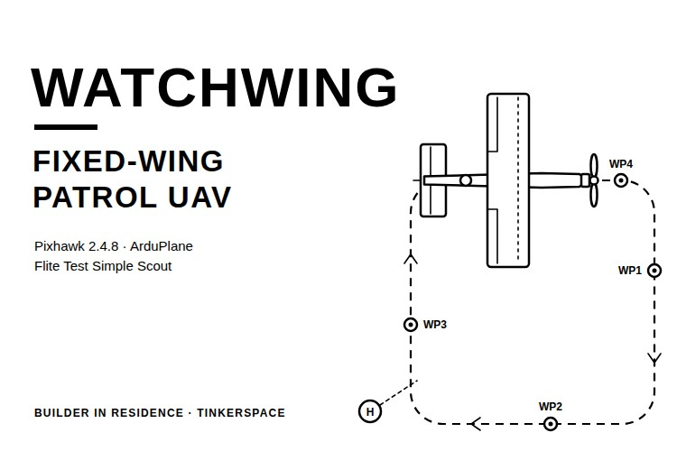
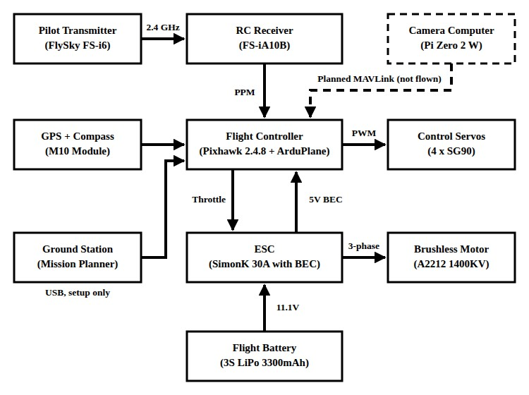
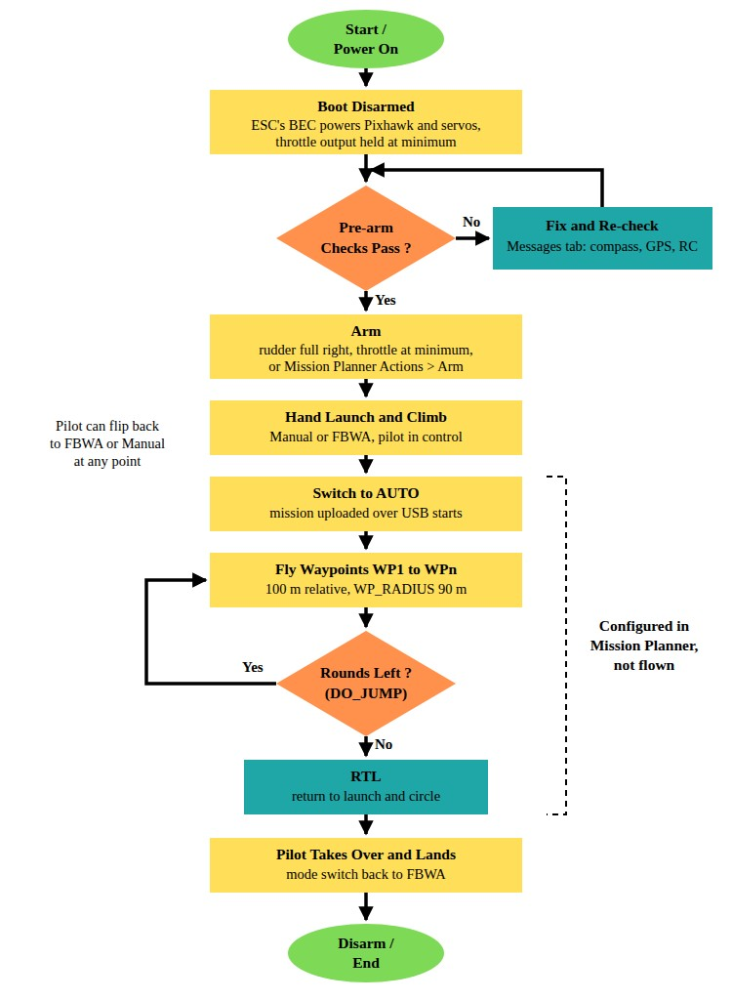
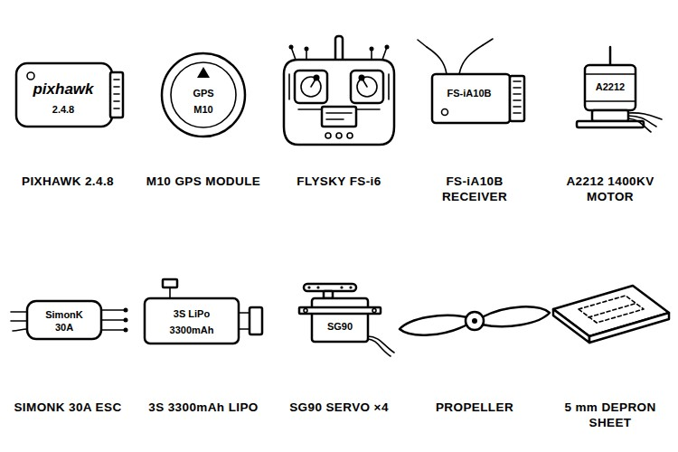
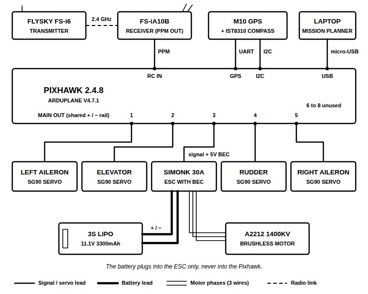
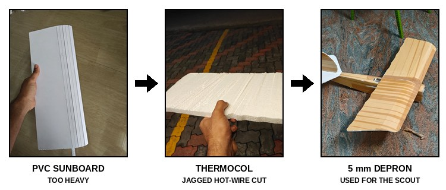
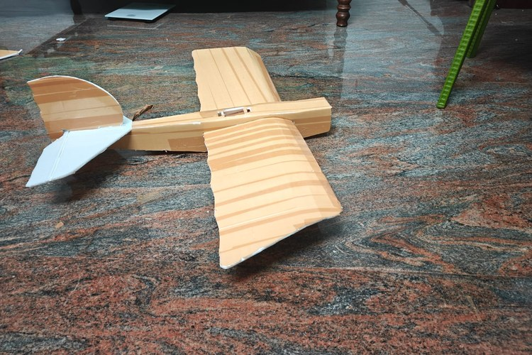
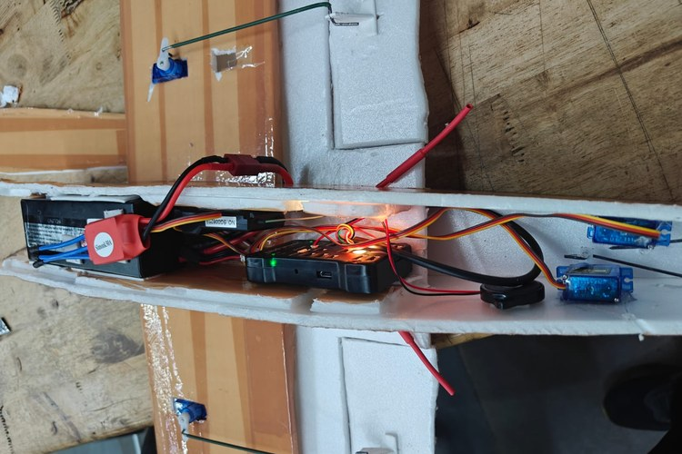

# How to Build WatchWing, a Fixed-Wing Patrol UAV Using Pixhawk and ArduPlane



A security guard on night duty walks the same perimeter again and again to see if anything has changed. So, can a small aircraft fly that route by itself, round after round? That is the job WatchWing was built to try.

In this project, we build WatchWing, a fixed-wing patrol UAV cut from 5mm Depron to the Flite Test Simple Scout plan. A Pixhawk 2.4.8 running ArduPlane flies it, the pilot has a FlySky FS-i6 transmitter, and the patrol route is a loop of GPS waypoints planned in Mission Planner. This guide covers the parts, the wiring, the airframe, the Mission Planner setup and every ArduPlane parameter we changed. Know where our build stands before you start: the electronics all worked on the bench, but the fixed-wing patrol UAV crashed on each of its three manual flights, so the autonomous mission was configured and never flown. The checks that would have saved it are in the pre-flight section. You can also check out similar [drone projects](https://circuitdigest.com/drone-projects) and [robotics projects](https://circuitdigest.com/robotics-projects) done previously here at Circuit Digest.

> **Quick Answer: What is WatchWing?**
>
> **WatchWing** is a foam **fixed-wing patrol UAV** built on the Flite Test Simple Scout, with a **Pixhawk 2.4.8 running ArduPlane V4.7.1**, a **FlySky FS-i6** radio and an **A2212 1400KV** motor. It is meant to fly the same GPS waypoint loop again and again. So far it has made three manual flights, and the waypoint mission is configured but not flown.

**Table of Contents**

- [What Is WatchWing?](#what-is-the-watchwing-fixed-wing-patrol-uav)
- [How WatchWing Works](#how-does-the-watchwing-fixed-wing-uav-work)
- [Components Required](#components-required-for-the-watchwing-fixed-wing-uav)
- [Wiring Diagram](#wiring-diagram-of-the-watchwing-fixed-wing-uav)
  - [MAIN OUT Channel Assignment](#pixhawk-main-out-channel-assignment)
- [Building the Airframe](#building-the-watchwing-airframe)
- [Hardware Assembly](#hardware-assembly-of-watchwing)
- [Mission Planner Setup](#mission-planner-setup-for-arduplane-on-the-pixhawk)
- [Pre-Flight Checks and Testing](#pre-flight-checks-and-testing)
- [Parameter Configuration Explained](#arduplane-parameter-configuration-explained)
- [Live Demo](#live-video-demonstration)
- [Flight Tests](#flight-tests-output-of-the-watchwing-fixed-wing-uav)
- [Troubleshooting](#troubleshooting-the-watchwing-fixed-wing-uav)
- [GitHub](#watchwing-github-repository)

## What Is the WatchWing Fixed-Wing Patrol UAV?

WatchWing is a small electric aircraft meant to fly a fixed patrol route on its own, photographing each GPS waypoint in every round so that the rounds can be compared to flag any change. A fixed-wing suits this, as a perimeter has long, straight legs, and a wing covers more ground on one battery than a quadcopter does. It cannot hover, though, so Loiter in ArduPlane means circling a point. The camera was only bench-tested, on a Raspberry Pi Zero 2 W, so this guide covers the flying build, and its scripts are at the end. For the camera basics, check out our tutorial on [interfacing the Pi Camera with the Raspberry Pi Zero W](https://circuitdigest.com/microcontroller-projects/interfacing-pi-camera-module-with-raspberry-pi-zero-w).

## How Does the WatchWing Fixed-Wing UAV Work?

The FS-i6 talks to the FS-iA10B receiver over 2.4 GHz, and the receiver sends all the channels to the Pixhawk on a single PPM wire. The Pixhawk combines its own IMU and barometer with the M10 GPS and compass and drives four SG90 servos and the SimonK 30A ESC. The 3S LiPo goes to the ESC only, and the ESC's BEC powers the servo rail and the Pixhawk. The laptop connects over USB only for setup, as there is no telemetry radio. Below is the block diagram of the WatchWing fixed-wing UAV.



The dashed box is the Raspberry Pi camera, which is not part of this build. Circuit Digest also has a [quadcopter build using the KK2.1.5 flight controller](https://circuitdigest.com/electronic-circuits/build-your-own-drone-using-kk215-flight-controller-from-selecting-right-component-to-first-flight-part1) and a tutorial on [connecting the LiteWing ESP32 drone to Betaflight](https://circuitdigest.com/tutorial/how-to-connect-the-litewing-esp32-drone-betaflight). If interested, do check them out.

Below is the flowchart of a full flight, from power-on to landing.



The Pixhawk boots disarmed, so the throttle stays at minimum until the pre-arm checks pass and the board is armed. The pilot hand-launches the aircraft in Manual or FBWA, and flipping the mode switch to AUTO hands it over to the mission, where DO_JUMP repeats the waypoint loop and RTL brings it home. The pilot can flip back to FBWA or Manual at any time.

## Components Required for the WatchWing Fixed-Wing UAV

Below is the list of components required to build this project.



| S.No | Component | Description | Quantity |
|---|---|---|---|
| 1. | Pixhawk 2.4.8 | Flight controller, ArduPlane V4.7.1 | 1 |
| 2. | M10 GPS Module | GPS with IST8310 compass | 1 |
| 3. | FlySky FS-i6 | 6-channel transmitter | 1 |
| 4. | FlySky FS-iA10B | Receiver, PPM output | 1 |
| 5. | A2212 1400KV Motor | Brushless outrunner | 1 |
| 6. | SimonK 30A ESC | Motor driver with BEC | 1 |
| 7. | 3S LiPo, 3300mAh | Flight battery | 1 |
| 8. | Propeller [TODO: size] | Matched to the motor on 3S | 1 |
| 9. | SG90 Micro Servo | Ailerons, elevator and rudder | 4 |
| 10. | Pixhawk Safety Switch | Unlocks the outputs | 1 |
| 11. | Depron Sheet, 5mm | Airframe | As required |
| 12. | 3D-Printed Firewall and Servo Horns | Motor mount and control horns | 1 set |
| 13. | Spar, Stiff Wire, Hot Glue, Tape, Zip Ties | Wing spar, pushrods and assembly | As required |
| 14. | Micro-USB Data Cable | Pixhawk to laptop | 1 |

The Pixhawk 2.4.8 is a clone of the Pixhawk 1, and Mission Planner lists it as Pixhawk1. We sized the build around the A2212 1400KV giving about 900 grams of thrust, a figure we never measured, so check a thrust table for it on 3S before choosing the propeller. With no power module, Mission Planner reads 0.00V for the battery. The same A2212 class of motor is used in our [BLDC motor control with Arduino](https://circuitdigest.com/microcontroller-projects/what-is-bldc-motor-and-arduino-bldc-motor-control) tutorial as well.

Apart from these parts, you need a Windows laptop with Mission Planner, a printer and tape for the plan, a sharp knife and a steel ruler, a LiPo balance charger, a multimeter, a 3D printer or print service, and an RC flight simulator such as PicaSim, which is free.

## Wiring Diagram of the WatchWing Fixed-Wing UAV

Below is the wiring diagram for the WatchWing fixed-wing UAV.



The brain of the aircraft is the Pixhawk 2.4.8. The FS-iA10B sends PPM, 5V and GND to the RC IN port on one lead, which carries all the channels. To get PPM, set **System > RX Setup > Output mode** to **PPM** on the FS-i6. The M10 module's GPS cable goes to the GPS port and its compass cable goes to the I2C port. The 3S LiPo connects only to the ESC, which drives the motor through three phase wires. The ESC's servo lead on MAIN OUT 3 carries the throttle signal and feeds 5V from the BEC into the servo rail. All the MAIN OUT + and − pins are one shared rail, so feed it from one source only. That is all about the wiring. To see an FS-i6 drive a servo on its own, do check out our [servo control using the FS-i6 transmitter-receiver](https://circuitdigest.com/article/how-to-control-servo-motor-using-fs-i6-transmitter-receiver) tutorial.

### Pixhawk MAIN OUT Channel Assignment

| MAIN OUT | Connects To | SERVOx_FUNCTION |
|---|---|---|
| 1 | Left aileron servo | 4 (Aileron) |
| 2 | Elevator servo | 19 (Elevator) |
| 3 | ESC signal lead, BEC 5V to the rail | 70 (Throttle) |
| 4 | Rudder servo | 21 (Rudder) |
| 5 | Right aileron servo | 4 (Aileron) |
| 6 to 8 | Unused | - |

## Building the WatchWing Airframe

Use genuine 5mm Depron for the airframe. Below are the three foam materials we tried, and only the last one is worth using.



A wing set in PVC foam board, sold locally as Sunboard, weighed around 300 grams for 1250 cm² of wing, about 0.24 g/cm², or around eight times heavier than Depron of a similar thickness by our calculation. Thermocol was too thick, and slicing it with a DIY hot-wire cutter failed. The cutter's gear-cable wire, used in place of nichrome, measured 4.57Ω and drew about 3.5A at 16V. Below is that attempt.

<video controls preload="metadata" width="640" poster="videos/WatchWing-Hot-Wire-Cutting-Thermocol.jpg">
<source src="videos/WatchWing-Hot-Wire-Cutting-Thermocol.mp4" type="video/mp4">
<source src="https://github.com/user-attachments/assets/4cb5d6a5-31f4-4e36-bd63-a17d4b966aa3" type="video/mp4">
<a href="https://github.com/user-attachments/assets/4cb5d6a5-31f4-4e36-bd63-a17d4b966aa3">Hot-wire cutting attempt (MP4)</a>
</video>

The wire scorched the balsa templates, left jagged cuts and then snapped. Depron cuts cleanly with a knife, and the Scout plan is designed around it. Ask for it by name, as "foam board" in a shop usually means signage board, and weigh a sample first; Depron is only around 0.03 g/cm³. If you do need to cut polystyrene, our [portable hot wire foam cutter using nichrome wire](https://circuitdigest.com/electronic-circuits/diy-portable-hot-wire-foam-cutter) shows how to build a proper one.

The airframe is the stock Flite Test Simple Scout, built exactly as per the published [Simple Scout plan](https://www.flitetest.com/articles/ft-simple-scout) and its [build article](https://www.flitetest.com/articles/ft-simple-scout-build). Below is our finished airframe.



The table below gives the plan's published numbers. Our electronics weigh more than a bare Scout carries, so weigh your own aircraft once it is built.

| Parameter | Value (from the Plan) |
|---|---|
| Wingspan | 952mm |
| Wing area | 20.9 dm² |
| All-up weight | 535.8 grams |
| Wing loading | 25.6 g/dm² |
| Centre of gravity | 62mm behind the leading edge |
| Recommended control throw | About 12° |
| Thrust-to-weight | About 1.68:1 with 900 grams of thrust |

The 3D-printed parts are in the cad folder of the repository. `rc-firewall (1).stl` is the motor firewall, and `print_batch_4horns_1firewall.stl` prints four servo horns and a firewall in one go. Print the firewall with low infill. Ours broke in the first crash and took the force that would otherwise have gone into the motor.

## Hardware Assembly of WatchWing

Below is the electronics bay of our build from the underside, which shows where everything ends up.



**Step 1⇒ Cut and Build the Airframe**

Print the plan at 100% scale and check its calibration square before cutting. Trace the parts onto the Depron, cut them with a sharp knife against a steel ruler, and join them with hot glue as per the build article, with a carbon rod or bamboo skewer along the wing as a spar. Glue the printed firewall to the nose and mount the motor on it.

**Step 2⇒ Install the Servos**

Centre each SG90 before connecting its pushrod. Bend the stiff-wire pushrods to reach each surface and use the printed horns so the rods connect properly at both ends, which was the hardest part of our build. Check that every surface moves freely through its full throw.

**Step 3⇒ Mount the Electronics**

Mount the Pixhawk, the receiver and the ESC inside the fuselage. Our Pixhawk is on the side wall, which needs the custom board orientation in the parameter section. Leave the GPS exposed through a gap with its antenna facing up. Fit the battery last, sliding it until the aircraft balances at 62mm behind the wing leading edge, and fix it with double-sided tape. If you are new to GPS modules, refer to our [NEO-6M GPS module guide](https://circuitdigest.com/microcontroller-projects/connect-arduino-with-neo-6m-gps-module).

**Step 4⇒ Bench-Check, Then Close the Hatch**

With the propeller off, check that every surface follows the sticks. Below is our bench check.

<video controls preload="metadata" width="640" poster="videos/WatchWing-Control-Surface-Check.jpg">
<source src="videos/WatchWing-Control-Surface-Check.mp4" type="video/mp4">
<source src="https://github.com/user-attachments/assets/c18ed667-0398-4f2e-9c53-f4187ca28d09" type="video/mp4">
<a href="https://github.com/user-attachments/assets/c18ed667-0398-4f2e-9c53-f4187ca28d09">Control-surface check (MP4)</a>
</video>

The underside is the only way into the bay, so finish all wiring and tests before you close it with tape and zip ties.

## Mission Planner Setup for ArduPlane on the Pixhawk

Connect the Pixhawk to Mission Planner over USB at 115200 baud (ours showed up on COM15) and follow these steps in order.

**Step 1⇒ Flash ArduPlane**

Go to **Setup > Install Firmware**, click **Plane**, pick the Pixhawk1 entry and wait for "Upload Done".

**Step 2⇒ Calibrate the Accelerometer and Compass**

Run **Accel Calibration** and hold the board still in each of its six positions. The internal compass can be calibrated on the bench, but the external IST8310 calibrates properly only when the Pixhawk and GPS are mounted and rotated together, so do it after mounting.

**Step 3⇒ Bind and Calibrate the Radio**

Hold the receiver's bind key while powering it and select **System > RX Bind** on the FS-i6. Then open **Radio Calibration** and move every stick and switch through its full range; all the green bars must move, including channel 3. Below is our radio calibration with the FS-i6.

<video controls preload="metadata" width="360" poster="videos/WatchWing-Radio-Calibration-in-Mission-Planner.jpg">
<source src="videos/WatchWing-Radio-Calibration-in-Mission-Planner.mp4" type="video/mp4">
<source src="https://github.com/user-attachments/assets/d9e56841-344a-40bb-9b3b-cab85152925d" type="video/mp4">
<a href="https://github.com/user-attachments/assets/d9e56841-344a-40bb-9b3b-cab85152925d">Radio calibration in Mission Planner (MP4)</a>
</video>

**Step 4⇒ Set the Parameters**

Enter the parameters from the parameter section below, then write them and reboot the board.

**Step 5⇒ Calibrate the ESC**

The **Calibrate ESCs** button fails on ArduPlane with "Please ensure your version is AC3.3+", and a disarmed ArduPlane holds the throttle at minimum, so calibrate outside the Pixhawk. Take the propeller off, plug the ESC straight into the receiver's throttle channel with the receiver set to PWM, hold full throttle, connect the battery and wait for the beeps, then pull the throttle down for the second beeps. Move the ESC back to MAIN OUT 3 afterwards.

**Step 6⇒ Plan the Patrol Mission**

In the **Plan** tab, set the default altitude to 100 m relative (from the launch point), drop waypoints around the perimeter, add a DO_JUMP back to waypoint 1 for the number of rounds, and finish with RETURN_TO_LAUNCH. Click **Write**, then **Read** to check what the aircraft holds. `WP_RADIUS` was 90 m for us, and on a small perimeter you will want it lower.

## Pre-Flight Checks and Testing

Set the control throws first. Move each surface to the recommended 12° by hand, note the PWM that gives it on the **Servo Output** screen, and write that into `SERVOx_MIN` and `SERVOx_MAX`. We never got to this, so our servos ran on default ranges. Then run the checks below before every flight.

| S.No | Check | How |
|---|---|---|
| 1. | Propeller off for bench work | Before every power-up |
| 2. | Pre-arm clean | No errors in the Messages tab |
| 3. | GPS 3D fix | Fix Type 3D, outdoors |
| 4. | Compass calibrated with everything mounted | Done after final mounting |
| 5. | Radio calibrated | All bars move, including channel 3 |
| 6. | Control directions by eye | Pull back: elevator up. Roll right: right aileron up, left down. Yaw right: rudder right |
| 7. | Mode switch rehearsed | Flip through all three positions and confirm each mode |
| 8. | Throttle works only when armed | Propeller off, arm, test, disarm |
| 9. | CG at 62mm behind the wing leading edge | Balance it on your fingertips |
| 10. | Battery strapped, hatch closed, GPS exposed | Visual check |
| 11. | Site is clear | Open field, no trees, no power lines, no people downwind |
| 12. | Parameters saved to a file | Full Parameter List, Save to file |

Below is our static thrust check on the finished airframe, held overhead with the propeller on.

<video controls preload="metadata" width="360" poster="videos/WatchWing-Static-Thrust-Test.jpg">
<source src="videos/WatchWing-Static-Thrust-Test.mp4" type="video/mp4">
<source src="https://github.com/user-attachments/assets/7c95ffb8-d15e-42a9-8387-aaaa71229296" type="video/mp4">
<a href="https://github.com/user-attachments/assets/7c95ffb8-d15e-42a9-8387-aaaa71229296">Static thrust test (MP4)</a>
</video>

It gave a good amount of thrust, though we did not measure it. Practise on an RC simulator and learn FBWA there before the first flight. We went straight from this check to the first flight without the simulator or check number 6, and the reversed elevator crashed it as soon as the stick moved.

## ArduPlane Parameter Configuration Explained

WatchWing has no firmware of its own. ArduPlane does the flying, and the build is defined by the parameters below, set in **Config > Full Parameter List**. Save the list to a file whenever something works, as we lost time when another team reflashed our board and we had no saved file.

**Servo Output Functions**

```
SERVO1_FUNCTION   4     # Aileron, left
SERVO2_FUNCTION   19    # Elevator
SERVO3_FUNCTION   70    # Throttle, ESC signal
SERVO4_FUNCTION   21    # Rudder
SERVO5_FUNCTION   4     # Aileron, right
SERVO5_REVERSED   1     # only if both ailerons move the same way
```

ArduPlane has no separate "Aileron2" function, so both aileron servos use function 4. Set `SERVO5_REVERSED` only if both ailerons move the same way, and check by eye that roll right lifts the right aileron.

**Flight-Mode Switch on Channel 5**

```
FLTMODE_CH   5
FLTMODE1     0     # Manual
FLTMODE2     0     # Manual
FLTMODE3     5     # FBWA
FLTMODE4     5     # FBWA
FLTMODE5     12    # Loiter
FLTMODE6     12    # Loiter
```

Channel 5 is a 3-position switch on the FS-i6, with Manual at the top, FBWA in the middle and Loiter at the bottom. ArduPlane splits 1000 to 2000 µs into six fixed slots, and a typical switch sends about 1000, 1500 and 2000 µs, which lands in slots 1, 4 and 6. The middle position is only 9 µs above the slot 3/4 boundary at 1491 µs, so each pair of slots gets the same mode. Read your own switch values on the **Radio Calibration** screen to confirm.

**Custom Board Orientation**

```
AHRS_ORIENTATION  101   # Custom 1
CUST_ROT_ENABLE   1
CUST_ROT1_ROLL    90
CUST_ROT1_PITCH   0
CUST_ROT1_YAW     180
```

A Pixhawk on the fuselage side wall needs Roll 90° and Yaw 180°, and there is no preset for this combination, so this block sets a custom rotation as Custom 1. Reboot after writing it and tip the aircraft by hand: nose up should show nose up on the artificial horizon. Skip this block if your Pixhawk sits flat and faces forward.

**Arming and Safety**

```
ARMING_REQUIRE     1    # throttle stays at minimum until armed
ARMING_RUDDER      1    # arm with full right rudder, throttle at minimum
BRD_SAFETY_DEFLT   0    # bench workaround only, not a flight setting
```

With `ARMING_REQUIRE` at 1, the throttle stays at minimum while disarmed, but the surfaces still move, so everything looks healthy except the motor. We lost most of a week checking the RCMAP values, the wiring and the channel order before finding that the pre-arm checks were failing on a compass that was not fully calibrated. Below is the Servo Output screen while we were chasing this.

<video controls preload="metadata" width="360" poster="videos/WatchWing-Servo-Output-in-Mission-Planner.jpg">
<source src="videos/WatchWing-Servo-Output-in-Mission-Planner.mp4" type="video/mp4">
<source src="https://github.com/user-attachments/assets/6a6e90e5-7b14-45b2-b108-5be83ae9cdb1" type="video/mp4">
<a href="https://github.com/user-attachments/assets/6a6e90e5-7b14-45b2-b108-5be83ae9cdb1">Servo Output screen in Mission Planner (MP4)</a>
</video>

Force-arming from the **Actions** tab got the motor running, but clear the pre-arm errors before flying. `BRD_SAFETY_DEFLT` 0 starts the board with safety off, a bench workaround for a faulty safety switch like ours.

## Live Video Demonstration

Below are the three flights, in order. The first lasted only a few seconds, as the elevator was reversed.

<video controls preload="metadata" width="360" poster="videos/WatchWing-Flight-1.jpg">
<source src="videos/WatchWing-Flight-1.mp4" type="video/mp4">
<source src="https://github.com/user-attachments/assets/8a103069-e0ae-4b2f-8837-02de886d7a3d" type="video/mp4">
<a href="https://github.com/user-attachments/assets/8a103069-e0ae-4b2f-8837-02de886d7a3d">Flight 1 (MP4)</a>
</video>

The second flight is below, after practice on the PicaSim simulator and with the elevator corrected.

<video controls preload="metadata" width="360" poster="videos/WatchWing-Flight-2.jpg">
<source src="videos/WatchWing-Flight-2.mp4" type="video/mp4">
<source src="https://github.com/user-attachments/assets/e85e026e-feed-42d0-a233-7aa0a86a7abd" type="video/mp4">
<a href="https://github.com/user-attachments/assets/e85e026e-feed-42d0-a233-7aa0a86a7abd">Flight 2 (MP4)</a>
</video>

Below is the third flight, from a bigger open field.

<video controls preload="metadata" width="640" poster="videos/WatchWing-Flight-3.jpg">
<source src="videos/WatchWing-Flight-3.mp4" type="video/mp4">
<source src="https://github.com/user-attachments/assets/d0688072-a5b2-436c-84c3-b29f3b602719" type="video/mp4">
<a href="https://github.com/user-attachments/assets/d0688072-a5b2-436c-84c3-b29f3b602719">Flight 3 (MP4)</a>
</video>

These clips are also in the [Week 9](https://github.com/BuilderinResidencyTinkerspace/WATCH_WING/blob/main/docs/week-09.md) and [Week 10](https://github.com/BuilderinResidencyTinkerspace/WATCH_WING/blob/main/docs/week-10.md) logs of the repository.

## Flight Tests: Output of the WatchWing Fixed-Wing UAV

On the bench, ArduPlane connected reliably after a full reflash, the GPS got a 3D fix, all the channels were live over PPM, and the motor responded once armed. All three flights were manual, and each ended in a crash.

| Flight | What Happened | Damage |
|---|---|---|
| 1 | Flown with no simulator practice or control check; the elevator was reversed, and it crashed as soon as the stick moved | Broken propeller and firewall, small cracks |
| 2 | After PicaSim practice, it flew; when it seemed headed for a power line, the pilot banked hard left and it went straight down | Heavy, taped back together |
| 3 | In a bigger field, it climbed higher than expected in Manual; the switch overshot FBWA into Loiter as the throttle came down | Went into a power line, beyond repair |

Below is the airframe after the third flight.

<video controls preload="metadata" width="360" poster="videos/WatchWing-Airframe-After-Flight-3.jpg">
<source src="videos/WatchWing-Airframe-After-Flight-3.mp4" type="video/mp4">
<source src="https://github.com/user-attachments/assets/42bfe03f-b019-4237-b2a9-4cf66adad5d7" type="video/mp4">
<a href="https://github.com/user-attachments/assets/42bfe03f-b019-4237-b2a9-4cf66adad5d7">Airframe after flight 3 (MP4)</a>
</video>

With no telemetry and no recorded data, we cannot say how much of the last crash was the mode change and how much the throttle. The waypoint mission, the external compass calibration and the 12° throws were never finished.

## Troubleshooting the WatchWing Fixed-Wing UAV

| Symptom | Likely Cause | Fix |
|---|---|---|
| Servos move but the motor does not | The vehicle is disarmed | Clear the pre-arm errors in the Messages tab, then arm with full right rudder |
| Calibrate ESCs fails with "AC3.3+" | The button is built for ArduCopter | Calibrate with the ESC on the receiver's throttle channel, propeller off |
| "PreArm: Waiting for RC" | Receiver unbound, wrong output mode or wrong port | Re-bind, set PPM output and check the lead goes to RC IN |
| Board shows "Legacy FMU" and will not connect | Bootloader mode | Check the COM port and data cable, unplug other peripherals and reflash |
| Aircraft reacts the wrong way to the elevator | Servo direction reversed | Check every surface by eye before each flight and use **Reverse** on Servo Output |

## Conclusion

ArduPlane on the Pixhawk 2.4.8 gave us stabilisation, waypoints and failsafes without writing any flight code, and every part of the setup in this guide worked on the bench. The flying side needs the most care, and the pre-flight checks come straight from our three crashes. There is still room for improvement, such as a telemetry radio, a power module and `FS_LONG_ACTN` set to 1 so the aircraft returns home on signal loss. Further, one can put a camera back on board, just like this [Wi-Fi camera on the LiteWing ESP32 drone](https://circuitdigest.com/tutorial/adding-wi-fi-camera-to-litewing-esp32-drone) on Circuit Digest.

## WatchWing GitHub Repository

The WATCH_WING repository has the full README, the build logs with their photos and flight videos, and the STL files. WatchWing was built by Adriel Jacob and Vishakh at Tinkerspace, MEC, as part of the Builder in Residence programme, and the repository is released under the MIT licence.

[Code & Schematics (GitHub)](https://github.com/BuilderinResidencyTinkerspace/WATCH_WING) · [Download Zip](https://github.com/BuilderinResidencyTinkerspace/WATCH_WING/archive/refs/heads/main.zip)

## Frequently Asked Questions About the WatchWing Fixed-Wing UAV

**⇥ 1. Why is FBWA better than Manual for a first-time pilot?**

FBWA limits how far the aircraft can bank and pitch, so a panicked correction is less likely to stall it. In Manual, the sticks go straight to the servos with no help at all.

**⇥ 2. Can I build the Simple Storch instead of the Simple Scout?**

Yes, but it is a heavier class, with a 1460mm span and about 1005 grams all-up weight, so it needs a bigger motor and battery than the A2212 1400KV and 3300mAh pack used here.

**⇥ 3. Is a fixed-wing UAV like this safe to fly?**

It can be, if you fly it in an open area away from people, trees and power lines. Check the local rules for unmanned aircraft before you fly, and take extra care with autonomous flights.

## Drone and RC Flight Projects

Take your flying projects further with guides on flight controllers, RC radios and brushless motors.

- **[Build your own Drone using KK2.1.5 Flight Controller - From Selecting Right Components to First Flight (Part-1)](https://circuitdigest.com/electronic-circuits/build-your-own-drone-using-kk215-flight-controller-from-selecting-right-component-to-first-flight-part1)**: *A quadcopter build that goes from selecting the right components to the first flight.*
- **[How to Control Servo Motor using FS-i6 Transmitter-Receiver](https://circuitdigest.com/article/how-to-control-servo-motor-using-fs-i6-transmitter-receiver)**: *In this tutorial, we show the connections and steps that need to be followed to control a servo motor with the FS-i6.*
- **[What is Brushless DC Motor (BLDC) and How to Control it with Arduino](https://circuitdigest.com/microcontroller-projects/what-is-bldc-motor-and-arduino-bldc-motor-control)**: *An A2212/13T BLDC motor and a 20A ESC, controlled from an Arduino.*

## Complete Project Code

WatchWing has no firmware of its own, so the complete code is the ArduPlane parameter set and the Raspberry Pi camera scripts from the repository README.

**ArduPlane parameters (Pixhawk 2.4.8, ArduPlane V4.7.1)**

```
# WatchWing - parameters set or checked for this build
# Enter in Mission Planner: Config > Full Parameter List, then Write Params

# Servo outputs, MAIN OUT 1 to 5
SERVO1_FUNCTION    4      # Aileron, left
SERVO2_FUNCTION    19     # Elevator
SERVO3_FUNCTION    70     # Throttle, ESC signal (ESC's BEC also feeds the rail)
SERVO4_FUNCTION    21     # Rudder
SERVO5_FUNCTION    4      # Aileron, right
SERVO5_REVERSED    1      # only if both ailerons move the same way

# Flight-mode switch: 3-position switch on channel 5
FLTMODE_CH         5
FLTMODE1           0      # Manual
FLTMODE2           0      # Manual
FLTMODE3           5      # FBWA
FLTMODE4           5      # FBWA
FLTMODE5           12     # Loiter
FLTMODE6           12     # Loiter

# Pixhawk mounted on the fuselage side wall: Roll 90, Yaw 180
AHRS_ORIENTATION   101    # Custom 1
CUST_ROT_ENABLE    1
CUST_ROT1_ROLL     90
CUST_ROT1_PITCH    0
CUST_ROT1_YAW      180

# Arming
ARMING_REQUIRE     1      # throttle held at minimum until armed
ARMING_RUDDER      1      # arm with full right rudder, throttle at minimum
# BRD_SAFETY_DEFLT 0      # bench workaround for a faulty safety switch only

# Mission
WP_RADIUS          90     # metres

# Planned camera link on TELEM2 (design only, not wired)
# SERIAL2_PROTOCOL 2      # MAVLink 2
# SERIAL2_BAUD     57     # 57600 baud
```

**Raspberry Pi still capture with fixed exposure (bench only)**

```python
from picamera2 import Picamera2
import time

picam2 = Picamera2()
picam2.configure(picam2.create_still_configuration(main={"size": (2304, 1296)}))
# AE off, 2 ms exposure (about 1/500 s), raise gain to compensate for the dark frame
picam2.set_controls({"AeEnable": False, "ExposureTime": 2000, "AnalogueGain": 4.0})
picam2.start()
time.sleep(1)                 # let the controls settle
picam2.capture_file("frame.jpg")
picam2.stop()
```

**Raspberry Pi live preview, MJPEG over HTTP (bench only)**

```python
import io, time
from flask import Flask, Response
from picamera2 import Picamera2

app = Flask(__name__)
cam = Picamera2()
cam.configure(cam.create_video_configuration(main={"size": (1280, 720)}))
cam.start()

def frames():
    while True:
        buf = io.BytesIO()
        cam.capture_file(buf, format="jpeg")
        yield b"--frame\r\nContent-Type: image/jpeg\r\n\r\n" + buf.getvalue() + b"\r\n"
        time.sleep(0.05)

@app.route("/")
def stream():
    return Response(frames(), mimetype="multipart/x-mixed-replace; boundary=frame")

app.run(host="0.0.0.0", port=8000, threaded=True)
```

**GPS-triggered capture, design sketch (not wired into the build)**

```python
from pymavlink import mavutil

link = mavutil.mavlink_connection("/dev/serial0", baud=57600)
link.wait_heartbeat()
while True:
    msg = link.recv_match(type="GLOBAL_POSITION_INT", blocking=True)
    lat, lon = msg.lat / 1e7, msg.lon / 1e7   # degrees
    # compare (lat, lon) with the stored checkpoint list, then call capture_file()
```
